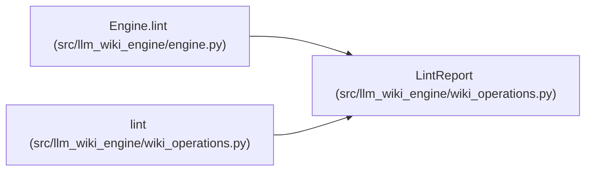

# LintReport

**Location:** `src/llm_wiki_engine/wiki_operations.py:94`
**Kind:** Class
**Bases:** —
**Module:** [wiki_operations](../modules/wiki_operations.md)

**Decorators:** `@dataclass(frozen=True)`

## Description

_Auto-generated from `LintReport` in `src/llm_wiki_engine/wiki_operations.py`._

## Attributes

| Name | Type | Default | Description |
|------|------|---------|-------------|
| `issues` | `tuple[LintIssue, ...]` | `field(default_factory=tuple)` | — |

## Methods

| Method | Signature | Decorators | Description |
|--------|-----------|------------|-------------|
| `passed` | `() -> bool` | `@property` | — |
| `issue_count` | `() -> int` | `@property` | — |
| `to_dict` | `() -> dict[str, Any]` | — | — |

## Relationships

<!-- Auto-generated relationship summary. Do not edit by hand. -->

### Summary

| Module | Methods | Attributes |
|---|---:|---|
| [wiki_operations](../modules/wiki_operations.md) | 3 | `issues` |

### References

| Reference | Kind | Source | Call sites |
|---|---|---|---:|
| `Engine.lint` | type_reference | [engine](../modules/engine.md) | — |
| `lint` | call | [wiki_operations](../modules/wiki_operations.md) | 2 |
| `lint` | type_reference | [wiki_operations](../modules/wiki_operations.md) | — |
