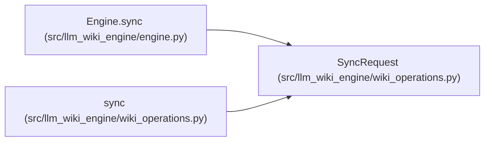

# SyncRequest

**Location:** `src/llm_wiki_engine/wiki_operations.py:52`
**Kind:** Class
**Bases:** —
**Module:** [wiki_operations](../modules/wiki_operations.md)

**Decorators:** `@dataclass(frozen=True)`

## Description

Bring the wiki at ``wiki_root`` up to date with ``source_root``.

## Attributes

| Name | Type | Default | Description |
|------|------|---------|-------------|
| `source_root` | `str \| os.PathLike[str]` | *required* | — |
| `wiki_root` | `str \| os.PathLike[str]` | *required* | — |

## Methods

*No declared methods.*

## Relationships

<!-- Auto-generated relationship summary. Do not edit by hand. -->

### Summary

| Module | Methods | Attributes |
|---|---:|---|
| [wiki_operations](../modules/wiki_operations.md) | 0 | `source_root`, `wiki_root` |

### References

| Reference | Kind | Source | Call sites |
|---|---|---|---:|
| `Engine.sync` | type_reference | [engine](../modules/engine.md) | — |
| `sync` | type_reference | [wiki_operations](../modules/wiki_operations.md) | — |
