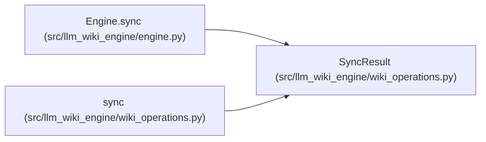

# SyncResult

**Location:** `src/llm_wiki_engine/wiki_operations.py:77`
**Kind:** Class
**Bases:** —
**Module:** [wiki_operations](../modules/wiki_operations.md)

**Decorators:** `@dataclass(frozen=True)`

## Description

_Auto-generated from `SyncResult` in `src/llm_wiki_engine/wiki_operations.py`._

## Attributes

| Name | Type | Default | Description |
|------|------|---------|-------------|
| `status` | `str` | *required* | — |
| `written` | `tuple[str, ...]` | `()` | — |
| `removed` | `tuple[str, ...]` | `()` | — |

## Methods

| Method | Signature | Decorators | Description |
|--------|-----------|------------|-------------|
| `to_dict` | `() -> dict[str, Any]` | — | — |

## Relationships

<!-- Auto-generated relationship summary. Do not edit by hand. -->

### Summary

| Module | Methods | Attributes |
|---|---:|---|
| [wiki_operations](../modules/wiki_operations.md) | 1 | `removed`, `status`, `written` |

### References

| Reference | Kind | Source | Call sites |
|---|---|---|---:|
| `Engine.sync` | type_reference | [engine](../modules/engine.md) | — |
| `sync` | call | [wiki_operations](../modules/wiki_operations.md) | 2 |
| `sync` | type_reference | [wiki_operations](../modules/wiki_operations.md) | — |
