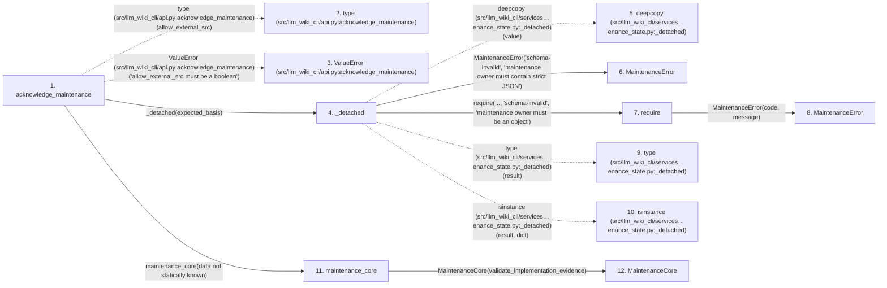

# acknowledge_maintenance

**Entry point:** `acknowledge_maintenance` (`api`)
**Source:** [api](../modules/api.md)
**Modules touched:** [analysis_compatibility](../modules/analysis_compatibility.md), [api](../modules/api.md), [canonical_json](../modules/canonical_json.md), [common](../modules/common.md), and 56 more

**Complete modules touched:**

- [analysis_compatibility](../modules/analysis_compatibility.md)
- [api](../modules/api.md)
- [canonical_json](../modules/canonical_json.md)
- [common](../modules/common.md)
- [config](../modules/config.md)
- [context_packet](../modules/context_packet.md)
- [context_service](../modules/context_service.md)
- [data_flow](../modules/data_flow.md)
- [dependency_versions](../modules/dependency_versions.md)
- [documentation_queries](../modules/documentation_queries.md)
- [documentation_query_builder](../modules/documentation_query_builder.md)
- [entrypoints](../modules/entrypoints.md)
- [extraction_service](../modules/extraction_service.md)
- [filesystem_guard](../modules/filesystem_guard.md)
- [immutable](../modules/immutable.md)
- [implementation_evidence](../modules/implementation_evidence.md)
- [imports](../modules/imports.md)
- [infrastructure_inventory](../modules/infrastructure_inventory.md)
- [infrastructure_sync](../modules/infrastructure_sync.md)
- [io](../modules/io.md)
- [knowledge_artifacts](../modules/knowledge_artifacts.md)
- [knowledge_consumption](../modules/knowledge_consumption.md)
- [knowledge_envelope](../modules/knowledge_envelope.md)
- [knowledge_evidence](../modules/knowledge_evidence.md)
- [knowledge_freshness](../modules/knowledge_freshness.md)
- [knowledge_governance](../modules/knowledge_governance.md)
- [knowledge_graph](../modules/knowledge_graph.md)
- [knowledge_index](../modules/knowledge_index.md)
- [knowledge_loader](../modules/knowledge_loader.md)
- [knowledge_model](../modules/knowledge_model.md)
- [knowledge_orchestration](../modules/knowledge_orchestration.md)
- [knowledge_packs](../modules/knowledge_packs.md)
- [knowledge_reuse](../modules/knowledge_reuse.md)
- [knowledge_storage](../modules/knowledge_storage.md)
- [knowledge_storage_io](../modules/knowledge_storage_io.md)
- [knowledge_verification](../modules/knowledge_verification.md)
- [maintenance_evidence](../modules/maintenance_evidence.md)
- [maintenance_projection](../modules/maintenance_projection.md)
- [maintenance_protocol](../modules/maintenance_protocol.md)
- [maintenance_service](../modules/maintenance_service.md)
- [maintenance_shapes](../modules/maintenance_shapes.md)
- [maintenance_state](../modules/maintenance_state.md)
- [maintenance_status](../modules/maintenance_status.md)
- [manifest_storage](../modules/manifest_storage.md)
- [markdown_sections](../modules/markdown_sections.md)
- [plugins](../modules/plugins.md)
- [python_calls](../modules/python_calls.md)
- [python_implementation](../modules/python_implementation.md)
- [python_imports](../modules/python_imports.md)
- [section_ownership](../modules/section_ownership.md)
- [services_dependencies](../modules/services_dependencies.md)
- [source_selection](../modules/source_selection.md)
- [source_snapshot](../modules/source_snapshot.md)
- [storage_spool](../modules/storage_spool.md)
- [sync_manifest](../modules/sync_manifest.md)
- [validation](../modules/validation.md)
- [wiki_media](../modules/wiki_media.md)
- [wiki_surface](../modules/wiki_surface.md)
- [wiki_surface_index](../modules/wiki_surface_index.md)
- [wiki_write_basis](../modules/wiki_write_basis.md)

## Call sequence

> Static overview in presentation order, not runtime execution order. Arrows retain captured callers; siblings are shown before deeper helper detail.

```mermaid
sequenceDiagram
    participant p0 as acknowledge_maintenance
    participant p1 as type (src/llm_wiki_cli/api.py:acknowledge_maintenance)
    participant p2 as ValueError (src/llm_wiki_cli/api.py:acknowledge_maintenance)
    participant p3 as _detached
    participant p4 as maintenance_core
    participant p5 as core.validate_schema (src/llm_wiki_cli/api.py:acknowledge_maintenance)
    participant p6 as core._coordinate
    participant p7 as core._target
    participant p8 as cast (src/llm_wiki_cli/api.py:acknowledge_maintenance)
    participant p9 as acknowledge_maintenance_authority
    participant p10 as _validate_wiki_dir
    participant p11 as deepcopy (src/llm_wiki_cli/services…enance_state.py:_detached)
    participant p12 as MaintenanceCore
    participant p13 as _identity (src/llm_wiki_cli/services/maintenance_state.py)
    participant p14 as validate_path
    participant p15 as MaintenanceError
    participant p16 as is_valid_sha256
    participant p17 as require
    participant p18 as MaintenanceProtocolError
    participant p19 as type (src/llm_wiki_cli/services…enance_state.py:_detached)
    participant p20 as isinstance (src/llm_wiki_cli/services…enance_state.py:_detached)
    participant p21 as deepcopy (src/llm_wiki_cli/services…dge_maintenance_authority)
    participant p22 as core.validate_schema (src/llm_wiki_cli/services…dge_maintenance_authority)
    participant p23 as _absolute_path
    participant p24 as Path (src/llm_wiki_cli/services…dge_maintenance_authority)
    participant p25 as _outside_recovery
    p0-->>p1: type (src/llm_wiki_cli/api.py:acknowledge_maintenance)(allow_external_src)
    p0-->>p2: ValueError (src/llm_wiki_cli/api.py:acknowledge_maintenance)('allow_external_src must be a boolean')
    p0->>p3: _detached
    p0->>p4: maintenance_core
    p0-->>p5: core.validate_schema (src/llm_wiki_cli/api.py:acknowledge_maintenance)('maintenance-event-v1', {...})
    p0-->>p6: core._coordinate(basis[...])
    p0-->>p7: core._target(basis[...])
    p0-->>p8: cast (src/llm_wiki_cli/api.py:acknowledge_maintenance)(MaintenanceAcknowledgmentResult, acknowledge_maintenance_authority(...))
    p0->>p9: acknowledge_maintenance_authority
    p0->>p10: _validate_wiki_dir
    p3-->>p11: deepcopy (src/llm_wiki_cli/services…enance_state.py:_detached)(value)
    p4->>p12: MaintenanceCore
    p9->>p13: _identity (src/llm_wiki_cli/services/maintenance_state.py)
    p10->>p14: validate_path
    p3->>p15: MaintenanceError
    p9->>p16: is_valid_sha256
    p3->>p17: require
    p9->>p18: MaintenanceProtocolError
    p3-->>p19: type (src/llm_wiki_cli/services…enance_state.py:_detached)(result)
    p9->>p4: maintenance_core
    p3-->>p20: isinstance (src/llm_wiki_cli/services…enance_state.py:_detached)(result, dict)
    p9-->>p21: deepcopy (src/llm_wiki_cli/services…dge_maintenance_authority)(expected_basis)
    p9-->>p22: core.validate_schema (src/llm_wiki_cli/services…dge_maintenance_authority)('maintenance-event-v1', event)
    p9->>p23: _absolute_path
    p9-->>p24: Path (src/llm_wiki_cli/services…dge_maintenance_authority)(wiki_dir)
    p9->>p25: _outside_recovery
    p9->>p23: _absolute_path
    p9-->>p24: Path (src/llm_wiki_cli/services…dge_maintenance_authority)(recovery_dir)
    p9->>p23: _absolute_path
    p9-->>p24: Path (src/llm_wiki_cli/services…dge_maintenance_authority)(src_dir)
```

<!-- Auto-generated from static call edges. Dashed arrows are external or unresolved calls. Reviewed runtime conditions and side effects belong in Behavior. -->

> Call sequence diagram shows 30 of 2820 interactions; 2790 omitted to keep the visualization within the 30-interaction and generated-diagram limits, with uncertain identities omitted rather than inferred.

> Captured boundary calls: external 10 of 944 (934 omitted); unresolved 4 of 672 (668 omitted). These counts cover the captured static trace.

Omitted captured detail, grouped by actual caller occurrence and target module:

| Caller | Parent step | Target module | Kind | Omitted interactions |
| --- | --- | --- | --- | --- |
| `src/llm_wiki_cli/services/maintenance_shapes.py:require` | 7 | [src/llm_wiki_cli/services/maintenance_shapes.py](../modules/maintenance_shapes.md) | internal | 1 |
| `src/llm_wiki_cli/services/maintenance_state.py:_identity` | 18 | - | external | 2 |
| `src/llm_wiki_cli/services/maintenance_state.py:_identity` | 18 | [src/llm_wiki_cli/services/maintenance_shapes.py](../modules/maintenance_shapes.md) | internal | 2 |
| `src/llm_wiki_cli/services/knowledge_evidence.py:is_valid_sha256` | 23 | - | external | 1 |
| `src/llm_wiki_cli/services/knowledge_evidence.py:is_valid_sha256` | 23 | - | unresolved | 1 |
| `src/llm_wiki_cli/services/knowledge_storage_io.py:_absolute_path` | 30 | - | external | 4 |
| `src/llm_wiki_cli/services/knowledge_storage_io.py:_absolute_path` | 30 | [src/llm_wiki_cli/services/io.py](../modules/io.md) | internal | 1 |
| `src/llm_wiki_cli/services/io.py:first_unsafe_path_component` | 33 | - | external | 20 |
> Omission summary shows 8 of 660 groups; 652 further groups are not expanded here. Counts above include all omitted interactions.
> Detailed flow queries retain their own coverage and limits; omitted paths may execute at runtime.

> Trace truncated at the depth limit; deeper calls are omitted.

## Data flow

<!-- Auto-generated static analysis. Treat values and boundaries as best-effort hints, not runtime proof. -->

### Step data

| Step | Inputs | Reads | Writes | Returns |
|---|---|---|---|---|
| `acknowledge_maintenance` | `src_dir: str`, `wiki_dir: str`, `record_id: str`, `expected_state_hash: str`, `expected_basis: Mapping[str, Any]`, `actor_kind: Literal['agent', 'human']`, `actor_id: str`, `recovery_dir: str \| Path \| None` | `MaintenanceAcknowledgmentResult` | - | `cast(...)` |
| `type (src/llm_wiki_cli/api.py:acknowledge_maintenance)` | - | - | - | - |
| `ValueError (src/llm_wiki_cli/api.py:acknowledge_maintenance)` | - | - | - | - |
| `_detached` | `value: object` | - | - | `result` |
| `deepcopy (src/llm_wiki_cli/services…enance_state.py:_detached)` | - | - | - | - |
| `MaintenanceError` | - | - | - | - |
| `require` | `condition`, `code`, `message` | - | - | - |
| `MaintenanceError` | - | - | - | - |
| `type (src/llm_wiki_cli/services…enance_state.py:_detached)` | - | - | - | - |
| `isinstance (src/llm_wiki_cli/services…enance_state.py:_detached)` | - | - | - | - |
| `maintenance_core` | - | `_CORE`, `_CORE` | `_CORE` | `_CORE` |
| `MaintenanceCore` | - | - | - | - |

### Call data

| From | To | Line | Call |
|---|---|---:|---|
| acknowledge_maintenance | type (src/llm_wiki_cli/api.py:acknowledge_maintenance) | 1629 | `type(allow_external_src)` |
| acknowledge_maintenance | ValueError (src/llm_wiki_cli/api.py:acknowledge_maintenance) | 1630 | `ValueError('allow_external_src must be a boolean')` |
| acknowledge_maintenance | _detached | 1631 | `_detached(expected_basis)` |
| _detached | deepcopy (src/llm_wiki_cli/services…enance_state.py:_detached) | 952 | `deepcopy(value)` |
| _detached | MaintenanceError | 954 | `MaintenanceError('schema-invalid', 'maintenance owner must contain strict JSON')` |
| _detached | require | 957 | `require(..., 'schema-invalid', 'maintenance owner must be an object')` |
| require | MaintenanceError | 27 | `MaintenanceError(code, message)` |
| _detached | type (src/llm_wiki_cli/services…enance_state.py:_detached) | 958 | `type(result)` |
| _detached | isinstance (src/llm_wiki_cli/services…enance_state.py:_detached) | 960 | `isinstance(result, dict)` |
| acknowledge_maintenance | maintenance_core | 1632 | `maintenance_core(data not statically known)` |
| maintenance_core | MaintenanceCore | 946 | `MaintenanceCore(validate_implementation_evidence)` |

### Boundary effects

*No boundary effects detected.*

### Static analysis gaps

| Kind | Step | Target | Line |
|---|---|---|---:|
| external_call | `acknowledge_maintenance` | `type` | 1629 |
| external_call | `acknowledge_maintenance` | `ValueError` | 1630 |
| external_call | `_detached` | `deepcopy` | 952 |
| external_call | `_detached` | `type` | 958 |
| external_call | `_detached` | `isinstance` | 960 |
| step_limit | `acknowledge_maintenance` | `first 12 steps` | 0 |
| truncated_flow | `acknowledge_maintenance` | `depth limit` | 0 |

## Behavior

This flow starts at `acknowledge_maintenance` and is classified as `api`. The generated call and data-flow sections are bounded static projections; runtime conditions and side effects require source-level confirmation.
