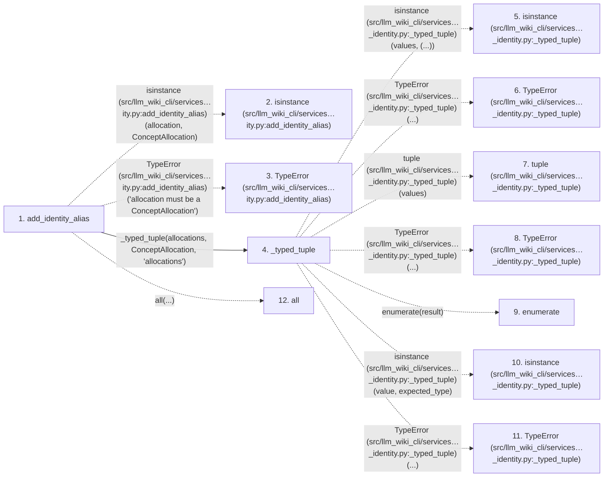

# add_identity_alias

**Entry point:** `add_identity_alias` (`api`)
**Source:** [concept_identity](../modules/concept_identity.md)
**Modules touched:** [concept_identity](../modules/concept_identity.md), [wiki_surface](../modules/wiki_surface.md)

## Call sequence

> Static overview in presentation order, not runtime execution order. Arrows retain captured callers; representative internal continuations and boundary examples precede repeated helper detail.

```mermaid
sequenceDiagram
    participant p0 as add_identity_alias
    participant p1 as validate_identity_registry
    participant p2 as _deduplicated_aliases
    participant p3 as _typed_tuple
    participant p4 as ConceptIdentityError
    participant p5 as validate_alias_type
    participant p6 as validate_alias_value
    participant p7 as identity_coordinate_key
    participant p8 as IdentityAlias
    participant p9 as IdentityUpdate
    participant p10 as find_identity_collisions
    participant p11 as canonical_path
    participant p12 as mcp_uri
    participant p13 as _entry_for
    participant p14 as validate_locator
    participant p15 as _validate_page_id
    participant p16 as validate_natural_key
    participant p17 as IdentityCollisionError
    participant p18 as _sorted_aliases
    participant p19 as IdentityCollision
    participant p20 as iter_page_kinds
    participant p21 as AliasType
    participant p22 as WikiSurfaceError
    participant p23 as _machine_text
    participant p24 as _contains_uri_userinfo
    participant p25 as PageKind
    participant p26 as _looks_absolute_path
    participant p27 as is_safe_page_id
    participant p28 as validate_exact_page_coordinate
    participant p29 as isinstance (src/llm_wiki_cli/services…ity.py:add_identity_alias)
    participant p30 as {item.uid: item for item in current}.get
    p0->>p1: validate_identity_registry
    p0->>p2: _deduplicated_aliases
    p0->>p3: _typed_tuple
    p0->>p4: ConceptIdentityError
    p0->>p5: validate_alias_type
    p0->>p6: validate_alias_value
    p0->>p7: identity_coordinate_key
    p0->>p8: IdentityAlias
    p0->>p9: IdentityUpdate
    p1->>p10: find_identity_collisions
    p7->>p11: canonical_path
    p7->>p12: mcp_uri
    p11->>p13: _entry_for
    p6->>p14: validate_locator
    p11->>p15: _validate_page_id
    p6->>p16: validate_natural_key
    p1->>p17: IdentityCollisionError
    p2->>p18: _sorted_aliases
    p10->>p19: IdentityCollision
    p7->>p20: iter_page_kinds
    p5->>p21: AliasType
    p11->>p22: WikiSurfaceError
    p14->>p23: _machine_text
    p14->>p24: _contains_uri_userinfo
    p13->>p25: PageKind
    p14->>p26: _looks_absolute_path
    p15->>p27: is_safe_page_id
    p14->>p28: validate_exact_page_coordinate
    p0-->>p29: isinstance (src/llm_wiki_cli/services…ity.py:add_identity_alias)(allocation, ConceptAllocation)
    p0-->>p30: {item.uid: item for item in current}.get(allocation.uid)
```

<!-- Auto-generated from static call edges. Dashed arrows are external or unresolved calls. Reviewed runtime conditions and side effects belong in Behavior. -->

> Call sequence diagram shows 30 of 159 interactions; 129 omitted to keep the visualization within the 30-interaction and generated-diagram limits, with uncertain identities omitted rather than inferred.

> Captured boundary calls: external 1 of 52 (51 omitted); unresolved 1 of 33 (32 omitted). These counts cover the captured static trace.

Omitted captured detail, grouped by actual caller occurrence and target module:

| Caller | Parent step | Target module | Kind | Omitted interactions |
| --- | --- | --- | --- | --- |
| `src/llm_wiki_cli/services/concept_identity.py:add_identity_alias` | 1 | - | external | 4 |
| `src/llm_wiki_cli/services/concept_identity.py:_typed_tuple` | 4 | - | external | 7 |
| `src/llm_wiki_cli/services/concept_identity.py:validate_identity_registry` | 13 | [src/llm_wiki_cli/services/concept_identity.py](../modules/concept_identity.md) | internal | 3 |
| `src/llm_wiki_cli/services/concept_identity.py:find_identity_collisions` | 16 | [src/llm_wiki_cli/services/concept_identity.py](../modules/concept_identity.md) | internal | 9 |
| `src/llm_wiki_cli/services/concept_identity.py:find_identity_collisions` | 16 | - | external | 24 |
| `src/llm_wiki_cli/services/concept_identity.py:find_identity_collisions` | 16 | - | unresolved | 15 |
| `src/llm_wiki_cli/services/concept_identity.py:identity_coordinate_key` | 25 | [src/llm_wiki_cli/services/concept_identity.py](../modules/concept_identity.md) | internal | 2 |
| `src/llm_wiki_cli/services/concept_identity.py:validate_alias_type` | 26 | - | external | 1 |
> Omission summary shows 8 of 29 groups; 21 further groups are not expanded here. Counts above include all omitted interactions.
> Detailed flow queries retain their own coverage and limits; omitted paths may execute at runtime.

> Trace truncated at the depth limit; deeper calls are omitted.

## Data flow

<!-- Auto-generated static analysis. Treat values and boundaries as best-effort hints, not runtime proof. -->

### Analysis coverage

**Effect analysis partially available.** Flow assembly and source effect analysis are separate; empty observations do not prove an empty handler body.

Source steps: 75; effect analysis evaluated: 43, partial: 0, unavailable: 32. Counts include steps omitted from the displayed trace.

Collector observations for 43 source steps with known totals: observed: 189, emitted: 189, omitted: 0. Unavailable totals are excluded.

- Callable record unavailable for one or more source steps; those steps have no represented callable body.
- Effect collector totals unavailable; observed counts cover captured records only.

| Step | Callable record | Effect analysis | Collector totals | Observed | Emitted | Omitted |
|---|---|---|---|---:|---:|---:|
| `add_identity_alias` | `available` | `evaluated` | `available` | `9` | `9` | `0` |
| `isinstance (src/llm_wiki_cli/services…ity.py:add_identity_alias)` | `not_applicable` | `not_applicable` | `not_applicable` | — | — | — |
| `TypeError (src/llm_wiki_cli/services…ity.py:add_identity_alias)` | `not_applicable` | `not_applicable` | `not_applicable` | — | — | — |
| `_typed_tuple` | `available` | `evaluated` | `available` | `4` | `4` | `0` |
| `isinstance (src/llm_wiki_cli/services…_identity.py:_typed_tuple)` | `not_applicable` | `not_applicable` | `not_applicable` | — | — | — |
| `TypeError (src/llm_wiki_cli/services…_identity.py:_typed_tuple)` | `not_applicable` | `not_applicable` | `not_applicable` | — | — | — |
| `tuple (src/llm_wiki_cli/services…_identity.py:_typed_tuple)` | `not_applicable` | `not_applicable` | `not_applicable` | — | — | — |
| `TypeError (src/llm_wiki_cli/services…_identity.py:_typed_tuple)` | `not_applicable` | `not_applicable` | `not_applicable` | — | — | — |
| `enumerate` | `not_applicable` | `not_applicable` | `not_applicable` | — | — | — |
| `isinstance (src/llm_wiki_cli/services…_identity.py:_typed_tuple)` | `not_applicable` | `not_applicable` | `not_applicable` | — | — | — |
| `TypeError (src/llm_wiki_cli/services…_identity.py:_typed_tuple)` | `not_applicable` | `not_applicable` | `not_applicable` | — | — | — |
| `all` | `not_applicable` | `not_applicable` | `not_applicable` | — | — | — |

### Step data

| Step | Inputs | Reads | Writes | Returns |
|---|---|---|---|---|
| `add_identity_alias` | `allocation: ConceptAllocation`, `alias_type: AliasType \| str`, `value: object`, `allocations: Iterable[ConceptAllocation]`, `aliases: Iterable[IdentityAlias]` | `ConceptAllocation`, `ConceptAllocation`, `AliasType` | - | `IdentityUpdate(...)` |
| `isinstance (src/llm_wiki_cli/services…ity.py:add_identity_alias)` | - | - | - | - |
| `TypeError (src/llm_wiki_cli/services…ity.py:add_identity_alias)` | - | - | - | - |
| `_typed_tuple` | `values: Iterable[_RecordT]`, `expected_type: type[_RecordT]`, `field: str` | - | - | `result` |
| `isinstance (src/llm_wiki_cli/services…_identity.py:_typed_tuple)` | - | - | - | - |
| `TypeError (src/llm_wiki_cli/services…_identity.py:_typed_tuple)` | - | - | - | - |
| `tuple (src/llm_wiki_cli/services…_identity.py:_typed_tuple)` | - | - | - | - |
| `TypeError (src/llm_wiki_cli/services…_identity.py:_typed_tuple)` | - | - | - | - |
| `enumerate` | - | - | - | - |
| `isinstance (src/llm_wiki_cli/services…_identity.py:_typed_tuple)` | - | - | - | - |
| `TypeError (src/llm_wiki_cli/services…_identity.py:_typed_tuple)` | - | - | - | - |
| `all` | - | - | - | - |

### Call data

| From | To | Line | Call |
|---|---|---:|---|
| add_identity_alias | isinstance (src/llm_wiki_cli/services…ity.py:add_identity_alias) | 891 | `isinstance(allocation, ConceptAllocation)` |
| add_identity_alias | TypeError (src/llm_wiki_cli/services…ity.py:add_identity_alias) | 892 | `TypeError('allocation must be a ConceptAllocation')` |
| add_identity_alias | _typed_tuple | 893 | `_typed_tuple(allocations, ConceptAllocation, 'allocations')` |
| _typed_tuple | isinstance (src/llm_wiki_cli/services…_identity.py:_typed_tuple) | 1013 | `isinstance(values, (...))` |
| _typed_tuple | TypeError (src/llm_wiki_cli/services…_identity.py:_typed_tuple) | 1014 | `TypeError(...)` |
| _typed_tuple | tuple (src/llm_wiki_cli/services…_identity.py:_typed_tuple) | 1016 | `tuple(values)` |
| _typed_tuple | TypeError (src/llm_wiki_cli/services…_identity.py:_typed_tuple) | 1018 | `TypeError(...)` |
| _typed_tuple | enumerate | 1021 | `enumerate(result)` |
| _typed_tuple | isinstance (src/llm_wiki_cli/services…_identity.py:_typed_tuple) | 1022 | `isinstance(value, expected_type)` |
| _typed_tuple | TypeError (src/llm_wiki_cli/services…_identity.py:_typed_tuple) | 1023 | `TypeError(...)` |
| add_identity_alias | all | 894 | `all(...)` |

### Boundary effects

*No boundary-effect observations were captured in this static trace.*

### Static analysis gaps

| Kind | Step | Target | Line |
|---|---|---|---:|
| external_call | `add_identity_alias` | `isinstance` | 891 |
| external_call | `add_identity_alias` | `TypeError` | 892 |
| external_call | `_typed_tuple` | `isinstance` | 1013 |
| external_call | `_typed_tuple` | `TypeError` | 1014 |
| external_call | `_typed_tuple` | `TypeError` | 1018 |
| external_call | `_typed_tuple` | `enumerate` | 1021 |
| external_call | `_typed_tuple` | `isinstance` | 1022 |
| external_call | `_typed_tuple` | `TypeError` | 1023 |
| external_call | `add_identity_alias` | `all` | 894 |
| step_limit | `add_identity_alias` | `first 12 steps` | 0 |
| truncated_flow | `add_identity_alias` | `depth limit` | 0 |

## Behavior

This flow starts at `add_identity_alias` and is classified as `api`. The generated call and data-flow sections are bounded static projections; runtime conditions and side effects require source-level confirmation.
