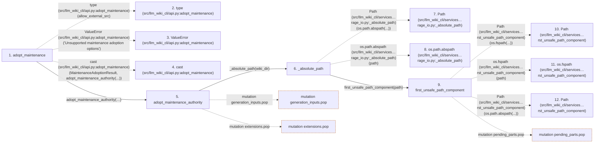

# adopt_maintenance

**Entry point:** `adopt_maintenance` (`api`)
**Source:** [api](../modules/api.md)
**Modules touched:** [analysis_compatibility](../modules/analysis_compatibility.md), [api](../modules/api.md), [canonical_json](../modules/canonical_json.md), [common](../modules/common.md), and 56 more

**Complete modules touched:**

- [analysis_compatibility](../modules/analysis_compatibility.md)
- [api](../modules/api.md)
- [canonical_json](../modules/canonical_json.md)
- [common](../modules/common.md)
- [config](../modules/config.md)
- [context_packet](../modules/context_packet.md)
- [context_service](../modules/context_service.md)
- [data_flow](../modules/data_flow.md)
- [dependency_versions](../modules/dependency_versions.md)
- [documentation_queries](../modules/documentation_queries.md)
- [documentation_query_builder](../modules/documentation_query_builder.md)
- [entrypoints](../modules/entrypoints.md)
- [extraction_service](../modules/extraction_service.md)
- [filesystem_guard](../modules/filesystem_guard.md)
- [immutable](../modules/immutable.md)
- [implementation_evidence](../modules/implementation_evidence.md)
- [imports](../modules/imports.md)
- [infrastructure_inventory](../modules/infrastructure_inventory.md)
- [infrastructure_sync](../modules/infrastructure_sync.md)
- [io](../modules/io.md)
- [knowledge_artifacts](../modules/knowledge_artifacts.md)
- [knowledge_consumption](../modules/knowledge_consumption.md)
- [knowledge_envelope](../modules/knowledge_envelope.md)
- [knowledge_evidence](../modules/knowledge_evidence.md)
- [knowledge_freshness](../modules/knowledge_freshness.md)
- [knowledge_governance](../modules/knowledge_governance.md)
- [knowledge_graph](../modules/knowledge_graph.md)
- [knowledge_index](../modules/knowledge_index.md)
- [knowledge_loader](../modules/knowledge_loader.md)
- [knowledge_model](../modules/knowledge_model.md)
- [knowledge_orchestration](../modules/knowledge_orchestration.md)
- [knowledge_packs](../modules/knowledge_packs.md)
- [knowledge_reuse](../modules/knowledge_reuse.md)
- [knowledge_storage](../modules/knowledge_storage.md)
- [knowledge_storage_io](../modules/knowledge_storage_io.md)
- [knowledge_verification](../modules/knowledge_verification.md)
- [maintenance_evidence](../modules/maintenance_evidence.md)
- [maintenance_projection](../modules/maintenance_projection.md)
- [maintenance_protocol](../modules/maintenance_protocol.md)
- [maintenance_service](../modules/maintenance_service.md)
- [maintenance_shapes](../modules/maintenance_shapes.md)
- [maintenance_state](../modules/maintenance_state.md)
- [maintenance_status](../modules/maintenance_status.md)
- [manifest_storage](../modules/manifest_storage.md)
- [markdown_sections](../modules/markdown_sections.md)
- [plugins](../modules/plugins.md)
- [python_calls](../modules/python_calls.md)
- [python_implementation](../modules/python_implementation.md)
- [python_imports](../modules/python_imports.md)
- [section_ownership](../modules/section_ownership.md)
- [services_dependencies](../modules/services_dependencies.md)
- [source_selection](../modules/source_selection.md)
- [source_snapshot](../modules/source_snapshot.md)
- [storage_spool](../modules/storage_spool.md)
- [sync_manifest](../modules/sync_manifest.md)
- [validation](../modules/validation.md)
- [wiki_media](../modules/wiki_media.md)
- [wiki_surface](../modules/wiki_surface.md)
- [wiki_surface_index](../modules/wiki_surface_index.md)
- [wiki_write_basis](../modules/wiki_write_basis.md)

## Call sequence

> Static overview in presentation order, not runtime execution order. Arrows retain captured callers; siblings are shown before deeper helper detail.

```mermaid
sequenceDiagram
    participant p0 as adopt_maintenance
    participant p1 as type (src/llm_wiki_cli/api.py:adopt_maintenance)
    participant p2 as ValueError (src/llm_wiki_cli/api.py:adopt_maintenance)
    participant p3 as cast (src/llm_wiki_cli/api.py:adopt_maintenance)
    participant p4 as adopt_maintenance_authority
    participant p5 as _validate_wiki_dir
    participant p6 as _absolute_path
    participant p7 as validate_path
    participant p8 as _outside_recovery
    participant p9 as governance_writer_lock
    participant p10 as storage_writer_lock
    participant p11 as load_adoption_marker
    participant p12 as guard_maintenance_owner
    participant p13 as snapshot_wiki
    participant p14 as _capture_basis
    participant p15 as _capture
    participant p16 as str (src/llm_wiki_cli/services…opt_maintenance_authority)
    participant p17 as new_identity
    participant p18 as capture_maintenance_observations
    participant p19 as reconcile_pending_maintenance
    participant p20 as view.manifest_basis.with_maintenance_state
    participant p21 as project_maintenance_knowledge
    participant p22 as dict (src/llm_wiki_cli/services…opt_maintenance_authority)
    participant p23 as generation_inputs.pop (src/llm_wiki_cli/services…opt_maintenance_authority)
    participant p24 as manifest.with_generation_state
    participant p25 as extensions.pop (src/llm_wiki_cli/services…opt_maintenance_authority)
    participant p26 as replace (src/llm_wiki_cli/services…opt_maintenance_authority)
    participant p27 as validated_artifact_bytes
    p0-->>p1: type (src/llm_wiki_cli/api.py:adopt_maintenance)(allow_external_src)
    p0-->>p2: ValueError (src/llm_wiki_cli/api.py:adopt_maintenance)('Unsupported maintenance adoption options')
    p0-->>p3: cast (src/llm_wiki_cli/api.py:adopt_maintenance)(MaintenanceAdoptionResult, adopt_maintenance_authority(...))
    p0->>p4: adopt_maintenance_authority
    p0->>p5: _validate_wiki_dir
    p4->>p6: _absolute_path
    p5->>p7: validate_path
    p4->>p6: _absolute_path
    p4->>p8: _outside_recovery
    p4->>p9: governance_writer_lock
    p4->>p10: storage_writer_lock
    p4->>p11: load_adoption_marker
    p4->>p12: guard_maintenance_owner
    p4->>p12: guard_maintenance_owner
    p4->>p13: snapshot_wiki
    p4->>p14: _capture_basis
    p4->>p15: _capture
    p4-->>p16: str (src/llm_wiki_cli/services…opt_maintenance_authority)(source)
    p4->>p17: new_identity
    p4->>p18: capture_maintenance_observations
    p4->>p19: reconcile_pending_maintenance
    p4-->>p20: view.manifest_basis.with_maintenance_state(state)
    p4->>p21: project_maintenance_knowledge
    p4-->>p22: dict (src/llm_wiki_cli/services…opt_maintenance_authority)(manifest.generation_inputs)
    p4-->>p23: generation_inputs.pop (src/llm_wiki_cli/services…opt_maintenance_authority)(REUSE_INPUT_KEY, None)
    p4-->>p24: manifest.with_generation_state(surfaces=manifest.surfaces, generation_inputs=generation_inputs)
    p4-->>p22: dict (src/llm_wiki_cli/services…opt_maintenance_authority)(knowledge.extensions)
    p4-->>p25: extensions.pop (src/llm_wiki_cli/services…opt_maintenance_authority)(REUSE_EXTENSION_KEY, None)
    p4-->>p26: replace (src/llm_wiki_cli/services…opt_maintenance_authority)(knowledge, extensions=extensions)
    p4->>p27: validated_artifact_bytes
```

<!-- Auto-generated from static call edges. Dashed arrows are external or unresolved calls. Reviewed runtime conditions and side effects belong in Behavior. -->

> Call sequence diagram shows 30 of 3074 interactions; 3044 omitted to keep the visualization within the 30-interaction and generated-diagram limits, with uncertain identities omitted rather than inferred.

> Captured boundary calls: external 7 of 1041 (1034 omitted); unresolved 4 of 717 (713 omitted). These counts cover the captured static trace.

Omitted captured detail, grouped by actual caller occurrence and target module:

| Caller | Parent step | Target module | Kind | Omitted interactions |
| --- | --- | --- | --- | --- |
| `src/llm_wiki_cli/services/knowledge_storage_io.py:_absolute_path` | 6 | - | external | 4 |
| `src/llm_wiki_cli/services/knowledge_storage_io.py:_absolute_path` | 6 | [src/llm_wiki_cli/services/io.py](../modules/io.md) | internal | 1 |
| `src/llm_wiki_cli/services/io.py:first_unsafe_path_component` | 9 | - | external | 20 |
| `src/llm_wiki_cli/services/io.py:first_unsafe_path_component` | 9 | - | unresolved | 5 |
| `src/llm_wiki_cli/services/knowledge_storage_io.py:_absolute_path` | 6 | [src/llm_wiki_cli/services/knowledge_storage.py](../modules/knowledge_storage.md) | internal | 1 |
| `src/llm_wiki_cli/services/knowledge_storage_io.py:_absolute_path` | 6 | - | unresolved | 3 |
| `src/llm_wiki_cli/services/maintenance_service.py:_outside_recovery` | 42 | [src/llm_wiki_cli/services/knowledge_storage_io.py](../modules/knowledge_storage_io.md) | internal | 1 |
| `src/llm_wiki_cli/services/maintenance_service.py:_outside_recovery` | 42 | - | unresolved | 3 |
> Omission summary shows 8 of 729 groups; 721 further groups are not expanded here. Counts above include all omitted interactions.
> Detailed flow queries retain their own coverage and limits; omitted paths may execute at runtime.

> Trace truncated at the depth limit; deeper calls are omitted.

## Data flow

<!-- Auto-generated static analysis. Treat values and boundaries as best-effort hints, not runtime proof. -->

### Step data

| Step | Inputs | Reads | Writes | Returns |
|---|---|---|---|---|
| `adopt_maintenance` | `src_dir: str`, `wiki_dir: str`, `recovery_dir: str \| Path`, `manifest_format: Literal['v7', 'indexed-v8'] \| None`, `source_selection: str \| Path \| None`, `helper_cache_dir: str \| None`, `allow_external_src: bool` | `MaintenanceAdoptionResult` | - | `cast(...)` |
| `type (src/llm_wiki_cli/api.py:adopt_maintenance)` | - | - | - | - |
| `ValueError (src/llm_wiki_cli/api.py:adopt_maintenance)` | - | - | - | - |
| `cast (src/llm_wiki_cli/api.py:adopt_maintenance)` | - | - | - | - |
| `adopt_maintenance_authority` | `src_dir`, `wiki_dir`, `recovery_dir`, `manifest_format`, `fault_injector`, `capture_options` | - | `basis.source_snapshot`, `after[...]` | `{...}`, `{...}` |
| `_absolute_path` | `path: Path` | - | - | `path` |
| `Path (src/llm_wiki_cli/services…rage_io.py:_absolute_path)` | - | - | - | - |
| `os.path.abspath (src/llm_wiki_cli/services…rage_io.py:_absolute_path)` | - | - | - | - |
| `first_unsafe_path_component` | `path: str \| Path`, `trusted_symlink_uids: Set[int] \| None`, `trusted_symlink_owner: Callable[[Path], bool] \| None` | `stat`, `os` | - | `lexical`, `None`, `current`, `current`, `current`, `current`, `current`, `None` |
| `Path (src/llm_wiki_cli/services…rst_unsafe_path_component)` | - | - | - | - |
| `os.fspath (src/llm_wiki_cli/services…rst_unsafe_path_component)` | - | - | - | - |
| `Path (src/llm_wiki_cli/services…rst_unsafe_path_component)` | - | - | - | - |

### Call data

| From | To | Line | Call |
|---|---|---:|---|
| adopt_maintenance | type (src/llm_wiki_cli/api.py:adopt_maintenance) | 1588 | `type(allow_external_src)` |
| adopt_maintenance | ValueError (src/llm_wiki_cli/api.py:adopt_maintenance) | 1589 | `ValueError('Unsupported maintenance adoption options')` |
| adopt_maintenance | cast (src/llm_wiki_cli/api.py:adopt_maintenance) | 1590 | `cast(MaintenanceAdoptionResult, adopt_maintenance_authority(...))` |
| adopt_maintenance | adopt_maintenance_authority | 1590 | `adopt_maintenance_authority(src_dir, _validate_wiki_dir(...), recovery_dir=recovery_dir, manifest_format=manifest_format, source_selection=source_selection, helper_cache_dir=helper_cache_dir, allow_external_src=allow_external_src)` |
| adopt_maintenance_authority | _absolute_path | 83 | `_absolute_path(wiki_dir)` |
| _absolute_path | Path (src/llm_wiki_cli/services…rage_io.py:_absolute_path) | 49 | `Path(os.path.abspath(...))` |
| _absolute_path | os.path.abspath (src/llm_wiki_cli/services…rage_io.py:_absolute_path) | 49 | `os.path.abspath(path)` |
| _absolute_path | first_unsafe_path_component | 50 | `first_unsafe_path_component(path)` |
| first_unsafe_path_component | Path (src/llm_wiki_cli/services…rst_unsafe_path_component) | 51 | `Path(os.fspath(...))` |
| first_unsafe_path_component | os.fspath (src/llm_wiki_cli/services…rst_unsafe_path_component) | 51 | `os.fspath(path)` |
| first_unsafe_path_component | Path (src/llm_wiki_cli/services…rst_unsafe_path_component) | 59 | `Path(os.path.abspath(...))` |

### Boundary effects

| Kind | Target | Step | Line |
|---|---|---|---:|
| mutation | `generation_inputs.pop` | `adopt_maintenance_authority` | 107 |
| mutation | `extensions.pop` | `adopt_maintenance_authority` | 110 |
| mutation | `pending_parts.pop` | `first_unsafe_path_component` | 71 |

### Static analysis gaps

| Kind | Step | Target | Line |
|---|---|---|---:|
| external_call | `adopt_maintenance` | `type` | 1588 |
| external_call | `adopt_maintenance` | `ValueError` | 1589 |
| external_call | `adopt_maintenance` | `cast` | 1590 |
| external_call | `_absolute_path` | `os.path.abspath` | 49 |
| external_call | `first_unsafe_path_component` | `os.fspath` | 51 |
| step_limit | `adopt_maintenance` | `first 12 steps` | 0 |
| truncated_flow | `adopt_maintenance` | `depth limit` | 0 |

## Behavior

This flow starts at `adopt_maintenance` and is classified as `api`. The generated call and data-flow sections are bounded static projections; runtime conditions and side effects require source-level confirmation.
