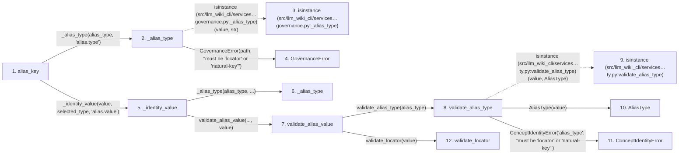

# alias_key

**Entry point:** `alias_key` (`api`)
**Source:** [knowledge_governance](../modules/knowledge_governance.md)
**Modules touched:** [concept_identity](../modules/concept_identity.md), [knowledge_governance](../modules/knowledge_governance.md), [wiki_surface](../modules/wiki_surface.md)

## Call sequence

> Static overview in presentation order, not runtime execution order. Arrows retain captured callers; representative internal continuations and boundary examples precede repeated helper detail.

```mermaid
sequenceDiagram
    participant p0 as alias_key
    participant p1 as _alias_type
    participant p2 as _identity_value
    participant p3 as validate_alias_value
    participant p4 as validate_alias_type
    participant p5 as validate_locator
    participant p6 as validate_natural_key
    participant p7 as _machine_text
    participant p8 as validate_exact_page_coordinate
    participant p9 as _safe_decoded_coordinate
    participant p10 as _matches_directory_path
    participant p11 as _matches_directory_uri
    participant p12 as GovernanceError
    participant p13 as AliasType
    participant p14 as _contains_uri_userinfo
    participant p15 as ConceptIdentityError
    participant p16 as _looks_absolute_path
    participant p17 as _contains_coordinate_userinfo
    participant p18 as WikiSurfaceError
    participant p19 as canonical_path
    participant p20 as mcp_uri
    participant p21 as is_safe_page_id
    participant p22 as isinstance (src/llm_wiki_cli/services…governance.py:_alias_type)
    participant p23 as text.partition
    participant p24 as isinstance (src/llm_wiki_cli/services…ty.py:validate_alias_type)
    participant p25 as _NATURAL_KEY_PREFIX_RE.fullmatch
    participant p26 as _NATURAL_KEY_PAYLOAD_RE.fullmatch
    participant p27 as _INVALID_PERCENT_RE.search
    participant p28 as _PERCENT_ESCAPE_RE.finditer
    participant p29 as match.group
    participant p30 as match.group(…).upper
    p0->>p1: _alias_type
    p0->>p2: _identity_value
    p2->>p3: validate_alias_value
    p3->>p4: validate_alias_type
    p3->>p5: validate_locator
    p3->>p6: validate_natural_key
    p5->>p7: _machine_text
    p5->>p8: validate_exact_page_coordinate
    p6->>p9: _safe_decoded_coordinate
    p8->>p10: _matches_directory_path
    p8->>p11: _matches_directory_uri
    p1->>p12: GovernanceError
    p4->>p13: AliasType
    p5->>p14: _contains_uri_userinfo
    p4->>p15: ConceptIdentityError
    p5->>p16: _looks_absolute_path
    p6->>p17: _contains_coordinate_userinfo
    p8->>p18: WikiSurfaceError
    p8->>p19: canonical_path
    p8->>p20: mcp_uri
    p10->>p21: is_safe_page_id
    p1-->>p22: isinstance (src/llm_wiki_cli/services…governance.py:_alias_type)(value, str)
    p6-->>p23: text.partition(':')
    p4-->>p24: isinstance (src/llm_wiki_cli/services…ty.py:validate_alias_type)(value, AliasType)
    p6-->>p25: _NATURAL_KEY_PREFIX_RE.fullmatch(prefix)
    p6-->>p26: _NATURAL_KEY_PAYLOAD_RE.fullmatch(payload)
    p6-->>p27: _INVALID_PERCENT_RE.search(payload)
    p6-->>p28: _PERCENT_ESCAPE_RE.finditer(payload)
    p6-->>p29: match.group(1)
    p6-->>p30: match.group(…).upper
```

<!-- Auto-generated from static call edges. Dashed arrows are external or unresolved calls. Reviewed runtime conditions and side effects belong in Behavior. -->

> Call sequence diagram shows 30 of 106 interactions; 76 omitted to keep the visualization within the 30-interaction and generated-diagram limits, with uncertain identities omitted rather than inferred.

> Captured boundary calls: external 2 of 27 (25 omitted); unresolved 7 of 27 (20 omitted). These counts cover the captured static trace.

Omitted captured detail, grouped by actual caller occurrence and target module:

| Caller | Parent step | Target module | Kind | Omitted interactions |
| --- | --- | --- | --- | --- |
| `src/llm_wiki_cli/services/knowledge_governance.py:_identity_value` | 5 | [src/llm_wiki_cli/services/knowledge_governance.py](../modules/knowledge_governance.md) | internal | 2 |
| `src/llm_wiki_cli/services/concept_identity.py:_machine_text` | 13 | - | external | 6 |
| `src/llm_wiki_cli/services/concept_identity.py:_machine_text` | 13 | [src/llm_wiki_cli/services/concept_identity.py](../modules/concept_identity.md) | internal | 5 |
| `src/llm_wiki_cli/services/concept_identity.py:_machine_text` | 13 | - | unresolved | 3 |
| `src/llm_wiki_cli/services/concept_identity.py:_contains_uri_userinfo` | 28 | - | external | 1 |
| `src/llm_wiki_cli/services/concept_identity.py:_looks_absolute_path` | 30 | - | unresolved | 2 |
| `src/llm_wiki_cli/services/concept_identity.py:validate_locator` | 12 | [src/llm_wiki_cli/services/concept_identity.py](../modules/concept_identity.md) | internal | 3 |
| `src/llm_wiki_cli/services/wiki_surface.py:validate_exact_page_coordinate` | 34 | - | external | 4 |
> Omission summary shows 8 of 24 groups; 16 further groups are not expanded here. Counts above include all omitted interactions.
> Detailed flow queries retain their own coverage and limits; omitted paths may execute at runtime.

> Trace truncated at the depth limit; deeper calls are omitted.

## Data flow

<!-- Auto-generated static analysis. Treat values and boundaries as best-effort hints, not runtime proof. -->

### Analysis coverage

**Effect analysis partially available.** Flow assembly and source effect analysis are separate; empty observations do not prove an empty handler body.

Source steps: 53; effect analysis evaluated: 25, partial: 0, unavailable: 28. Counts include steps omitted from the displayed trace.

Collector observations for 25 source steps with known totals: observed: 100, emitted: 100, omitted: 0. Unavailable totals are excluded.

- Callable record unavailable for one or more source steps; those steps have no represented callable body.
- Effect collector totals unavailable; observed counts cover captured records only.

| Step | Callable record | Effect analysis | Collector totals | Observed | Emitted | Omitted |
|---|---|---|---|---:|---:|---:|
| `alias_key` | `available` | `evaluated` | `available` | `3` | `3` | `0` |
| `_alias_type` | `available` | `evaluated` | `available` | `4` | `4` | `0` |
| `isinstance (src/llm_wiki_cli/services…governance.py:_alias_type)` | `not_applicable` | `not_applicable` | `not_applicable` | — | — | — |
| `GovernanceError` | `unavailable` | `unavailable` | `unavailable` | — | — | — |
| `_identity_value` | `available` | `evaluated` | `available` | `8` | `8` | `0` |
| `_alias_type` | `available` | `evaluated` | `available` | `4` | `4` | `0` |
| `validate_alias_value` | `available` | `evaluated` | `available` | `5` | `5` | `0` |
| `validate_alias_type` | `available` | `evaluated` | `available` | `3` | `3` | `0` |
| `isinstance (src/llm_wiki_cli/services…ty.py:validate_alias_type)` | `not_applicable` | `not_applicable` | `not_applicable` | — | — | — |
| `AliasType` | `unavailable` | `unavailable` | `unavailable` | — | — | — |
| `ConceptIdentityError` | `unavailable` | `unavailable` | `unavailable` | — | — | — |
| `validate_locator` | `available` | `evaluated` | `available` | `4` | `4` | `0` |

### Step data

| Step | Inputs | Reads | Writes | Returns |
|---|---|---|---|---|
| `alias_key` | `alias_type: str`, `value: str` | - | - | `...` |
| `_alias_type` | `value: object`, `path: str` | `ALIAS_TYPES` | - | `value` |
| `isinstance (src/llm_wiki_cli/services…governance.py:_alias_type)` | - | - | - | - |
| `GovernanceError` | - | - | - | - |
| `_identity_value` | `value: object`, `alias_type: str`, `path: str` | `ALIAS_LOCATOR`, `AliasType`, `AliasType`, `ConceptIdentityError` | - | `validate_alias_value(...)` |
| `_alias_type` | `value: object`, `path: str` | `ALIAS_TYPES` | - | `value` |
| `validate_alias_value` | `alias_type: AliasType \| str`, `value: object` | `AliasType` | - | `validate_locator(...)`, `validate_natural_key(...)` |
| `validate_alias_type` | `value: AliasType \| str` | `AliasType` | - | `...` |
| `isinstance (src/llm_wiki_cli/services…ty.py:validate_alias_type)` | - | - | - | - |
| `AliasType` | - | - | - | - |
| `ConceptIdentityError` | - | - | - | - |
| `validate_locator` | `value: object` | `_MAX_NATURAL_KEY_LENGTH`, `WikiSurfaceError` | - | `normalized` |

### Call data

| From | To | Line | Call |
|---|---|---:|---|
| alias_key | _alias_type | 381 | `_alias_type(alias_type, 'alias.type')` |
| _alias_type | isinstance (src/llm_wiki_cli/services…governance.py:_alias_type) | 3388 | `isinstance(value, str)` |
| _alias_type | GovernanceError | 3389 | `GovernanceError(path, "must be 'locator' or 'natural-key'")` |
| alias_key | _identity_value | 382 | `_identity_value(value, selected_type, 'alias.value')` |
| _identity_value | _alias_type | 3397 | `_alias_type(alias_type, ...)` |
| _identity_value | validate_alias_value | 3399 | `validate_alias_value(..., value)` |
| validate_alias_value | validate_alias_type | 486 | `validate_alias_type(alias_type)` |
| validate_alias_type | isinstance (src/llm_wiki_cli/services…ty.py:validate_alias_type) | 475 | `isinstance(value, AliasType)` |
| validate_alias_type | AliasType | 475 | `AliasType(value)` |
| validate_alias_type | ConceptIdentityError | 477 | `ConceptIdentityError('alias_type', "must be 'locator' or 'natural-key'")` |
| validate_alias_value | validate_locator | 488 | `validate_locator(value)` |

### Boundary effects

*No boundary-effect observations were captured in this static trace.*

### Static analysis gaps

| Kind | Step | Target | Line |
|---|---|---|---:|
| external_call | `_alias_type` | `isinstance` | 3388 |
| external_call | `validate_alias_type` | `isinstance` | 475 |
| step_limit | `alias_key` | `first 12 steps` | 0 |
| truncated_flow | `alias_key` | `depth limit` | 0 |

## Behavior

This flow starts at `alias_key` and is classified as `api`. The generated call and data-flow sections are bounded static projections; runtime conditions and side effects require source-level confirmation.
