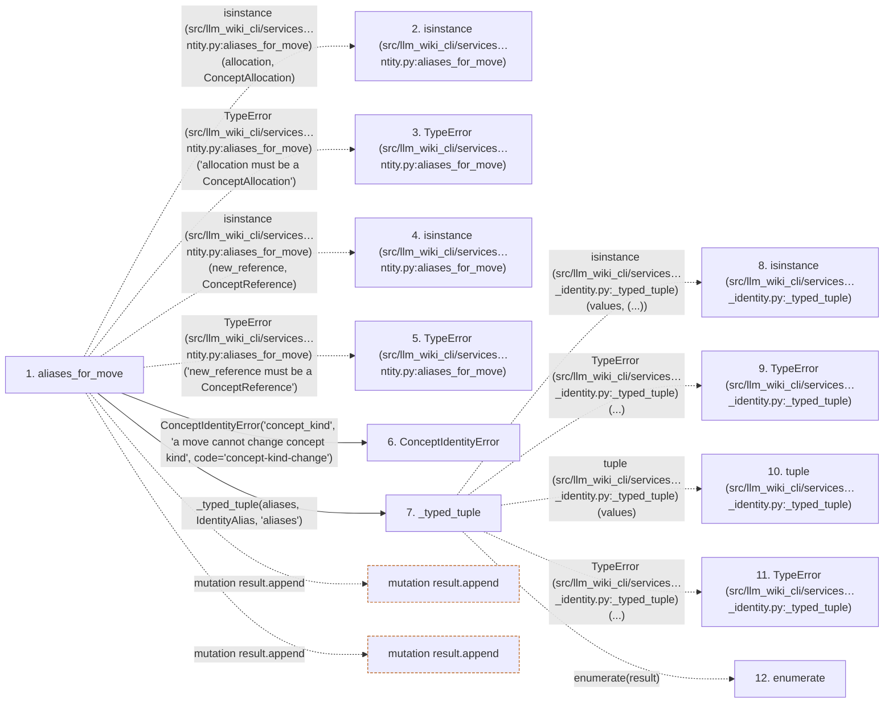

# aliases_for_move

**Entry point:** `aliases_for_move` (`api`)
**Source:** [concept_identity](../modules/concept_identity.md)
**Modules touched:** [concept_identity](../modules/concept_identity.md), [wiki_surface](../modules/wiki_surface.md)

## Call sequence

> Static overview in presentation order, not runtime execution order. Arrows retain captured callers; representative internal continuations and boundary examples precede repeated helper detail.

```mermaid
sequenceDiagram
    participant p0 as aliases_for_move
    participant p1 as identity_coordinate_key
    participant p2 as _deduplicated_aliases
    participant p3 as ConceptIdentityError
    participant p4 as _typed_tuple
    participant p5 as IdentityAlias
    participant p6 as validate_alias_type
    participant p7 as validate_alias_value
    participant p8 as validate_locator
    participant p9 as validate_natural_key
    participant p10 as _machine_text
    participant p11 as validate_exact_page_coordinate
    participant p12 as _safe_decoded_coordinate
    participant p13 as _matches_directory_path
    participant p14 as _matches_directory_uri
    participant p15 as iter_page_kinds
    participant p16 as _sorted_aliases
    participant p17 as canonical_path
    participant p18 as mcp_uri
    participant p19 as AliasType
    participant p20 as _contains_uri_userinfo
    participant p21 as _looks_absolute_path
    participant p22 as _contains_coordinate_userinfo
    participant p23 as WikiSurfaceError
    participant p24 as is_safe_page_id
    participant p25 as isinstance (src/llm_wiki_cli/services…ntity.py:aliases_for_move)
    participant p26 as result.append
    participant p27 as TypeError (src/llm_wiki_cli/services…ntity.py:aliases_for_move)
    p0->>p1: identity_coordinate_key
    p0->>p2: _deduplicated_aliases
    p0->>p3: ConceptIdentityError
    p0->>p4: _typed_tuple
    p0->>p5: IdentityAlias
    p1->>p6: validate_alias_type
    p1->>p7: validate_alias_value
    p7->>p8: validate_locator
    p7->>p9: validate_natural_key
    p8->>p10: _machine_text
    p8->>p11: validate_exact_page_coordinate
    p9->>p12: _safe_decoded_coordinate
    p11->>p13: _matches_directory_path
    p11->>p14: _matches_directory_uri
    p1->>p15: iter_page_kinds
    p2->>p16: _sorted_aliases
    p1->>p17: canonical_path
    p1->>p18: mcp_uri
    p6->>p19: AliasType
    p8->>p20: _contains_uri_userinfo
    p8->>p21: _looks_absolute_path
    p9->>p22: _contains_coordinate_userinfo
    p11->>p23: WikiSurfaceError
    p13->>p24: is_safe_page_id
    p0-->>p25: isinstance (src/llm_wiki_cli/services…ntity.py:aliases_for_move)(allocation, ConceptAllocation)
    p0-->>p26: result.append(IdentityAlias(...))
    p0-->>p27: TypeError (src/llm_wiki_cli/services…ntity.py:aliases_for_move)('allocation must be a ConceptAllocation')
    p0-->>p25: isinstance (src/llm_wiki_cli/services…ntity.py:aliases_for_move)(new_reference, ConceptReference)
    p0-->>p27: TypeError (src/llm_wiki_cli/services…ntity.py:aliases_for_move)('new_reference must be a ConceptReference')
    p0-->>p26: result.append(IdentityAlias(...))
```

<!-- Auto-generated from static call edges. Dashed arrows are external or unresolved calls. Reviewed runtime conditions and side effects belong in Behavior. -->

> Call sequence diagram shows 30 of 141 interactions; 111 omitted to keep the visualization within the 30-interaction and generated-diagram limits, with uncertain identities omitted rather than inferred.

> Captured boundary calls: external 4 of 45 (41 omitted); unresolved 2 of 33 (31 omitted). These counts cover the captured static trace.

Omitted captured detail, grouped by actual caller occurrence and target module:

| Caller | Parent step | Target module | Kind | Omitted interactions |
| --- | --- | --- | --- | --- |
| `src/llm_wiki_cli/services/concept_identity.py:_typed_tuple` | 7 | - | external | 7 |
| `src/llm_wiki_cli/services/concept_identity.py:validate_alias_type` | 16 | - | external | 1 |
| `src/llm_wiki_cli/services/concept_identity.py:validate_alias_type` | 16 | [src/llm_wiki_cli/services/concept_identity.py](../modules/concept_identity.md) | internal | 1 |
| `src/llm_wiki_cli/services/concept_identity.py:validate_alias_value` | 20 | [src/llm_wiki_cli/services/concept_identity.py](../modules/concept_identity.md) | internal | 1 |
| `src/llm_wiki_cli/services/concept_identity.py:_machine_text` | 23 | - | external | 6 |
| `src/llm_wiki_cli/services/concept_identity.py:_machine_text` | 23 | [src/llm_wiki_cli/services/concept_identity.py](../modules/concept_identity.md) | internal | 5 |
| `src/llm_wiki_cli/services/concept_identity.py:_machine_text` | 23 | - | unresolved | 3 |
| `src/llm_wiki_cli/services/concept_identity.py:_contains_uri_userinfo` | 38 | - | external | 1 |
> Omission summary shows 8 of 35 groups; 27 further groups are not expanded here. Counts above include all omitted interactions.
> Detailed flow queries retain their own coverage and limits; omitted paths may execute at runtime.

> Trace truncated at the depth limit; deeper calls are omitted.

## Data flow

<!-- Auto-generated static analysis. Treat values and boundaries as best-effort hints, not runtime proof. -->

### Analysis coverage

**Effect analysis partially available.** Flow assembly and source effect analysis are separate; empty observations do not prove an empty handler body.

Source steps: 64; effect analysis evaluated: 34, partial: 1, unavailable: 29. Counts include steps omitted from the displayed trace.

Collector observations for 35 source steps with known totals: observed: 159, emitted: 157, omitted: 2. Unavailable totals are excluded.

- Callable record unavailable; the selected entry symbol has no represented callable body.
- Effect collector omitted observations before flow assembly; displayed effects are partial.
- Effect collector totals unavailable; observed counts cover captured records only.

| Step | Callable record | Effect analysis | Collector totals | Observed | Emitted | Omitted |
|---|---|---|---|---:|---:|---:|
| `aliases_for_move` | `available` | `partial` | `available` | `16` | `14` | `2` |
| `isinstance (src/llm_wiki_cli/services…ntity.py:aliases_for_move)` | `not_applicable` | `not_applicable` | `not_applicable` | — | — | — |
| `TypeError (src/llm_wiki_cli/services…ntity.py:aliases_for_move)` | `not_applicable` | `not_applicable` | `not_applicable` | — | — | — |
| `isinstance (src/llm_wiki_cli/services…ntity.py:aliases_for_move)` | `not_applicable` | `not_applicable` | `not_applicable` | — | — | — |
| `TypeError (src/llm_wiki_cli/services…ntity.py:aliases_for_move)` | `not_applicable` | `not_applicable` | `not_applicable` | — | — | — |
| `ConceptIdentityError` | `unavailable` | `unavailable` | `unavailable` | — | — | — |
| `_typed_tuple` | `available` | `evaluated` | `available` | `4` | `4` | `0` |
| `isinstance (src/llm_wiki_cli/services…_identity.py:_typed_tuple)` | `not_applicable` | `not_applicable` | `not_applicable` | — | — | — |
| `TypeError (src/llm_wiki_cli/services…_identity.py:_typed_tuple)` | `not_applicable` | `not_applicable` | `not_applicable` | — | — | — |
| `tuple (src/llm_wiki_cli/services…_identity.py:_typed_tuple)` | `not_applicable` | `not_applicable` | `not_applicable` | — | — | — |
| `TypeError (src/llm_wiki_cli/services…_identity.py:_typed_tuple)` | `not_applicable` | `not_applicable` | `not_applicable` | — | — | — |
| `enumerate` | `not_applicable` | `not_applicable` | `not_applicable` | — | — | — |

### Step data

| Step | Inputs | Reads | Writes | Returns |
|---|---|---|---|---|
| `aliases_for_move` | `allocation: ConceptAllocation`, `new_reference: ConceptReference`, `aliases: Iterable[IdentityAlias]` | `ConceptAllocation`, `ConceptReference`, `IdentityAlias`, `AliasType`, `AliasType`, `AliasType`, `AliasType`, `AliasType` | - | `_deduplicated_aliases(...)` |
| `isinstance (src/llm_wiki_cli/services…ntity.py:aliases_for_move)` | - | - | - | - |
| `TypeError (src/llm_wiki_cli/services…ntity.py:aliases_for_move)` | - | - | - | - |
| `isinstance (src/llm_wiki_cli/services…ntity.py:aliases_for_move)` | - | - | - | - |
| `TypeError (src/llm_wiki_cli/services…ntity.py:aliases_for_move)` | - | - | - | - |
| `ConceptIdentityError` | - | - | - | - |
| `_typed_tuple` | `values: Iterable[_RecordT]`, `expected_type: type[_RecordT]`, `field: str` | - | - | `result` |
| `isinstance (src/llm_wiki_cli/services…_identity.py:_typed_tuple)` | - | - | - | - |
| `TypeError (src/llm_wiki_cli/services…_identity.py:_typed_tuple)` | - | - | - | - |
| `tuple (src/llm_wiki_cli/services…_identity.py:_typed_tuple)` | - | - | - | - |
| `TypeError (src/llm_wiki_cli/services…_identity.py:_typed_tuple)` | - | - | - | - |
| `enumerate` | - | - | - | - |

### Call data

| From | To | Line | Call |
|---|---|---:|---|
| aliases_for_move | isinstance (src/llm_wiki_cli/services…ntity.py:aliases_for_move) | 787 | `isinstance(allocation, ConceptAllocation)` |
| aliases_for_move | TypeError (src/llm_wiki_cli/services…ntity.py:aliases_for_move) | 788 | `TypeError('allocation must be a ConceptAllocation')` |
| aliases_for_move | isinstance (src/llm_wiki_cli/services…ntity.py:aliases_for_move) | 789 | `isinstance(new_reference, ConceptReference)` |
| aliases_for_move | TypeError (src/llm_wiki_cli/services…ntity.py:aliases_for_move) | 790 | `TypeError('new_reference must be a ConceptReference')` |
| aliases_for_move | ConceptIdentityError | 792 | `ConceptIdentityError('concept_kind', 'a move cannot change concept kind', code='concept-kind-change')` |
| aliases_for_move | _typed_tuple | 797 | `_typed_tuple(aliases, IdentityAlias, 'aliases')` |
| _typed_tuple | isinstance (src/llm_wiki_cli/services…_identity.py:_typed_tuple) | 1013 | `isinstance(values, (...))` |
| _typed_tuple | TypeError (src/llm_wiki_cli/services…_identity.py:_typed_tuple) | 1014 | `TypeError(...)` |
| _typed_tuple | tuple (src/llm_wiki_cli/services…_identity.py:_typed_tuple) | 1016 | `tuple(values)` |
| _typed_tuple | TypeError (src/llm_wiki_cli/services…_identity.py:_typed_tuple) | 1018 | `TypeError(...)` |
| _typed_tuple | enumerate | 1021 | `enumerate(result)` |

### Boundary effects

| Kind | Target | Step | Line |
|---|---|---|---:|
| mutation | `result.append` | `aliases_for_move` | 820 |
| mutation | `result.append` | `aliases_for_move` | 831 |

### Static analysis gaps

| Kind | Step | Target | Line |
|---|---|---|---:|
| external_call | `aliases_for_move` | `isinstance` | 787 |
| external_call | `aliases_for_move` | `TypeError` | 788 |
| external_call | `aliases_for_move` | `isinstance` | 789 |
| external_call | `aliases_for_move` | `TypeError` | 790 |
| external_call | `_typed_tuple` | `isinstance` | 1013 |
| external_call | `_typed_tuple` | `TypeError` | 1014 |
| external_call | `_typed_tuple` | `TypeError` | 1018 |
| external_call | `_typed_tuple` | `enumerate` | 1021 |
| step_limit | `aliases_for_move` | `first 12 steps` | 0 |
| truncated_flow | `aliases_for_move` | `depth limit` | 0 |

## Behavior

This flow starts at `aliases_for_move` and is classified as `api`. The generated call and data-flow sections are bounded static projections; runtime conditions and side effects require source-level confirmation.
