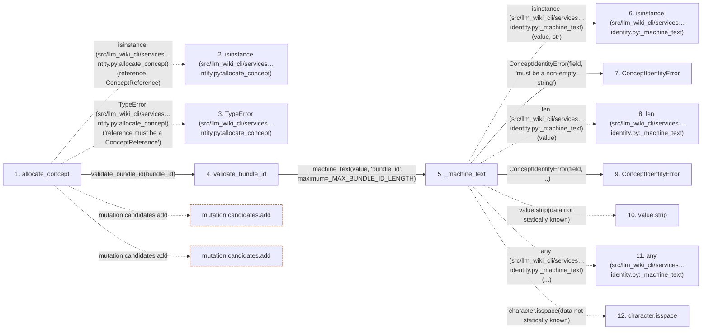

# allocate_concept

**Entry point:** `allocate_concept` (`api`)
**Source:** [concept_identity](../modules/concept_identity.md)
**Modules touched:** [concept_identity](../modules/concept_identity.md), [wiki_surface](../modules/wiki_surface.md)

## Call sequence

> Static overview in presentation order, not runtime execution order. Arrows retain captured callers; representative internal continuations and boundary examples precede repeated helper detail.

```mermaid
sequenceDiagram
    participant p0 as allocate_concept
    participant p1 as validate_bundle_id
    participant p2 as validate_identity_registry
    participant p3 as derive_concept_uid
    participant p4 as identity_coordinate_key
    participant p5 as IdentityCollision
    participant p6 as IdentityCollisionError
    participant p7 as ConceptIdentityError
    participant p8 as ConceptAllocation
    participant p9 as _machine_text
    participant p10 as validate_concept_kind
    participant p11 as find_identity_collisions
    participant p12 as validate_alias_type
    participant p13 as validate_alias_value
    participant p14 as canonical_path
    participant p15 as mcp_uri
    participant p16 as _entry_for
    participant p17 as validate_locator
    participant p18 as _validate_page_id
    participant p19 as validate_natural_key
    participant p20 as _typed_tuple
    participant p21 as _looks_absolute_path
    participant p22 as _contains_uri_userinfo
    participant p23 as _sorted_aliases
    participant p24 as _uid_tag
    participant p25 as iter_page_kinds
    participant p26 as AliasType
    participant p27 as WikiSurfaceError
    participant p28 as PageKind
    participant p29 as isinstance (src/llm_wiki_cli/services…ntity.py:allocate_concept)
    participant p30 as candidates.add
    p0->>p1: validate_bundle_id
    p0->>p2: validate_identity_registry
    p0->>p3: derive_concept_uid
    p0->>p4: identity_coordinate_key
    p0->>p5: IdentityCollision
    p0->>p6: IdentityCollisionError
    p0->>p7: ConceptIdentityError
    p0->>p8: ConceptAllocation
    p1->>p9: _machine_text
    p3->>p10: validate_concept_kind
    p2->>p11: find_identity_collisions
    p4->>p12: validate_alias_type
    p4->>p13: validate_alias_value
    p4->>p14: canonical_path
    p4->>p15: mcp_uri
    p14->>p16: _entry_for
    p13->>p17: validate_locator
    p14->>p18: _validate_page_id
    p13->>p19: validate_natural_key
    p2->>p20: _typed_tuple
    p1->>p21: _looks_absolute_path
    p1->>p22: _contains_uri_userinfo
    p2->>p23: _sorted_aliases
    p3->>p24: _uid_tag
    p4->>p25: iter_page_kinds
    p12->>p26: AliasType
    p14->>p27: WikiSurfaceError
    p16->>p28: PageKind
    p0-->>p29: isinstance (src/llm_wiki_cli/services…ntity.py:allocate_concept)(reference, ConceptReference)
    p0-->>p30: candidates.add(allocation.uid)
```

<!-- Auto-generated from static call edges. Dashed arrows are external or unresolved calls. Reviewed runtime conditions and side effects belong in Behavior. -->

> Call sequence diagram shows 30 of 193 interactions; 163 omitted to keep the visualization within the 30-interaction and generated-diagram limits, with uncertain identities omitted rather than inferred.

> Captured boundary calls: external 1 of 62 (61 omitted); unresolved 1 of 44 (43 omitted). These counts cover the captured static trace.

Omitted captured detail, grouped by actual caller occurrence and target module:

| Caller | Parent step | Target module | Kind | Omitted interactions |
| --- | --- | --- | --- | --- |
| `src/llm_wiki_cli/services/concept_identity.py:allocate_concept` | 1 | - | external | 7 |
| `src/llm_wiki_cli/services/concept_identity.py:_machine_text` | 5 | - | external | 6 |
| `src/llm_wiki_cli/services/concept_identity.py:_machine_text` | 5 | [src/llm_wiki_cli/services/concept_identity.py](../modules/concept_identity.md) | internal | 5 |
| `src/llm_wiki_cli/services/concept_identity.py:_machine_text` | 5 | - | unresolved | 3 |
| `src/llm_wiki_cli/services/concept_identity.py:validate_bundle_id` | 4 | - | unresolved | 2 |
| `src/llm_wiki_cli/services/concept_identity.py:_looks_absolute_path` | 22 | - | unresolved | 2 |
| `src/llm_wiki_cli/services/concept_identity.py:_contains_uri_userinfo` | 25 | - | external | 1 |
| `src/llm_wiki_cli/services/concept_identity.py:validate_bundle_id` | 4 | [src/llm_wiki_cli/services/concept_identity.py](../modules/concept_identity.md) | internal | 1 |
> Omission summary shows 8 of 40 groups; 32 further groups are not expanded here. Counts above include all omitted interactions.
> Detailed flow queries retain their own coverage and limits; omitted paths may execute at runtime.

> Trace truncated at the depth limit; deeper calls are omitted.

## Data flow

<!-- Auto-generated static analysis. Treat values and boundaries as best-effort hints, not runtime proof. -->

### Analysis coverage

**Effect analysis partially available.** Flow assembly and source effect analysis are separate; empty observations do not prove an empty handler body.

Source steps: 88; effect analysis evaluated: 46, partial: 0, unavailable: 42. Counts include steps omitted from the displayed trace.

Collector observations for 46 source steps with known totals: observed: 198, emitted: 198, omitted: 0. Unavailable totals are excluded.

- Callable record unavailable; the selected entry symbol has no represented callable body.
- Effect collector totals unavailable; observed counts cover captured records only.

| Step | Callable record | Effect analysis | Collector totals | Observed | Emitted | Omitted |
|---|---|---|---|---:|---:|---:|
| `allocate_concept` | `available` | `evaluated` | `available` | `13` | `13` | `0` |
| `isinstance (src/llm_wiki_cli/services…ntity.py:allocate_concept)` | `not_applicable` | `not_applicable` | `not_applicable` | — | — | — |
| `TypeError (src/llm_wiki_cli/services…ntity.py:allocate_concept)` | `not_applicable` | `not_applicable` | `not_applicable` | — | — | — |
| `validate_bundle_id` | `available` | `evaluated` | `available` | `3` | `3` | `0` |
| `_machine_text` | `available` | `evaluated` | `available` | `4` | `4` | `0` |
| `isinstance (src/llm_wiki_cli/services…identity.py:_machine_text)` | `not_applicable` | `not_applicable` | `not_applicable` | — | — | — |
| `ConceptIdentityError` | `unavailable` | `unavailable` | `unavailable` | — | — | — |
| `len (src/llm_wiki_cli/services…identity.py:_machine_text)` | `not_applicable` | `not_applicable` | `not_applicable` | — | — | — |
| `ConceptIdentityError` | `unavailable` | `unavailable` | `unavailable` | — | — | — |
| `value.strip` | `not_applicable` | `not_applicable` | `not_applicable` | — | — | — |
| `any (src/llm_wiki_cli/services…identity.py:_machine_text)` | `not_applicable` | `not_applicable` | `not_applicable` | — | — | — |
| `character.isspace` | `not_applicable` | `not_applicable` | `not_applicable` | — | — | — |

### Step data

| Step | Inputs | Reads | Writes | Returns |
|---|---|---|---|---|
| `allocate_concept` | `bundle_id: object`, `reference: ConceptReference`, `allocations: Iterable[ConceptAllocation]`, `aliases: Iterable[IdentityAlias]` | `ConceptReference`, `AliasType`, `AliasType`, `AliasType`, `AliasType` | - | `allocation`, `ConceptAllocation(...)` |
| `isinstance (src/llm_wiki_cli/services…ntity.py:allocate_concept)` | - | - | - | - |
| `TypeError (src/llm_wiki_cli/services…ntity.py:allocate_concept)` | - | - | - | - |
| `validate_bundle_id` | `value: object` | `_MAX_BUNDLE_ID_LENGTH` | - | `text` |
| `_machine_text` | `value: object`, `field: str`, `maximum: int` | - | - | `value` |
| `isinstance (src/llm_wiki_cli/services…identity.py:_machine_text)` | - | - | - | - |
| `ConceptIdentityError` | - | - | - | - |
| `len (src/llm_wiki_cli/services…identity.py:_machine_text)` | - | - | - | - |
| `ConceptIdentityError` | - | - | - | - |
| `value.strip` | - | - | - | - |
| `any (src/llm_wiki_cli/services…identity.py:_machine_text)` | - | - | - | - |
| `character.isspace` | - | - | - | - |

### Call data

| From | To | Line | Call |
|---|---|---:|---|
| allocate_concept | isinstance (src/llm_wiki_cli/services…ntity.py:allocate_concept) | 567 | `isinstance(reference, ConceptReference)` |
| allocate_concept | TypeError (src/llm_wiki_cli/services…ntity.py:allocate_concept) | 568 | `TypeError('reference must be a ConceptReference')` |
| allocate_concept | validate_bundle_id | 569 | `validate_bundle_id(bundle_id)` |
| validate_bundle_id | _machine_text | 289 | `_machine_text(value, 'bundle_id', maximum=_MAX_BUNDLE_ID_LENGTH)` |
| _machine_text | isinstance (src/llm_wiki_cli/services…identity.py:_machine_text) | 942 | `isinstance(value, str)` |
| _machine_text | ConceptIdentityError | 943 | `ConceptIdentityError(field, 'must be a non-empty string')` |
| _machine_text | len (src/llm_wiki_cli/services…identity.py:_machine_text) | 944 | `len(value)` |
| _machine_text | ConceptIdentityError | 945 | `ConceptIdentityError(field, ...)` |
| _machine_text | value.strip | 946 | `value.strip(data not statically known)` |
| _machine_text | any (src/llm_wiki_cli/services…identity.py:_machine_text) | 946 | `any(...)` |
| _machine_text | character.isspace | 946 | `character.isspace(data not statically known)` |

### Boundary effects

| Kind | Target | Step | Line |
|---|---|---|---:|
| mutation | `candidates.add` | `allocate_concept` | 586 |
| mutation | `candidates.add` | `allocate_concept` | 596 |

### Static analysis gaps

| Kind | Step | Target | Line |
|---|---|---|---:|
| external_call | `allocate_concept` | `isinstance` | 567 |
| external_call | `allocate_concept` | `TypeError` | 568 |
| external_call | `_machine_text` | `isinstance` | 942 |
| unresolved_call | `_machine_text` | `value.strip` | 946 |
| external_call | `_machine_text` | `any` | 946 |
| unresolved_call | `_machine_text` | `character.isspace` | 946 |
| step_limit | `allocate_concept` | `first 12 steps` | 0 |
| truncated_flow | `allocate_concept` | `depth limit` | 0 |

## Behavior

This flow starts at `allocate_concept` and is classified as `api`. The generated call and data-flow sections are bounded static projections; runtime conditions and side effects require source-level confirmation.
