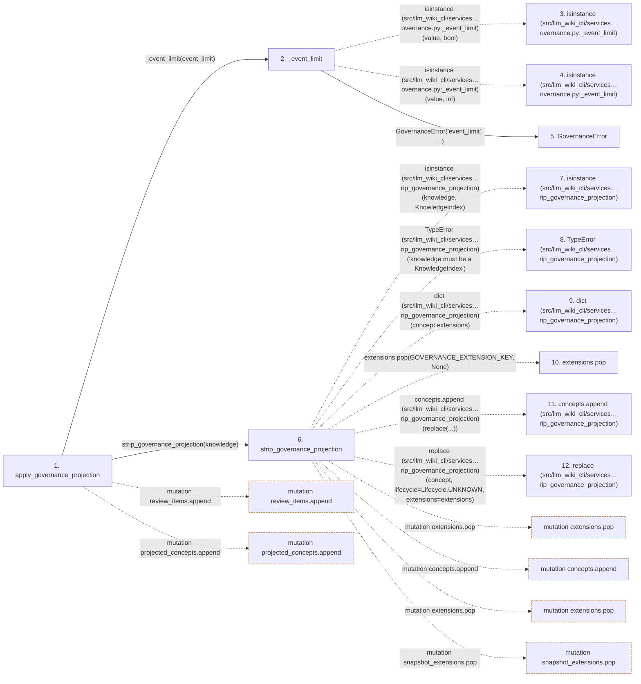

# apply_governance_projection

**Entry point:** `apply_governance_projection` (`api`)
**Source:** [knowledge_governance](../modules/knowledge_governance.md)
**Modules touched:** [concept_identity](../modules/concept_identity.md), [knowledge_evidence](../modules/knowledge_evidence.md), [knowledge_governance](../modules/knowledge_governance.md), and 5 more

**Complete modules touched:**

- [concept_identity](../modules/concept_identity.md)
- [knowledge_evidence](../modules/knowledge_evidence.md)
- [knowledge_governance](../modules/knowledge_governance.md)
- [knowledge_graph](../modules/knowledge_graph.md)
- [knowledge_model](../modules/knowledge_model.md)
- [validation](../modules/validation.md)
- [wiki_media](../modules/wiki_media.md)
- [wiki_surface](../modules/wiki_surface.md)

## Call sequence

> Static overview in presentation order, not runtime execution order. Arrows retain captured callers; representative internal continuations and boundary examples precede repeated helper detail.

```mermaid
sequenceDiagram
    participant p0 as apply_governance_projection
    participant p1 as _event_limit
    participant p2 as strip_governance_projection
    participant p3 as validate_governance_ledger
    participant p4 as concept_references_from_knowledge
    participant p5 as lifecycle_state_by_uid
    participant p6 as evaluate_review_event
    participant p7 as _add_supersession_edges
    participant p8 as validate_governance_projection
    participant p9 as GovernanceError
    participant p10 as _lifecycle_event_summary
    participant p11 as _ordered_lifecycle_events
    participant p12 as _review_event_summary
    participant p13 as _bounded_event_payload
    participant p14 as _bundle_id
    participant p15 as natural_key_for (src/llm_wiki_cli/services/knowledge_governance.py)
    participant p16 as materialize_typed_graph
    participant p17 as _validated_references
    participant p18 as _object (src/llm_wiki_cli/services/knowledge_governance.py)
    participant p19 as _exact_fields
    participant p20 as _concept_uid
    participant p21 as _concept_kind
    participant p22 as current_review_evidence
    participant p23 as validate_typed_graph
    participant p24 as _identity_value
    participant p25 as _identity_ownership_key
    participant p26 as _validate_concept_summary
    participant p27 as _validate_lifecycle_event_fields
    participant p28 as _validate_lifecycle_histories
    participant p29 as set (src/llm_wiki_cli/services…ply_governance_projection)
    participant p30 as current.concepts.values
    p0->>p1: _event_limit
    p0->>p2: strip_governance_projection
    p0->>p3: validate_governance_ledger
    p0->>p4: concept_references_from_knowledge
    p0->>p5: lifecycle_state_by_uid
    p0->>p6: evaluate_review_event
    p0->>p7: _add_supersession_edges
    p0->>p8: validate_governance_projection
    p0->>p9: GovernanceError
    p0->>p10: _lifecycle_event_summary
    p0->>p11: _ordered_lifecycle_events
    p0->>p12: _review_event_summary
    p0->>p13: _bounded_event_payload
    p3->>p14: _bundle_id
    p4->>p15: natural_key_for (src/llm_wiki_cli/services/knowledge_governance.py)
    p7->>p16: materialize_typed_graph
    p4->>p17: _validated_references
    p8->>p18: _object (src/llm_wiki_cli/services/knowledge_governance.py)
    p8->>p19: _exact_fields
    p3->>p20: _concept_uid
    p3->>p21: _concept_kind
    p6->>p22: current_review_evidence
    p2->>p23: validate_typed_graph
    p3->>p24: _identity_value
    p3->>p25: _identity_ownership_key
    p8->>p26: _validate_concept_summary
    p3->>p27: _validate_lifecycle_event_fields
    p3->>p28: _validate_lifecycle_histories
    p0-->>p29: set (src/llm_wiki_cli/services…ply_governance_projection)(active_by_locator)
    p0-->>p30: current.concepts.values
```

<!-- Auto-generated from static call edges. Dashed arrows are external or unresolved calls. Reviewed runtime conditions and side effects belong in Behavior. -->

> Call sequence diagram shows 30 of 1397 interactions; 1367 omitted to keep the visualization within the 30-interaction and generated-diagram limits, with uncertain identities omitted rather than inferred.

> Captured boundary calls: external 1 of 417 (416 omitted); unresolved 1 of 326 (325 omitted). These counts cover the captured static trace.

Omitted captured detail, grouped by actual caller occurrence and target module:

| Caller | Parent step | Target module | Kind | Omitted interactions |
| --- | --- | --- | --- | --- |
| `src/llm_wiki_cli/services/knowledge_governance.py:_event_limit` | 2 | - | external | 2 |
| `src/llm_wiki_cli/services/knowledge_governance.py:_event_limit` | 2 | [src/llm_wiki_cli/services/knowledge_governance.py](../modules/knowledge_governance.md) | internal | 1 |
| `src/llm_wiki_cli/services/knowledge_governance.py:strip_governance_projection` | 6 | - | external | 15 |
| `src/llm_wiki_cli/services/knowledge_governance.py:strip_governance_projection` | 6 | - | unresolved | 8 |
| `src/llm_wiki_cli/services/knowledge_graph.py:validate_typed_graph` | 23 | [src/llm_wiki_cli/services/knowledge_graph.py](../modules/knowledge_graph.md) | internal | 1 |
| `src/llm_wiki_cli/services/knowledge_graph.py:_parse_typed_graph` | 24 | [src/llm_wiki_cli/services/knowledge_graph.py](../modules/knowledge_graph.md) | internal | 16 |
| `src/llm_wiki_cli/services/knowledge_graph.py:_object` | 25 | [src/llm_wiki_cli/services/validation.py](../modules/validation.md) | internal | 1 |
| `src/llm_wiki_cli/services/validation.py:require_mapping` | 26 | - | external | 2 |
> Omission summary shows 8 of 295 groups; 287 further groups are not expanded here. Counts above include all omitted interactions.
> Detailed flow queries retain their own coverage and limits; omitted paths may execute at runtime.

> Trace truncated at the depth limit; deeper calls are omitted.

## Data flow

<!-- Auto-generated static analysis. Treat values and boundaries as best-effort hints, not runtime proof. -->

### Step data

| Step | Inputs | Reads | Writes | Returns |
|---|---|---|---|---|
| `apply_governance_projection` | `knowledge: KnowledgeIndex`, `ledger: GovernanceLedger`, `event_limit: int` | `GOVERNANCE_SCHEMA_VERSION`, `INVENTORY_HASH_EXTENSION` | `summary[...]`, `concept_summaries[...]`, `concept_extensions[...]`, `extensions[...]`, `snapshot_extensions[...]` | `projected` |
| `_event_limit` | `value: object` | `MAX_EVENT_LIMIT`, `MAX_EVENT_LIMIT` | - | `value` |
| `isinstance (src/llm_wiki_cli/services…overnance.py:_event_limit)` | - | - | - | - |
| `isinstance (src/llm_wiki_cli/services…overnance.py:_event_limit)` | - | - | - | - |
| `GovernanceError` | - | - | - | - |
| `strip_governance_projection` | `knowledge: KnowledgeIndex` | `KnowledgeIndex`, `GOVERNANCE_EXTENSION_KEY`, `Lifecycle`, `GOVERNANCE_EXTENSION_KEY`, `Mapping`, `Mapping`, `ConceptKind`, `GOVERNANCE_HASH_EXTENSION_KEY` | `graph_payload[...]`, `extensions[...]` | `replace(...)` |
| `isinstance (src/llm_wiki_cli/services…rip_governance_projection)` | - | - | - | - |
| `TypeError (src/llm_wiki_cli/services…rip_governance_projection)` | - | - | - | - |
| `dict (src/llm_wiki_cli/services…rip_governance_projection)` | - | - | - | - |
| `extensions.pop` | - | - | - | - |
| `concepts.append (src/llm_wiki_cli/services…rip_governance_projection)` | - | - | - | - |
| `replace (src/llm_wiki_cli/services…rip_governance_projection)` | - | - | - | - |

### Call data

| From | To | Line | Call |
|---|---|---:|---|
| apply_governance_projection | _event_limit | 1693 | `_event_limit(event_limit)` |
| _event_limit | isinstance (src/llm_wiki_cli/services…overnance.py:_event_limit) | 2558 | `isinstance(value, bool)` |
| _event_limit | isinstance (src/llm_wiki_cli/services…overnance.py:_event_limit) | 2559 | `isinstance(value, int)` |
| _event_limit | GovernanceError | 2562 | `GovernanceError('event_limit', ...)` |
| apply_governance_projection | strip_governance_projection | 1694 | `strip_governance_projection(knowledge)` |
| strip_governance_projection | isinstance (src/llm_wiki_cli/services…rip_governance_projection) | 1626 | `isinstance(knowledge, KnowledgeIndex)` |
| strip_governance_projection | TypeError (src/llm_wiki_cli/services…rip_governance_projection) | 1627 | `TypeError('knowledge must be a KnowledgeIndex')` |
| strip_governance_projection | dict (src/llm_wiki_cli/services…rip_governance_projection) | 1630 | `dict(concept.extensions)` |
| strip_governance_projection | extensions.pop | 1631 | `extensions.pop(GOVERNANCE_EXTENSION_KEY, None)` |
| strip_governance_projection | concepts.append (src/llm_wiki_cli/services…rip_governance_projection) | 1632 | `concepts.append(replace(...))` |
| strip_governance_projection | replace (src/llm_wiki_cli/services…rip_governance_projection) | 1633 | `replace(concept, lifecycle=Lifecycle.UNKNOWN, extensions=extensions)` |

### Boundary effects

| Kind | Target | Step | Line |
|---|---|---|---:|
| mutation | `review_items.append` | `apply_governance_projection` | 1748 |
| mutation | `projected_concepts.append` | `apply_governance_projection` | 1773 |
| mutation | `extensions.pop` | `strip_governance_projection` | 1631 |
| mutation | `concepts.append` | `strip_governance_projection` | 1632 |
| mutation | `extensions.pop` | `strip_governance_projection` | 1640 |
| mutation | `snapshot_extensions.pop` | `strip_governance_projection` | 1669 |

### Static analysis gaps

| Kind | Step | Target | Line |
|---|---|---|---:|
| external_call | `_event_limit` | `isinstance` | 2558 |
| external_call | `_event_limit` | `isinstance` | 2559 |
| external_call | `strip_governance_projection` | `isinstance` | 1626 |
| external_call | `strip_governance_projection` | `TypeError` | 1627 |
| external_call | `strip_governance_projection` | `replace` | 1633 |
| step_limit | `apply_governance_projection` | `first 12 steps` | 0 |
| truncated_flow | `apply_governance_projection` | `depth limit` | 0 |

## Behavior

This flow starts at `apply_governance_projection` and is classified as `api`. The generated call and data-flow sections are bounded static projections; runtime conditions and side effects require source-level confirmation.
