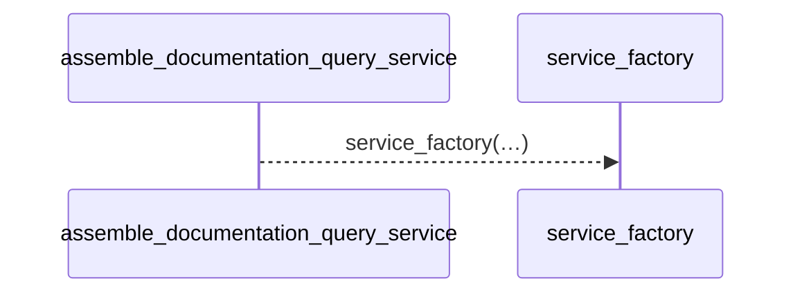
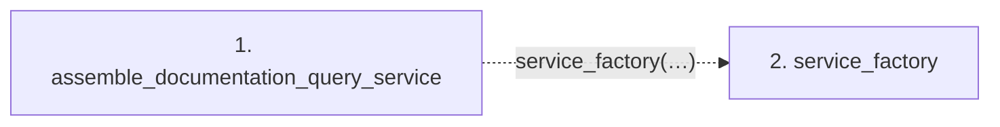

# assemble_documentation_query_service

**Entry point:** `assemble_documentation_query_service` (`api`)
**Source:** [documentation_query_builder](../modules/documentation_query_builder.md)
**Modules touched:** [documentation_query_builder](../modules/documentation_query_builder.md)

## Call sequence

> Static overview in presentation order, not runtime execution order. Arrows retain captured callers; representative internal continuations and boundary examples precede repeated helper detail.

<!-- Auto-generated from static call edges. Dashed arrows are external or unresolved calls. Reviewed runtime conditions and side effects belong in Behavior. -->

> Call sequence diagram shows 1 of 1 interactions; 0 omitted to keep the visualization within the 30-interaction and generated-diagram limits, with uncertain identities omitted rather than inferred.

> Captured boundary calls: external 0 of 0 (0 omitted); unresolved 1 of 1 (0 omitted). These counts cover the captured static trace.
> Detailed flow queries retain their own coverage and limits; omitted paths may execute at runtime.

## Data flow

<!-- Auto-generated static analysis. Treat values and boundaries as best-effort hints, not runtime proof. -->

### Analysis coverage

**Effect analysis partially available.** Flow assembly and source effect analysis are separate; empty observations do not prove an empty handler body.

Source steps: 1; effect analysis evaluated: 0, partial: 1, unavailable: 0. Counts include steps omitted from the displayed trace.

Collector observations for 1 source steps with known totals: observed: 14, emitted: 10, omitted: 4. Unavailable totals are excluded.

- Effect collector omitted observations before flow assembly; displayed effects are partial.

| Step | Callable record | Effect analysis | Collector totals | Observed | Emitted | Omitted |
|---|---|---|---|---:|---:|---:|
| `assemble_documentation_query_service` | `available` | `partial` | `available` | `14` | `10` | `4` |
| `service_factory` | `not_applicable` | `not_applicable` | `not_applicable` | — | — | — |

### Step data

| Step | Inputs | Reads | Writes | Returns |
|---|---|---|---|---|
| `assemble_documentation_query_service` | `inventory: Mapping[str, Mapping[str, Any]]`, `call_edges: Iterable[Mapping[str, Any]]`, `flows: Iterable[Mapping[str, Any]]`, `data_flows: object`, `dependency_analysis: Mapping[str, Any] \| None`, `surface_index: Mapping[str, Any] \| None`, `limit: int`, `knowledge_view: object` | - | `captured_options[...]` | `service_factory(...)` |
| `service_factory` | - | - | - | - |

### Call data

| From | To | Line | Call |
|---|---|---:|---|
| assemble_documentation_query_service | service_factory | 384 | `service_factory(inventory, call_edges=call_edges, flows=flows, data_flows=data_flows, dependency_analysis=dependency_analysis, surface_index=surface_index, limit=limit, knowledge_view=knowledge_view, machine_verification=machine_verification, **=captured_options)` |

### Boundary effects

*No boundary-effect observations were captured in this static trace.*

### Static analysis gaps

| Kind | Step | Target | Line |
|---|---|---|---:|
| unresolved_call | `assemble_documentation_query_service` | `service_factory` | 384 |

## Behavior

This flow starts at `assemble_documentation_query_service` and is classified as `api`. The generated call and data-flow sections are bounded static projections; runtime conditions and side effects require source-level confirmation.
