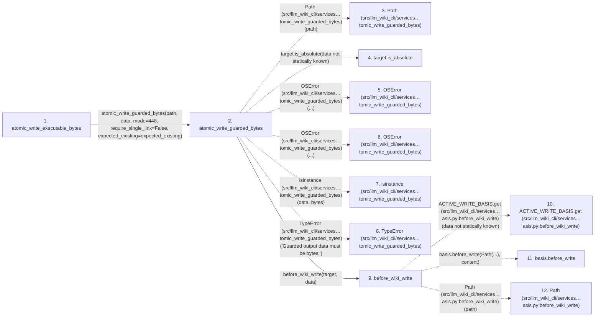

# atomic_write_executable_bytes

**Entry point:** `atomic_write_executable_bytes` (`api`)
**Source:** [filesystem_guard](../modules/filesystem_guard.md)
**Modules touched:** [filesystem_guard](../modules/filesystem_guard.md), [wiki_write_basis](../modules/wiki_write_basis.md)

## Call sequence

> Static overview in presentation order, not runtime execution order. Arrows retain captured callers; siblings are shown before deeper helper detail.

```mermaid
sequenceDiagram
    participant p0 as atomic_write_executable_bytes
    participant p1 as atomic_write_guarded_bytes
    participant p2 as Path (src/llm_wiki_cli/services…tomic_write_guarded_bytes)
    participant p3 as target.is_absolute
    participant p4 as OSError (src/llm_wiki_cli/services…tomic_write_guarded_bytes)
    participant p5 as isinstance (src/llm_wiki_cli/services…tomic_write_guarded_bytes)
    participant p6 as TypeError (src/llm_wiki_cli/services…tomic_write_guarded_bytes)
    participant p7 as before_wiki_write
    participant p8 as _atomic_write_guarded_bytes_windows
    participant p9 as _atomic_write_private_bytes_posix
    participant p10 as after_wiki_write
    participant p11 as ACTIVE_WRITE_BASIS.get (src/llm_wiki_cli/services…asis.py:before_wiki_write)
    participant p12 as uuid.uuid4 (src/llm_wiki_cli/services…ite_guarded_bytes_windows)
    participant p13 as getattr (src/llm_wiki_cli/services…write_private_bytes_posix)
    participant p14 as ACTIVE_WRITE_BASIS.get (src/llm_wiki_cli/services…basis.py:after_wiki_write)
    participant p15 as basis.before_write
    participant p16 as basis.after_write
    participant p17 as Path (src/llm_wiki_cli/services…asis.py:before_wiki_write)
    participant p18 as guard_windows_directory_chain
    participant p19 as OSError (src/llm_wiki_cli/services…write_private_bytes_posix)
    participant p20 as Path (src/llm_wiki_cli/services…basis.py:after_wiki_write)
    participant p21 as Path (src/llm_wiki_cli/services…ite_guarded_bytes_windows)
    participant p22 as os.path.lexists (src/llm_wiki_cli/services…ite_guarded_bytes_windows)
    participant p23 as os.open (src/llm_wiki_cli/services…write_private_bytes_posix)
    participant p24 as target.lstat
    participant p25 as uuid.uuid4 (src/llm_wiki_cli/services…write_private_bytes_posix)
    participant p26 as getattr (src/llm_wiki_cli/services…ite_guarded_bytes_windows)
    p0->>p1: atomic_write_guarded_bytes
    p1-->>p2: Path (src/llm_wiki_cli/services…tomic_write_guarded_bytes)(path)
    p1-->>p3: target.is_absolute
    p1-->>p4: OSError (src/llm_wiki_cli/services…tomic_write_guarded_bytes)(...)
    p1-->>p4: OSError (src/llm_wiki_cli/services…tomic_write_guarded_bytes)(...)
    p1-->>p5: isinstance (src/llm_wiki_cli/services…tomic_write_guarded_bytes)(data, bytes)
    p1-->>p6: TypeError (src/llm_wiki_cli/services…tomic_write_guarded_bytes)('Guarded output data must be bytes.')
    p1->>p7: before_wiki_write
    p1->>p8: _atomic_write_guarded_bytes_windows
    p1->>p9: _atomic_write_private_bytes_posix
    p1->>p10: after_wiki_write
    p7-->>p11: ACTIVE_WRITE_BASIS.get (src/llm_wiki_cli/services…asis.py:before_wiki_write)
    p8-->>p12: uuid.uuid4 (src/llm_wiki_cli/services…ite_guarded_bytes_windows)
    p9-->>p13: getattr (src/llm_wiki_cli/services…write_private_bytes_posix)(os, 'O_NOFOLLOW', None)
    p10-->>p14: ACTIVE_WRITE_BASIS.get (src/llm_wiki_cli/services…basis.py:after_wiki_write)
    p7-->>p15: basis.before_write(Path(...), content)
    p8-->>p12: uuid.uuid4 (src/llm_wiki_cli/services…ite_guarded_bytes_windows)
    p9-->>p13: getattr (src/llm_wiki_cli/services…write_private_bytes_posix)(os, 'O_DIRECTORY', None)
    p10-->>p16: basis.after_write(Path(...), content)
    p7-->>p17: Path (src/llm_wiki_cli/services…asis.py:before_wiki_write)(path)
    p8->>p18: guard_windows_directory_chain
    p9-->>p19: OSError (src/llm_wiki_cli/services…write_private_bytes_posix)('This POSIX platform cannot provide no-follow directory writes.')
    p10-->>p20: Path (src/llm_wiki_cli/services…basis.py:after_wiki_write)(path)
    p8-->>p21: Path (src/llm_wiki_cli/services…ite_guarded_bytes_windows)(parent.anchor)
    p9-->>p13: getattr (src/llm_wiki_cli/services…write_private_bytes_posix)(os, 'O_CLOEXEC', 0)
    p8-->>p22: os.path.lexists (src/llm_wiki_cli/services…ite_guarded_bytes_windows)(target)
    p9-->>p23: os.open (src/llm_wiki_cli/services…write_private_bytes_posix)(target.anchor, directory_flags)
    p8-->>p24: target.lstat
    p9-->>p25: uuid.uuid4 (src/llm_wiki_cli/services…write_private_bytes_posix)
    p8-->>p26: getattr (src/llm_wiki_cli/services…ite_guarded_bytes_windows)(existing, 'st_file_attributes', 0)
```

<!-- Auto-generated from static call edges. Dashed arrows are external or unresolved calls. Reviewed runtime conditions and side effects belong in Behavior. -->

> Call sequence diagram shows 30 of 353 interactions; 323 omitted to keep the visualization within the 30-interaction and generated-diagram limits, with uncertain identities omitted rather than inferred.

> Captured boundary calls: external 18 of 219 (201 omitted); unresolved 6 of 43 (37 omitted). These counts cover the captured static trace.

Omitted captured detail, grouped by actual caller occurrence and target module:

| Caller | Parent step | Target module | Kind | Omitted interactions |
| --- | --- | --- | --- | --- |
| `src/llm_wiki_cli/services/filesystem_guard.py:guard_windows_directory_chain` | 16 | [src/llm_wiki_cli/services/filesystem_guard.py](../modules/filesystem_guard.md) | internal | 9 |
| `src/llm_wiki_cli/services/filesystem_guard.py:guard_windows_directory_chain` | 16 | - | external | 9 |
| `src/llm_wiki_cli/services/filesystem_guard.py:guard_windows_directory_chain` | 16 | - | unresolved | 4 |
| `src/llm_wiki_cli/services/filesystem_guard.py:_open_windows_directory_guard` | 24 | - | external | 14 |
| `src/llm_wiki_cli/services/filesystem_guard.py:_open_windows_directory_guard` | 24 | - | unresolved | 3 |
| `src/llm_wiki_cli/services/filesystem_guard.py:_open_windows_directory_guard` | 24 | [src/llm_wiki_cli/services/filesystem_guard.py](../modules/filesystem_guard.md) | internal | 9 |
| `src/llm_wiki_cli/services/filesystem_guard.py:_windows_api_path` | 27 | - | external | 2 |
| `src/llm_wiki_cli/services/filesystem_guard.py:_windows_api_path` | 27 | - | unresolved | 2 |
> Omission summary shows 8 of 43 groups; 35 further groups are not expanded here. Counts above include all omitted interactions.
> Detailed flow queries retain their own coverage and limits; omitted paths may execute at runtime.

> Trace truncated at the depth limit; deeper calls are omitted.

## Data flow

<!-- Auto-generated static analysis. Treat values and boundaries as best-effort hints, not runtime proof. -->

### Step data

| Step | Inputs | Reads | Writes | Returns |
|---|---|---|---|---|
| `atomic_write_executable_bytes` | `path: Path`, `data: bytes`, `expected_existing: bytes \| None \| object` | - | - | `atomic_write_guarded_bytes(...)` |
| `atomic_write_guarded_bytes` | `path: Path`, `data: bytes`, `mode: int`, `require_single_link: bool`, `expected_existing: bytes \| None \| object` | `os` | - | `target` |
| `Path (src/llm_wiki_cli/services…tomic_write_guarded_bytes)` | - | - | - | - |
| `target.is_absolute` | - | - | - | - |
| `OSError (src/llm_wiki_cli/services…tomic_write_guarded_bytes)` | - | - | - | - |
| `OSError (src/llm_wiki_cli/services…tomic_write_guarded_bytes)` | - | - | - | - |
| `isinstance (src/llm_wiki_cli/services…tomic_write_guarded_bytes)` | - | - | - | - |
| `TypeError (src/llm_wiki_cli/services…tomic_write_guarded_bytes)` | - | - | - | - |
| `before_wiki_write` | `path: str \| Path`, `content: bytes \| None` | - | - | - |
| `ACTIVE_WRITE_BASIS.get (src/llm_wiki_cli/services…asis.py:before_wiki_write)` | - | - | - | - |
| `basis.before_write` | - | - | - | - |
| `Path (src/llm_wiki_cli/services…asis.py:before_wiki_write)` | - | - | - | - |

### Call data

| From | To | Line | Call |
|---|---|---:|---|
| atomic_write_executable_bytes | atomic_write_guarded_bytes | 1596 | `atomic_write_guarded_bytes(path, data, mode=448, require_single_link=False, expected_existing=expected_existing)` |
| atomic_write_guarded_bytes | Path (src/llm_wiki_cli/services…tomic_write_guarded_bytes) | 1615 | `Path(path)` |
| atomic_write_guarded_bytes | target.is_absolute | 1616 | `target.is_absolute(data not statically known)` |
| atomic_write_guarded_bytes | OSError (src/llm_wiki_cli/services…tomic_write_guarded_bytes) | 1617 | `OSError(...)` |
| atomic_write_guarded_bytes | OSError (src/llm_wiki_cli/services…tomic_write_guarded_bytes) | 1619 | `OSError(...)` |
| atomic_write_guarded_bytes | isinstance (src/llm_wiki_cli/services…tomic_write_guarded_bytes) | 1620 | `isinstance(data, bytes)` |
| atomic_write_guarded_bytes | TypeError (src/llm_wiki_cli/services…tomic_write_guarded_bytes) | 1621 | `TypeError('Guarded output data must be bytes.')` |
| atomic_write_guarded_bytes | before_wiki_write | 1624 | `before_wiki_write(target, data)` |
| before_wiki_write | ACTIVE_WRITE_BASIS.get (src/llm_wiki_cli/services…asis.py:before_wiki_write) | 26 | `ACTIVE_WRITE_BASIS.get(data not statically known)` |
| before_wiki_write | basis.before_write | 28 | `basis.before_write(Path(...), content)` |
| before_wiki_write | Path (src/llm_wiki_cli/services…asis.py:before_wiki_write) | 28 | `Path(path)` |

### Boundary effects

*No boundary effects detected.*

### Static analysis gaps

| Kind | Step | Target | Line |
|---|---|---|---:|
| unresolved_call | `atomic_write_guarded_bytes` | `target.is_absolute` | 1616 |
| external_call | `atomic_write_guarded_bytes` | `OSError` | 1617 |
| external_call | `atomic_write_guarded_bytes` | `OSError` | 1619 |
| external_call | `atomic_write_guarded_bytes` | `isinstance` | 1620 |
| external_call | `atomic_write_guarded_bytes` | `TypeError` | 1621 |
| unresolved_call | `before_wiki_write` | `ACTIVE_WRITE_BASIS.get` | 26 |
| unresolved_call | `before_wiki_write` | `basis.before_write` | 28 |
| step_limit | `atomic_write_executable_bytes` | `first 12 steps` | 0 |
| truncated_flow | `atomic_write_executable_bytes` | `depth limit` | 0 |

## Behavior

This flow starts at `atomic_write_executable_bytes` and is classified as `api`. The generated call and data-flow sections are bounded static projections; runtime conditions and side effects require source-level confirmation.
