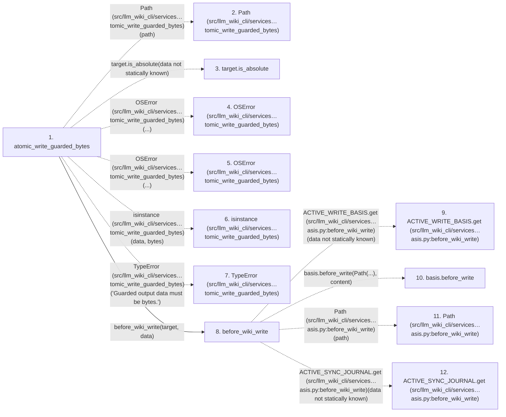

# atomic_write_guarded_bytes

**Entry point:** `atomic_write_guarded_bytes` (`api`)
**Source:** [filesystem_guard](../modules/filesystem_guard.md)
**Modules touched:** [filesystem_guard](../modules/filesystem_guard.md), [wiki_write_basis](../modules/wiki_write_basis.md)

## Call sequence

> Static overview in presentation order, not runtime execution order. Arrows retain captured callers; representative internal continuations and boundary examples precede repeated helper detail.

```mermaid
sequenceDiagram
    participant p0 as atomic_write_guarded_bytes
    participant p1 as _atomic_write_guarded_bytes_windows
    participant p2 as _atomic_write_private_bytes_posix
    participant p3 as before_wiki_write
    participant p4 as after_wiki_write
    participant p5 as guard_windows_directory_chain
    participant p6 as windows_object_identity
    participant p7 as _commit_windows_absent_snapshot
    participant p8 as open_windows_readonly_file
    participant p9 as _restore_posix_quarantined_entry
    participant p10 as windows_object_identity_from_values
    participant p11 as _open_windows_readonly_file_handle
    participant p12 as _open_windows_directory_guard
    participant p13 as create_private_windows_directory
    participant p14 as _private_windows_security_attributes
    participant p15 as move_windows_path_write_through
    participant p16 as _verify_windows_handle_restrictive_dacl
    participant p17 as _current_windows_user_sid
    participant p18 as WindowsFileGuardError
    participant p19 as _read_posix_descriptor
    participant p20 as WindowsDirectoryGuardError
    participant p21 as _restore_posix_entry_between
    participant p22 as _close_windows_handle
    participant p23 as WindowsIdentityUnavailableError
    participant p24 as WindowsObjectIdentity
    participant p25 as _windows_api_path
    participant p26 as _WindowsDirectoryGuardUnavailableError
    participant p27 as WindowsDurabilityError
    participant p28 as WindowsSecurityGuardError
    participant p29 as Path (src/llm_wiki_cli/services…tomic_write_guarded_bytes)
    participant p30 as target.is_absolute
    p0->>p1: _atomic_write_guarded_bytes_windows
    p0->>p2: _atomic_write_private_bytes_posix
    p0->>p3: before_wiki_write
    p0->>p4: after_wiki_write
    p1->>p5: guard_windows_directory_chain
    p1->>p6: windows_object_identity
    p1->>p7: _commit_windows_absent_snapshot
    p1->>p8: open_windows_readonly_file
    p2->>p9: _restore_posix_quarantined_entry
    p6->>p10: windows_object_identity_from_values
    p8->>p11: _open_windows_readonly_file_handle
    p5->>p12: _open_windows_directory_guard
    p5->>p13: create_private_windows_directory
    p13->>p14: _private_windows_security_attributes
    p13->>p15: move_windows_path_write_through
    p12->>p16: _verify_windows_handle_restrictive_dacl
    p16->>p17: _current_windows_user_sid
    p1->>p18: WindowsFileGuardError
    p2->>p19: _read_posix_descriptor
    p5->>p20: WindowsDirectoryGuardError
    p9->>p21: _restore_posix_entry_between
    p8->>p22: _close_windows_handle
    p10->>p23: WindowsIdentityUnavailableError
    p10->>p24: WindowsObjectIdentity
    p12->>p25: _windows_api_path
    p12->>p26: _WindowsDirectoryGuardUnavailableError
    p15->>p27: WindowsDurabilityError
    p14->>p28: WindowsSecurityGuardError
    p0-->>p29: Path (src/llm_wiki_cli/services…tomic_write_guarded_bytes)(path)
    p0-->>p30: target.is_absolute
```

<!-- Auto-generated from static call edges. Dashed arrows are external or unresolved calls. Reviewed runtime conditions and side effects belong in Behavior. -->

> Call sequence diagram shows 30 of 392 interactions; 362 omitted to keep the visualization within the 30-interaction and generated-diagram limits, with uncertain identities omitted rather than inferred.

> Captured boundary calls: external 1 of 242 (241 omitted); unresolved 1 of 55 (54 omitted). These counts cover the captured static trace.

Omitted captured detail, grouped by actual caller occurrence and target module:

| Caller | Parent step | Target module | Kind | Omitted interactions |
| --- | --- | --- | --- | --- |
| `src/llm_wiki_cli/services/filesystem_guard.py:atomic_write_guarded_bytes` | 1 | - | external | 4 |
| `src/llm_wiki_cli/services/wiki_write_basis.py:before_wiki_write` | 8 | - | unresolved | 6 |
| `src/llm_wiki_cli/services/wiki_write_basis.py:before_wiki_write` | 8 | - | external | 3 |
| `src/llm_wiki_cli/services/filesystem_guard.py:_atomic_write_guarded_bytes_windows` | 18 | - | external | 19 |
| `src/llm_wiki_cli/services/filesystem_guard.py:guard_windows_directory_chain` | 21 | - | external | 9 |
| `src/llm_wiki_cli/services/filesystem_guard.py:guard_windows_directory_chain` | 21 | [src/llm_wiki_cli/services/filesystem_guard.py](../modules/filesystem_guard.md) | internal | 6 |
| `src/llm_wiki_cli/services/filesystem_guard.py:guard_windows_directory_chain` | 21 | - | unresolved | 4 |
| `src/llm_wiki_cli/services/filesystem_guard.py:_open_windows_directory_guard` | 29 | - | external | 14 |
> Omission summary shows 8 of 48 groups; 40 further groups are not expanded here. Counts above include all omitted interactions.
> Detailed flow queries retain their own coverage and limits; omitted paths may execute at runtime.

> Trace truncated at the depth limit; deeper calls are omitted.

## Data flow

<!-- Auto-generated static analysis. Treat values and boundaries as best-effort hints, not runtime proof. -->

### Step data

| Step | Inputs | Reads | Writes | Returns |
|---|---|---|---|---|
| `atomic_write_guarded_bytes` | `path: Path`, `data: bytes`, `mode: int`, `require_single_link: bool`, `expected_existing: bytes \| None \| object` | `os` | - | `target` |
| `Path (src/llm_wiki_cli/services…tomic_write_guarded_bytes)` | - | - | - | - |
| `target.is_absolute` | - | - | - | - |
| `OSError (src/llm_wiki_cli/services…tomic_write_guarded_bytes)` | - | - | - | - |
| `OSError (src/llm_wiki_cli/services…tomic_write_guarded_bytes)` | - | - | - | - |
| `isinstance (src/llm_wiki_cli/services…tomic_write_guarded_bytes)` | - | - | - | - |
| `TypeError (src/llm_wiki_cli/services…tomic_write_guarded_bytes)` | - | - | - | - |
| `before_wiki_write` | `path: str \| Path`, `content: bytes \| None` | - | - | - |
| `ACTIVE_WRITE_BASIS.get (src/llm_wiki_cli/services…asis.py:before_wiki_write)` | - | - | - | - |
| `basis.before_write` | - | - | - | - |
| `Path (src/llm_wiki_cli/services…asis.py:before_wiki_write)` | - | - | - | - |
| `ACTIVE_SYNC_JOURNAL.get (src/llm_wiki_cli/services…asis.py:before_wiki_write)` | - | - | - | - |

### Call data

| From | To | Line | Call |
|---|---|---:|---|
| atomic_write_guarded_bytes | Path (src/llm_wiki_cli/services…tomic_write_guarded_bytes) | 1615 | `Path(path)` |
| atomic_write_guarded_bytes | target.is_absolute | 1616 | `target.is_absolute(data not statically known)` |
| atomic_write_guarded_bytes | OSError (src/llm_wiki_cli/services…tomic_write_guarded_bytes) | 1617 | `OSError(...)` |
| atomic_write_guarded_bytes | OSError (src/llm_wiki_cli/services…tomic_write_guarded_bytes) | 1619 | `OSError(...)` |
| atomic_write_guarded_bytes | isinstance (src/llm_wiki_cli/services…tomic_write_guarded_bytes) | 1620 | `isinstance(data, bytes)` |
| atomic_write_guarded_bytes | TypeError (src/llm_wiki_cli/services…tomic_write_guarded_bytes) | 1621 | `TypeError('Guarded output data must be bytes.')` |
| atomic_write_guarded_bytes | before_wiki_write | 1624 | `before_wiki_write(target, data)` |
| before_wiki_write | ACTIVE_WRITE_BASIS.get (src/llm_wiki_cli/services…asis.py:before_wiki_write) | 33 | `ACTIVE_WRITE_BASIS.get(data not statically known)` |
| before_wiki_write | basis.before_write | 35 | `basis.before_write(Path(...), content)` |
| before_wiki_write | Path (src/llm_wiki_cli/services…asis.py:before_wiki_write) | 35 | `Path(path)` |
| before_wiki_write | ACTIVE_SYNC_JOURNAL.get (src/llm_wiki_cli/services…asis.py:before_wiki_write) | 36 | `ACTIVE_SYNC_JOURNAL.get(data not statically known)` |

### Boundary effects

*No boundary effects detected.*

### Static analysis gaps

| Kind | Step | Target | Line |
|---|---|---|---:|
| unresolved_call | `atomic_write_guarded_bytes` | `target.is_absolute` | 1616 |
| external_call | `atomic_write_guarded_bytes` | `OSError` | 1617 |
| external_call | `atomic_write_guarded_bytes` | `OSError` | 1619 |
| external_call | `atomic_write_guarded_bytes` | `isinstance` | 1620 |
| external_call | `atomic_write_guarded_bytes` | `TypeError` | 1621 |
| unresolved_call | `before_wiki_write` | `ACTIVE_WRITE_BASIS.get` | 33 |
| unresolved_call | `before_wiki_write` | `basis.before_write` | 35 |
| unresolved_call | `before_wiki_write` | `ACTIVE_SYNC_JOURNAL.get` | 36 |
| step_limit | `atomic_write_guarded_bytes` | `first 12 steps` | 0 |
| truncated_flow | `atomic_write_guarded_bytes` | `depth limit` | 0 |

## Behavior

This flow starts at `atomic_write_guarded_bytes` and is classified as `api`. The generated call and data-flow sections are bounded static projections; runtime conditions and side effects require source-level confirmation.
