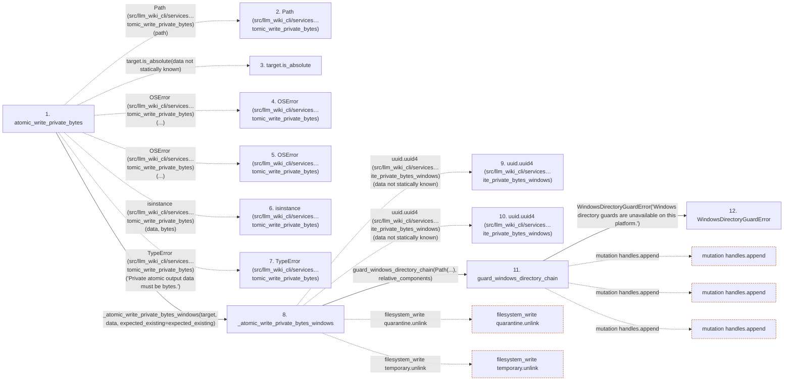

# atomic_write_private_bytes

**Entry point:** `atomic_write_private_bytes` (`api`)
**Source:** [filesystem_guard](../modules/filesystem_guard.md)
**Modules touched:** [filesystem_guard](../modules/filesystem_guard.md)

## Call sequence

> Static overview in presentation order, not runtime execution order. Arrows retain captured callers; representative internal continuations and boundary examples precede repeated helper detail.

```mermaid
sequenceDiagram
    participant p0 as atomic_write_private_bytes
    participant p1 as _atomic_write_private_bytes_windows
    participant p2 as _atomic_write_private_bytes_posix
    participant p3 as guard_windows_directory_chain
    participant p4 as open_windows_private_write_file
    participant p5 as windows_object_identity
    participant p6 as replace_windows_file_write_through
    participant p7 as _commit_windows_absent_snapshot
    participant p8 as open_windows_readonly_file
    participant p9 as verify_windows_restrictive_dacl
    participant p10 as _restore_posix_quarantined_entry
    participant p11 as windows_object_identity_from_values
    participant p12 as _open_windows_readonly_file_handle
    participant p13 as _open_windows_directory_guard
    participant p14 as _open_windows_file_metadata_guard
    participant p15 as _assert_windows_regular_file_handle
    participant p16 as create_private_windows_directory
    participant p17 as _windows_handle_information
    participant p18 as _private_windows_security_attributes
    participant p19 as move_windows_path_write_through
    participant p20 as _verify_windows_handle_restrictive_dacl
    participant p21 as _current_windows_user_sid
    participant p22 as WindowsFileGuardError
    participant p23 as _read_posix_descriptor
    participant p24 as WindowsDirectoryGuardError
    participant p25 as WindowsSecurityGuardError
    participant p26 as _restore_posix_entry_between
    participant p27 as _windows_api_path
    participant p28 as _close_windows_handle
    participant p29 as Path (src/llm_wiki_cli/services…tomic_write_private_bytes)
    participant p30 as target.is_absolute
    p0->>p1: _atomic_write_private_bytes_windows
    p0->>p2: _atomic_write_private_bytes_posix
    p1->>p3: guard_windows_directory_chain
    p1->>p4: open_windows_private_write_file
    p1->>p5: windows_object_identity
    p1->>p6: replace_windows_file_write_through
    p1->>p7: _commit_windows_absent_snapshot
    p1->>p8: open_windows_readonly_file
    p1->>p9: verify_windows_restrictive_dacl
    p2->>p10: _restore_posix_quarantined_entry
    p5->>p11: windows_object_identity_from_values
    p8->>p12: _open_windows_readonly_file_handle
    p3->>p13: _open_windows_directory_guard
    p9->>p14: _open_windows_file_metadata_guard
    p4->>p15: _assert_windows_regular_file_handle
    p3->>p16: create_private_windows_directory
    p15->>p17: _windows_handle_information
    p16->>p18: _private_windows_security_attributes
    p16->>p19: move_windows_path_write_through
    p13->>p20: _verify_windows_handle_restrictive_dacl
    p20->>p21: _current_windows_user_sid
    p1->>p22: WindowsFileGuardError
    p2->>p23: _read_posix_descriptor
    p3->>p24: WindowsDirectoryGuardError
    p9->>p25: WindowsSecurityGuardError
    p10->>p26: _restore_posix_entry_between
    p4->>p27: _windows_api_path
    p9->>p28: _close_windows_handle
    p0-->>p29: Path (src/llm_wiki_cli/services…tomic_write_private_bytes)(path)
    p0-->>p30: target.is_absolute
```

<!-- Auto-generated from static call edges. Dashed arrows are external or unresolved calls. Reviewed runtime conditions and side effects belong in Behavior. -->

> Call sequence diagram shows 30 of 432 interactions; 402 omitted to keep the visualization within the 30-interaction and generated-diagram limits, with uncertain identities omitted rather than inferred.

> Captured boundary calls: external 1 of 264 (263 omitted); unresolved 1 of 49 (48 omitted). These counts cover the captured static trace.

Omitted captured detail, grouped by actual caller occurrence and target module:

| Caller | Parent step | Target module | Kind | Omitted interactions |
| --- | --- | --- | --- | --- |
| `src/llm_wiki_cli/services/filesystem_guard.py:atomic_write_private_bytes` | 1 | - | external | 4 |
| `src/llm_wiki_cli/services/filesystem_guard.py:_atomic_write_private_bytes_windows` | 8 | - | external | 16 |
| `src/llm_wiki_cli/services/filesystem_guard.py:guard_windows_directory_chain` | 11 | - | external | 9 |
| `src/llm_wiki_cli/services/filesystem_guard.py:guard_windows_directory_chain` | 11 | [src/llm_wiki_cli/services/filesystem_guard.py](../modules/filesystem_guard.md) | internal | 6 |
| `src/llm_wiki_cli/services/filesystem_guard.py:guard_windows_directory_chain` | 11 | - | unresolved | 4 |
| `src/llm_wiki_cli/services/filesystem_guard.py:_open_windows_directory_guard` | 19 | - | external | 14 |
| `src/llm_wiki_cli/services/filesystem_guard.py:_open_windows_directory_guard` | 19 | - | unresolved | 3 |
| `src/llm_wiki_cli/services/filesystem_guard.py:_open_windows_directory_guard` | 19 | [src/llm_wiki_cli/services/filesystem_guard.py](../modules/filesystem_guard.md) | internal | 8 |
> Omission summary shows 8 of 60 groups; 52 further groups are not expanded here. Counts above include all omitted interactions.
> Detailed flow queries retain their own coverage and limits; omitted paths may execute at runtime.

> Trace truncated at the depth limit; deeper calls are omitted.

## Data flow

<!-- Auto-generated static analysis. Treat values and boundaries as best-effort hints, not runtime proof. -->

### Step data

| Step | Inputs | Reads | Writes | Returns |
|---|---|---|---|---|
| `atomic_write_private_bytes` | `path: Path`, `data: bytes`, `expected_existing: bytes \| None \| object` | `os` | - | `target` |
| `Path (src/llm_wiki_cli/services…tomic_write_private_bytes)` | - | - | - | - |
| `target.is_absolute` | - | - | - | - |
| `OSError (src/llm_wiki_cli/services…tomic_write_private_bytes)` | - | - | - | - |
| `OSError (src/llm_wiki_cli/services…tomic_write_private_bytes)` | - | - | - | - |
| `isinstance (src/llm_wiki_cli/services…tomic_write_private_bytes)` | - | - | - | - |
| `TypeError (src/llm_wiki_cli/services…tomic_write_private_bytes)` | - | - | - | - |
| `_atomic_write_private_bytes_windows` | `target: Path`, `data: bytes`, `expected_existing: bytes \| None \| object`, `require_single_link: bool` | `_EXPECTED_EXISTING_UNSET` | - | - |
| `uuid.uuid4 (src/llm_wiki_cli/services…ite_private_bytes_windows)` | - | - | - | - |
| `uuid.uuid4 (src/llm_wiki_cli/services…ite_private_bytes_windows)` | - | - | - | - |
| `guard_windows_directory_chain` | `root: Path`, `relative_components: Sequence[str]`, `create_missing: bool`, `require_restrictive_dacl: bool` | `os`, `WindowsDurabilityError` | - | - |
| `WindowsDirectoryGuardError` | - | - | - | - |

### Call data

| From | To | Line | Call |
|---|---|---:|---|
| atomic_write_private_bytes | Path (src/llm_wiki_cli/services…tomic_write_private_bytes) | 1560 | `Path(path)` |
| atomic_write_private_bytes | target.is_absolute | 1561 | `target.is_absolute(data not statically known)` |
| atomic_write_private_bytes | OSError (src/llm_wiki_cli/services…tomic_write_private_bytes) | 1562 | `OSError(...)` |
| atomic_write_private_bytes | OSError (src/llm_wiki_cli/services…tomic_write_private_bytes) | 1564 | `OSError(...)` |
| atomic_write_private_bytes | isinstance (src/llm_wiki_cli/services…tomic_write_private_bytes) | 1565 | `isinstance(data, bytes)` |
| atomic_write_private_bytes | TypeError (src/llm_wiki_cli/services…tomic_write_private_bytes) | 1566 | `TypeError('Private atomic output data must be bytes.')` |
| atomic_write_private_bytes | _atomic_write_private_bytes_windows | 1568 | `_atomic_write_private_bytes_windows(target, data, expected_existing=expected_existing)` |
| _atomic_write_private_bytes_windows | uuid.uuid4 (src/llm_wiki_cli/services…ite_private_bytes_windows) | 2474 | `uuid.uuid4(data not statically known)` |
| _atomic_write_private_bytes_windows | uuid.uuid4 (src/llm_wiki_cli/services…ite_private_bytes_windows) | 2475 | `uuid.uuid4(data not statically known)` |
| _atomic_write_private_bytes_windows | guard_windows_directory_chain | 2479 | `guard_windows_directory_chain(Path(...), relative_components)` |
| guard_windows_directory_chain | WindowsDirectoryGuardError | 170 | `WindowsDirectoryGuardError('Windows directory guards are unavailable on this platform.')` |

### Boundary effects

| Kind | Target | Step | Line |
|---|---|---|---:|
| filesystem_write | `quarantine.unlink` | `_atomic_write_private_bytes_windows` | 2553 |
| filesystem_write | `temporary.unlink` | `_atomic_write_private_bytes_windows` | 2558 |
| mutation | `handles.append` | `guard_windows_directory_chain` | 182 |
| mutation | `handles.append` | `guard_windows_directory_chain` | 189 |
| mutation | `handles.append` | `guard_windows_directory_chain` | 216 |

### Static analysis gaps

| Kind | Step | Target | Line |
|---|---|---|---:|
| unresolved_call | `atomic_write_private_bytes` | `target.is_absolute` | 1561 |
| external_call | `atomic_write_private_bytes` | `OSError` | 1562 |
| external_call | `atomic_write_private_bytes` | `OSError` | 1564 |
| external_call | `atomic_write_private_bytes` | `isinstance` | 1565 |
| external_call | `atomic_write_private_bytes` | `TypeError` | 1566 |
| external_call | `_atomic_write_private_bytes_windows` | `uuid.uuid4` | 2474 |
| external_call | `_atomic_write_private_bytes_windows` | `uuid.uuid4` | 2475 |
| step_limit | `atomic_write_private_bytes` | `first 12 steps` | 0 |
| truncated_flow | `atomic_write_private_bytes` | `depth limit` | 0 |

## Behavior

This flow starts at `atomic_write_private_bytes` and is classified as `api`. The generated call and data-flow sections are bounded static projections; runtime conditions and side effects require source-level confirmation.
