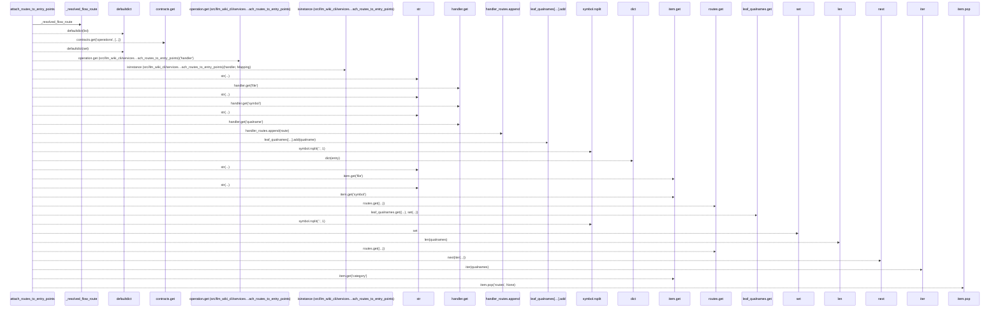
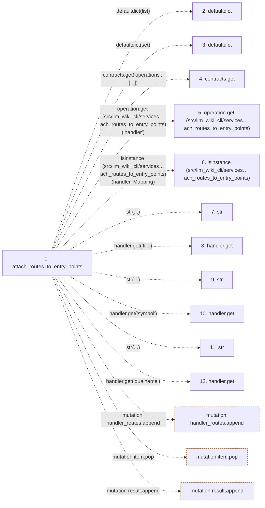

# attach_routes_to_entry_points

**Entry point:** `attach_routes_to_entry_points` (`api`)
**Source:** [api_contracts](../modules/api_contracts.md)
**Modules touched:** [api_contracts](../modules/api_contracts.md)

## Call sequence

> Static overview in presentation order, not runtime execution order. Arrows retain captured callers; representative internal continuations and boundary examples precede repeated helper detail.

<!-- Auto-generated from static call edges. Dashed arrows are external or unresolved calls. Reviewed runtime conditions and side effects belong in Behavior. -->

> Call sequence diagram shows 30 of 46 interactions; 16 omitted to keep the visualization within the 30-interaction and generated-diagram limits, with uncertain identities omitted rather than inferred.

> Captured boundary calls: external 13 of 19 (6 omitted); unresolved 16 of 26 (10 omitted). These counts cover the captured static trace.

Omitted captured detail, grouped by actual caller occurrence and target module:

| Caller | Parent step | Target module | Kind | Omitted interactions |
| --- | --- | --- | --- | --- |
| `src/llm_wiki_cli/services/api_contracts.py:_resolved_flow_route` | 13 | - | unresolved | 9 |
| `src/llm_wiki_cli/services/api_contracts.py:_resolved_flow_route` | 13 | - | external | 5 |
| `src/llm_wiki_cli/services/api_contracts.py:attach_routes_to_entry_points` | 1 | - | external | 1 |
| `src/llm_wiki_cli/services/api_contracts.py:attach_routes_to_entry_points` | 1 | - | unresolved | 1 |
> Detailed flow queries retain their own coverage and limits; omitted paths may execute at runtime.

## Data flow

<!-- Auto-generated static analysis. Treat values and boundaries as best-effort hints, not runtime proof. -->

### Step data

| Step | Inputs | Reads | Writes | Returns |
|---|---|---|---|---|
| `attach_routes_to_entry_points` | `entry_points: Sequence[Mapping[str, Any]]`, `contracts: Mapping[str, Any]` | `Mapping` | `item[...]` | `result` |
| `defaultdict` | - | - | - | - |
| `defaultdict` | - | - | - | - |
| `contracts.get` | - | - | - | - |
| `operation.get (src/llm_wiki_cli/services…ach_routes_to_entry_points)` | - | - | - | - |
| `isinstance (src/llm_wiki_cli/services…ach_routes_to_entry_points)` | - | - | - | - |
| `str` | - | - | - | - |
| `handler.get` | - | - | - | - |
| `str` | - | - | - | - |
| `handler.get` | - | - | - | - |
| `str` | - | - | - | - |
| `handler.get` | - | - | - | - |

### Call data

| From | To | Line | Call |
|---|---|---:|---|
| attach_routes_to_entry_points | defaultdict | 1922 | `defaultdict(list)` |
| attach_routes_to_entry_points | defaultdict | 1923 | `defaultdict(set)` |
| attach_routes_to_entry_points | contracts.get | 1924 | `contracts.get('operations', [...])` |
| attach_routes_to_entry_points | operation.get (src/llm_wiki_cli/services…ach_routes_to_entry_points) | 1925 | `operation.get('handler')` |
| attach_routes_to_entry_points | isinstance (src/llm_wiki_cli/services…ach_routes_to_entry_points) | 1926 | `isinstance(handler, Mapping)` |
| attach_routes_to_entry_points | str | 1928 | `str(...)` |
| attach_routes_to_entry_points | handler.get | 1928 | `handler.get('file')` |
| attach_routes_to_entry_points | str | 1929 | `str(...)` |
| attach_routes_to_entry_points | handler.get | 1929 | `handler.get('symbol')` |
| attach_routes_to_entry_points | str | 1930 | `str(...)` |
| attach_routes_to_entry_points | handler.get | 1930 | `handler.get('qualname')` |

### Boundary effects

| Kind | Target | Step | Line |
|---|---|---|---:|
| mutation | `handler_routes.append` | `attach_routes_to_entry_points` | 1936 |
| mutation | `item.pop` | `attach_routes_to_entry_points` | 1949 |
| mutation | `result.append` | `attach_routes_to_entry_points` | 1954 |

### Static analysis gaps

| Kind | Step | Target | Line |
|---|---|---|---:|
| external_call | `attach_routes_to_entry_points` | `defaultdict` | 1922 |
| external_call | `attach_routes_to_entry_points` | `defaultdict` | 1923 |
| unresolved_call | `attach_routes_to_entry_points` | `contracts.get` | 1924 |
| unresolved_call | `attach_routes_to_entry_points` | `operation.get` | 1925 |
| external_call | `attach_routes_to_entry_points` | `isinstance` | 1926 |
| unresolved_call | `attach_routes_to_entry_points` | `handler.get` | 1928 |
| unresolved_call | `attach_routes_to_entry_points` | `handler.get` | 1929 |
| unresolved_call | `attach_routes_to_entry_points` | `handler.get` | 1930 |
| step_limit | `attach_routes_to_entry_points` | `first 12 steps` | 0 |

## Behavior

This flow starts at `attach_routes_to_entry_points` and is classified as `api`. The generated call and data-flow sections are bounded static projections; runtime conditions and side effects require source-level confirmation.
