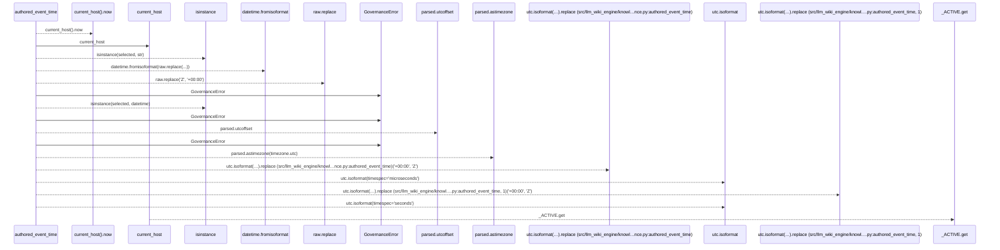
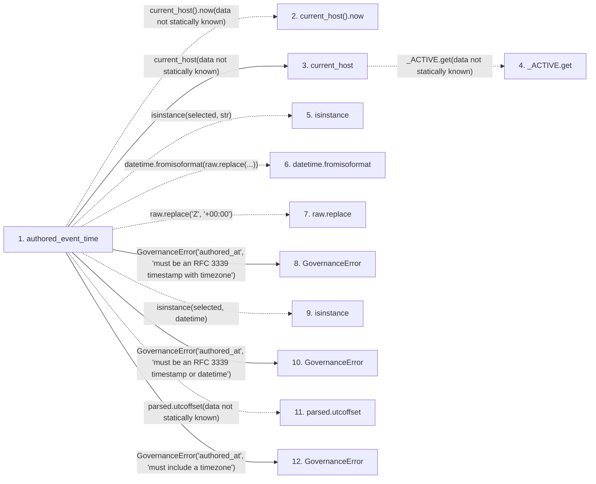

# authored_event_time

**Entry point:** `authored_event_time` (`api`)
**Source:** [knowledge_governance](../modules/knowledge_governance.md)
**Modules touched:** [host](../modules/host.md), [knowledge_governance](../modules/knowledge_governance.md)

## Call sequence

> Static overview in presentation order, not runtime execution order. Arrows retain captured callers; representative internal continuations and boundary examples precede repeated helper detail.

<!-- Auto-generated from static call edges. Dashed arrows are external or unresolved calls. Reviewed runtime conditions and side effects belong in Behavior. -->

> Call sequence diagram shows 16 of 16 interactions; 0 omitted to keep the visualization within the 30-interaction and generated-diagram limits, with uncertain identities omitted rather than inferred.

> Captured boundary calls: external 3 of 3 (0 omitted); unresolved 9 of 9 (0 omitted). These counts cover the captured static trace.
> Detailed flow queries retain their own coverage and limits; omitted paths may execute at runtime.

## Data flow

<!-- Auto-generated static analysis. Treat values and boundaries as best-effort hints, not runtime proof. -->

### Analysis coverage

**Effect analysis partially available.** Flow assembly and source effect analysis are separate; empty observations do not prove an empty handler body.

Source steps: 5; effect analysis evaluated: 2, partial: 0, unavailable: 3. Counts include steps omitted from the displayed trace.

Collector observations for 2 source steps with known totals: observed: 7, emitted: 7, omitted: 0. Unavailable totals are excluded.

- Callable record unavailable for one or more source steps; those steps have no represented callable body.
- Effect collector totals unavailable; observed counts cover captured records only.

| Step | Callable record | Effect analysis | Collector totals | Observed | Emitted | Omitted |
|---|---|---|---|---:|---:|---:|
| `authored_event_time` | `available` | `evaluated` | `available` | `5` | `5` | `0` |
| `current_host().now` | `not_applicable` | `not_applicable` | `not_applicable` | — | — | — |
| `current_host` | `available` | `evaluated` | `available` | `2` | `2` | `0` |
| `_ACTIVE.get` | `not_applicable` | `not_applicable` | `not_applicable` | — | — | — |
| `isinstance` | `not_applicable` | `not_applicable` | `not_applicable` | — | — | — |
| `datetime.fromisoformat` | `not_applicable` | `not_applicable` | `not_applicable` | — | — | — |
| `raw.replace` | `not_applicable` | `not_applicable` | `not_applicable` | — | — | — |
| `GovernanceError` | `unavailable` | `unavailable` | `unavailable` | — | — | — |
| `isinstance` | `not_applicable` | `not_applicable` | `not_applicable` | — | — | — |
| `GovernanceError` | `unavailable` | `unavailable` | `unavailable` | — | — | — |
| `parsed.utcoffset` | `not_applicable` | `not_applicable` | `not_applicable` | — | — | — |
| `GovernanceError` | `unavailable` | `unavailable` | `unavailable` | — | — | — |

### Step data

| Step | Inputs | Reads | Writes | Returns |
|---|---|---|---|---|
| `authored_event_time` | `value: object` | `datetime`, `timezone` | - | `...`, `...` |
| `current_host().now` | - | - | - | - |
| `current_host` | - | `_DEFAULT` | - | `...` |
| `_ACTIVE.get` | - | - | - | - |
| `isinstance` | - | - | - | - |
| `datetime.fromisoformat` | - | - | - | - |
| `raw.replace` | - | - | - | - |
| `GovernanceError` | - | - | - | - |
| `isinstance` | - | - | - | - |
| `GovernanceError` | - | - | - | - |
| `parsed.utcoffset` | - | - | - | - |
| `GovernanceError` | - | - | - | - |

### Call data

| From | To | Line | Call |
|---|---|---:|---|
| authored_event_time | current_host().now | 1443 | `current_host().now(data not statically known)` |
| authored_event_time | current_host | 1443 | `current_host(data not statically known)` |
| current_host | _ACTIVE.get | 166 | `_ACTIVE.get(data not statically known)` |
| authored_event_time | isinstance | 1444 | `isinstance(selected, str)` |
| authored_event_time | datetime.fromisoformat | 1447 | `datetime.fromisoformat(raw.replace(...))` |
| authored_event_time | raw.replace | 1447 | `raw.replace('Z', '+00:00')` |
| authored_event_time | GovernanceError | 1449 | `GovernanceError('authored_at', 'must be an RFC 3339 timestamp with timezone')` |
| authored_event_time | isinstance | 1453 | `isinstance(selected, datetime)` |
| authored_event_time | GovernanceError | 1456 | `GovernanceError('authored_at', 'must be an RFC 3339 timestamp or datetime')` |
| authored_event_time | parsed.utcoffset | 1460 | `parsed.utcoffset(data not statically known)` |
| authored_event_time | GovernanceError | 1461 | `GovernanceError('authored_at', 'must include a timezone')` |

### Boundary effects

*No boundary-effect observations were captured in this static trace.*

### Static analysis gaps

| Kind | Step | Target | Line |
|---|---|---|---:|
| unresolved_call | `authored_event_time` | `current_host().now` | 1443 |
| unresolved_call | `current_host` | `_ACTIVE.get` | 166 |
| external_call | `authored_event_time` | `isinstance` | 1444 |
| external_call | `authored_event_time` | `datetime.fromisoformat` | 1447 |
| unresolved_call | `authored_event_time` | `raw.replace` | 1447 |
| external_call | `authored_event_time` | `isinstance` | 1453 |
| unresolved_call | `authored_event_time` | `parsed.utcoffset` | 1460 |
| step_limit | `authored_event_time` | `first 12 steps` | 0 |

## Behavior

This flow starts at `authored_event_time` and is classified as `api`. The generated call and data-flow sections are bounded static projections; runtime conditions and side effects require source-level confirmation.
