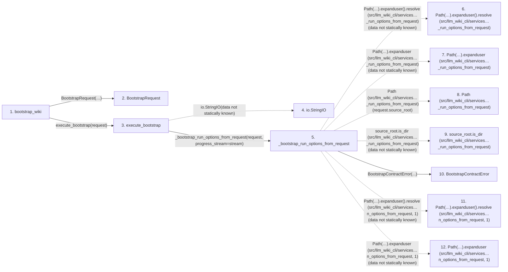

# bootstrap_wiki

**Entry point:** `bootstrap_wiki` (`api`)
**Source:** [api](../modules/api.md)
**Modules touched:** [api](../modules/api.md), [api_contracts](../modules/api_contracts.md), [bootstrap_runtime](../modules/bootstrap_runtime.md), [bootstrap_service](../modules/bootstrap_service.md), and 31 more

**Complete modules touched:**

- [api](../modules/api.md)
- [api_contracts](../modules/api_contracts.md)
- [bootstrap_runtime](../modules/bootstrap_runtime.md)
- [bootstrap_service](../modules/bootstrap_service.md)
- [common](../modules/common.md)
- [config](../modules/config.md)
- [data_flow](../modules/data_flow.md)
- [entrypoints](../modules/entrypoints.md)
- [extraction_service](../modules/extraction_service.md)
- [filesystem_guard](../modules/filesystem_guard.md)
- [imports](../modules/imports.md)
- [infrastructure_inventory](../modules/infrastructure_inventory.md)
- [infrastructure_sync](../modules/infrastructure_sync.md)
- [io](../modules/io.md)
- [knowledge_evidence](../modules/knowledge_evidence.md)
- [knowledge_governance](../modules/knowledge_governance.md)
- [knowledge_orchestration](../modules/knowledge_orchestration.md)
- [knowledge_reuse](../modules/knowledge_reuse.md)
- [knowledge_storage](../modules/knowledge_storage.md)
- [knowledge_storage_io](../modules/knowledge_storage_io.md)
- [maintenance_protocol](../modules/maintenance_protocol.md)
- [maintenance_state](../modules/maintenance_state.md)
- [manifest_storage](../modules/manifest_storage.md)
- [module_maps](../modules/module_maps.md)
- [paths](../modules/paths.md)
- [relationships](../modules/relationships.md)
- [services_dependencies](../modules/services_dependencies.md)
- [source_selection](../modules/source_selection.md)
- [source_snapshot](../modules/source_snapshot.md)
- [sync_manifest](../modules/sync_manifest.md)
- [validation](../modules/validation.md)
- [wiki_lifecycle](../modules/wiki_lifecycle.md)
- [wiki_surface](../modules/wiki_surface.md)
- [wiki_surface_index](../modules/wiki_surface_index.md)
- [wiki_write_basis](../modules/wiki_write_basis.md)

## Call sequence

> Static overview in presentation order, not runtime execution order. Arrows retain captured callers; representative internal continuations and boundary examples precede repeated helper detail.

```mermaid
sequenceDiagram
    participant p0 as bootstrap_wiki
    participant p1 as execute_bootstrap
    participant p2 as BootstrapRequest
    participant p3 as InvalidRequestError
    participant p4 as WorkspaceStateError
    participant p5 as _bootstrap_run_options_from_request
    participant p6 as _execute_bootstrap_options
    participant p7 as guard_maintenance_owner
    participant p8 as _preflight_public_bootstrap
    participant p9 as _preflight_bootstrap_source_selection
    participant p10 as maintenance_write_operation
    participant p11 as _execute_bootstrap_options_locked
    participant p12 as _absolute_path
    participant p13 as _preflight_bootstrap_governance
    participant p14 as _first_use_guidance
    participant p15 as load_adoption_marker
    participant p16 as _is_pristine_bootstrap_target
    participant p17 as resolve_source_selection
    participant p18 as SyncManifest.load
    participant p19 as validate_persisted_source_selection_identity
    participant p20 as _start_bootstrap
    participant p21 as governance_writer_lock
    participant p22 as _extract_bootstrap_inventory
    participant p23 as storage_writer_lock
    participant p24 as _finish_if_empty_bootstrap_inventory
    participant p25 as snapshot_wiki
    participant p26 as _bootstrap_result
    participant p27 as _prepare_bootstrap_page_maps
    participant p28 as _generate_bootstrap_content
    participant p29 as str (src/llm_wiki_cli/api.py:bootstrap_wiki)
    participant p30 as Path(…).expanduser().resolve (src/llm_wiki_cli/services…_run_options_from_request)
    p0->>p1: execute_bootstrap
    p0->>p2: BootstrapRequest
    p0->>p3: InvalidRequestError
    p0->>p4: WorkspaceStateError
    p1->>p5: _bootstrap_run_options_from_request
    p1->>p6: _execute_bootstrap_options
    p6->>p7: guard_maintenance_owner
    p6->>p8: _preflight_public_bootstrap
    p6->>p9: _preflight_bootstrap_source_selection
    p6->>p10: maintenance_write_operation
    p6->>p11: _execute_bootstrap_options_locked
    p7->>p12: _absolute_path
    p11->>p13: _preflight_bootstrap_governance
    p8->>p14: _first_use_guidance
    p7->>p15: load_adoption_marker
    p8->>p16: _is_pristine_bootstrap_target
    p9->>p17: resolve_source_selection
    p7->>p18: SyncManifest.load
    p9->>p19: validate_persisted_source_selection_identity
    p11->>p20: _start_bootstrap
    p10->>p21: governance_writer_lock
    p11->>p22: _extract_bootstrap_inventory
    p10->>p23: storage_writer_lock
    p11->>p24: _finish_if_empty_bootstrap_inventory
    p10->>p25: snapshot_wiki
    p11->>p26: _bootstrap_result
    p11->>p27: _prepare_bootstrap_page_maps
    p11->>p28: _generate_bootstrap_content
    p0-->>p29: str (src/llm_wiki_cli/api.py:bootstrap_wiki)(exc)
    p5-->>p30: Path(…).expanduser().resolve (src/llm_wiki_cli/services…_run_options_from_request)
```

<!-- Auto-generated from static call edges. Dashed arrows are external or unresolved calls. Reviewed runtime conditions and side effects belong in Behavior. -->

> Call sequence diagram shows 30 of 1055 interactions; 1025 omitted to keep the visualization within the 30-interaction and generated-diagram limits, with uncertain identities omitted rather than inferred.

> Captured boundary calls: external 1 of 317 (316 omitted); unresolved 1 of 244 (243 omitted). These counts cover the captured static trace.

Omitted captured detail, grouped by actual caller occurrence and target module:

| Caller | Parent step | Target module | Kind | Omitted interactions |
| --- | --- | --- | --- | --- |
| `src/llm_wiki_cli/services/bootstrap_runtime.py:execute_bootstrap` | 3 | - | external | 1 |
| `src/llm_wiki_cli/services/bootstrap_runtime.py:_bootstrap_run_options_from_request` | 5 | - | unresolved | 4 |
| `src/llm_wiki_cli/services/bootstrap_runtime.py:_bootstrap_run_options_from_request` | 5 | - | external | 5 |
| `src/llm_wiki_cli/services/bootstrap_runtime.py:_bootstrap_run_options_from_request` | 5 | [src/llm_wiki_cli/services/bootstrap_service.py](../modules/bootstrap_service.md) | internal | 3 |
| `src/llm_wiki_cli/services/bootstrap_runtime.py:_bootstrap_run_options_from_request` | 5 | [src/llm_wiki_cli/services/bootstrap_runtime.py](../modules/bootstrap_runtime.md) | internal | 1 |
| `src/llm_wiki_cli/services/knowledge_storage_io.py:_absolute_path` | 22 | - | external | 4 |
| `src/llm_wiki_cli/services/knowledge_storage_io.py:_absolute_path` | 22 | [src/llm_wiki_cli/services/io.py](../modules/io.md) | internal | 1 |
| `src/llm_wiki_cli/services/io.py:first_unsafe_path_component` | 25 | - | external | 20 |
> Omission summary shows 8 of 281 groups; 273 further groups are not expanded here. Counts above include all omitted interactions.
> Detailed flow queries retain their own coverage and limits; omitted paths may execute at runtime.

> Trace truncated at the depth limit; deeper calls are omitted.

## Data flow

<!-- Auto-generated static analysis. Treat values and boundaries as best-effort hints, not runtime proof. -->

### Step data

| Step | Inputs | Reads | Writes | Returns |
|---|---|---|---|---|
| `bootstrap_wiki` | `source_root: str`, `wiki_root: str`, `depth: str`, `skip_workflows: bool`, `skip_flows: bool`, `skip_data_flow: bool`, `skip_dependencies: bool`, `api_contracts: bool` | `BootstrapRequestError`, `BootstrapContractError`, `BootstrapServiceError` | - | `bootstrap_cmd.execute_bootstrap(...)` |
| `BootstrapRequest` | - | - | - | - |
| `execute_bootstrap` | `request: BootstrapRequest`, `progress_stream: TextIO \| None` | - | - | `_execute_bootstrap_options(...)` |
| `io.StringIO` | - | - | - | - |
| `_bootstrap_run_options_from_request` | `request: BootstrapRequest`, `progress_stream: TextIO` | - | - | `_BootstrapRunOptions(...)` |
| `Path(…).expanduser().resolve (src/llm_wiki_cli/services…_run_options_from_request)` | - | - | - | - |
| `Path(…).expanduser (src/llm_wiki_cli/services…_run_options_from_request)` | - | - | - | - |
| `Path (src/llm_wiki_cli/services…_run_options_from_request)` | - | - | - | - |
| `source_root.is_dir (src/llm_wiki_cli/services…_run_options_from_request)` | - | - | - | - |
| `BootstrapContractError` | - | - | - | - |
| `Path(…).expanduser().resolve (src/llm_wiki_cli/services…n_options_from_request, 1)` | - | - | - | - |
| `Path(…).expanduser (src/llm_wiki_cli/services…n_options_from_request, 1)` | - | - | - | - |

### Call data

| From | To | Line | Call |
|---|---|---:|---|
| bootstrap_wiki | BootstrapRequest | 1092 | `BootstrapRequest(source_root=source_root, wiki_root=wiki_root, depth=depth, skip_workflows=skip_workflows, skip_flows=skip_flows, skip_data_flow=skip_data_flow, skip_dependencies=skip_dependencies, api_contracts=api_contracts, openapi_file=openapi_file, dependency_graph_detail=dependency_graph_detail, overwrite=overwrite, source_adapter=True, helper_cache_dir=helper_cache_dir, include_tests=include_tests, trust_source_plugins=trust_source_plugins, source_selection=source_selection)` |
| bootstrap_wiki | execute_bootstrap | 1111 | `bootstrap_cmd.execute_bootstrap(request)` |
| execute_bootstrap | io.StringIO | 6412 | `io.StringIO(data not statically known)` |
| execute_bootstrap | _bootstrap_run_options_from_request | 6413 | `_bootstrap_run_options_from_request(request, progress_stream=stream)` |
| _bootstrap_run_options_from_request | Path(…).expanduser().resolve (src/llm_wiki_cli/services…_run_options_from_request) | 4567 | `Path(request.source_root).expanduser().resolve(data not statically known)` |
| _bootstrap_run_options_from_request | Path(…).expanduser (src/llm_wiki_cli/services…_run_options_from_request) | 4567 | `Path(request.source_root).expanduser(data not statically known)` |
| _bootstrap_run_options_from_request | Path (src/llm_wiki_cli/services…_run_options_from_request) | 4567 | `Path(request.source_root)` |
| _bootstrap_run_options_from_request | source_root.is_dir (src/llm_wiki_cli/services…_run_options_from_request) | 4568 | `source_root.is_dir(data not statically known)` |
| _bootstrap_run_options_from_request | BootstrapContractError | 4569 | `BootstrapContractError(...)` |
| _bootstrap_run_options_from_request | Path(…).expanduser().resolve (src/llm_wiki_cli/services…n_options_from_request, 1) | 4572 | `Path(request.wiki_root).expanduser().resolve(data not statically known)` |
| _bootstrap_run_options_from_request | Path(…).expanduser (src/llm_wiki_cli/services…n_options_from_request, 1) | 4572 | `Path(request.wiki_root).expanduser(data not statically known)` |

### Boundary effects

*No boundary effects detected.*

### Static analysis gaps

| Kind | Step | Target | Line |
|---|---|---|---:|
| external_call | `execute_bootstrap` | `io.StringIO` | 6412 |
| unresolved_call | `_bootstrap_run_options_from_request` | `Path(request.source_root).expanduser().resolve` | 4567 |
| unresolved_call | `_bootstrap_run_options_from_request` | `Path(request.source_root).expanduser` | 4567 |
| unresolved_call | `_bootstrap_run_options_from_request` | `source_root.is_dir` | 4568 |
| unresolved_call | `_bootstrap_run_options_from_request` | `Path(request.wiki_root).expanduser().resolve` | 4572 |
| unresolved_call | `_bootstrap_run_options_from_request` | `Path(request.wiki_root).expanduser` | 4572 |
| step_limit | `bootstrap_wiki` | `first 12 steps` | 0 |
| truncated_flow | `bootstrap_wiki` | `depth limit` | 0 |

## Behavior

Creates a frozen `BootstrapRequest` and executes the same deterministic
first-use generator as the CLI. The library boundary always enables source-
adapter behavior, so it writes within the wiki target without installing agent
instructions in the source project. Request errors become
`InvalidRequestError`; target or service-state failures become
`WorkspaceStateError`; success returns a typed `BootstrapResult`.
