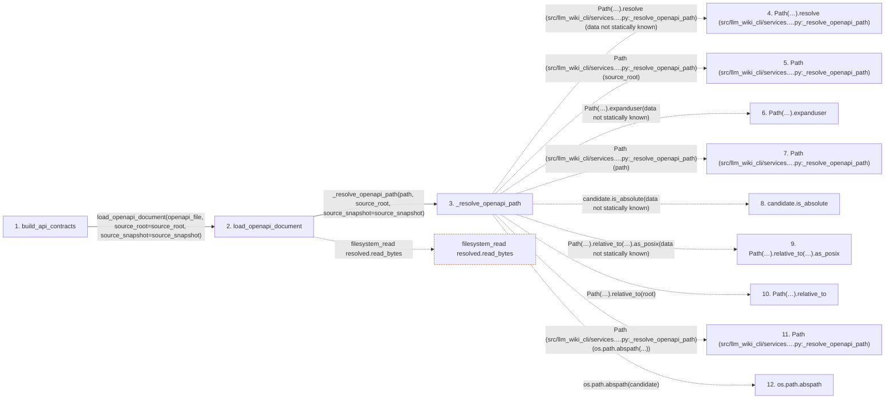

# build_api_contracts

**Entry point:** `build_api_contracts` (`api`)
**Source:** [api_contracts](../modules/api_contracts.md)
**Modules touched:** [api_contracts](../modules/api_contracts.md), [config](../modules/config.md), [imports](../modules/imports.md), [packages](../modules/packages.md), and 4 more

**Complete modules touched:**

- [api_contracts](../modules/api_contracts.md)
- [config](../modules/config.md)
- [imports](../modules/imports.md)
- [packages](../modules/packages.md)
- [paths](../modules/paths.md)
- [python_imports](../modules/python_imports.md)
- [source_selection](../modules/source_selection.md)
- [validation](../modules/validation.md)

## Call sequence

> Static overview in presentation order, not runtime execution order. Arrows retain captured callers; siblings are shown before deeper helper detail.

```mermaid
sequenceDiagram
    participant p0 as build_api_contracts
    participant p1 as load_openapi_document
    participant p2 as build_static_api_contracts
    participant p3 as _reconcile_openapi
    participant p4 as _resolve_openapi_path
    participant p5 as _framework_records
    participant p6 as _openapi_operations
    participant p7 as resolved.suffix.lower
    participant p8 as is_test_source_path
    participant p9 as list (src/llm_wiki_cli/services…cts.py:_reconcile_openapi)
    participant p10 as resolved.read_bytes
    participant p11 as fastapi.get (src/llm_wiki_cli/services…uild_static_api_contracts)
    participant p12 as static.get
    participant p13 as ApiContractError
    participant p14 as isinstance (src/llm_wiki_cli/services…uild_static_api_contracts)
    participant p15 as defaultdict (src/llm_wiki_cli/services…cts.py:_reconcile_openapi)
    participant p16 as len (src/llm_wiki_cli/services….py:load_openapi_document)
    participant p17 as sum
    participant p18 as max
    participant p19 as by_route[…].append
    participant p20 as data.decode
    participant p21 as len (src/llm_wiki_cli/services…uild_static_api_contracts)
    participant p22 as str (src/llm_wiki_cli/services…cts.py:_reconcile_openapi)
    participant p23 as _operation_methods
    participant p24 as operation.get (src/llm_wiki_cli/services…cts.py:_reconcile_openapi)
    participant p25 as json.loads (src/llm_wiki_cli/services….py:load_openapi_document)
    participant p26 as any (src/llm_wiki_cli/services…uild_static_api_contracts)
    p0->>p1: load_openapi_document
    p0->>p2: build_static_api_contracts
    p0->>p3: _reconcile_openapi
    p1->>p4: _resolve_openapi_path
    p2->>p5: _framework_records
    p3->>p6: _openapi_operations
    p1-->>p7: resolved.suffix.lower
    p2->>p8: is_test_source_path
    p3-->>p9: list (src/llm_wiki_cli/services…cts.py:_reconcile_openapi)(static.get(...))
    p1-->>p10: resolved.read_bytes
    p2-->>p11: fastapi.get (src/llm_wiki_cli/services…uild_static_api_contracts)(kind, [...])
    p3-->>p12: static.get('operations', [...])
    p1->>p13: ApiContractError
    p2-->>p14: isinstance (src/llm_wiki_cli/services…uild_static_api_contracts)(record, Mapping)
    p3-->>p15: defaultdict (src/llm_wiki_cli/services…cts.py:_reconcile_openapi)(list)
    p1-->>p16: len (src/llm_wiki_cli/services….py:load_openapi_document)(data)
    p2-->>p17: sum(...)
    p3-->>p15: defaultdict (src/llm_wiki_cli/services…cts.py:_reconcile_openapi)(list)
    p1->>p13: ApiContractError
    p2-->>p18: max(1, len(...))
    p3-->>p19: by_route[…].append(operation)
    p1-->>p20: data.decode('utf-8')
    p2-->>p21: len (src/llm_wiki_cli/services…uild_static_api_contracts)(...)
    p3-->>p22: str (src/llm_wiki_cli/services…cts.py:_reconcile_openapi)(operation.get(...))
    p1->>p13: ApiContractError
    p2->>p23: _operation_methods
    p3-->>p24: operation.get (src/llm_wiki_cli/services…cts.py:_reconcile_openapi)('method')
    p1-->>p25: json.loads (src/llm_wiki_cli/services….py:load_openapi_document)(text)
    p2-->>p26: any (src/llm_wiki_cli/services…uild_static_api_contracts)(declarations.values(...))
    p3-->>p22: str (src/llm_wiki_cli/services…cts.py:_reconcile_openapi)(operation.get(...))
```

<!-- Auto-generated from static call edges. Dashed arrows are external or unresolved calls. Reviewed runtime conditions and side effects belong in Behavior. -->

> Call sequence diagram shows 30 of 943 interactions; 913 omitted to keep the visualization within the 30-interaction and generated-diagram limits, with uncertain identities omitted rather than inferred.

> Captured boundary calls: external 12 of 349 (337 omitted); unresolved 7 of 408 (401 omitted). These counts cover the captured static trace.

Omitted captured detail, grouped by actual caller occurrence and target module:

| Caller | Parent step | Target module | Kind | Omitted interactions |
| --- | --- | --- | --- | --- |
| `src/llm_wiki_cli/services/api_contracts.py:_resolve_openapi_path` | 3 | - | unresolved | 10 |
| `src/llm_wiki_cli/services/api_contracts.py:_resolve_openapi_path` | 3 | - | external | 4 |
| `src/llm_wiki_cli/services/api_contracts.py:_resolve_openapi_path` | 3 | [src/llm_wiki_cli/services/api_contracts.py](../modules/api_contracts.md) | internal | 9 |
| `src/llm_wiki_cli/services/api_contracts.py:_resolve_openapi_path` | 3 | [src/llm_wiki_cli/services/source_selection.py](../modules/source_selection.md) | internal | 2 |
| `src/llm_wiki_cli/services/source_selection.py:path_is_selected` | 20 | [src/llm_wiki_cli/services/source_selection.py](../modules/source_selection.md) | internal | 4 |
| `src/llm_wiki_cli/services/source_selection.py:_selection_path` | 21 | [src/llm_wiki_cli/services/source_selection.py](../modules/source_selection.md) | internal | 4 |
| `src/llm_wiki_cli/services/source_selection.py:_require_selection_path` | 22 | [src/llm_wiki_cli/services/validation.py](../modules/validation.md) | internal | 1 |
| `src/llm_wiki_cli/services/source_selection.py:_require_selection_path` | 22 | [src/llm_wiki_cli/services/source_selection.py](../modules/source_selection.md) | internal | 7 |
> Omission summary shows 8 of 171 groups; 163 further groups are not expanded here. Counts above include all omitted interactions.
> Detailed flow queries retain their own coverage and limits; omitted paths may execute at runtime.

> Trace truncated at the depth limit; deeper calls are omitted.

## Data flow

<!-- Auto-generated static analysis. Treat values and boundaries as best-effort hints, not runtime proof. -->

### Step data

| Step | Inputs | Reads | Writes | Returns |
|---|---|---|---|---|
| `build_api_contracts` | `inventory: Mapping[str, Mapping[str, Any]]`, `openapi_file: str \| Path \| None`, `source_root: str \| Path`, `source_snapshot: SourceSnapshot \| None` | - | - | `static`, `_reconcile_openapi(...)` |
| `load_openapi_document` | `path: str \| Path`, `source_root: str \| Path`, `source_snapshot: SourceSnapshot \| None` | `_OPENAPI_INPUT_LIMIT`, `json`, `json`, `yaml`, `Mapping`, `Mapping` | - | `{...}` |
| `_resolve_openapi_path` | `path: str \| Path`, `source_root: str \| Path`, `source_snapshot: SourceSnapshot \| None` | `SourceSelectionError` | - | `(...)` |
| `Path(…).resolve (src/llm_wiki_cli/services….py:_resolve_openapi_path)` | - | - | - | - |
| `Path (src/llm_wiki_cli/services….py:_resolve_openapi_path)` | - | - | - | - |
| `Path(…).expanduser` | - | - | - | - |
| `Path (src/llm_wiki_cli/services….py:_resolve_openapi_path)` | - | - | - | - |
| `candidate.is_absolute` | - | - | - | - |
| `Path(…).relative_to(…).as_posix` | - | - | - | - |
| `Path(…).relative_to` | - | - | - | - |
| `Path (src/llm_wiki_cli/services….py:_resolve_openapi_path)` | - | - | - | - |
| `os.path.abspath` | - | - | - | - |

### Call data

| From | To | Line | Call |
|---|---|---:|---|
| build_api_contracts | load_openapi_document | 1853 | `load_openapi_document(openapi_file, source_root=source_root, source_snapshot=source_snapshot)` |
| load_openapi_document | _resolve_openapi_path | 1285 | `_resolve_openapi_path(path, source_root, source_snapshot=source_snapshot)` |
| _resolve_openapi_path | Path(…).resolve (src/llm_wiki_cli/services….py:_resolve_openapi_path) | 1213 | `Path(source_root).resolve(data not statically known)` |
| _resolve_openapi_path | Path (src/llm_wiki_cli/services….py:_resolve_openapi_path) | 1213 | `Path(source_root)` |
| _resolve_openapi_path | Path(…).expanduser | 1214 | `Path(path).expanduser(data not statically known)` |
| _resolve_openapi_path | Path (src/llm_wiki_cli/services….py:_resolve_openapi_path) | 1214 | `Path(path)` |
| _resolve_openapi_path | candidate.is_absolute | 1215 | `candidate.is_absolute(data not statically known)` |
| _resolve_openapi_path | Path(…).relative_to(…).as_posix | 1218 | `Path(os.path.abspath(candidate)).relative_to(root).as_posix(data not statically known)` |
| _resolve_openapi_path | Path(…).relative_to | 1218 | `Path(os.path.abspath(candidate)).relative_to(root)` |
| _resolve_openapi_path | Path (src/llm_wiki_cli/services….py:_resolve_openapi_path) | 1218 | `Path(os.path.abspath(...))` |
| _resolve_openapi_path | os.path.abspath | 1218 | `os.path.abspath(candidate)` |

### Boundary effects

| Kind | Target | Step | Line |
|---|---|---|---:|
| filesystem_read | `resolved.read_bytes` | `load_openapi_document` | 1292 |

### Static analysis gaps

| Kind | Step | Target | Line |
|---|---|---|---:|
| unresolved_call | `_resolve_openapi_path` | `Path(source_root).resolve` | 1213 |
| unresolved_call | `_resolve_openapi_path` | `Path(path).expanduser` | 1214 |
| unresolved_call | `_resolve_openapi_path` | `candidate.is_absolute` | 1215 |
| unresolved_call | `_resolve_openapi_path` | `Path(os.path.abspath(candidate)).relative_to(root).as_posix` | 1218 |
| unresolved_call | `_resolve_openapi_path` | `Path(os.path.abspath(candidate)).relative_to` | 1218 |
| external_call | `_resolve_openapi_path` | `os.path.abspath` | 1218 |
| step_limit | `build_api_contracts` | `first 12 steps` | 0 |
| truncated_flow | `build_api_contracts` | `depth limit` | 0 |

## Behavior

This flow starts at `build_api_contracts` and is classified as `api`. The generated call and data-flow sections are bounded static projections; runtime conditions and side effects require source-level confirmation.
