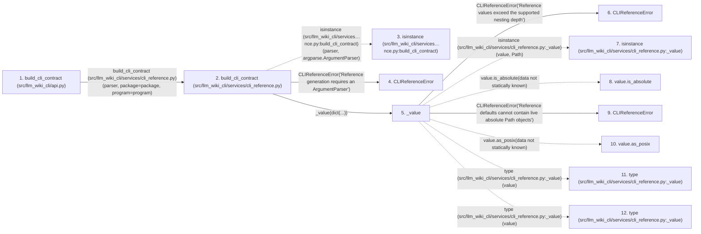

# build_cli_contract

**Entry point:** `build_cli_contract` (`api`)
**Source:** [api](../modules/api.md)
**Modules touched:** [api](../modules/api.md), [cli_reference](../modules/cli_reference.md), [knowledge_evidence](../modules/knowledge_evidence.md)

## Call sequence

> Static overview in presentation order, not runtime execution order. Arrows retain captured callers; representative internal continuations and boundary examples precede repeated helper detail.

```mermaid
sequenceDiagram
    participant p0 as build_cli_contract (src/llm_wiki_cli/api.py)
    participant p1 as build_cli_contract (src/llm_wiki_cli/services/cli_reference.py)
    participant p2 as _value
    participant p3 as _command
    participant p4 as hash_json
    participant p5 as validate_cli_contract
    participant p6 as _json_tree
    participant p7 as canonical_json_bytes
    participant p8 as _validate_schema
    participant p9 as _validate_command
    participant p10 as _text
    participant p11 as _argument
    participant p12 as _symbol
    participant p13 as _notes
    participant p14 as CLIReferenceError
    participant p15 as sha256_bytes
    participant p16 as _schema
    participant p17 as canonical_json_text
    participant p18 as _matches_type
    participant p19 as isinstance (src/llm_wiki_cli/services…nce.py:build_cli_contract)
    participant p20 as json.dumps(…).encode
    participant p21 as dict (src/llm_wiki_cli/services…nce.py:build_cli_contract)
    participant p22 as set (src/llm_wiki_cli/services/cli_reference.py:_command)
    participant p23 as isinstance (src/llm_wiki_cli/services/cli_reference.py:_value)
    participant p24 as id
    participant p25 as value.is_absolute
    participant p26 as len (src/llm_wiki_cli/services/cli_reference.py:_command)
    participant p27 as json.dumps (src/llm_wiki_cli/services….py:validate_cli_contract)
    participant p28 as len (src/llm_wiki_cli/services….py:validate_cli_contract)
    participant p29 as value.as_posix
    p0->>p1: build_cli_contract (src/llm_wiki_cli/services/cli_reference.py)
    p1->>p2: _value
    p1->>p3: _command
    p1->>p4: hash_json
    p1->>p5: validate_cli_contract
    p5->>p6: _json_tree
    p4->>p7: canonical_json_bytes
    p5->>p8: _validate_schema
    p5->>p9: _validate_command
    p3->>p10: _text
    p3->>p11: _argument
    p11->>p12: _symbol
    p11->>p13: _notes
    p1->>p14: CLIReferenceError
    p4->>p15: sha256_bytes
    p5->>p16: _schema
    p7->>p17: canonical_json_text
    p8->>p18: _matches_type
    p1-->>p19: isinstance (src/llm_wiki_cli/services…nce.py:build_cli_contract)(parser, argparse.ArgumentParser)
    p5-->>p20: json.dumps(…).encode('utf-8')
    p1-->>p21: dict (src/llm_wiki_cli/services…nce.py:build_cli_contract)(package)
    p3-->>p22: set (src/llm_wiki_cli/services/cli_reference.py:_command)
    p2-->>p23: isinstance (src/llm_wiki_cli/services/cli_reference.py:_value)(value, Path)
    p3-->>p24: id(parser)
    p2-->>p25: value.is_absolute
    p3-->>p26: len (src/llm_wiki_cli/services/cli_reference.py:_command)(path)
    p5-->>p27: json.dumps (src/llm_wiki_cli/services….py:validate_cli_contract)(contract, ensure_ascii=False, allow_nan=False)
    p5-->>p28: len (src/llm_wiki_cli/services….py:validate_cli_contract)(encoded)
    p2-->>p29: value.as_posix
    p3-->>p24: id(parser)
```

<!-- Auto-generated from static call edges. Dashed arrows are external or unresolved calls. Reviewed runtime conditions and side effects belong in Behavior. -->

> Call sequence diagram shows 30 of 231 interactions; 201 omitted to keep the visualization within the 30-interaction and generated-diagram limits, with uncertain identities omitted rather than inferred.

> Captured boundary calls: external 9 of 106 (97 omitted); unresolved 3 of 50 (47 omitted). These counts cover the captured static trace.

Omitted captured detail, grouped by actual caller occurrence and target module:

| Caller | Parent step | Target module | Kind | Omitted interactions |
| --- | --- | --- | --- | --- |
| `src/llm_wiki_cli/services/cli_reference.py:_value` | 5 | [src/llm_wiki_cli/services/cli_reference.py](../modules/cli_reference.md) | internal | 5 |
| `src/llm_wiki_cli/services/cli_reference.py:_value` | 5 | - | external | 8 |
| `src/llm_wiki_cli/services/cli_reference.py:_value` | 5 | - | unresolved | 1 |
| `src/llm_wiki_cli/services/cli_reference.py:_command` | 24 | [src/llm_wiki_cli/services/cli_reference.py](../modules/cli_reference.md) | internal | 8 |
| `src/llm_wiki_cli/services/cli_reference.py:_command` | 24 | - | external | 20 |
| `src/llm_wiki_cli/services/cli_reference.py:_command` | 24 | - | unresolved | 14 |
| `src/llm_wiki_cli/services/cli_reference.py:_text` | 35 | - | external | 1 |
| `src/llm_wiki_cli/services/cli_reference.py:_text` | 35 | [src/llm_wiki_cli/services/cli_reference.py](../modules/cli_reference.md) | internal | 1 |
> Omission summary shows 8 of 38 groups; 30 further groups are not expanded here. Counts above include all omitted interactions.
> Detailed flow queries retain their own coverage and limits; omitted paths may execute at runtime.

## Data flow

<!-- Auto-generated static analysis. Treat values and boundaries as best-effort hints, not runtime proof. -->

### Analysis coverage

**Effect analysis partially available.** Flow assembly and source effect analysis are separate; empty observations do not prove an empty handler body.

Source steps: 76; effect analysis evaluated: 41, partial: 0, unavailable: 35. Counts include steps omitted from the displayed trace.

Collector observations for 41 source steps with known totals: observed: 258, emitted: 258, omitted: 0. Unavailable totals are excluded.

- Callable record unavailable for one or more source steps; those steps have no represented callable body.
- Effect collector totals unavailable; observed counts cover captured records only.

| Step | Callable record | Effect analysis | Collector totals | Observed | Emitted | Omitted |
|---|---|---|---|---:|---:|---:|
| `build_cli_contract (src/llm_wiki_cli/api.py)` | `available` | `evaluated` | `available` | `4` | `4` | `0` |
| `build_cli_contract (src/llm_wiki_cli/services/cli_reference.py)` | `available` | `evaluated` | `available` | `6` | `6` | `0` |
| `isinstance (src/llm_wiki_cli/services…nce.py:build_cli_contract)` | `not_applicable` | `not_applicable` | `not_applicable` | — | — | — |
| `CLIReferenceError` | `unavailable` | `unavailable` | `unavailable` | — | — | — |
| `_value` | `available` | `evaluated` | `available` | `10` | `10` | `0` |
| `CLIReferenceError` | `unavailable` | `unavailable` | `unavailable` | — | — | — |
| `isinstance (src/llm_wiki_cli/services/cli_reference.py:_value)` | `not_applicable` | `not_applicable` | `not_applicable` | — | — | — |
| `value.is_absolute` | `not_applicable` | `not_applicable` | `not_applicable` | — | — | — |
| `CLIReferenceError` | `unavailable` | `unavailable` | `unavailable` | — | — | — |
| `value.as_posix` | `not_applicable` | `not_applicable` | `not_applicable` | — | — | — |
| `type (src/llm_wiki_cli/services/cli_reference.py:_value)` | `not_applicable` | `not_applicable` | `not_applicable` | — | — | — |
| `type (src/llm_wiki_cli/services/cli_reference.py:_value)` | `not_applicable` | `not_applicable` | `not_applicable` | — | — | — |

### Step data

| Step | Inputs | Reads | Writes | Returns |
|---|---|---|---|---|
| `build_cli_contract (src/llm_wiki_cli/api.py)` | `parser: argparse.ArgumentParser`, `package: Mapping[str, Any]`, `program: str` | - | - | `build(...)` |
| `build_cli_contract (src/llm_wiki_cli/services/cli_reference.py)` | `parser: argparse.ArgumentParser`, `package: Mapping[str, Any]`, `program: str` | `argparse`, `CLI_CONTRACT_SCHEMA_VERSION` | - | `result` |
| `isinstance (src/llm_wiki_cli/services…nce.py:build_cli_contract)` | - | - | - | - |
| `CLIReferenceError` | - | - | - | - |
| `_value` | `value: object`, `depth: int` | `_MAX_DEPTH`, `Path`, `Mapping` | - | `value`, `value`, `value`, `...`, `...` |
| `CLIReferenceError` | - | - | - | - |
| `isinstance (src/llm_wiki_cli/services/cli_reference.py:_value)` | - | - | - | - |
| `value.is_absolute` | - | - | - | - |
| `CLIReferenceError` | - | - | - | - |
| `value.as_posix` | - | - | - | - |
| `type (src/llm_wiki_cli/services/cli_reference.py:_value)` | - | - | - | - |
| `type (src/llm_wiki_cli/services/cli_reference.py:_value)` | - | - | - | - |

### Call data

| From | To | Line | Call |
|---|---|---:|---|
| build_cli_contract (src/llm_wiki_cli/api.py) | build_cli_contract (src/llm_wiki_cli/services/cli_reference.py) | 3546 | `build(parser, package=package, program=program)` |
| build_cli_contract (src/llm_wiki_cli/services/cli_reference.py) | isinstance (src/llm_wiki_cli/services…nce.py:build_cli_contract) | 241 | `isinstance(parser, argparse.ArgumentParser)` |
| build_cli_contract (src/llm_wiki_cli/services/cli_reference.py) | CLIReferenceError | 242 | `CLIReferenceError('Reference generation requires an ArgumentParser')` |
| build_cli_contract (src/llm_wiki_cli/services/cli_reference.py) | _value | 245 | `_value(dict(...))` |
| _value | CLIReferenceError | 68 | `CLIReferenceError('Reference values exceed the supported nesting depth')` |
| _value | isinstance (src/llm_wiki_cli/services/cli_reference.py:_value) | 69 | `isinstance(value, Path)` |
| _value | value.is_absolute | 70 | `value.is_absolute(data not statically known)` |
| _value | CLIReferenceError | 71 | `CLIReferenceError('Reference defaults cannot contain live absolute Path objects')` |
| _value | value.as_posix | 74 | `value.as_posix(data not statically known)` |
| _value | type (src/llm_wiki_cli/services/cli_reference.py:_value) | 75 | `type(value)` |
| _value | type (src/llm_wiki_cli/services/cli_reference.py:_value) | 77 | `type(value)` |

### Boundary effects

*No boundary-effect observations were captured in this static trace.*

### Static analysis gaps

| Kind | Step | Target | Line |
|---|---|---|---:|
| external_call | `build_cli_contract` | `isinstance` | 241 |
| external_call | `_value` | `isinstance` | 69 |
| unresolved_call | `_value` | `value.is_absolute` | 70 |
| unresolved_call | `_value` | `value.as_posix` | 74 |
| external_call | `_value` | `type` | 75 |
| external_call | `_value` | `type` | 77 |
| step_limit | `build_cli_contract` | `first 12 steps` | 0 |

## Behavior

This flow starts at `build_cli_contract` and is classified as `api`. The generated call and data-flow sections are bounded static projections; runtime conditions and side effects require source-level confirmation.
