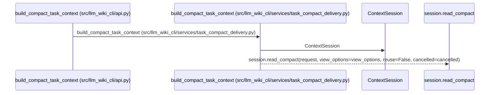
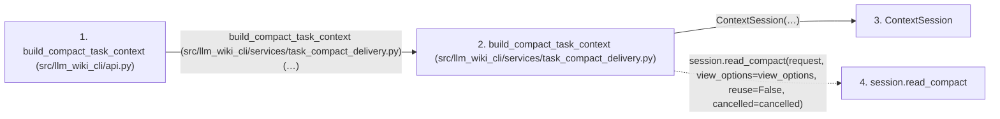

# build_compact_task_context

**Entry point:** `build_compact_task_context` (`api`)
**Source:** [api](../modules/api.md)
**Modules touched:** [api](../modules/api.md), [context_session](../modules/context_session.md), [task_compact_delivery](../modules/task_compact_delivery.md)

## Call sequence

> Static overview in presentation order, not runtime execution order. Arrows retain captured callers; representative internal continuations and boundary examples precede repeated helper detail.

<!-- Auto-generated from static call edges. Dashed arrows are external or unresolved calls. Reviewed runtime conditions and side effects belong in Behavior. -->

> Call sequence diagram shows 3 of 3 interactions; 0 omitted to keep the visualization within the 30-interaction and generated-diagram limits, with uncertain identities omitted rather than inferred.

> Captured boundary calls: external 0 of 0 (0 omitted); unresolved 1 of 1 (0 omitted). These counts cover the captured static trace.
> Detailed flow queries retain their own coverage and limits; omitted paths may execute at runtime.

## Data flow

<!-- Auto-generated static analysis. Treat values and boundaries as best-effort hints, not runtime proof. -->

### Step data

| Step | Inputs | Reads | Writes | Returns |
|---|---|---|---|---|
| `build_compact_task_context (src/llm_wiki_cli/api.py)` | `request: Mapping[str, Any]`, `view_options: Mapping[str, Any]`, `src_dir: str`, `wiki_dir: str`, `profile: WorkflowProfile \| Mapping[str, Any] \| None`, `policy: WorkflowPolicy \| None`, `counter: TokenCounter \| None`, `allow_external_src: bool` | - | - | `build(...)` |
| `build_compact_task_context (src/llm_wiki_cli/services/task_compact_delivery.py)` | `request`, `view_options`, `src_dir`, `wiki_dir`, `profile`, `policy`, `counter`, `allow_external_src` | - | - | `reply.view` |
| `ContextSession` | - | - | - | - |
| `session.read_compact` | - | - | - | - |

### Call data

| From | To | Line | Call |
|---|---|---:|---|
| build_compact_task_context (src/llm_wiki_cli/api.py) | build_compact_task_context (src/llm_wiki_cli/services/task_compact_delivery.py) | 1436 | `build(request, view_options=view_options, src_dir=src_dir, wiki_dir=wiki_dir, profile=profile, policy=policy, counter=counter, allow_external_src=allow_external_src, source_selection=source_selection, helper_cache_dir=helper_cache_dir, cancelled=cancelled)` |
| build_compact_task_context (src/llm_wiki_cli/services/task_compact_delivery.py) | ContextSession | 18 | `ContextSession(src_dir=src_dir, wiki_dir=wiki_dir, profile=profile, policy=policy, counter=counter, allow_external_src=allow_external_src, source_selection=source_selection, helper_cache_dir=helper_cache_dir, max_entries=0, max_bytes=0)` |
| build_compact_task_context (src/llm_wiki_cli/services/task_compact_delivery.py) | session.read_compact | 22 | `session.read_compact(request, view_options=view_options, reuse=False, cancelled=cancelled)` |

### Boundary effects

*No boundary effects detected.*

### Static analysis gaps

| Kind | Step | Target | Line |
|---|---|---|---:|
| unresolved_call | `build_compact_task_context` | `session.read_compact` | 22 |

## Behavior

This flow starts at `build_compact_task_context` and is classified as `api`. The generated call and data-flow sections are bounded static projections; runtime conditions and side effects require source-level confirmation.
