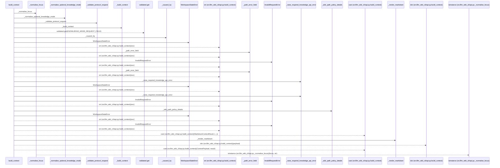
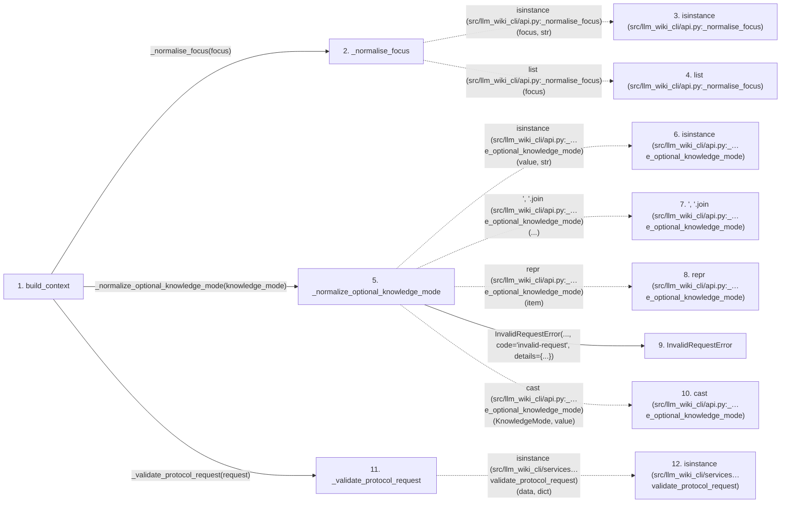

# build_context

**Entry point:** `build_context` (`api`)
**Source:** [api](../modules/api.md)
**Modules touched:** [analysis_compatibility](../modules/analysis_compatibility.md), [api](../modules/api.md), [change_selection](../modules/change_selection.md), [common](../modules/common.md), and 40 more

**Complete modules touched:**

- [analysis_compatibility](../modules/analysis_compatibility.md)
- [api](../modules/api.md)
- [change_selection](../modules/change_selection.md)
- [common](../modules/common.md)
- [config](../modules/config.md)
- [context_budget](../modules/context_budget.md)
- [context_service](../modules/context_service.md)
- [data_flow](../modules/data_flow.md)
- [dependency_versions](../modules/dependency_versions.md)
- [documentation_queries](../modules/documentation_queries.md)
- [documentation_query_builder](../modules/documentation_query_builder.md)
- [entrypoints](../modules/entrypoints.md)
- [extraction_service](../modules/extraction_service.md)
- [filesystem_guard](../modules/filesystem_guard.md)
- [implementation_evidence](../modules/implementation_evidence.md)
- [imports](../modules/imports.md)
- [infrastructure_inventory](../modules/infrastructure_inventory.md)
- [infrastructure_sync](../modules/infrastructure_sync.md)
- [io](../modules/io.md)
- [knowledge_consumption](../modules/knowledge_consumption.md)
- [knowledge_envelope](../modules/knowledge_envelope.md)
- [knowledge_freshness](../modules/knowledge_freshness.md)
- [knowledge_loader](../modules/knowledge_loader.md)
- [knowledge_observability](../modules/knowledge_observability.md)
- [knowledge_orchestration](../modules/knowledge_orchestration.md)
- [knowledge_storage](../modules/knowledge_storage.md)
- [knowledge_storage_io](../modules/knowledge_storage_io.md)
- [knowledge_verification](../modules/knowledge_verification.md)
- [maintenance_protocol](../modules/maintenance_protocol.md)
- [maintenance_state](../modules/maintenance_state.md)
- [maintenance_status](../modules/maintenance_status.md)
- [manifest_storage](../modules/manifest_storage.md)
- [plugins](../modules/plugins.md)
- [python_calls](../modules/python_calls.md)
- [python_implementation](../modules/python_implementation.md)
- [python_imports](../modules/python_imports.md)
- [services_dependencies](../modules/services_dependencies.md)
- [source_selection](../modules/source_selection.md)
- [source_snapshot](../modules/source_snapshot.md)
- [sync_manifest](../modules/sync_manifest.md)
- [validation](../modules/validation.md)
- [wiki_media](../modules/wiki_media.md)
- [wiki_surface](../modules/wiki_surface.md)
- [wiki_surface_index](../modules/wiki_surface_index.md)

## Call sequence

> Static overview in presentation order, not runtime execution order. Arrows retain captured callers; siblings are shown before deeper helper detail.

<!-- Auto-generated from static call edges. Dashed arrows are external or unresolved calls. Reviewed runtime conditions and side effects belong in Behavior. -->

> Call sequence diagram shows 30 of 2168 interactions; 2138 omitted to keep the visualization within the 30-interaction and generated-diagram limits, with uncertain identities omitted rather than inferred.

> Captured boundary calls: external 12 of 734 (722 omitted); unresolved 1 of 796 (795 omitted). These counts cover the captured static trace.

Omitted captured detail, grouped by actual caller occurrence and target module:

| Caller | Parent step | Target module | Kind | Omitted interactions |
| --- | --- | --- | --- | --- |
| `src/llm_wiki_cli/api.py:_normalise_focus` | 2 | - | external | 1 |
| `src/llm_wiki_cli/api.py:_normalize_optional_knowledge_mode` | 5 | - | external | 3 |
| `src/llm_wiki_cli/api.py:_normalize_optional_knowledge_mode` | 5 | - | unresolved | 1 |
| `src/llm_wiki_cli/api.py:_normalize_optional_knowledge_mode` | 5 | [src/llm_wiki_cli/api.py](../modules/api.md) | internal | 1 |
| `src/llm_wiki_cli/services/context_service.py:_validate_protocol_request` | 11 | - | external | 2 |
| `src/llm_wiki_cli/services/context_service.py:_validate_protocol_request` | 11 | - | unresolved | 1 |
| `src/llm_wiki_cli/services/context_service.py:_validate_protocol_request` | 11 | [src/llm_wiki_cli/services/context_service.py](../modules/context_service.md) | internal | 1 |
| `src/llm_wiki_cli/services/context_service.py:_validate_protocol_request_impl` | 14 | - | external | 11 |
> Omission summary shows 8 of 478 groups; 470 further groups are not expanded here. Counts above include all omitted interactions.
> Detailed flow queries retain their own coverage and limits; omitted paths may execute at runtime.

> Trace truncated at the depth limit; deeper calls are omitted.

## Data flow

<!-- Auto-generated static analysis. Treat values and boundaries as best-effort hints, not runtime proof. -->

### Step data

| Step | Inputs | Reads | Writes | Returns |
|---|---|---|---|---|
| `build_context` | `src_dir: str`, `budget: int`, `format: str`, `focus: str \| list[str]`, `filters: dict[str, Any] \| None`, `wiki_dir: str`, `prefer_fresh: bool`, `allow_external_src: bool` | `context_cmd`, `CONTEXT_KNOWLEDGE_PROTOCOL_VERSION`, `KNOWLEDGE_MODE_REQUEST_FIELD`, `PathValidationError`, `context_cmd`, `context_cmd`, `MarkdownContextResult`, `ContextPayload` | `request[...]`, `result[...]` | `cast(...)`, `cast(...)` |
| `_normalise_focus` | `focus: str \| list[str]` | - | - | `[...]`, `[...]`, `[...]`, `list(...)` |
| `isinstance (src/llm_wiki_cli/api.py:_normalise_focus)` | - | - | - | - |
| `list (src/llm_wiki_cli/api.py:_normalise_focus)` | - | - | - | - |
| `_normalize_optional_knowledge_mode` | `value: object` | `KNOWLEDGE_MODE_VALUES`, `KNOWLEDGE_MODE_VALUES`, `KNOWLEDGE_MODE_REQUEST_FIELD`, `KnowledgeMode` | - | `None`, `cast(...)` |
| `isinstance (src/llm_wiki_cli/api.py:_…e_optional_knowledge_mode)` | - | - | - | - |
| `', '.join (src/llm_wiki_cli/api.py:_…e_optional_knowledge_mode)` | - | - | - | - |
| `repr (src/llm_wiki_cli/api.py:_…e_optional_knowledge_mode)` | - | - | - | - |
| `InvalidRequestError` | - | - | - | - |
| `cast (src/llm_wiki_cli/api.py:_…e_optional_knowledge_mode)` | - | - | - | - |
| `_validate_protocol_request` | `data: object` | `PROTOCOL_VERSION`, `ProtocolRequestError`, `PROTOCOL_VERSION`, `KNOWLEDGE_PROTOCOL_VERSION` | `exc.protocol` | `_validate_protocol_request_impl(...)` |
| `isinstance (src/llm_wiki_cli/services…validate_protocol_request)` | - | - | - | - |

### Call data

| From | To | Line | Call |
|---|---|---:|---|
| build_context | _normalise_focus | 1239 | `_normalise_focus(focus)` |
| _normalise_focus | isinstance (src/llm_wiki_cli/api.py:_normalise_focus) | 3197 | `isinstance(focus, str)` |
| _normalise_focus | list (src/llm_wiki_cli/api.py:_normalise_focus) | 3203 | `list(focus)` |
| build_context | _normalize_optional_knowledge_mode | 1240 | `_normalize_optional_knowledge_mode(knowledge_mode)` |
| _normalize_optional_knowledge_mode | isinstance (src/llm_wiki_cli/api.py:_…e_optional_knowledge_mode) | 397 | `isinstance(value, str)` |
| _normalize_optional_knowledge_mode | ', '.join (src/llm_wiki_cli/api.py:_…e_optional_knowledge_mode) | 398 | `', '.join(...)` |
| _normalize_optional_knowledge_mode | repr (src/llm_wiki_cli/api.py:_…e_optional_knowledge_mode) | 398 | `repr(item)` |
| _normalize_optional_knowledge_mode | InvalidRequestError | 399 | `InvalidRequestError(..., code='invalid-request', details={...})` |
| _normalize_optional_knowledge_mode | cast (src/llm_wiki_cli/api.py:_…e_optional_knowledge_mode) | 404 | `cast(KnowledgeMode, value)` |
| build_context | _validate_protocol_request | 1256 | `context_cmd._validate_protocol_request(request)` |
| _validate_protocol_request | isinstance (src/llm_wiki_cli/services…validate_protocol_request) | 1104 | `isinstance(data, dict)` |

### Boundary effects

*No boundary effects detected.*

### Static analysis gaps

| Kind | Step | Target | Line |
|---|---|---|---:|
| external_call | `_normalise_focus` | `isinstance` | 3197 |
| external_call | `_normalize_optional_knowledge_mode` | `isinstance` | 397 |
| unresolved_call | `_normalize_optional_knowledge_mode` | `', '.join` | 398 |
| external_call | `_normalize_optional_knowledge_mode` | `cast` | 404 |
| external_call | `_validate_protocol_request` | `isinstance` | 1104 |
| step_limit | `build_context` | `first 12 steps` | 0 |
| truncated_flow | `build_context` | `depth limit` | 0 |

## Behavior

Normalizes focus values, validates the versioned context request, and builds a
token-bounded response from the selected source and wiki. JSON mode returns the
payload with any warnings; Markdown mode returns rendered content alongside the
same payload and warnings. Path, workspace, and request failures remain
separate public API categories, and read-only mode is the default.
