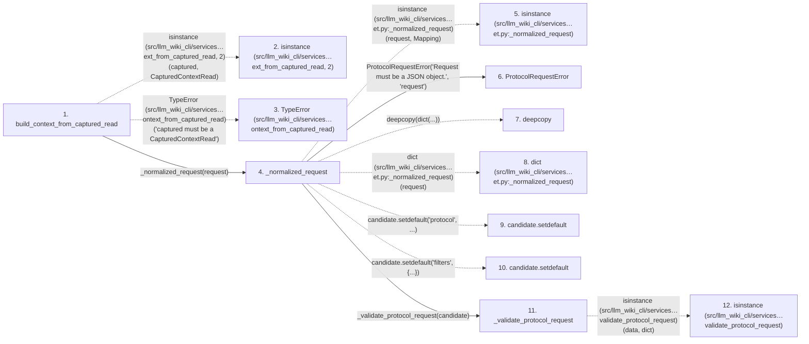

# build_context_from_captured_read

**Entry point:** `build_context_from_captured_read` (`api`)
**Source:** [context_packet](../modules/context_packet.md)
**Modules touched:** [change_selection](../modules/change_selection.md), [context_budget](../modules/context_budget.md), [context_packet](../modules/context_packet.md), [context_service](../modules/context_service.md), and 6 more

**Complete modules touched:**

- [change_selection](../modules/change_selection.md)
- [context_budget](../modules/context_budget.md)
- [context_packet](../modules/context_packet.md)
- [context_service](../modules/context_service.md)
- [documentation_queries](../modules/documentation_queries.md)
- [implementation_evidence](../modules/implementation_evidence.md)
- [knowledge_observability](../modules/knowledge_observability.md)
- [knowledge_verification](../modules/knowledge_verification.md)
- [maintenance_status](../modules/maintenance_status.md)
- [wiki_surface](../modules/wiki_surface.md)

## Call sequence

> Static overview in presentation order, not runtime execution order. Arrows retain captured callers; siblings are shown before deeper helper detail.

```mermaid
sequenceDiagram
    participant p0 as build_context_from_captured_read
    participant p1 as isinstance (src/llm_wiki_cli/services…ext_from_captured_read, 2)
    participant p2 as TypeError (src/llm_wiki_cli/services…ontext_from_captured_read)
    participant p3 as _normalized_request
    participant p4 as _build_legacy_context_from_captured_read
    participant p5 as _build_knowledge_context_from_captured_read
    participant p6 as isinstance (src/llm_wiki_cli/services…et.py:_normalized_request)
    participant p7 as _thaw_json
    participant p8 as ProtocolRequestError
    participant p9 as _apply_protocol_filters
    participant p10 as deepcopy
    participant p11 as _build_protocol_enrichment_from_captured_read
    participant p12 as _captured_source_classification
    participant p13 as dict (src/llm_wiki_cli/services…et.py:_normalized_request)
    participant p14 as warnings.append (src/llm_wiki_cli/services…ontext_from_captured_read)
    participant p15 as any (src/llm_wiki_cli/services…ontext_from_captured_read)
    participant p16 as candidate.setdefault
    participant p17 as knowledge_view_selection_eligible
    participant p18 as _normalise_changed_paths
    participant p19 as _context_query_surface
    participant p20 as _validate_protocol_request
    participant p21 as list (src/llm_wiki_cli/services…ontext_from_captured_read)
    participant p22 as _captured_query_service
    participant p23 as _build_import_graph
    participant p24 as _explicit_filter_enrichment_from_captured_read
    participant p25 as _classify_files
    participant p26 as _context_freshness_rank_by_source
    p0-->>p1: isinstance (src/llm_wiki_cli/services…ext_from_captured_read, 2)(captured, CapturedContextRead)
    p0-->>p2: TypeError (src/llm_wiki_cli/services…ontext_from_captured_read)('captured must be a CapturedContextRead')
    p0->>p3: _normalized_request
    p0->>p4: _build_legacy_context_from_captured_read
    p0->>p5: _build_knowledge_context_from_captured_read
    p3-->>p6: isinstance (src/llm_wiki_cli/services…et.py:_normalized_request)(request, Mapping)
    p4->>p7: _thaw_json
    p5->>p7: _thaw_json
    p3->>p8: ProtocolRequestError
    p4->>p9: _apply_protocol_filters
    p5->>p9: _apply_protocol_filters
    p3-->>p10: deepcopy(dict(...))
    p4->>p11: _build_protocol_enrichment_from_captured_read
    p5->>p12: _captured_source_classification
    p3-->>p13: dict (src/llm_wiki_cli/services…et.py:_normalized_request)(request)
    p4-->>p14: warnings.append (src/llm_wiki_cli/services…ontext_from_captured_read)('Could not get changed files from git. Treating all files as high priority.')
    p5-->>p15: any (src/llm_wiki_cli/services…ontext_from_captured_read)(...)
    p3-->>p16: candidate.setdefault('protocol', ...)
    p4-->>p14: warnings.append (src/llm_wiki_cli/services…ontext_from_captured_read)('No files changed in the last commit. Treating all files as high priority.')
    p5->>p17: knowledge_view_selection_eligible
    p3-->>p16: candidate.setdefault('filters', {...})
    p4->>p18: _normalise_changed_paths
    p5->>p19: _context_query_surface
    p3->>p20: _validate_protocol_request
    p4-->>p21: list (src/llm_wiki_cli/services…ontext_from_captured_read)(captured.changed_files)
    p5->>p22: _captured_query_service
    p4->>p23: _build_import_graph
    p5->>p24: _explicit_filter_enrichment_from_captured_read
    p4->>p25: _classify_files
    p5->>p26: _context_freshness_rank_by_source
```

<!-- Auto-generated from static call edges. Dashed arrows are external or unresolved calls. Reviewed runtime conditions and side effects belong in Behavior. -->

> Call sequence diagram shows 30 of 672 interactions; 642 omitted to keep the visualization within the 30-interaction and generated-diagram limits, with uncertain identities omitted rather than inferred.

> Captured boundary calls: external 7 of 285 (278 omitted); unresolved 4 of 224 (220 omitted). These counts cover the captured static trace.

Omitted captured detail, grouped by actual caller occurrence and target module:

| Caller | Parent step | Target module | Kind | Omitted interactions |
| --- | --- | --- | --- | --- |
| `src/llm_wiki_cli/services/context_service.py:_validate_protocol_request` | 11 | - | external | 2 |
| `src/llm_wiki_cli/services/context_service.py:_validate_protocol_request` | 11 | - | unresolved | 1 |
| `src/llm_wiki_cli/services/context_service.py:_validate_protocol_request` | 11 | [src/llm_wiki_cli/services/context_service.py](../modules/context_service.md) | internal | 1 |
| `src/llm_wiki_cli/services/context_service.py:_validate_protocol_request_impl` | 14 | - | external | 11 |
| `src/llm_wiki_cli/services/context_service.py:_validate_protocol_request_impl` | 14 | [src/llm_wiki_cli/services/context_service.py](../modules/context_service.md) | internal | 12 |
| `src/llm_wiki_cli/services/context_service.py:_validate_protocol_request_impl` | 14 | - | unresolved | 6 |
| `src/llm_wiki_cli/services/context_service.py:_validate_protocol_request_impl` | 14 | [src/llm_wiki_cli/services/context_budget.py](../modules/context_budget.md) | internal | 1 |
| `src/llm_wiki_cli/services/context_budget.py:validate_request` | 21 | - | external | 10 |
> Omission summary shows 8 of 162 groups; 154 further groups are not expanded here. Counts above include all omitted interactions.
> Detailed flow queries retain their own coverage and limits; omitted paths may execute at runtime.

> Trace truncated at the depth limit; deeper calls are omitted.

## Data flow

<!-- Auto-generated static analysis. Treat values and boundaries as best-effort hints, not runtime proof. -->

### Step data

| Step | Inputs | Reads | Writes | Returns |
|---|---|---|---|---|
| `build_context_from_captured_read` | `captured: CapturedContextRead`, `request: Mapping[str, Any]`, `freshness_ranking_out: dict[str, int] \| None` | `CapturedContextRead`, `context_service` | - | `_build_legacy_context_from_captured_read(...)`, `_build_knowledge_context_from_captured_read(...)` |
| `isinstance (src/llm_wiki_cli/services…ext_from_captured_read, 2)` | - | - | - | - |
| `TypeError (src/llm_wiki_cli/services…ontext_from_captured_read)` | - | - | - | - |
| `_normalized_request` | `request: Mapping[str, Any]` | `Mapping`, `CONTEXT_KNOWLEDGE_PROTOCOL_VERSION`, `context_service` | - | `context_service._validate_protocol_request(...)` |
| `isinstance (src/llm_wiki_cli/services…et.py:_normalized_request)` | - | - | - | - |
| `ProtocolRequestError` | - | - | - | - |
| `deepcopy` | - | - | - | - |
| `dict (src/llm_wiki_cli/services…et.py:_normalized_request)` | - | - | - | - |
| `candidate.setdefault` | - | - | - | - |
| `candidate.setdefault` | - | - | - | - |
| `_validate_protocol_request` | `data: object` | `PROTOCOL_VERSION`, `ProtocolRequestError`, `PROTOCOL_VERSION`, `KNOWLEDGE_PROTOCOL_VERSION` | `exc.protocol` | `_validate_protocol_request_impl(...)` |
| `isinstance (src/llm_wiki_cli/services…validate_protocol_request)` | - | - | - | - |

### Call data

| From | To | Line | Call |
|---|---|---:|---|
| build_context_from_captured_read | isinstance (src/llm_wiki_cli/services…ext_from_captured_read, 2) | 1048 | `isinstance(captured, CapturedContextRead)` |
| build_context_from_captured_read | TypeError (src/llm_wiki_cli/services…ontext_from_captured_read) | 1049 | `TypeError('captured must be a CapturedContextRead')` |
| build_context_from_captured_read | _normalized_request | 1050 | `_normalized_request(request)` |
| _normalized_request | isinstance (src/llm_wiki_cli/services…et.py:_normalized_request) | 1961 | `isinstance(request, Mapping)` |
| _normalized_request | ProtocolRequestError | 1962 | `context_service.ProtocolRequestError('Request must be a JSON object.', 'request')` |
| _normalized_request | deepcopy | 1966 | `deepcopy(dict(...))` |
| _normalized_request | dict (src/llm_wiki_cli/services…et.py:_normalized_request) | 1966 | `dict(request)` |
| _normalized_request | candidate.setdefault | 1967 | `candidate.setdefault('protocol', ...)` |
| _normalized_request | candidate.setdefault | 1975 | `candidate.setdefault('filters', {...})` |
| _normalized_request | _validate_protocol_request | 1976 | `context_service._validate_protocol_request(candidate)` |
| _validate_protocol_request | isinstance (src/llm_wiki_cli/services…validate_protocol_request) | 1104 | `isinstance(data, dict)` |

### Boundary effects

*No boundary effects detected.*

### Static analysis gaps

| Kind | Step | Target | Line |
|---|---|---|---:|
| external_call | `build_context_from_captured_read` | `isinstance` | 1048 |
| external_call | `build_context_from_captured_read` | `TypeError` | 1049 |
| external_call | `_normalized_request` | `isinstance` | 1961 |
| external_call | `_normalized_request` | `deepcopy` | 1966 |
| unresolved_call | `_normalized_request` | `candidate.setdefault` | 1967 |
| unresolved_call | `_normalized_request` | `candidate.setdefault` | 1975 |
| external_call | `_validate_protocol_request` | `isinstance` | 1104 |
| step_limit | `build_context_from_captured_read` | `first 12 steps` | 0 |
| truncated_flow | `build_context_from_captured_read` | `depth limit` | 0 |

## Behavior

This flow starts at `build_context_from_captured_read` and is classified as `api`. The generated call and data-flow sections are bounded static projections; runtime conditions and side effects require source-level confirmation.
