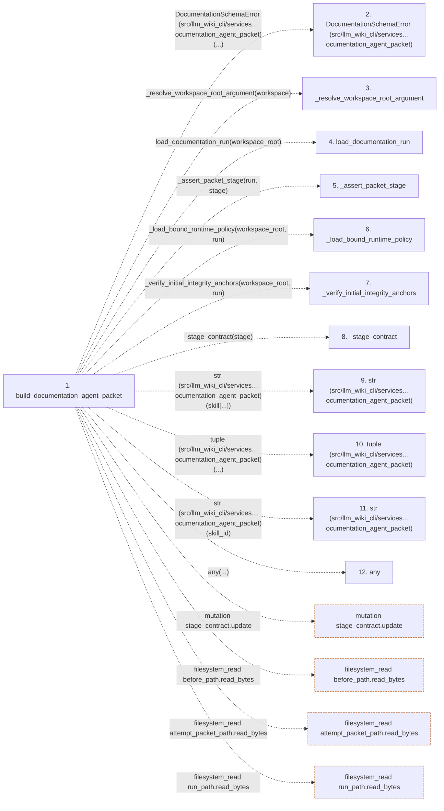

# build_documentation_agent_packet

**Entry point:** `build_documentation_agent_packet` (`api`)
**Source:** [packet](../modules/packet.md)
**Modules touched:** [documentation_policy](../modules/documentation_policy.md), [documentation_run_contracts](../modules/documentation_run_contracts.md), [filesystem_guard](../modules/filesystem_guard.md), and 9 more

**Complete modules touched:**

- [documentation_policy](../modules/documentation_policy.md)
- [documentation_run_contracts](../modules/documentation_run_contracts.md)
- [filesystem_guard](../modules/filesystem_guard.md)
- [io](../modules/io.md)
- [knowledge_evidence](../modules/knowledge_evidence.md)
- [knowledge_storage](../modules/knowledge_storage.md)
- [knowledge_storage_io](../modules/knowledge_storage_io.md)
- [packet](../modules/packet.md)
- [publication](../modules/publication.md)
- [publication_candidate](../modules/publication_candidate.md)
- [validation](../modules/validation.md)
- [workspace](../modules/workspace.md)

## Call sequence

> Static overview in presentation order, not runtime execution order. Arrows retain captured callers; representative internal continuations and boundary examples precede repeated helper detail.

```mermaid
sequenceDiagram
    participant p0 as build_documentation_agent_packet
    participant p1 as publication_packet
    participant p2 as protected_stage_hash
    participant p3 as _documents
    participant p4 as capture_tree_baseline (src/llm_wiki_cli/services/documentation_policy.py)
    participant p5 as _hashes
    participant p6 as _read_tree
    participant p7 as _resolve_existing_directory
    participant p8 as _binding
    participant p9 as _walk_regular_files
    participant p10 as _hash_file
    participant p11 as _absolute_path
    participant p12 as _tree_paths
    participant p13 as _lstat
    participant p14 as hash_json
    participant p15 as _assert_safe_directory
    participant p16 as _resolve_path
    participant p17 as _guard_baseline_directory
    participant p18 as _hash_windows_file
    participant p19 as _assert_same_file_identity
    participant p20 as windows_object_identity
    participant p21 as guard_windows_directory_chain
    participant p22 as canonical_json_bytes
    participant p23 as _assert_safe_regular_file
    participant p24 as open_windows_readonly_file
    participant p25 as _portable
    participant p26 as _assert_stable_windows_path_handle_metadata
    participant p27 as _assert_stable_file_metadata
    participant p28 as DocumentationIntegrityError (src/llm_wiki_cli/services…entation_run/contracts.py)
    participant p29 as isinstance (src/llm_wiki_cli/services….py:capture_tree_baseline)
    participant p30 as DocumentationSchemaError (src/llm_wiki_cli/services…ocumentation_agent_packet)
    p0->>p1: publication_packet
    p0->>p2: protected_stage_hash
    p1->>p3: _documents
    p2->>p4: capture_tree_baseline (src/llm_wiki_cli/services/documentation_policy.py)
    p1->>p5: _hashes
    p3->>p6: _read_tree
    p4->>p7: _resolve_existing_directory
    p3->>p8: _binding
    p4->>p9: _walk_regular_files
    p4->>p10: _hash_file
    p6->>p11: _absolute_path
    p6->>p12: _tree_paths
    p7->>p13: _lstat
    p8->>p14: hash_json
    p7->>p15: _assert_safe_directory
    p7->>p16: _resolve_path
    p9->>p17: _guard_baseline_directory
    p10->>p18: _hash_windows_file
    p7->>p19: _assert_same_file_identity
    p19->>p20: windows_object_identity
    p17->>p21: guard_windows_directory_chain
    p14->>p22: canonical_json_bytes
    p18->>p23: _assert_safe_regular_file
    p18->>p24: open_windows_readonly_file
    p12->>p25: _portable
    p18->>p26: _assert_stable_windows_path_handle_metadata
    p18->>p27: _assert_stable_file_metadata
    p1->>p28: DocumentationIntegrityError (src/llm_wiki_cli/services…entation_run/contracts.py)
    p4-->>p29: isinstance (src/llm_wiki_cli/services….py:capture_tree_baseline)(value, bool)
    p0-->>p30: DocumentationSchemaError (src/llm_wiki_cli/services…ocumentation_agent_packet)(...)
```

<!-- Auto-generated from static call edges. Dashed arrows are external or unresolved calls. Reviewed runtime conditions and side effects belong in Behavior. -->

> Call sequence diagram shows 30 of 426 interactions; 396 omitted to keep the visualization within the 30-interaction and generated-diagram limits, with uncertain identities omitted rather than inferred.

> Captured boundary calls: external 1 of 133 (132 omitted); unresolved 1 of 153 (152 omitted). These counts cover the captured static trace.

Omitted captured detail, grouped by actual caller occurrence and target module:

| Caller | Parent step | Target module | Kind | Omitted interactions |
| --- | --- | --- | --- | --- |
| `src/llm_wiki_cli/services/documentation_run/packet.py:build_documentation_agent_packet` | 1 | - | unresolved | 74 |
| `src/llm_wiki_cli/services/knowledge_storage_io.py:_absolute_path` | 31 | - | external | 4 |
| `src/llm_wiki_cli/services/knowledge_storage_io.py:_absolute_path` | 31 | [src/llm_wiki_cli/services/io.py](../modules/io.md) | internal | 1 |
| `src/llm_wiki_cli/services/io.py:first_unsafe_path_component` | 34 | - | external | 20 |
| `src/llm_wiki_cli/services/io.py:first_unsafe_path_component` | 34 | - | unresolved | 5 |
| `src/llm_wiki_cli/services/knowledge_storage_io.py:_absolute_path` | 31 | [src/llm_wiki_cli/services/knowledge_storage.py](../modules/knowledge_storage.md) | internal | 1 |
| `src/llm_wiki_cli/services/knowledge_storage_io.py:_absolute_path` | 31 | - | unresolved | 3 |
| `src/llm_wiki_cli/services/publication_candidate.py:_tree_paths` | 66 | - | unresolved | 12 |
> Omission summary shows 8 of 88 groups; 80 further groups are not expanded here. Counts above include all omitted interactions.
> Detailed flow queries retain their own coverage and limits; omitted paths may execute at runtime.

> Trace truncated at the depth limit; deeper calls are omitted.

## Data flow

<!-- Auto-generated static analysis. Treat values and boundaries as best-effort hints, not runtime proof. -->

### Analysis coverage

**Effect analysis partially available.** Flow assembly and source effect analysis are separate; empty observations do not prove an empty handler body.

Source steps: 141; effect analysis evaluated: 93, partial: 4, unavailable: 44. Counts include steps omitted from the displayed trace.

Collector observations for 97 source steps with known totals: observed: 478, emitted: 465, omitted: 13. Unavailable totals are excluded.

- Callable record unavailable for one or more source steps; those steps have no represented callable body.
- Effect collector omitted observations before flow assembly; displayed effects are partial.
- Effect collector totals unavailable; observed counts cover captured records only.

| Step | Callable record | Effect analysis | Collector totals | Observed | Emitted | Omitted |
|---|---|---|---|---:|---:|---:|
| `build_documentation_agent_packet` | `available` | `evaluated` | `available` | `9` | `9` | `0` |
| `DocumentationSchemaError (src/llm_wiki_cli/services…ocumentation_agent_packet)` | `not_applicable` | `not_applicable` | `not_applicable` | — | — | — |
| `_resolve_workspace_root_argument` | `not_applicable` | `not_applicable` | `not_applicable` | — | — | — |
| `load_documentation_run` | `not_applicable` | `not_applicable` | `not_applicable` | — | — | — |
| `_assert_packet_stage` | `not_applicable` | `not_applicable` | `not_applicable` | — | — | — |
| `_load_bound_runtime_policy` | `not_applicable` | `not_applicable` | `not_applicable` | — | — | — |
| `_verify_initial_integrity_anchors` | `not_applicable` | `not_applicable` | `not_applicable` | — | — | — |
| `_stage_contract` | `not_applicable` | `not_applicable` | `not_applicable` | — | — | — |
| `str (src/llm_wiki_cli/services…ocumentation_agent_packet)` | `not_applicable` | `not_applicable` | `not_applicable` | — | — | — |
| `tuple (src/llm_wiki_cli/services…ocumentation_agent_packet)` | `not_applicable` | `not_applicable` | `not_applicable` | — | — | — |
| `str (src/llm_wiki_cli/services…ocumentation_agent_packet)` | `not_applicable` | `not_applicable` | `not_applicable` | — | — | — |
| `any` | `not_applicable` | `not_applicable` | `not_applicable` | — | — | — |

### Step data

| Step | Inputs | Reads | Writes | Returns |
|---|---|---|---|---|
| `build_documentation_agent_packet` | `workspace: str \| Path`, `stage: str` | - | `run.current_stage`, `run.stage_attempts[...]` | `packet` |
| `DocumentationSchemaError (src/llm_wiki_cli/services…ocumentation_agent_packet)` | - | - | - | - |
| `_resolve_workspace_root_argument` | - | - | - | - |
| `load_documentation_run` | - | - | - | - |
| `_assert_packet_stage` | - | - | - | - |
| `_load_bound_runtime_policy` | - | - | - | - |
| `_verify_initial_integrity_anchors` | - | - | - | - |
| `_stage_contract` | - | - | - | - |
| `str (src/llm_wiki_cli/services…ocumentation_agent_packet)` | - | - | - | - |
| `tuple (src/llm_wiki_cli/services…ocumentation_agent_packet)` | - | - | - | - |
| `str (src/llm_wiki_cli/services…ocumentation_agent_packet)` | - | - | - | - |
| `any` | - | - | - | - |

### Call data

| From | To | Line | Call |
|---|---|---:|---|
| build_documentation_agent_packet | DocumentationSchemaError (src/llm_wiki_cli/services…ocumentation_agent_packet) | 99 | `DocumentationSchemaError(...)` |
| build_documentation_agent_packet | _resolve_workspace_root_argument | 100 | `_resolve_workspace_root_argument(workspace)` |
| build_documentation_agent_packet | load_documentation_run | 101 | `load_documentation_run(workspace_root)` |
| build_documentation_agent_packet | _assert_packet_stage | 102 | `_assert_packet_stage(run, stage)` |
| build_documentation_agent_packet | _load_bound_runtime_policy | 103 | `_load_bound_runtime_policy(workspace_root, run)` |
| build_documentation_agent_packet | _verify_initial_integrity_anchors | 104 | `_verify_initial_integrity_anchors(workspace_root, run)` |
| build_documentation_agent_packet | _stage_contract | 105 | `_stage_contract(stage)` |
| build_documentation_agent_packet | str (src/llm_wiki_cli/services…ocumentation_agent_packet) | 106 | `str(skill[...])` |
| build_documentation_agent_packet | tuple (src/llm_wiki_cli/services…ocumentation_agent_packet) | 107 | `tuple(...)` |
| build_documentation_agent_packet | str (src/llm_wiki_cli/services…ocumentation_agent_packet) | 107 | `str(skill_id)` |
| build_documentation_agent_packet | any | 110 | `any(...)` |

### Boundary effects

| Kind | Target | Step | Line |
|---|---|---|---:|
| mutation | `stage_contract.update` | `build_documentation_agent_packet` | 161 |
| filesystem_read | `before_path.read_bytes` | `build_documentation_agent_packet` | 196 |
| filesystem_read | `attempt_packet_path.read_bytes` | `build_documentation_agent_packet` | 328 |
| filesystem_read | `run_path.read_bytes` | `build_documentation_agent_packet` | 332 |

### Static analysis gaps

| Kind | Step | Target | Line |
|---|---|---|---:|
| unresolved_call | `build_documentation_agent_packet` | `DocumentationSchemaError` | 99 |
| unresolved_call | `build_documentation_agent_packet` | `_resolve_workspace_root_argument` | 100 |
| unresolved_call | `build_documentation_agent_packet` | `load_documentation_run` | 101 |
| unresolved_call | `build_documentation_agent_packet` | `_assert_packet_stage` | 102 |
| unresolved_call | `build_documentation_agent_packet` | `_load_bound_runtime_policy` | 103 |
| unresolved_call | `build_documentation_agent_packet` | `_verify_initial_integrity_anchors` | 104 |
| unresolved_call | `build_documentation_agent_packet` | `_stage_contract` | 105 |
| unresolved_call | `build_documentation_agent_packet` | `any` | 110 |
| step_limit | `build_documentation_agent_packet` | `first 12 steps` | 0 |
| truncated_flow | `build_documentation_agent_packet` | `depth limit` | 0 |

## Behavior

This flow starts at `build_documentation_agent_packet` and is classified as `api`. The generated call and data-flow sections are bounded static projections; runtime conditions and side effects require source-level confirmation.
