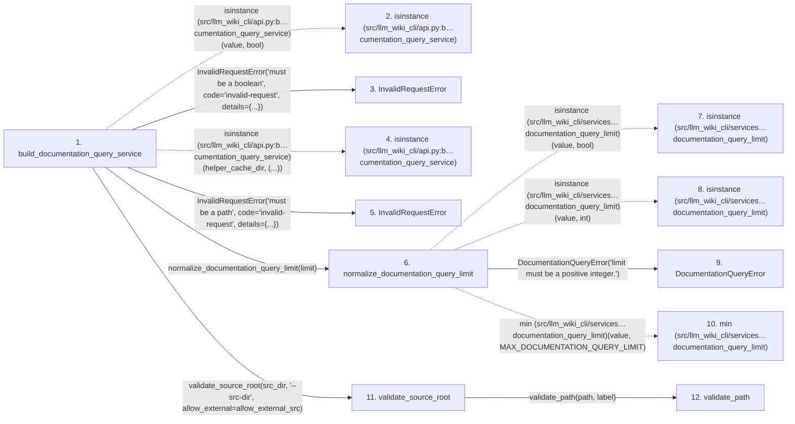

# build_documentation_query_service

**Entry point:** `build_documentation_query_service` (`api`)
**Source:** [api](../modules/api.md)
**Modules touched:** [api](../modules/api.md), [common](../modules/common.md), [config](../modules/config.md), [context_packet](../modules/context_packet.md), and 23 more

**Complete modules touched:**

- [api](../modules/api.md)
- [common](../modules/common.md)
- [config](../modules/config.md)
- [context_packet](../modules/context_packet.md)
- [documentation_queries](../modules/documentation_queries.md)
- [documentation_query_builder](../modules/documentation_query_builder.md)
- [filesystem_guard](../modules/filesystem_guard.md)
- [implementation_evidence](../modules/implementation_evidence.md)
- [io](../modules/io.md)
- [knowledge_consumption](../modules/knowledge_consumption.md)
- [knowledge_evidence](../modules/knowledge_evidence.md)
- [knowledge_governance](../modules/knowledge_governance.md)
- [knowledge_storage](../modules/knowledge_storage.md)
- [knowledge_storage_io](../modules/knowledge_storage_io.md)
- [maintenance_evidence](../modules/maintenance_evidence.md)
- [maintenance_shapes](../modules/maintenance_shapes.md)
- [maintenance_state](../modules/maintenance_state.md)
- [maintenance_status](../modules/maintenance_status.md)
- [manifest_storage](../modules/manifest_storage.md)
- [markdown_sections](../modules/markdown_sections.md)
- [python_implementation](../modules/python_implementation.md)
- [section_ownership](../modules/section_ownership.md)
- [source_path_diagnostics](../modules/source_path_diagnostics.md)
- [source_selection](../modules/source_selection.md)
- [source_snapshot](../modules/source_snapshot.md)
- [sync_manifest](../modules/sync_manifest.md)
- [validation](../modules/validation.md)

## Call sequence

> Static overview in presentation order, not runtime execution order. Arrows retain captured callers; representative internal continuations and boundary examples precede repeated helper detail.

```mermaid
sequenceDiagram
    participant p0 as build_documentation_query_service
    participant p1 as normalize_documentation_query_limit
    participant p2 as validate_source_root
    participant p3 as _validate_wiki_dir
    participant p4 as build_live_documentation_query_service
    participant p5 as InvalidRequestError
    participant p6 as WorkspaceStateError
    participant p7 as _caused_by
    participant p8 as validate_path
    participant p9 as normalize_supplied_paths
    participant p10 as resolve_source_selection
    participant p11 as capture_source_selection_inputs
    participant p12 as validate_live_query_source_selection
    participant p13 as windows_current_user_sid
    participant p14 as _source_anchor
    participant p15 as _wiki_anchor
    participant p16 as source_path_diagnostics
    participant p17 as _live_source_selection_identity
    participant p18 as confirmed_missing_source_paths (src/llm_wiki_cli/services/context_packet.py)
    participant p19 as attach_implementation_read_view
    participant p20 as analysis_identity
    participant p21 as read_guarded
    participant p22 as attach_maintenance_view_from_inputs
    participant p23 as _assert_source_unchanged
    participant p24 as _assert_wiki_unchanged
    participant p25 as _portable_supplied_path
    participant p26 as SyncManifest.load
    participant p27 as _domain_hash
    participant p28 as confirmed_missing_source_paths (src/llm_wiki_cli/services/source_snapshot.py)
    participant p29 as isinstance (src/llm_wiki_cli/api.py:b…cumentation_query_service)
    participant p30 as src_root.is_dir
    p0->>p1: normalize_documentation_query_limit
    p0->>p2: validate_source_root
    p0->>p3: _validate_wiki_dir
    p0->>p4: build_live_documentation_query_service
    p0->>p5: InvalidRequestError
    p0->>p6: WorkspaceStateError
    p0->>p7: _caused_by
    p2->>p8: validate_path
    p4->>p9: normalize_supplied_paths
    p4->>p10: resolve_source_selection
    p4->>p11: capture_source_selection_inputs
    p4->>p12: validate_live_query_source_selection
    p2->>p13: windows_current_user_sid
    p4->>p14: _source_anchor
    p4->>p15: _wiki_anchor
    p4->>p16: source_path_diagnostics
    p4->>p17: _live_source_selection_identity
    p4->>p18: confirmed_missing_source_paths (src/llm_wiki_cli/services/context_packet.py)
    p4->>p19: attach_implementation_read_view
    p4->>p20: analysis_identity
    p4->>p21: read_guarded
    p4->>p22: attach_maintenance_view_from_inputs
    p4->>p23: _assert_source_unchanged
    p4->>p24: _assert_wiki_unchanged
    p9->>p25: _portable_supplied_path
    p12->>p26: SyncManifest.load
    p14->>p27: _domain_hash
    p18->>p28: confirmed_missing_source_paths (src/llm_wiki_cli/services/source_snapshot.py)
    p0-->>p29: isinstance (src/llm_wiki_cli/api.py:b…cumentation_query_service)(value, bool)
    p0-->>p30: src_root.is_dir
```

<!-- Auto-generated from static call edges. Dashed arrows are external or unresolved calls. Reviewed runtime conditions and side effects belong in Behavior. -->

> Call sequence diagram shows 30 of 1871 interactions; 1841 omitted to keep the visualization within the 30-interaction and generated-diagram limits, with uncertain identities omitted rather than inferred.

> Captured boundary calls: external 1 of 683 (682 omitted); unresolved 1 of 491 (490 omitted). These counts cover the captured static trace.

Omitted captured detail, grouped by actual caller occurrence and target module:

| Caller | Parent step | Target module | Kind | Omitted interactions |
| --- | --- | --- | --- | --- |
| `src/llm_wiki_cli/api.py:build_documentation_query_service` | 1 | - | external | 9 |
| `src/llm_wiki_cli/api.py:build_documentation_query_service` | 1 | [src/llm_wiki_cli/api.py](../modules/api.md) | internal | 7 |
| `src/llm_wiki_cli/services/documentation_query_builder.py:normalize_documentation_query_limit` | 6 | - | external | 3 |
| `src/llm_wiki_cli/services/documentation_query_builder.py:normalize_documentation_query_limit` | 6 | [src/llm_wiki_cli/services/documentation_queries.py](../modules/documentation_queries.md) | internal | 1 |
| `src/llm_wiki_cli/config.py:validate_path` | 12 | [src/llm_wiki_cli/config.py](../modules/config.md) | internal | 2 |
| `src/llm_wiki_cli/config.py:validate_path` | 12 | - | unresolved | 3 |
| `src/llm_wiki_cli/config.py:validate_path` | 12 | - | external | 2 |
| `src/llm_wiki_cli/config.py:validate_source_root` | 11 | - | unresolved | 5 |
> Omission summary shows 8 of 448 groups; 440 further groups are not expanded here. Counts above include all omitted interactions.
> Detailed flow queries retain their own coverage and limits; omitted paths may execute at runtime.

> Trace truncated at the depth limit; deeper calls are omitted.

## Data flow

<!-- Auto-generated static analysis. Treat values and boundaries as best-effort hints, not runtime proof. -->

### Step data

| Step | Inputs | Reads | Writes | Returns |
|---|---|---|---|---|
| `build_documentation_query_service` | `src_dir: str`, `wiki_dir: str`, `limit: int`, `allow_external_src: bool`, `read_only: bool`, `source_selection: str \| Path \| None`, `helper_cache_dir: str \| Path \| None`, `comparison_policy: str \| None` | `Path`, `extract_cmd`, `extract_cmd`, `extract_cmd`, `build_flow`, `evaluate_surface_index`, `context_cmd`, `context_cmd` | - | `build_live_documentation_query_service(...)` |
| `isinstance (src/llm_wiki_cli/api.py:b…cumentation_query_service)` | - | - | - | - |
| `InvalidRequestError` | - | - | - | - |
| `isinstance (src/llm_wiki_cli/api.py:b…cumentation_query_service)` | - | - | - | - |
| `InvalidRequestError` | - | - | - | - |
| `normalize_documentation_query_limit` | `value: object` | `MAX_DOCUMENTATION_QUERY_LIMIT` | - | `min(...)` |
| `isinstance (src/llm_wiki_cli/services…documentation_query_limit)` | - | - | - | - |
| `isinstance (src/llm_wiki_cli/services…documentation_query_limit)` | - | - | - | - |
| `DocumentationQueryError` | - | - | - | - |
| `min (src/llm_wiki_cli/services…documentation_query_limit)` | - | - | - | - |
| `validate_source_root` | `path: str`, `label: str`, `allow_external: bool` | `sys`, `os`, `WindowsSecurityGuardError`, `sys` | - | `validate_path(...)`, `resolved` |
| `validate_path` | `path: str`, `label: str` | - | - | `resolved` |

### Call data

| From | To | Line | Call |
|---|---|---:|---|
| build_documentation_query_service | isinstance (src/llm_wiki_cli/api.py:b…cumentation_query_service) | 1919 | `isinstance(value, bool)` |
| build_documentation_query_service | InvalidRequestError | 1920 | `InvalidRequestError('must be a boolean', code='invalid-request', details={...})` |
| build_documentation_query_service | isinstance (src/llm_wiki_cli/api.py:b…cumentation_query_service) | 1925 | `isinstance(helper_cache_dir, (...))` |
| build_documentation_query_service | InvalidRequestError | 1928 | `InvalidRequestError('must be a path', code='invalid-request', details={...})` |
| build_documentation_query_service | normalize_documentation_query_limit | 1933 | `normalize_documentation_query_limit(limit)` |
| normalize_documentation_query_limit | isinstance (src/llm_wiki_cli/services…documentation_query_limit) | 56 | `isinstance(value, bool)` |
| normalize_documentation_query_limit | isinstance (src/llm_wiki_cli/services…documentation_query_limit) | 56 | `isinstance(value, int)` |
| normalize_documentation_query_limit | DocumentationQueryError | 57 | `DocumentationQueryError('limit must be a positive integer.')` |
| normalize_documentation_query_limit | min (src/llm_wiki_cli/services…documentation_query_limit) | 58 | `min(value, MAX_DOCUMENTATION_QUERY_LIMIT)` |
| build_documentation_query_service | validate_source_root | 1934 | `validate_source_root(src_dir, '--src-dir', allow_external=allow_external_src)` |
| validate_source_root | validate_path | 160 | `validate_path(path, label)` |

### Boundary effects

*No boundary effects detected.*

### Static analysis gaps

| Kind | Step | Target | Line |
|---|---|---|---:|
| external_call | `build_documentation_query_service` | `isinstance` | 1919 |
| external_call | `build_documentation_query_service` | `isinstance` | 1925 |
| external_call | `normalize_documentation_query_limit` | `isinstance` | 56 |
| external_call | `normalize_documentation_query_limit` | `min` | 58 |
| step_limit | `build_documentation_query_service` | `first 12 steps` | 0 |
| truncated_flow | `build_documentation_query_service` | `depth limit` | 0 |

## Behavior

This flow starts at `build_documentation_query_service` and is classified as `api`. The generated call and data-flow sections are bounded static projections; runtime conditions and side effects require source-level confirmation.
