# build_documentation_query_service_from_view

**Entry point:** `build_documentation_query_service_from_view` (`api`)
**Source:** [documentation_query_builder](../modules/documentation_query_builder.md)
**Modules touched:** [documentation_query_builder](../modules/documentation_query_builder.md), [io](../modules/io.md), [knowledge_consumption](../modules/knowledge_consumption.md), and 3 more

**Complete modules touched:**

- [documentation_query_builder](../modules/documentation_query_builder.md)
- [io](../modules/io.md)
- [knowledge_consumption](../modules/knowledge_consumption.md)
- [knowledge_evidence](../modules/knowledge_evidence.md)
- [knowledge_verification](../modules/knowledge_verification.md)
- [verification_contracts](../modules/verification_contracts.md)

## Call sequence

> Static overview in presentation order, not runtime execution order. Arrows retain captured callers; representative internal continuations and boundary examples precede repeated helper detail.

```mermaid
sequenceDiagram
    participant p0 as build_documentation_query_service_from_view
    participant p1 as attach_machine_verification_read_view
    participant p2 as verification_summaries_for_concepts
    participant p3 as assemble_documentation_query_service
    participant p4 as load_machine_verification_read_view
    participant p5 as _deep_copy
    participant p6 as load_verification_receipt
    participant p7 as evaluate_verification_receipt
    participant p8 as _read_regular_receipt
    participant p9 as deserialize_verification_receipt
    participant p10 as validate_verification_receipt
    participant p11 as serialize_verification_receipt
    participant p12 as _frozen_summaries
    participant p13 as MachineVerificationReadView
    participant p14 as hash_json
    participant p15 as machine_verification_summary
    participant p16 as first_unsafe_path_component
    participant p17 as VerificationReceiptError
    participant p18 as verification_receipt_path
    participant p19 as VerificationReceiptEvaluation
    participant p20 as formatted_json_bytes
    participant p21 as _receipt_to_payload
    participant p22 as verification_receipt_to_payload
    participant p23 as _object
    participant p24 as _exact_fields
    participant p25 as _string
    participant p26 as _receipt_hash
    participant p27 as _scope_uid
    participant p28 as _receipt_anchor_mapping
    participant p29 as isinstance (src/llm_wiki_cli/services…ne_verification_read_view)
    participant p30 as service_factory
    p0->>p1: attach_machine_verification_read_view
    p0->>p2: verification_summaries_for_concepts
    p0->>p3: assemble_documentation_query_service
    p1->>p4: load_machine_verification_read_view
    p2->>p5: _deep_copy
    p4->>p6: load_verification_receipt
    p4->>p7: evaluate_verification_receipt
    p6->>p8: _read_regular_receipt
    p6->>p9: deserialize_verification_receipt
    p9->>p10: validate_verification_receipt
    p9->>p11: serialize_verification_receipt
    p2->>p12: _frozen_summaries
    p4->>p13: MachineVerificationReadView
    p4->>p14: hash_json
    p4->>p15: machine_verification_summary
    p6->>p16: first_unsafe_path_component
    p6->>p17: VerificationReceiptError
    p6->>p18: verification_receipt_path
    p7->>p19: VerificationReceiptEvaluation
    p11->>p20: formatted_json_bytes
    p10->>p21: _receipt_to_payload
    p11->>p22: verification_receipt_to_payload
    p10->>p23: _object
    p10->>p24: _exact_fields
    p10->>p25: _string
    p10->>p26: _receipt_hash
    p10->>p27: _scope_uid
    p10->>p28: _receipt_anchor_mapping
    p1-->>p29: isinstance (src/llm_wiki_cli/services…ne_verification_read_view)(knowledge_view, KnowledgeReadView)
    p3-->>p30: service_factory(…)
```

<!-- Auto-generated from static call edges. Dashed arrows are external or unresolved calls. Reviewed runtime conditions and side effects belong in Behavior. -->

> Call sequence diagram shows 30 of 198 interactions; 168 omitted to keep the visualization within the 30-interaction and generated-diagram limits, with uncertain identities omitted rather than inferred.

> Captured boundary calls: external 1 of 95 (94 omitted); unresolved 1 of 33 (32 omitted). These counts cover the captured static trace.

Omitted captured detail, grouped by actual caller occurrence and target module:

| Caller | Parent step | Target module | Kind | Omitted interactions |
| --- | --- | --- | --- | --- |
| `src/llm_wiki_cli/services/knowledge_verification.py:attach_machine_verification_read_view` | 2 | - | external | 2 |
| `src/llm_wiki_cli/services/knowledge_verification.py:load_machine_verification_read_view` | 6 | - | external | 11 |
| `src/llm_wiki_cli/services/verification_contracts.py:load_verification_receipt` | 10 | - | external | 1 |
| `src/llm_wiki_cli/services/io.py:first_unsafe_path_component` | 12 | - | external | 20 |
| `src/llm_wiki_cli/services/io.py:first_unsafe_path_component` | 12 | - | unresolved | 5 |
| `src/llm_wiki_cli/services/verification_contracts.py:load_verification_receipt` | 10 | - | unresolved | 1 |
| `src/llm_wiki_cli/services/verification_contracts.py:load_verification_receipt` | 10 | [src/llm_wiki_cli/services/verification_contracts.py](../modules/verification_contracts.md) | internal | 1 |
| `src/llm_wiki_cli/services/verification_contracts.py:verification_receipt_path` | 41 | - | external | 1 |
> Omission summary shows 8 of 33 groups; 25 further groups are not expanded here. Counts above include all omitted interactions.
> Detailed flow queries retain their own coverage and limits; omitted paths may execute at runtime.

> Trace truncated at the depth limit; deeper calls are omitted.

## Data flow

```mermaid
flowchart LR
    s1["1. build_documentation_query_service_from_view"]
    s2["2. attach_machine_verification_read_view"]
    s3["3. isinstance (src/llm_wiki_cli/services…ne_verification_read_view)"]
    s4["4. TypeError (src/llm_wiki_cli/services…ne_verification_read_view)"]
    s5["5. replace"]
    s6["6. load_machine_verification_read_view"]
    s7["7. isinstance (src/llm_wiki_cli/services…verification_read_view, 1)"]
    s8["8. TypeError (src/llm_wiki_cli/services…verification_read_view, 1)"]
    s9["9. MachineVerificationReadView"]
    s10["10. load_verification_receipt"]
    s11["11. Path (src/llm_wiki_cli/services…load_verification_receipt)"]
    s12["12. first_unsafe_path_component"]
    s1 -->|"attach_machine_verification_read_view(wiki_root, knowledge_view)"| s2
    s2 -. "isinstance (src/llm_wiki_cli/services…ne_verification_read_view)(knowledge_view, KnowledgeReadView)" .-> s3
    s2 -. "TypeError (src/llm_wiki_cli/services…ne_verification_read_view)('knowledge_view must be a KnowledgeReadView')" .-> s4
    s2 -. "replace(knowledge_view, machine_verification=load_machine_verification_read_view(...))" .-> s5
    s2 -->|"load_machine_verification_read_view(wiki_dir, knowledge_view)"| s6
    s6 -. "isinstance (src/llm_wiki_cli/services…verification_read_view, 1)(knowledge_view, KnowledgeReadView)" .-> s7
    s6 -. "TypeError (src/llm_wiki_cli/services…verification_read_view, 1)('knowledge_view must be a KnowledgeReadView')" .-> s8
    s6 -->|"MachineVerificationReadView(availability=MachineVerificationAvailability.ABSENT, reason='verification-receipt-not-present')"| s9
    s6 -->|"load_verification_receipt(Path(...))"| s10
    s10 -. "Path (src/llm_wiki_cli/services…load_verification_receipt)(wiki_dir)" .-> s11
    s10 -->|"first_unsafe_path_component(root)"| s12
    b0["mutation pending_parts.pop"]
    s12 -. "mutation pending_parts.pop" .-> b0
    click s1 "../modules/documentation_query_builder.md"
    click s2 "../modules/knowledge_verification.md"
    click s6 "../modules/knowledge_verification.md"
    click s9 "../modules/knowledge_consumption.md"
    click s10 "../modules/verification_contracts.md"
    click s12 "../modules/io.md"
    classDef boundary stroke:#b45309,stroke-dasharray: 4 2
    class b0 boundary
```

<!-- Auto-generated static analysis. Treat values and boundaries as best-effort hints, not runtime proof. -->

### Analysis coverage

**Effect analysis partially available.** Flow assembly and source effect analysis are separate; empty observations do not prove an empty handler body.

Source steps: 71; effect analysis evaluated: 40, partial: 3, unavailable: 28. Counts include steps omitted from the displayed trace.

Collector observations for 43 source steps with known totals: observed: 237, emitted: 227, omitted: 10. Unavailable totals are excluded.

- Callable record unavailable for one or more source steps; those steps have no represented callable body.
- Effect collector omitted observations before flow assembly; displayed effects are partial.
- Effect collector totals unavailable; observed counts cover captured records only.

| Step | Callable record | Effect analysis | Collector totals | Observed | Emitted | Omitted |
|---|---|---|---|---:|---:|---:|
| `build_documentation_query_service_from_view` | `available` | `partial` | `available` | `12` | `9` | `3` |
| `attach_machine_verification_read_view` | `available` | `evaluated` | `available` | `6` | `6` | `0` |
| `isinstance (src/llm_wiki_cli/services…ne_verification_read_view)` | `not_applicable` | `not_applicable` | `not_applicable` | — | — | — |
| `TypeError (src/llm_wiki_cli/services…ne_verification_read_view)` | `not_applicable` | `not_applicable` | `not_applicable` | — | — | — |
| `replace` | `not_applicable` | `not_applicable` | `not_applicable` | — | — | — |
| `load_machine_verification_read_view` | `available` | `evaluated` | `available` | `13` | `13` | `0` |
| `isinstance (src/llm_wiki_cli/services…verification_read_view, 1)` | `not_applicable` | `not_applicable` | `not_applicable` | — | — | — |
| `TypeError (src/llm_wiki_cli/services…verification_read_view, 1)` | `not_applicable` | `not_applicable` | `not_applicable` | — | — | — |
| `MachineVerificationReadView` | `unavailable` | `unavailable` | `unavailable` | — | — | — |
| `load_verification_receipt` | `available` | `evaluated` | `available` | `4` | `4` | `0` |
| `Path (src/llm_wiki_cli/services…load_verification_receipt)` | `not_applicable` | `not_applicable` | `not_applicable` | — | — | — |
| `first_unsafe_path_component` | `available` | `evaluated` | `available` | `14` | `14` | `0` |

### Step data

| Step | Inputs | Reads | Writes | Returns |
|---|---|---|---|---|
| `build_documentation_query_service_from_view` | `wiki_root: Path`, `knowledge_view: KnowledgeReadView`, `limit: int`, `inventory: Mapping[str, Mapping[str, Any]] \| None`, `call_edges: Iterable[Mapping[str, Any]]`, `flows: Iterable[Mapping[str, Any]]`, `data_flows: object`, `dependency_analysis: Mapping[str, Any] \| None` | - | - | `assemble_documentation_query_service(...)` |
| `attach_machine_verification_read_view` | `wiki_dir: str \| Path`, `knowledge_view: KnowledgeReadView` | `KnowledgeReadView`, `MachineVerificationAvailability` | - | `knowledge_view`, `replace(...)` |
| `isinstance (src/llm_wiki_cli/services…ne_verification_read_view)` | - | - | - | - |
| `TypeError (src/llm_wiki_cli/services…ne_verification_read_view)` | - | - | - | - |
| `replace` | - | - | - | - |
| `load_machine_verification_read_view` | `wiki_dir: str \| Path`, `knowledge_view: KnowledgeReadView` | `KnowledgeReadView`, `MachineVerificationAvailability`, `MachineVerificationAvailability`, `MachineVerificationAvailability`, `GOVERNANCE_EXTENSION_KEY`, `Mapping`, `MachineVerificationAvailability` | - | `MachineVerificationReadView(...)`, `MachineVerificationReadView(...)`, `MachineVerificationReadView(...)`, `MachineVerificationReadView(...)` |
| `isinstance (src/llm_wiki_cli/services…verification_read_view, 1)` | - | - | - | - |
| `TypeError (src/llm_wiki_cli/services…verification_read_view, 1)` | - | - | - | - |
| `MachineVerificationReadView` | - | - | - | - |
| `load_verification_receipt` | `wiki_dir: str \| Path`, `missing_ok: bool` | - | - | `None`, `deserialize_verification_receipt(...)` |
| `Path (src/llm_wiki_cli/services…load_verification_receipt)` | - | - | - | - |
| `first_unsafe_path_component` | `path: str \| Path`, `trusted_symlink_uids: Set[int] \| None`, `trusted_symlink_owner: Callable[[Path], bool] \| None` | `stat`, `os` | - | `lexical`, `None`, `current`, `current`, `current`, `current`, `current`, `None` |

### Call data

| From | To | Line | Call |
|---|---|---:|---|
| build_documentation_query_service_from_view | attach_machine_verification_read_view | 414 | `attach_machine_verification_read_view(wiki_root, knowledge_view)` |
| attach_machine_verification_read_view | isinstance (src/llm_wiki_cli/services…ne_verification_read_view) | 53 | `isinstance(knowledge_view, KnowledgeReadView)` |
| attach_machine_verification_read_view | TypeError (src/llm_wiki_cli/services…ne_verification_read_view) | 54 | `TypeError('knowledge_view must be a KnowledgeReadView')` |
| attach_machine_verification_read_view | replace | 60 | `replace(knowledge_view, machine_verification=load_machine_verification_read_view(...))` |
| attach_machine_verification_read_view | load_machine_verification_read_view | 62 | `load_machine_verification_read_view(wiki_dir, knowledge_view)` |
| load_machine_verification_read_view | isinstance (src/llm_wiki_cli/services…verification_read_view, 1) | 75 | `isinstance(knowledge_view, KnowledgeReadView)` |
| load_machine_verification_read_view | TypeError (src/llm_wiki_cli/services…verification_read_view, 1) | 76 | `TypeError('knowledge_view must be a KnowledgeReadView')` |
| load_machine_verification_read_view | MachineVerificationReadView | 80 | `MachineVerificationReadView(availability=MachineVerificationAvailability.ABSENT, reason='verification-receipt-not-present')` |
| load_machine_verification_read_view | load_verification_receipt | 86 | `load_verification_receipt(Path(...))` |
| load_verification_receipt | Path (src/llm_wiki_cli/services…load_verification_receipt) | 956 | `Path(wiki_dir)` |
| load_verification_receipt | first_unsafe_path_component | 957 | `first_unsafe_path_component(root)` |

### Boundary effects

| Kind | Target | Step | Line |
|---|---|---|---:|
| mutation | `pending_parts.pop` | `first_unsafe_path_component` | 71 |

### Static analysis gaps

| Kind | Step | Target | Line |
|---|---|---|---:|
| external_call | `attach_machine_verification_read_view` | `isinstance` | 53 |
| external_call | `attach_machine_verification_read_view` | `TypeError` | 54 |
| external_call | `attach_machine_verification_read_view` | `replace` | 60 |
| external_call | `load_machine_verification_read_view` | `isinstance` | 75 |
| external_call | `load_machine_verification_read_view` | `TypeError` | 76 |
| step_limit | `build_documentation_query_service_from_view` | `first 12 steps` | 0 |
| truncated_flow | `build_documentation_query_service_from_view` | `depth limit` | 0 |

## Behavior

This flow starts at `build_documentation_query_service_from_view` and is classified as `api`. The generated call and data-flow sections are bounded static projections; runtime conditions and side effects require source-level confirmation.
