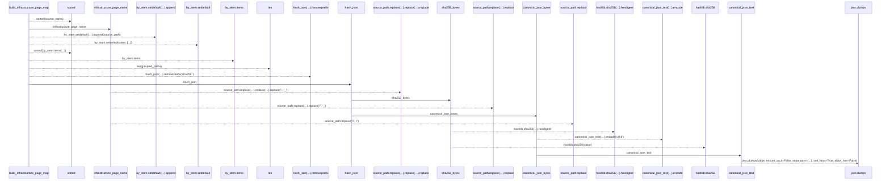
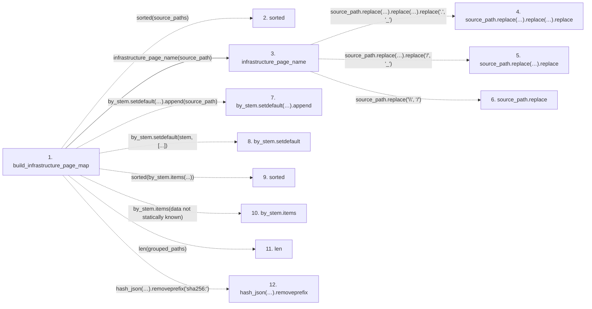

# build_infrastructure_page_map

**Entry point:** `build_infrastructure_page_map` (`api`)
**Source:** [infrastructure_sync](../modules/infrastructure_sync.md)
**Modules touched:** [infrastructure_inventory](../modules/infrastructure_inventory.md), [infrastructure_sync](../modules/infrastructure_sync.md), [knowledge_evidence](../modules/knowledge_evidence.md)

## Call sequence

> Static overview in presentation order, not runtime execution order. Arrows retain captured callers; representative internal continuations and boundary examples precede repeated helper detail.

<!-- Auto-generated from static call edges. Dashed arrows are external or unresolved calls. Reviewed runtime conditions and side effects belong in Behavior. -->

> Call sequence diagram shows 19 of 19 interactions; 0 omitted to keep the visualization within the 30-interaction and generated-diagram limits, with uncertain identities omitted rather than inferred.

> Captured boundary calls: external 5 of 5 (0 omitted); unresolved 9 of 9 (0 omitted). These counts cover the captured static trace.
> Detailed flow queries retain their own coverage and limits; omitted paths may execute at runtime.

## Data flow

<!-- Auto-generated static analysis. Treat values and boundaries as best-effort hints, not runtime proof. -->

### Step data

| Step | Inputs | Reads | Writes | Returns |
|---|---|---|---|---|
| `build_infrastructure_page_map` | `source_paths: Mapping[str, object] \| tuple[str, ...] \| list[str] \| set[str]` | - | `result[...]` | `result` |
| `sorted` | - | - | - | - |
| `infrastructure_page_name` | `source_path: str` | - | - | `...` |
| `source_path.replace(…).replace(…).replace` | - | - | - | - |
| `source_path.replace(…).replace` | - | - | - | - |
| `source_path.replace` | - | - | - | - |
| `by_stem.setdefault(…).append` | - | - | - | - |
| `by_stem.setdefault` | - | - | - | - |
| `sorted` | - | - | - | - |
| `by_stem.items` | - | - | - | - |
| `len` | - | - | - | - |
| `hash_json(…).removeprefix` | - | - | - | - |

### Call data

| From | To | Line | Call |
|---|---|---:|---|
| build_infrastructure_page_map | sorted | 42 | `sorted(source_paths)` |
| build_infrastructure_page_map | infrastructure_page_name | 45 | `infrastructure_page_name(source_path)` |
| infrastructure_page_name | source_path.replace(…).replace(…).replace | 28 | `source_path.replace('\\', '/').replace('/', '_').replace('.', '_')` |
| infrastructure_page_name | source_path.replace(…).replace | 28 | `source_path.replace('\\', '/').replace('/', '_')` |
| infrastructure_page_name | source_path.replace | 28 | `source_path.replace('\\', '/')` |
| build_infrastructure_page_map | by_stem.setdefault(…).append | 46 | `by_stem.setdefault(stem, []).append(source_path)` |
| build_infrastructure_page_map | by_stem.setdefault | 46 | `by_stem.setdefault(stem, [...])` |
| build_infrastructure_page_map | sorted | 48 | `sorted(by_stem.items(...))` |
| build_infrastructure_page_map | by_stem.items | 48 | `by_stem.items(data not statically known)` |
| build_infrastructure_page_map | len | 49 | `len(grouped_paths)` |
| build_infrastructure_page_map | hash_json(…).removeprefix | 53 | `hash_json(source_path).removeprefix('sha256:')` |

### Boundary effects

*No boundary effects detected.*

### Static analysis gaps

| Kind | Step | Target | Line |
|---|---|---|---:|
| external_call | `build_infrastructure_page_map` | `sorted` | 42 |
| unresolved_call | `infrastructure_page_name` | `source_path.replace('\\', '/').replace('/', '_').replace` | 28 |
| unresolved_call | `infrastructure_page_name` | `source_path.replace('\\', '/').replace` | 28 |
| unresolved_call | `infrastructure_page_name` | `source_path.replace` | 28 |
| unresolved_call | `build_infrastructure_page_map` | `by_stem.setdefault(stem, []).append` | 46 |
| unresolved_call | `build_infrastructure_page_map` | `by_stem.setdefault` | 46 |
| external_call | `build_infrastructure_page_map` | `sorted` | 48 |
| unresolved_call | `build_infrastructure_page_map` | `by_stem.items` | 48 |
| unresolved_call | `build_infrastructure_page_map` | `hash_json(source_path).removeprefix` | 53 |
| step_limit | `build_infrastructure_page_map` | `first 12 steps` | 0 |

## Behavior

This flow starts at `build_infrastructure_page_map` and is classified as `api`. The generated call and data-flow sections are bounded static projections; runtime conditions and side effects require source-level confirmation.
