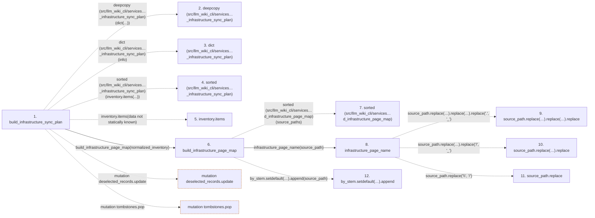

# build_infrastructure_sync_plan

**Entry point:** `build_infrastructure_sync_plan` (`api`)
**Source:** [infrastructure_sync](../modules/infrastructure_sync.md)
**Modules touched:** [infrastructure_inventory](../modules/infrastructure_inventory.md), [infrastructure_sync](../modules/infrastructure_sync.md), [knowledge_evidence](../modules/knowledge_evidence.md), and 2 more

**Complete modules touched:**

- [infrastructure_inventory](../modules/infrastructure_inventory.md)
- [infrastructure_sync](../modules/infrastructure_sync.md)
- [knowledge_evidence](../modules/knowledge_evidence.md)
- [validation](../modules/validation.md)
- [yaml_syntax](../modules/yaml_syntax.md)

## Call sequence

> Static overview in presentation order, not runtime execution order. Arrows retain captured callers; representative internal continuations and boundary examples precede repeated helper detail.

```mermaid
sequenceDiagram
    participant p0 as build_infrastructure_sync_plan
    participant p1 as build_infrastructure_page_map
    participant p2 as _prior_infrastructure_state
    participant p3 as _record_mapping
    participant p4 as _deselection_only_state
    participant p5 as _source_record
    participant p6 as _detect_moves
    participant p7 as _unsupported_yaml_records
    participant p8 as _candidate_roots
    participant p9 as _selected_prior_tombstones
    participant p10 as _tombstone
    participant p11 as _yaml_candidates
    participant p12 as _discovery_status
    participant p13 as InfrastructureSyncPlan
    participant p14 as _source_hash
    participant p15 as _observation_hash
    participant p16 as load_yaml_documents
    participant p17 as _valid_repository_path
    participant p18 as _pruned_prior_discovery
    participant p19 as hash_json
    participant p20 as canonical_json_bytes
    participant p21 as is_portable_relative_path
    participant p22 as _check_events
    participant p23 as _convert_node
    participant p24 as require_portable_relative_path
    participant p25 as _convert_mapping
    participant p26 as _default_path_error
    participant p27 as _check_path_collision
    participant p28 as require_portable_path_component
    participant p29 as deepcopy (src/llm_wiki_cli/services…_infrastructure_sync_plan)
    participant p30 as inventory.items
    p0->>p1: build_infrastructure_page_map
    p0->>p2: _prior_infrastructure_state
    p0->>p3: _record_mapping
    p0->>p4: _deselection_only_state
    p0->>p5: _source_record
    p0->>p6: _detect_moves
    p0->>p7: _unsupported_yaml_records
    p0->>p8: _candidate_roots
    p0->>p9: _selected_prior_tombstones
    p0->>p10: _tombstone
    p0->>p11: _yaml_candidates
    p0->>p12: _discovery_status
    p0->>p13: InfrastructureSyncPlan
    p5->>p14: _source_hash
    p5->>p15: _observation_hash
    p7->>p16: load_yaml_documents
    p3->>p17: _valid_repository_path
    p4->>p18: _pruned_prior_discovery
    p1->>p19: hash_json
    p19->>p20: canonical_json_bytes
    p17->>p21: is_portable_relative_path
    p16->>p22: _check_events
    p16->>p23: _convert_node
    p21->>p24: require_portable_relative_path
    p23->>p25: _convert_mapping
    p24->>p26: _default_path_error
    p24->>p27: _check_path_collision
    p24->>p28: require_portable_path_component
    p0-->>p29: deepcopy (src/llm_wiki_cli/services…_infrastructure_sync_plan)(dict(...))
    p0-->>p30: inventory.items
```

<!-- Auto-generated from static call edges. Dashed arrows are external or unresolved calls. Reviewed runtime conditions and side effects belong in Behavior. -->

> Call sequence diagram shows 30 of 334 interactions; 304 omitted to keep the visualization within the 30-interaction and generated-diagram limits, with uncertain identities omitted rather than inferred.

> Captured boundary calls: external 1 of 140 (139 omitted); unresolved 1 of 96 (95 omitted). These counts cover the captured static trace.

Omitted captured detail, grouped by actual caller occurrence and target module:

| Caller | Parent step | Target module | Kind | Omitted interactions |
| --- | --- | --- | --- | --- |
| `src/llm_wiki_cli/services/infrastructure_sync.py:build_infrastructure_sync_plan` | 1 | - | external | 28 |
| `src/llm_wiki_cli/services/infrastructure_sync.py:build_infrastructure_page_map` | 6 | - | external | 3 |
| `src/llm_wiki_cli/services/infrastructure_sync.py:build_infrastructure_page_map` | 6 | [src/llm_wiki_cli/services/infrastructure_inventory.py](../modules/infrastructure_inventory.md) | internal | 1 |
| `src/llm_wiki_cli/services/infrastructure_inventory.py:infrastructure_page_name` | 8 | - | unresolved | 3 |
| `src/llm_wiki_cli/services/infrastructure_sync.py:build_infrastructure_page_map` | 6 | - | unresolved | 4 |
| `src/llm_wiki_cli/services/knowledge_evidence.py:hash_json` | 18 | [src/llm_wiki_cli/services/knowledge_evidence.py](../modules/knowledge_evidence.md) | internal | 1 |
| `src/llm_wiki_cli/services/knowledge_evidence.py:sha256_bytes` | 19 | - | unresolved | 1 |
| `src/llm_wiki_cli/services/knowledge_evidence.py:sha256_bytes` | 19 | - | external | 1 |
> Omission summary shows 8 of 76 groups; 68 further groups are not expanded here. Counts above include all omitted interactions.
> Detailed flow queries retain their own coverage and limits; omitted paths may execute at runtime.

> Trace truncated at the depth limit; deeper calls are omitted.

## Data flow

<!-- Auto-generated static analysis. Treat values and boundaries as best-effort hints, not runtime proof. -->

### Analysis coverage

**Effect analysis partially available.** Flow assembly and source effect analysis are separate; empty observations do not prove an empty handler body.

Source steps: 99; effect analysis evaluated: 53, partial: 8, unavailable: 38. Counts include steps omitted from the displayed trace.

Collector observations for 61 source steps with known totals: observed: 385, emitted: 362, omitted: 23. Unavailable totals are excluded.

- Callable record unavailable for one or more source steps; those steps have no represented callable body.
- Effect collector omitted observations before flow assembly; displayed effects are partial.
- Effect collector totals unavailable; observed counts cover captured records only.

| Step | Callable record | Effect analysis | Collector totals | Observed | Emitted | Omitted |
|---|---|---|---|---:|---:|---:|
| `build_infrastructure_sync_plan` | `available` | `evaluated` | `available` | `9` | `9` | `0` |
| `deepcopy (src/llm_wiki_cli/services…_infrastructure_sync_plan)` | `not_applicable` | `not_applicable` | `not_applicable` | — | — | — |
| `dict (src/llm_wiki_cli/services…_infrastructure_sync_plan)` | `not_applicable` | `not_applicable` | `not_applicable` | — | — | — |
| `sorted (src/llm_wiki_cli/services…_infrastructure_sync_plan)` | `not_applicable` | `not_applicable` | `not_applicable` | — | — | — |
| `inventory.items` | `not_applicable` | `not_applicable` | `not_applicable` | — | — | — |
| `build_infrastructure_page_map` | `available` | `evaluated` | `available` | `3` | `3` | `0` |
| `sorted (src/llm_wiki_cli/services…d_infrastructure_page_map)` | `not_applicable` | `not_applicable` | `not_applicable` | — | — | — |
| `infrastructure_page_name` | `available` | `evaluated` | `available` | `2` | `2` | `0` |
| `source_path.replace(…).replace(…).replace` | `not_applicable` | `not_applicable` | `not_applicable` | — | — | — |
| `source_path.replace(…).replace` | `not_applicable` | `not_applicable` | `not_applicable` | — | — | — |
| `source_path.replace` | `not_applicable` | `not_applicable` | `not_applicable` | — | — | — |
| `by_stem.setdefault(…).append` | `not_applicable` | `not_applicable` | `not_applicable` | — | — | — |

### Step data

| Step | Inputs | Reads | Writes | Returns |
|---|---|---|---|---|
| `build_infrastructure_sync_plan` | `snapshot: SourceSnapshot`, `inventory: Mapping[str, Mapping[str, object]]`, `generation_inputs: Mapping[str, object] \| None` | `INFRASTRUCTURE_SYNC_SCHEMA_VERSION` | `tombstones[...]`, `tombstones[...]` | `InfrastructureSyncPlan(...)` |
| `deepcopy (src/llm_wiki_cli/services…_infrastructure_sync_plan)` | - | - | - | - |
| `dict (src/llm_wiki_cli/services…_infrastructure_sync_plan)` | - | - | - | - |
| `sorted (src/llm_wiki_cli/services…_infrastructure_sync_plan)` | - | - | - | - |
| `inventory.items` | - | - | - | - |
| `build_infrastructure_page_map` | `source_paths: Mapping[str, object] \| tuple[str, ...] \| list[str] \| set[str]` | - | `result[...]` | `result` |
| `sorted (src/llm_wiki_cli/services…d_infrastructure_page_map)` | - | - | - | - |
| `infrastructure_page_name` | `source_path: str` | - | - | `...` |
| `source_path.replace(…).replace(…).replace` | - | - | - | - |
| `source_path.replace(…).replace` | - | - | - | - |
| `source_path.replace` | - | - | - | - |
| `by_stem.setdefault(…).append` | - | - | - | - |

### Call data

| From | To | Line | Call |
|---|---|---:|---|
| build_infrastructure_sync_plan | deepcopy (src/llm_wiki_cli/services…_infrastructure_sync_plan) | 636 | `deepcopy(dict(...))` |
| build_infrastructure_sync_plan | dict (src/llm_wiki_cli/services…_infrastructure_sync_plan) | 636 | `dict(info)` |
| build_infrastructure_sync_plan | sorted (src/llm_wiki_cli/services…_infrastructure_sync_plan) | 637 | `sorted(inventory.items(...))` |
| build_infrastructure_sync_plan | inventory.items | 637 | `inventory.items(data not statically known)` |
| build_infrastructure_sync_plan | build_infrastructure_page_map | 639 | `build_infrastructure_page_map(normalized_inventory)` |
| build_infrastructure_page_map | sorted (src/llm_wiki_cli/services…d_infrastructure_page_map) | 42 | `sorted(source_paths)` |
| build_infrastructure_page_map | infrastructure_page_name | 45 | `infrastructure_page_name(source_path)` |
| infrastructure_page_name | source_path.replace(…).replace(…).replace | 31 | `source_path.replace('\\', '/').replace('/', '_').replace('.', '_')` |
| infrastructure_page_name | source_path.replace(…).replace | 31 | `source_path.replace('\\', '/').replace('/', '_')` |
| infrastructure_page_name | source_path.replace | 31 | `source_path.replace('\\', '/')` |
| build_infrastructure_page_map | by_stem.setdefault(…).append | 46 | `by_stem.setdefault(stem, []).append(source_path)` |

### Boundary effects

| Kind | Target | Step | Line |
|---|---|---|---:|
| mutation | `deselected_records.update` | `build_infrastructure_sync_plan` | 663 |
| mutation | `tombstones.pop` | `build_infrastructure_sync_plan` | 705 |

### Static analysis gaps

| Kind | Step | Target | Line |
|---|---|---|---:|
| external_call | `build_infrastructure_sync_plan` | `deepcopy` | 636 |
| external_call | `build_infrastructure_sync_plan` | `sorted` | 637 |
| unresolved_call | `build_infrastructure_sync_plan` | `inventory.items` | 637 |
| external_call | `build_infrastructure_page_map` | `sorted` | 42 |
| unresolved_call | `infrastructure_page_name` | `source_path.replace('\\', '/').replace('/', '_').replace` | 31 |
| unresolved_call | `infrastructure_page_name` | `source_path.replace('\\', '/').replace` | 31 |
| unresolved_call | `infrastructure_page_name` | `source_path.replace` | 31 |
| unresolved_call | `build_infrastructure_page_map` | `by_stem.setdefault(stem, []).append` | 46 |
| step_limit | `build_infrastructure_sync_plan` | `first 12 steps` | 0 |
| truncated_flow | `build_infrastructure_sync_plan` | `depth limit` | 0 |

## Behavior

This flow starts at `build_infrastructure_sync_plan` and is classified as `api`. The generated call and data-flow sections are bounded static projections; runtime conditions and side effects require source-level confirmation.
