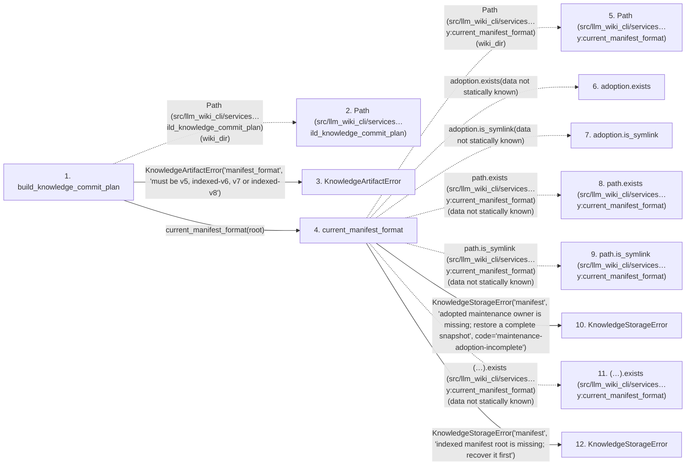

# build_knowledge_commit_plan

**Entry point:** `build_knowledge_commit_plan` (`api`)
**Source:** [knowledge_artifacts](../modules/knowledge_artifacts.md)
**Modules touched:** [canonical_json](../modules/canonical_json.md), [common](../modules/common.md), [concept_identity](../modules/concept_identity.md), [filesystem_guard](../modules/filesystem_guard.md), and 29 more

**Complete modules touched:**

- [canonical_json](../modules/canonical_json.md)
- [common](../modules/common.md)
- [concept_identity](../modules/concept_identity.md)
- [filesystem_guard](../modules/filesystem_guard.md)
- [immutable](../modules/immutable.md)
- [implementation_evidence](../modules/implementation_evidence.md)
- [infrastructure_sync](../modules/infrastructure_sync.md)
- [io](../modules/io.md)
- [knowledge_artifacts](../modules/knowledge_artifacts.md)
- [knowledge_envelope](../modules/knowledge_envelope.md)
- [knowledge_evidence](../modules/knowledge_evidence.md)
- [knowledge_governance](../modules/knowledge_governance.md)
- [knowledge_graph](../modules/knowledge_graph.md)
- [knowledge_index](../modules/knowledge_index.md)
- [knowledge_links](../modules/knowledge_links.md)
- [knowledge_model](../modules/knowledge_model.md)
- [knowledge_packs](../modules/knowledge_packs.md)
- [knowledge_reuse](../modules/knowledge_reuse.md)
- [knowledge_storage](../modules/knowledge_storage.md)
- [knowledge_storage_io](../modules/knowledge_storage_io.md)
- [maintenance_projection](../modules/maintenance_projection.md)
- [maintenance_protocol](../modules/maintenance_protocol.md)
- [maintenance_shapes](../modules/maintenance_shapes.md)
- [maintenance_state](../modules/maintenance_state.md)
- [manifest_storage](../modules/manifest_storage.md)
- [progress](../modules/progress.md)
- [section_ownership](../modules/section_ownership.md)
- [source_retirement](../modules/source_retirement.md)
- [storage_spool](../modules/storage_spool.md)
- [sync_manifest](../modules/sync_manifest.md)
- [validation](../modules/validation.md)
- [wiki_media](../modules/wiki_media.md)
- [wiki_surface](../modules/wiki_surface.md)

## Call sequence

> Static overview in presentation order, not runtime execution order. Arrows retain captured callers; representative internal continuations and boundary examples precede repeated helper detail.

```mermaid
sequenceDiagram
    participant p0 as build_knowledge_commit_plan
    participant p1 as current_manifest_format
    participant p2 as validate_maintenance_adoption
    participant p3 as load_adoption_marker
    participant p4 as _planned_write
    participant p5 as current_knowledge_format
    participant p6 as _validated_index_receipt
    participant p7 as build_storage
    participant p8 as validate_knowledge_artifacts
    participant p9 as build_manifest_store
    participant p10 as formatted_json_bytes
    participant p11 as KnowledgeArtifactError
    participant p12 as canonical_bytes
    participant p13 as digest
    participant p14 as _has_validation_operation
    participant p15 as _model_to_payload
    participant p16 as _validated_index_serialization
    participant p17 as sha256_bytes
    participant p18 as KnowledgeStorageError
    participant p19 as KnowledgeCommitPlan
    participant p20 as _detached
    participant p21 as build_packed_store
    participant p22 as validate_surface_index_bytes
    participant p23 as maintenance_core
    participant p24 as _require_validation_receipt
    participant p25 as _decode_json_object
    participant p26 as read_guarded
    participant p27 as spool_write
    participant p28 as parse_packed_root
    participant p29 as Path (src/llm_wiki_cli/services…ild_knowledge_commit_plan)
    participant p30 as (…).exists (src/llm_wiki_cli/services…ild_knowledge_commit_plan)
    p0->>p1: current_manifest_format
    p0->>p2: validate_maintenance_adoption
    p0->>p3: load_adoption_marker
    p0->>p4: _planned_write
    p0->>p5: current_knowledge_format
    p0->>p6: _validated_index_receipt
    p0->>p7: build_storage
    p0->>p8: validate_knowledge_artifacts
    p0->>p9: build_manifest_store
    p0->>p10: formatted_json_bytes
    p0->>p11: KnowledgeArtifactError
    p0->>p12: canonical_bytes
    p0->>p13: digest
    p0->>p14: _has_validation_operation
    p0->>p15: _model_to_payload
    p0->>p16: _validated_index_serialization
    p0->>p17: sha256_bytes
    p0->>p18: KnowledgeStorageError
    p0->>p19: KnowledgeCommitPlan
    p2->>p20: _detached
    p7->>p21: build_packed_store
    p8->>p22: validate_surface_index_bytes
    p2->>p23: maintenance_core
    p6->>p24: _require_validation_receipt
    p5->>p25: _decode_json_object
    p1->>p26: read_guarded
    p4->>p27: spool_write
    p5->>p28: parse_packed_root
    p0-->>p29: Path (src/llm_wiki_cli/services…ild_knowledge_commit_plan)(wiki_dir)
    p0-->>p30: (…).exists (src/llm_wiki_cli/services…ild_knowledge_commit_plan)
```

<!-- Auto-generated from static call edges. Dashed arrows are external or unresolved calls. Reviewed runtime conditions and side effects belong in Behavior. -->

> Call sequence diagram shows 30 of 2302 interactions; 2272 omitted to keep the visualization within the 30-interaction and generated-diagram limits, with uncertain identities omitted rather than inferred.

> Captured boundary calls: external 1 of 749 (748 omitted); unresolved 1 of 406 (405 omitted). These counts cover the captured static trace.

Omitted captured detail, grouped by actual caller occurrence and target module:

| Caller | Parent step | Target module | Kind | Omitted interactions |
| --- | --- | --- | --- | --- |
| `src/llm_wiki_cli/services/manifest_storage.py:current_manifest_format` | 4 | - | external | 5 |
| `src/llm_wiki_cli/services/manifest_storage.py:current_manifest_format` | 4 | - | unresolved | 7 |
| `src/llm_wiki_cli/services/manifest_storage.py:current_manifest_format` | 4 | [src/llm_wiki_cli/services/knowledge_storage.py](../modules/knowledge_storage.md) | internal | 6 |
| `src/llm_wiki_cli/services/knowledge_storage_io.py:read_guarded` | 14 | [src/llm_wiki_cli/services/knowledge_storage_io.py](../modules/knowledge_storage_io.md) | internal | 15 |
| `src/llm_wiki_cli/services/knowledge_storage_io.py:_validate_range` | 15 | - | external | 4 |
| `src/llm_wiki_cli/services/knowledge_storage_io.py:_validate_range` | 15 | [src/llm_wiki_cli/services/knowledge_storage.py](../modules/knowledge_storage.md) | internal | 2 |
| `src/llm_wiki_cli/services/knowledge_storage_io.py:_absolute_path` | 22 | - | external | 4 |
| `src/llm_wiki_cli/services/knowledge_storage_io.py:_absolute_path` | 22 | [src/llm_wiki_cli/services/io.py](../modules/io.md) | internal | 1 |
> Omission summary shows 8 of 519 groups; 511 further groups are not expanded here. Counts above include all omitted interactions.
> Detailed flow queries retain their own coverage and limits; omitted paths may execute at runtime.

> Trace truncated at the depth limit; deeper calls are omitted.

## Data flow

<!-- Auto-generated static analysis. Treat values and boundaries as best-effort hints, not runtime proof. -->

### Analysis coverage

**Effect analysis partially available.** Flow assembly and source effect analysis are separate; empty observations do not prove an empty handler body.

Source steps: 1148; effect analysis evaluated: 691, partial: 0, unavailable: 457. Counts include steps omitted from the displayed trace.

- Callable record unavailable; the selected entry symbol has no represented callable body.
- Effect collector totals unavailable; observed counts cover captured records only.

| Step | Callable record | Effect analysis | Collector totals |
|---|---|---|---|
| `build_knowledge_commit_plan` | `available` | `evaluated` | `available` |
| `Path (src/llm_wiki_cli/services…ild_knowledge_commit_plan)` | `not_applicable` | `not_applicable` | `not_applicable` |
| `KnowledgeArtifactError` | `unavailable` | `unavailable` | `unavailable` |
| `current_manifest_format` | `available` | `evaluated` | `available` |
| `Path (src/llm_wiki_cli/services…y:current_manifest_format)` | `not_applicable` | `not_applicable` | `not_applicable` |
| `adoption.exists` | `not_applicable` | `not_applicable` | `not_applicable` |
| `adoption.is_symlink` | `not_applicable` | `not_applicable` | `not_applicable` |
| `path.exists (src/llm_wiki_cli/services…y:current_manifest_format)` | `not_applicable` | `not_applicable` | `not_applicable` |
| `path.is_symlink (src/llm_wiki_cli/services…y:current_manifest_format)` | `not_applicable` | `not_applicable` | `not_applicable` |
| `KnowledgeStorageError` | `unavailable` | `unavailable` | `unavailable` |
| `(…).exists (src/llm_wiki_cli/services…y:current_manifest_format)` | `not_applicable` | `not_applicable` | `not_applicable` |
| `KnowledgeStorageError` | `unavailable` | `unavailable` | `unavailable` |

### Step data

| Step | Inputs | Reads | Writes | Returns |
|---|---|---|---|---|
| `build_knowledge_commit_plan` | `wiki_dir: str \| Path`, `surface_index_bytes: bytes`, `knowledge_index_bytes: bytes \| None`, `manifest: SyncManifest`, `knowledge_format: str \| None`, `knowledge_index: KnowledgeIndex \| None`, `manifest_format: str \| None`, `prior: ValidatedKnowledgeArtifacts \| None` | `PACKED_FORMATS`, `KnowledgeStorageError`, `KnowledgeStorageError`, `SyncManifest`, `SURFACE_INDEX_FILENAME`, `SURFACE_INDEX_FILENAME`, `KNOWLEDGE_INDEX_FILENAME`, `KNOWLEDGE_INDEX_FILENAME` | `committed_manifest.storage_version`, `committed_manifest.storage_objects`, `committed_manifest.storage_version`, `committed_manifest.storage_objects` | `KnowledgeCommitPlan(...)` |
| `Path (src/llm_wiki_cli/services…ild_knowledge_commit_plan)` | - | - | - | - |
| `KnowledgeArtifactError` | - | - | - | - |
| `current_manifest_format` | `wiki_dir: str \| Path` | `MAX_EXPANDED_BYTES`, `MAINTENANCE_VERSION`, `VERSION`, `MAINTENANCE_VERSION` | - | `'v5'`, `'v5'`, `'v5'`, `'indexed-v6'`, `'v7'`, `'indexed-v8'` |
| `Path (src/llm_wiki_cli/services…y:current_manifest_format)` | - | - | - | - |
| `adoption.exists` | - | - | - | - |
| `adoption.is_symlink` | - | - | - | - |
| `path.exists (src/llm_wiki_cli/services…y:current_manifest_format)` | - | - | - | - |
| `path.is_symlink (src/llm_wiki_cli/services…y:current_manifest_format)` | - | - | - | - |
| `KnowledgeStorageError` | - | - | - | - |
| `(…).exists (src/llm_wiki_cli/services…y:current_manifest_format)` | - | - | - | - |
| `KnowledgeStorageError` | - | - | - | - |

### Call data

| From | To | Line | Call |
|---|---|---:|---|
| build_knowledge_commit_plan | Path (src/llm_wiki_cli/services…ild_knowledge_commit_plan) | 551 | `Path(wiki_dir)` |
| build_knowledge_commit_plan | KnowledgeArtifactError | 554 | `KnowledgeArtifactError('manifest_format', 'must be v5, indexed-v6, v7 or indexed-v8')` |
| build_knowledge_commit_plan | current_manifest_format | 555 | `current_manifest_format(root)` |
| current_manifest_format | Path (src/llm_wiki_cli/services…y:current_manifest_format) | 287 | `Path(wiki_dir)` |
| current_manifest_format | adoption.exists | 289 | `adoption.exists(data not statically known)` |
| current_manifest_format | adoption.is_symlink | 289 | `adoption.is_symlink(data not statically known)` |
| current_manifest_format | path.exists (src/llm_wiki_cli/services…y:current_manifest_format) | 290 | `path.exists(data not statically known)` |
| current_manifest_format | path.is_symlink (src/llm_wiki_cli/services…y:current_manifest_format) | 290 | `path.is_symlink(data not statically known)` |
| current_manifest_format | KnowledgeStorageError | 292 | `KnowledgeStorageError('manifest', 'adopted maintenance owner is missing; restore a complete snapshot', code='maintenance-adoption-incomplete')` |
| current_manifest_format | (…).exists (src/llm_wiki_cli/services…y:current_manifest_format) | 293 | `(path.parent / '.llm-wiki-manifest').exists(data not statically known)` |
| current_manifest_format | KnowledgeStorageError | 294 | `KnowledgeStorageError('manifest', 'indexed manifest root is missing; recover it first')` |

### Boundary effects

*No boundary-effect observations were captured in this static trace.*

### Static analysis gaps

| Kind | Step | Target | Line |
|---|---|---|---:|
| unresolved_call | `current_manifest_format` | `adoption.exists` | 289 |
| unresolved_call | `current_manifest_format` | `adoption.is_symlink` | 289 |
| unresolved_call | `current_manifest_format` | `path.exists` | 290 |
| unresolved_call | `current_manifest_format` | `path.is_symlink` | 290 |
| unresolved_call | `current_manifest_format` | `(path.parent / '.llm-wiki-manifest').exists` | 293 |
| step_limit | `build_knowledge_commit_plan` | `first 12 steps` | 0 |
| truncated_flow | `build_knowledge_commit_plan` | `depth limit` | 0 |

## Behavior

This flow starts at `build_knowledge_commit_plan` and is classified as `api`. The generated call and data-flow sections are bounded static projections; runtime conditions and side effects require source-level confirmation.
