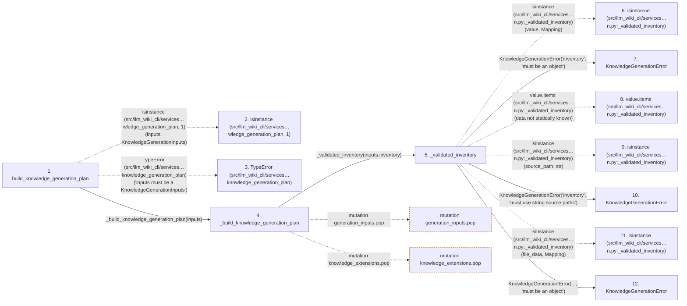

# build_knowledge_generation_plan

**Entry point:** `build_knowledge_generation_plan` (`api`)
**Source:** [knowledge_generation](../modules/knowledge_generation.md)
**Modules touched:** [analysis_compatibility](../modules/analysis_compatibility.md), [canonical_json](../modules/canonical_json.md), [common](../modules/common.md), [concept_identity](../modules/concept_identity.md), and 33 more

**Complete modules touched:**

- [analysis_compatibility](../modules/analysis_compatibility.md)
- [canonical_json](../modules/canonical_json.md)
- [common](../modules/common.md)
- [concept_identity](../modules/concept_identity.md)
- [filesystem_guard](../modules/filesystem_guard.md)
- [immutable](../modules/immutable.md)
- [implementation_evidence](../modules/implementation_evidence.md)
- [infrastructure_sync](../modules/infrastructure_sync.md)
- [io](../modules/io.md)
- [knowledge_artifacts](../modules/knowledge_artifacts.md)
- [knowledge_envelope](../modules/knowledge_envelope.md)
- [knowledge_evidence](../modules/knowledge_evidence.md)
- [knowledge_generation](../modules/knowledge_generation.md)
- [knowledge_governance](../modules/knowledge_governance.md)
- [knowledge_graph](../modules/knowledge_graph.md)
- [knowledge_index](../modules/knowledge_index.md)
- [knowledge_links](../modules/knowledge_links.md)
- [knowledge_model](../modules/knowledge_model.md)
- [knowledge_packs](../modules/knowledge_packs.md)
- [knowledge_reuse](../modules/knowledge_reuse.md)
- [knowledge_storage](../modules/knowledge_storage.md)
- [knowledge_storage_io](../modules/knowledge_storage_io.md)
- [maintenance_evidence](../modules/maintenance_evidence.md)
- [maintenance_projection](../modules/maintenance_projection.md)
- [maintenance_protocol](../modules/maintenance_protocol.md)
- [maintenance_shapes](../modules/maintenance_shapes.md)
- [maintenance_state](../modules/maintenance_state.md)
- [manifest_storage](../modules/manifest_storage.md)
- [markdown_sections](../modules/markdown_sections.md)
- [progress](../modules/progress.md)
- [python_implementation](../modules/python_implementation.md)
- [section_ownership](../modules/section_ownership.md)
- [storage_spool](../modules/storage_spool.md)
- [sync_manifest](../modules/sync_manifest.md)
- [validation](../modules/validation.md)
- [wiki_media](../modules/wiki_media.md)
- [wiki_surface](../modules/wiki_surface.md)

## Call sequence

> Static overview in presentation order, not runtime execution order. Arrows retain captured callers; siblings are shown before deeper helper detail.

```mermaid
sequenceDiagram
    participant p0 as build_knowledge_generation_plan
    participant p1 as isinstance (src/llm_wiki_cli/services…wledge_generation_plan, 1)
    participant p2 as TypeError (src/llm_wiki_cli/services…knowledge_generation_plan)
    participant p3 as _build_knowledge_generation_plan
    participant p4 as KnowledgeGenerationError
    participant p5 as _validated_inventory
    participant p6 as _validated_source_hashes
    participant p7 as _validated_consumed_inputs
    participant p8 as _validated_page_maps
    participant p9 as _exact_source_mapping
    participant p10 as isinstance (src/llm_wiki_cli/services…knowledge_generation_plan)
    participant p11 as _build_evidence_baselines
    participant p12 as _validated_evidence_page_paths
    participant p13 as min (src/llm_wiki_cli/services…knowledge_generation_plan)
    participant p14 as _preserve_unchanged_unknown_baselines
    participant p15 as _mark_untrusted_evidence
    participant p16 as previous.evidence_baselines.get (src/llm_wiki_cli/services…knowledge_generation_plan)
    participant p17 as ManifestEvidenceBaseline.unknown
    participant p18 as _surface_index_bytes
    participant p19 as build_repository_record
    participant p20 as build_evaluated_envelope
    participant p21 as EnvelopeInputs
    participant p22 as tuple (src/llm_wiki_cli/services…knowledge_generation_plan)
    participant p23 as _validated_previous_producer
    p0-->>p1: isinstance (src/llm_wiki_cli/services…wledge_generation_plan, 1)(inputs, KnowledgeGenerationInputs)
    p0-->>p2: TypeError (src/llm_wiki_cli/services…knowledge_generation_plan)('inputs must be a KnowledgeGenerationInputs')
    p0->>p3: _build_knowledge_generation_plan
    p0->>p4: KnowledgeGenerationError
    p3->>p5: _validated_inventory
    p3->>p6: _validated_source_hashes
    p3->>p7: _validated_consumed_inputs
    p3->>p8: _validated_page_maps
    p3->>p9: _exact_source_mapping
    p3->>p9: _exact_source_mapping
    p3-->>p10: isinstance (src/llm_wiki_cli/services…knowledge_generation_plan)(previous, SyncManifest)
    p3->>p4: KnowledgeGenerationError
    p3->>p11: _build_evidence_baselines
    p3->>p12: _validated_evidence_page_paths
    p3->>p12: _validated_evidence_page_paths
    p3-->>p13: min (src/llm_wiki_cli/services…knowledge_generation_plan)(overlapping_page_paths)
    p3->>p4: KnowledgeGenerationError
    p3->>p14: _preserve_unchanged_unknown_baselines
    p3->>p15: _mark_untrusted_evidence
    p3-->>p16: previous.evidence_baselines.get (src/llm_wiki_cli/services…knowledge_generation_plan)(page_path)
    p3->>p17: ManifestEvidenceBaseline.unknown
    p3->>p18: _surface_index_bytes
    p3->>p19: build_repository_record
    p3->>p20: build_evaluated_envelope
    p3->>p21: EnvelopeInputs
    p3-->>p22: tuple (src/llm_wiki_cli/services…knowledge_generation_plan)(inputs.generation_option_allowlist)
    p3-->>p22: tuple (src/llm_wiki_cli/services…knowledge_generation_plan)(inputs.extractors)
    p3-->>p22: tuple (src/llm_wiki_cli/services…knowledge_generation_plan)(inputs.plugins)
    p3->>p23: _validated_previous_producer
    p3-->>p10: isinstance (src/llm_wiki_cli/services…knowledge_generation_plan)(inputs.next_manifest, SyncManifest)
```

<!-- Auto-generated from static call edges. Dashed arrows are external or unresolved calls. Reviewed runtime conditions and side effects belong in Behavior. -->

> Call sequence diagram shows 30 of 4517 interactions; 4487 omitted to keep the visualization within the 30-interaction and generated-diagram limits, with uncertain identities omitted rather than inferred.

> Captured boundary calls: external 8 of 1428 (1420 omitted); unresolved 1 of 1042 (1041 omitted). These counts cover the captured static trace.

Omitted captured detail, grouped by actual caller occurrence and target module:

| Caller | Parent step | Target module | Kind | Omitted interactions |
| --- | --- | --- | --- | --- |
| `src/llm_wiki_cli/services/knowledge_generation.py:_validated_inventory` | 5 | - | external | 7 |
| `src/llm_wiki_cli/services/knowledge_generation.py:_validated_inventory` | 5 | [src/llm_wiki_cli/services/knowledge_generation.py](../modules/knowledge_generation.md) | internal | 6 |
| `src/llm_wiki_cli/services/knowledge_generation.py:_validated_inventory` | 5 | - | unresolved | 3 |
| `src/llm_wiki_cli/services/knowledge_generation.py:_validated_source_hashes` | 22 | [src/llm_wiki_cli/services/knowledge_generation.py](../modules/knowledge_generation.md) | internal | 2 |
| `src/llm_wiki_cli/services/knowledge_generation.py:_exact_source_mapping` | 23 | - | external | 10 |
| `src/llm_wiki_cli/services/knowledge_generation.py:_exact_source_mapping` | 23 | [src/llm_wiki_cli/services/knowledge_generation.py](../modules/knowledge_generation.md) | internal | 4 |
| `src/llm_wiki_cli/services/knowledge_generation.py:_raise_page_map_parity` | 31 | - | external | 2 |
| `src/llm_wiki_cli/services/knowledge_generation.py:_raise_page_map_parity` | 31 | [src/llm_wiki_cli/services/knowledge_generation.py](../modules/knowledge_generation.md) | internal | 2 |
> Omission summary shows 8 of 1080 groups; 1072 further groups are not expanded here. Counts above include all omitted interactions.
> Detailed flow queries retain their own coverage and limits; omitted paths may execute at runtime.

> Trace truncated at the depth limit; deeper calls are omitted.

## Data flow

<!-- Auto-generated static analysis. Treat values and boundaries as best-effort hints, not runtime proof. -->

### Step data

| Step | Inputs | Reads | Writes | Returns |
|---|---|---|---|---|
| `build_knowledge_generation_plan` | `inputs: KnowledgeGenerationInputs` | `KnowledgeGenerationInputs`, `KnowledgeGenerationError`, `KnowledgeArtifactError`, `KnowledgeEnvelopeError`, `KnowledgeGraphError`, `KnowledgeIndexBuildError`, `KnowledgeLinkError`, `SyncManifestError` | - | `_build_knowledge_generation_plan(...)` |
| `isinstance (src/llm_wiki_cli/services…wledge_generation_plan, 1)` | - | - | - | - |
| `TypeError (src/llm_wiki_cli/services…knowledge_generation_plan)` | - | - | - | - |
| `_build_knowledge_generation_plan` | `inputs: KnowledgeGenerationInputs` | `SyncManifest`, `SyncManifest`, `InfrastructureSyncError` | `unknown_baselines[...]`, `generation_inputs[...]`, `knowledge_extensions[...]` | `build_knowledge_commit_plan(...)` |
| `_validated_inventory` | `value: object` | `Mapping`, `Mapping`, `Mapping` | `result[...]` | `result` |
| `isinstance (src/llm_wiki_cli/services…n.py:_validated_inventory)` | - | - | - | - |
| `KnowledgeGenerationError` | - | - | - | - |
| `value.items (src/llm_wiki_cli/services…n.py:_validated_inventory)` | - | - | - | - |
| `isinstance (src/llm_wiki_cli/services…n.py:_validated_inventory)` | - | - | - | - |
| `KnowledgeGenerationError` | - | - | - | - |
| `isinstance (src/llm_wiki_cli/services…n.py:_validated_inventory)` | - | - | - | - |
| `KnowledgeGenerationError` | - | - | - | - |

### Call data

| From | To | Line | Call |
|---|---|---:|---|
| build_knowledge_generation_plan | isinstance (src/llm_wiki_cli/services…wledge_generation_plan, 1) | 183 | `isinstance(inputs, KnowledgeGenerationInputs)` |
| build_knowledge_generation_plan | TypeError (src/llm_wiki_cli/services…knowledge_generation_plan) | 184 | `TypeError('inputs must be a KnowledgeGenerationInputs')` |
| build_knowledge_generation_plan | _build_knowledge_generation_plan | 186 | `_build_knowledge_generation_plan(inputs)` |
| _build_knowledge_generation_plan | _validated_inventory | 203 | `_validated_inventory(inputs.inventory)` |
| _validated_inventory | isinstance (src/llm_wiki_cli/services…n.py:_validated_inventory) | 954 | `isinstance(value, Mapping)` |
| _validated_inventory | KnowledgeGenerationError | 955 | `KnowledgeGenerationError('inventory', 'must be an object')` |
| _validated_inventory | value.items (src/llm_wiki_cli/services…n.py:_validated_inventory) | 957 | `value.items(data not statically known)` |
| _validated_inventory | isinstance (src/llm_wiki_cli/services…n.py:_validated_inventory) | 958 | `isinstance(source_path, str)` |
| _validated_inventory | KnowledgeGenerationError | 959 | `KnowledgeGenerationError('inventory', 'must use string source paths')` |
| _validated_inventory | isinstance (src/llm_wiki_cli/services…n.py:_validated_inventory) | 963 | `isinstance(file_data, Mapping)` |
| _validated_inventory | KnowledgeGenerationError | 964 | `KnowledgeGenerationError(..., 'must be an object')` |

### Boundary effects

| Kind | Target | Step | Line |
|---|---|---|---:|
| mutation | `generation_inputs.pop` | `_build_knowledge_generation_plan` | 390 |
| mutation | `knowledge_extensions.pop` | `_build_knowledge_generation_plan` | 394 |

### Static analysis gaps

| Kind | Step | Target | Line |
|---|---|---|---:|
| external_call | `build_knowledge_generation_plan` | `isinstance` | 183 |
| external_call | `build_knowledge_generation_plan` | `TypeError` | 184 |
| external_call | `_validated_inventory` | `isinstance` | 954 |
| unresolved_call | `_validated_inventory` | `value.items` | 957 |
| external_call | `_validated_inventory` | `isinstance` | 958 |
| external_call | `_validated_inventory` | `isinstance` | 963 |
| step_limit | `build_knowledge_generation_plan` | `first 12 steps` | 0 |
| truncated_flow | `build_knowledge_generation_plan` | `depth limit` | 0 |

## Behavior

This flow starts at `build_knowledge_generation_plan` and is classified as `api`. The generated call and data-flow sections are bounded static projections; runtime conditions and side effects require source-level confirmation.
