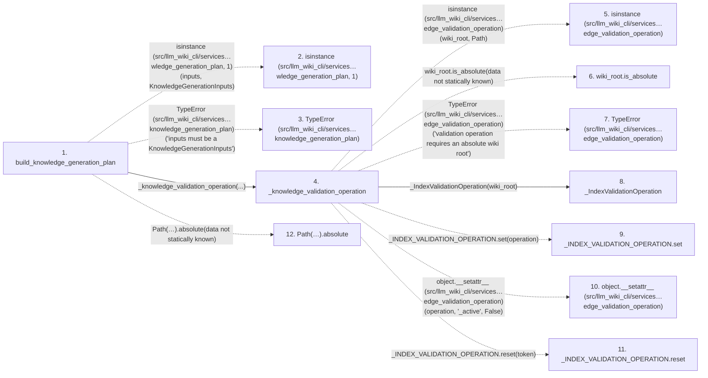

# build_knowledge_generation_plan

**Entry point:** `build_knowledge_generation_plan` (`api`)
**Source:** [knowledge_generation](../modules/knowledge_generation.md)
**Modules touched:** [analysis_compatibility](../modules/analysis_compatibility.md), [canonical_json](../modules/canonical_json.md), [common](../modules/common.md), [concept_identity](../modules/concept_identity.md), and 35 more

**Complete modules touched:**

- [analysis_compatibility](../modules/analysis_compatibility.md)
- [canonical_json](../modules/canonical_json.md)
- [common](../modules/common.md)
- [concept_identity](../modules/concept_identity.md)
- [filesystem_guard](../modules/filesystem_guard.md)
- [immutable](../modules/immutable.md)
- [implementation_evidence](../modules/implementation_evidence.md)
- [infrastructure_sync](../modules/infrastructure_sync.md)
- [io](../modules/io.md)
- [knowledge_artifacts](../modules/knowledge_artifacts.md)
- [knowledge_envelope](../modules/knowledge_envelope.md)
- [knowledge_evidence](../modules/knowledge_evidence.md)
- [knowledge_generation](../modules/knowledge_generation.md)
- [knowledge_governance](../modules/knowledge_governance.md)
- [knowledge_graph](../modules/knowledge_graph.md)
- [knowledge_index](../modules/knowledge_index.md)
- [knowledge_links](../modules/knowledge_links.md)
- [knowledge_model](../modules/knowledge_model.md)
- [knowledge_packs](../modules/knowledge_packs.md)
- [knowledge_reuse](../modules/knowledge_reuse.md)
- [knowledge_storage](../modules/knowledge_storage.md)
- [knowledge_storage_io](../modules/knowledge_storage_io.md)
- [maintenance_evidence](../modules/maintenance_evidence.md)
- [maintenance_projection](../modules/maintenance_projection.md)
- [maintenance_protocol](../modules/maintenance_protocol.md)
- [maintenance_shapes](../modules/maintenance_shapes.md)
- [maintenance_state](../modules/maintenance_state.md)
- [manifest_storage](../modules/manifest_storage.md)
- [markdown_sections](../modules/markdown_sections.md)
- [normalization_diagnostics](../modules/normalization_diagnostics.md)
- [progress](../modules/progress.md)
- [python_implementation](../modules/python_implementation.md)
- [section_ownership](../modules/section_ownership.md)
- [source_retirement](../modules/source_retirement.md)
- [storage_spool](../modules/storage_spool.md)
- [sync_manifest](../modules/sync_manifest.md)
- [validation](../modules/validation.md)
- [wiki_media](../modules/wiki_media.md)
- [wiki_surface](../modules/wiki_surface.md)

## Call sequence

> Static overview in presentation order, not runtime execution order. Arrows retain captured callers; representative internal continuations and boundary examples precede repeated helper detail.

```mermaid
sequenceDiagram
    participant p0 as build_knowledge_generation_plan
    participant p1 as _knowledge_validation_operation
    participant p2 as _build_knowledge_generation_plan
    participant p3 as KnowledgeGenerationError
    participant p4 as _validated_inventory
    participant p5 as _validated_source_hashes
    participant p6 as _validated_consumed_inputs
    participant p7 as _validated_page_maps
    participant p8 as _build_evidence_baselines
    participant p9 as _validated_evidence_page_paths
    participant p10 as _mark_untrusted_evidence
    participant p11 as _surface_index_bytes
    participant p12 as build_repository_record
    participant p13 as build_evaluated_envelope
    participant p14 as _validated_previous_producer
    participant p15 as SyncManifest.build_from_inventory
    participant p16 as _next_manifest_mapping
    participant p17 as _structural_page_paths
    participant p18 as _defer_sources_for_regeneration
    participant p19 as _reconcile_active_structural_evidence
    participant p20 as _downgrade_incompatible_tombstones
    participant p21 as collect_link_observations
    participant p22 as _application_knowledge_extensions
    participant p23 as bind_reuse_commitment
    participant p24 as infrastructure_evidence_by_page
    participant p25 as project_concept_implementations
    participant p26 as build_knowledge_index
    participant p27 as apply_governance_projection
    participant p28 as captured_observations_from_knowledge
    participant p29 as isinstance (src/llm_wiki_cli/services…wledge_generation_plan, 1)
    participant p30 as Path(…).absolute
    p0->>p1: _knowledge_validation_operation
    p0->>p2: _build_knowledge_generation_plan
    p0->>p3: KnowledgeGenerationError
    p2->>p4: _validated_inventory
    p2->>p5: _validated_source_hashes
    p2->>p6: _validated_consumed_inputs
    p2->>p7: _validated_page_maps
    p2->>p8: _build_evidence_baselines
    p2->>p9: _validated_evidence_page_paths
    p2->>p10: _mark_untrusted_evidence
    p2->>p11: _surface_index_bytes
    p2->>p12: build_repository_record
    p2->>p13: build_evaluated_envelope
    p2->>p14: _validated_previous_producer
    p2->>p15: SyncManifest.build_from_inventory
    p2->>p16: _next_manifest_mapping
    p2->>p17: _structural_page_paths
    p2->>p18: _defer_sources_for_regeneration
    p2->>p19: _reconcile_active_structural_evidence
    p2->>p20: _downgrade_incompatible_tombstones
    p2->>p21: collect_link_observations
    p2->>p22: _application_knowledge_extensions
    p2->>p23: bind_reuse_commitment
    p2->>p24: infrastructure_evidence_by_page
    p2->>p25: project_concept_implementations
    p2->>p26: build_knowledge_index
    p2->>p27: apply_governance_projection
    p2->>p28: captured_observations_from_knowledge
    p0-->>p29: isinstance (src/llm_wiki_cli/services…wledge_generation_plan, 1)(inputs, KnowledgeGenerationInputs)
    p0-->>p30: Path(…).absolute
```

<!-- Auto-generated from static call edges. Dashed arrows are external or unresolved calls. Reviewed runtime conditions and side effects belong in Behavior. -->

> Call sequence diagram shows 30 of 4771 interactions; 4741 omitted to keep the visualization within the 30-interaction and generated-diagram limits, with uncertain identities omitted rather than inferred.

> Captured boundary calls: external 1 of 1503 (1502 omitted); unresolved 1 of 1098 (1097 omitted). These counts cover the captured static trace.

Omitted captured detail, grouped by actual caller occurrence and target module:

| Caller | Parent step | Target module | Kind | Omitted interactions |
| --- | --- | --- | --- | --- |
| `src/llm_wiki_cli/services/knowledge_generation.py:build_knowledge_generation_plan` | 1 | - | external | 2 |
| `src/llm_wiki_cli/services/knowledge_index.py:_knowledge_validation_operation` | 4 | - | external | 3 |
| `src/llm_wiki_cli/services/knowledge_index.py:_knowledge_validation_operation` | 4 | - | unresolved | 3 |
| `src/llm_wiki_cli/services/knowledge_index.py:_knowledge_validation_operation` | 4 | [src/llm_wiki_cli/services/knowledge_index.py](../modules/knowledge_index.md) | internal | 1 |
| `src/llm_wiki_cli/services/knowledge_generation.py:_validated_inventory` | 15 | - | external | 7 |
| `src/llm_wiki_cli/services/knowledge_generation.py:_validated_inventory` | 15 | [src/llm_wiki_cli/services/knowledge_generation.py](../modules/knowledge_generation.md) | internal | 6 |
| `src/llm_wiki_cli/services/knowledge_generation.py:_validated_inventory` | 15 | - | unresolved | 3 |
| `src/llm_wiki_cli/services/knowledge_generation.py:_validated_source_hashes` | 32 | [src/llm_wiki_cli/services/knowledge_generation.py](../modules/knowledge_generation.md) | internal | 2 |
> Omission summary shows 8 of 1110 groups; 1102 further groups are not expanded here. Counts above include all omitted interactions.
> Detailed flow queries retain their own coverage and limits; omitted paths may execute at runtime.

> Trace truncated at the depth limit; deeper calls are omitted.

## Data flow

<!-- Auto-generated static analysis. Treat values and boundaries as best-effort hints, not runtime proof. -->

### Analysis coverage

**Effect analysis partially available.** Flow assembly and source effect analysis are separate; empty observations do not prove an empty handler body.

Source steps: 2171; effect analysis evaluated: 1282, partial: 45, unavailable: 844. Counts include steps omitted from the displayed trace.

Collector observations for 1327 source steps with known totals: observed: 7120, emitted: 6717, omitted: 403. Unavailable totals are excluded.

- Callable record unavailable; the selected entry symbol has no represented callable body.
- Effect collector omitted observations before flow assembly; displayed effects are partial.
- Effect collector totals unavailable; observed counts cover captured records only.

| Step | Callable record | Effect analysis | Collector totals | Observed | Emitted | Omitted |
|---|---|---|---|---:|---:|---:|
| `build_knowledge_generation_plan` | `available` | `evaluated` | `available` | `10` | `10` | `0` |
| `isinstance (src/llm_wiki_cli/services…wledge_generation_plan, 1)` | `not_applicable` | `not_applicable` | `not_applicable` | — | — | — |
| `TypeError (src/llm_wiki_cli/services…knowledge_generation_plan)` | `not_applicable` | `not_applicable` | `not_applicable` | — | — | — |
| `_knowledge_validation_operation` | `available` | `evaluated` | `available` | `2` | `2` | `0` |
| `isinstance (src/llm_wiki_cli/services…edge_validation_operation)` | `not_applicable` | `not_applicable` | `not_applicable` | — | — | — |
| `wiki_root.is_absolute` | `not_applicable` | `not_applicable` | `not_applicable` | — | — | — |
| `TypeError (src/llm_wiki_cli/services…edge_validation_operation)` | `not_applicable` | `not_applicable` | `not_applicable` | — | — | — |
| `_IndexValidationOperation` | `unavailable` | `unavailable` | `unavailable` | — | — | — |
| `_INDEX_VALIDATION_OPERATION.set` | `not_applicable` | `not_applicable` | `not_applicable` | — | — | — |
| `object.__setattr__ (src/llm_wiki_cli/services…edge_validation_operation)` | `not_applicable` | `not_applicable` | `not_applicable` | — | — | — |
| `_INDEX_VALIDATION_OPERATION.reset` | `not_applicable` | `not_applicable` | `not_applicable` | — | — | — |
| `Path(…).absolute` | `not_applicable` | `not_applicable` | `not_applicable` | — | — | — |

### Step data

| Step | Inputs | Reads | Writes | Returns |
|---|---|---|---|---|
| `build_knowledge_generation_plan` | `inputs: KnowledgeGenerationInputs` | `KnowledgeGenerationInputs`, `KnowledgeGenerationError`, `KnowledgeArtifactError`, `KnowledgeEnvelopeError`, `KnowledgeGraphError`, `KnowledgeIndexBuildError`, `KnowledgeLinkError`, `SyncManifestError` | - | `_build_knowledge_generation_plan(...)` |
| `isinstance (src/llm_wiki_cli/services…wledge_generation_plan, 1)` | - | - | - | - |
| `TypeError (src/llm_wiki_cli/services…knowledge_generation_plan)` | - | - | - | - |
| `_knowledge_validation_operation` | `wiki_root: Path` | `Path` | - | - |
| `isinstance (src/llm_wiki_cli/services…edge_validation_operation)` | - | - | - | - |
| `wiki_root.is_absolute` | - | - | - | - |
| `TypeError (src/llm_wiki_cli/services…edge_validation_operation)` | - | - | - | - |
| `_IndexValidationOperation` | - | - | - | - |
| `_INDEX_VALIDATION_OPERATION.set` | - | - | - | - |
| `object.__setattr__ (src/llm_wiki_cli/services…edge_validation_operation)` | - | - | - | - |
| `_INDEX_VALIDATION_OPERATION.reset` | - | - | - | - |
| `Path(…).absolute` | - | - | - | - |

### Call data

| From | To | Line | Call |
|---|---|---:|---|
| build_knowledge_generation_plan | isinstance (src/llm_wiki_cli/services…wledge_generation_plan, 1) | 192 | `isinstance(inputs, KnowledgeGenerationInputs)` |
| build_knowledge_generation_plan | TypeError (src/llm_wiki_cli/services…knowledge_generation_plan) | 193 | `TypeError('inputs must be a KnowledgeGenerationInputs')` |
| build_knowledge_generation_plan | _knowledge_validation_operation | 195 | `_knowledge_validation_operation(...)` |
| _knowledge_validation_operation | isinstance (src/llm_wiki_cli/services…edge_validation_operation) | 330 | `isinstance(wiki_root, Path)` |
| _knowledge_validation_operation | wiki_root.is_absolute | 330 | `wiki_root.is_absolute(data not statically known)` |
| _knowledge_validation_operation | TypeError (src/llm_wiki_cli/services…edge_validation_operation) | 331 | `TypeError('validation operation requires an absolute wiki root')` |
| _knowledge_validation_operation | _IndexValidationOperation | 332 | `_IndexValidationOperation(wiki_root)` |
| _knowledge_validation_operation | _INDEX_VALIDATION_OPERATION.set | 333 | `_INDEX_VALIDATION_OPERATION.set(operation)` |
| _knowledge_validation_operation | object.__setattr__ (src/llm_wiki_cli/services…edge_validation_operation) | 337 | `object.__setattr__(operation, '_active', False)` |
| _knowledge_validation_operation | _INDEX_VALIDATION_OPERATION.reset | 338 | `_INDEX_VALIDATION_OPERATION.reset(token)` |
| build_knowledge_generation_plan | Path(…).absolute | 195 | `Path(inputs.wiki_dir).absolute(data not statically known)` |

### Boundary effects

*No boundary-effect observations were captured in this static trace.*

### Static analysis gaps

| Kind | Step | Target | Line |
|---|---|---|---:|
| external_call | `build_knowledge_generation_plan` | `isinstance` | 192 |
| external_call | `build_knowledge_generation_plan` | `TypeError` | 193 |
| external_call | `_knowledge_validation_operation` | `isinstance` | 330 |
| unresolved_call | `_knowledge_validation_operation` | `wiki_root.is_absolute` | 330 |
| external_call | `_knowledge_validation_operation` | `TypeError` | 331 |
| external_call | `_knowledge_validation_operation` | `object.__setattr__` | 337 |
| unresolved_call | `_knowledge_validation_operation` | `_INDEX_VALIDATION_OPERATION.reset` | 338 |
| unresolved_call | `build_knowledge_generation_plan` | `Path(inputs.wiki_dir).absolute` | 195 |
| step_limit | `build_knowledge_generation_plan` | `first 12 steps` | 0 |
| truncated_flow | `build_knowledge_generation_plan` | `depth limit` | 0 |

## Behavior

This flow starts at `build_knowledge_generation_plan` and is classified as `api`. The generated call and data-flow sections are bounded static projections; runtime conditions and side effects require source-level confirmation.
