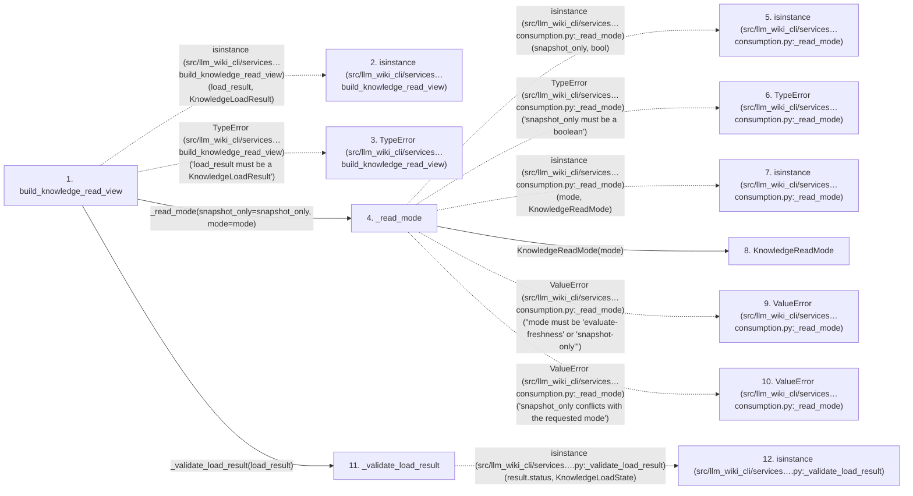

# build_knowledge_read_view

**Entry point:** `build_knowledge_read_view` (`api`)
**Source:** [knowledge_consumption](../modules/knowledge_consumption.md)
**Modules touched:** [analysis_compatibility](../modules/analysis_compatibility.md), [concept_identity](../modules/concept_identity.md), [implementation_evidence](../modules/implementation_evidence.md), and 17 more

**Complete modules touched:**

- [analysis_compatibility](../modules/analysis_compatibility.md)
- [concept_identity](../modules/concept_identity.md)
- [implementation_evidence](../modules/implementation_evidence.md)
- [knowledge_artifacts](../modules/knowledge_artifacts.md)
- [knowledge_consumption](../modules/knowledge_consumption.md)
- [knowledge_evidence](../modules/knowledge_evidence.md)
- [knowledge_freshness](../modules/knowledge_freshness.md)
- [knowledge_governance](../modules/knowledge_governance.md)
- [knowledge_graph](../modules/knowledge_graph.md)
- [knowledge_model](../modules/knowledge_model.md)
- [knowledge_reuse](../modules/knowledge_reuse.md)
- [knowledge_storage](../modules/knowledge_storage.md)
- [maintenance_evidence](../modules/maintenance_evidence.md)
- [maintenance_projection](../modules/maintenance_projection.md)
- [maintenance_shapes](../modules/maintenance_shapes.md)
- [maintenance_state](../modules/maintenance_state.md)
- [maintenance_status](../modules/maintenance_status.md)
- [section_ownership](../modules/section_ownership.md)
- [validation](../modules/validation.md)
- [wiki_surface](../modules/wiki_surface.md)

## Call sequence

> Static overview in presentation order, not runtime execution order. Arrows retain captured callers; siblings are shown before deeper helper detail.

```mermaid
sequenceDiagram
    participant p0 as build_knowledge_read_view
    participant p1 as isinstance (src/llm_wiki_cli/services…build_knowledge_read_view)
    participant p2 as TypeError (src/llm_wiki_cli/services…build_knowledge_read_view)
    participant p3 as _read_mode
    participant p4 as _validate_load_result
    participant p5 as _loaded_freshness
    participant p6 as _knowledge_counts
    participant p7 as KnowledgeReadView
    participant p8 as _snapshot_maintenance_report
    participant p9 as _implementation_report
    participant p10 as _unsupported_reason
    participant p11 as isinstance (src/llm_wiki_cli/services…consumption.py:_read_mode)
    participant p12 as isinstance (src/llm_wiki_cli/services….py:_validate_load_result)
    participant p13 as require_validated_artifacts
    participant p14 as Counter (src/llm_wiki_cli/services…tion.py:_knowledge_counts)
    participant p15 as build_maintenance_status
    participant p16 as any (src/llm_wiki_cli/services…py:_implementation_report)
    participant p17 as TypeError (src/llm_wiki_cli/services…consumption.py:_read_mode)
    participant p18 as TypeError (src/llm_wiki_cli/services….py:_validate_load_result)
    participant p19 as evaluate_knowledge_freshness
    participant p20 as marker_from_validated_state
    participant p21 as compare_knowledge_implementation
    participant p22 as isinstance (src/llm_wiki_cli/services…tion.py:_knowledge_counts)
    participant p23 as KnowledgeReadMode
    p0-->>p1: isinstance (src/llm_wiki_cli/services…build_knowledge_read_view)(load_result, KnowledgeLoadResult)
    p0-->>p2: TypeError (src/llm_wiki_cli/services…build_knowledge_read_view)('load_result must be a KnowledgeLoadResult')
    p0->>p3: _read_mode
    p0->>p4: _validate_load_result
    p0->>p5: _loaded_freshness
    p0->>p6: _knowledge_counts
    p0->>p7: KnowledgeReadView
    p0->>p8: _snapshot_maintenance_report
    p0->>p9: _implementation_report
    p0->>p7: KnowledgeReadView
    p0->>p10: _unsupported_reason
    p0->>p7: KnowledgeReadView
    p3-->>p11: isinstance (src/llm_wiki_cli/services…consumption.py:_read_mode)(snapshot_only, bool)
    p4-->>p12: isinstance (src/llm_wiki_cli/services….py:_validate_load_result)(result.status, KnowledgeLoadState)
    p5->>p13: require_validated_artifacts
    p6-->>p14: Counter (src/llm_wiki_cli/services…tion.py:_knowledge_counts)
    p8->>p15: build_maintenance_status
    p9-->>p16: any (src/llm_wiki_cli/services…py:_implementation_report)(...)
    p3-->>p17: TypeError (src/llm_wiki_cli/services…consumption.py:_read_mode)('snapshot_only must be a boolean')
    p4-->>p18: TypeError (src/llm_wiki_cli/services….py:_validate_load_result)('load_result.status must be a KnowledgeLoadState')
    p5->>p19: evaluate_knowledge_freshness
    p6-->>p14: Counter (src/llm_wiki_cli/services…tion.py:_knowledge_counts)
    p8->>p20: marker_from_validated_state
    p9->>p21: compare_knowledge_implementation
    p3-->>p11: isinstance (src/llm_wiki_cli/services…consumption.py:_read_mode)(mode, KnowledgeReadMode)
    p4-->>p12: isinstance (src/llm_wiki_cli/services….py:_validate_load_result)(result.underlying_status, KnowledgeLoadState)
    p5->>p19: evaluate_knowledge_freshness
    p6-->>p22: isinstance (src/llm_wiki_cli/services…tion.py:_knowledge_counts)(raw_kind, Enum)
    p9->>p21: compare_knowledge_implementation
    p3->>p23: KnowledgeReadMode
```

<!-- Auto-generated from static call edges. Dashed arrows are external or unresolved calls. Reviewed runtime conditions and side effects belong in Behavior. -->

> Call sequence diagram shows 30 of 1113 interactions; 1083 omitted to keep the visualization within the 30-interaction and generated-diagram limits, with uncertain identities omitted rather than inferred.

> Captured boundary calls: external 12 of 306 (294 omitted); unresolved 0 of 183 (183 omitted). These counts cover the captured static trace.

Omitted captured detail, grouped by actual caller occurrence and target module:

| Caller | Parent step | Target module | Kind | Omitted interactions |
| --- | --- | --- | --- | --- |
| `src/llm_wiki_cli/services/knowledge_consumption.py:_read_mode` | 4 | - | external | 2 |
| `src/llm_wiki_cli/services/knowledge_consumption.py:_validate_load_result` | 11 | - | external | 15 |
| `src/llm_wiki_cli/services/knowledge_consumption.py:_validate_load_result` | 11 | [src/llm_wiki_cli/services/knowledge_consumption.py](../modules/knowledge_consumption.md) | internal | 1 |
| `src/llm_wiki_cli/services/knowledge_consumption.py:_unsupported_reason` | 29 | - | unresolved | 1 |
| `src/llm_wiki_cli/services/knowledge_artifacts.py:require_validated_artifacts` | 33 | - | external | 4 |
| `src/llm_wiki_cli/services/knowledge_freshness.py:evaluate_knowledge_freshness` | 38 | - | external | 2 |
| `src/llm_wiki_cli/services/knowledge_freshness.py:evaluate_knowledge_freshness` | 38 | [src/llm_wiki_cli/services/knowledge_artifacts.py](../modules/knowledge_artifacts.md) | internal | 1 |
| `src/llm_wiki_cli/services/knowledge_freshness.py:evaluate_knowledge_freshness` | 38 | [src/llm_wiki_cli/services/knowledge_model.py](../modules/knowledge_model.md) | internal | 3 |
> Omission summary shows 8 of 214 groups; 206 further groups are not expanded here. Counts above include all omitted interactions.
> Detailed flow queries retain their own coverage and limits; omitted paths may execute at runtime.

> Trace truncated at the depth limit; deeper calls are omitted.

## Data flow

<!-- Auto-generated static analysis. Treat values and boundaries as best-effort hints, not runtime proof. -->

### Step data

| Step | Inputs | Reads | Writes | Returns |
|---|---|---|---|---|
| `build_knowledge_read_view` | `load_result: KnowledgeLoadResult`, `live_evaluation: LiveKnowledgeEvaluation \| None`, `snapshot_only: bool`, `mode: KnowledgeReadMode \| str \| None` | `KnowledgeLoadResult`, `KnowledgeLoadState`, `KnowledgeLoadState`, `KnowledgeReadMode`, `KnowledgeAvailability`, `KnowledgeReadReason`, `KnowledgeReadMode`, `KnowledgeLoadState` | - | `KnowledgeReadView(...)`, `KnowledgeReadView(...)`, `KnowledgeReadView(...)` |
| `isinstance (src/llm_wiki_cli/services…build_knowledge_read_view)` | - | - | - | - |
| `TypeError (src/llm_wiki_cli/services…build_knowledge_read_view)` | - | - | - | - |
| `_read_mode` | `snapshot_only: bool`, `mode: KnowledgeReadMode \| str \| None` | `KnowledgeReadMode`, `KnowledgeReadMode`, `KnowledgeReadMode`, `KnowledgeReadMode` | - | `...`, `selected` |
| `isinstance (src/llm_wiki_cli/services…consumption.py:_read_mode)` | - | - | - | - |
| `TypeError (src/llm_wiki_cli/services…consumption.py:_read_mode)` | - | - | - | - |
| `isinstance (src/llm_wiki_cli/services…consumption.py:_read_mode)` | - | - | - | - |
| `KnowledgeReadMode` | - | - | - | - |
| `ValueError (src/llm_wiki_cli/services…consumption.py:_read_mode)` | - | - | - | - |
| `ValueError (src/llm_wiki_cli/services…consumption.py:_read_mode)` | - | - | - | - |
| `_validate_load_result` | `result: KnowledgeLoadResult` | `KnowledgeLoadState`, `KnowledgeLoadState`, `KnowledgeLoadIssue`, `KnowledgeLoadState`, `Mapping`, `KnowledgeIndex`, `SyncManifest`, `KnowledgeLoadState` | - | `none`, `none`, `none`, `none` |
| `isinstance (src/llm_wiki_cli/services….py:_validate_load_result)` | - | - | - | - |

### Call data

| From | To | Line | Call |
|---|---|---:|---|
| build_knowledge_read_view | isinstance (src/llm_wiki_cli/services…build_knowledge_read_view) | 587 | `isinstance(load_result, KnowledgeLoadResult)` |
| build_knowledge_read_view | TypeError (src/llm_wiki_cli/services…build_knowledge_read_view) | 588 | `TypeError('load_result must be a KnowledgeLoadResult')` |
| build_knowledge_read_view | _read_mode | 589 | `_read_mode(snapshot_only=snapshot_only, mode=mode)` |
| _read_mode | isinstance (src/llm_wiki_cli/services…consumption.py:_read_mode) | 734 | `isinstance(snapshot_only, bool)` |
| _read_mode | TypeError (src/llm_wiki_cli/services…consumption.py:_read_mode) | 735 | `TypeError('snapshot_only must be a boolean')` |
| _read_mode | isinstance (src/llm_wiki_cli/services…consumption.py:_read_mode) | 745 | `isinstance(mode, KnowledgeReadMode)` |
| _read_mode | KnowledgeReadMode | 746 | `KnowledgeReadMode(mode)` |
| _read_mode | ValueError (src/llm_wiki_cli/services…consumption.py:_read_mode) | 749 | `ValueError("mode must be 'evaluate-freshness' or 'snapshot-only'")` |
| _read_mode | ValueError (src/llm_wiki_cli/services…consumption.py:_read_mode) | 753 | `ValueError('snapshot_only conflicts with the requested mode')` |
| build_knowledge_read_view | _validate_load_result | 590 | `_validate_load_result(load_result)` |
| _validate_load_result | isinstance (src/llm_wiki_cli/services….py:_validate_load_result) | 854 | `isinstance(result.status, KnowledgeLoadState)` |

### Boundary effects

*No boundary effects detected.*

### Static analysis gaps

| Kind | Step | Target | Line |
|---|---|---|---:|
| external_call | `build_knowledge_read_view` | `isinstance` | 587 |
| external_call | `build_knowledge_read_view` | `TypeError` | 588 |
| external_call | `_read_mode` | `isinstance` | 734 |
| external_call | `_read_mode` | `TypeError` | 735 |
| external_call | `_read_mode` | `isinstance` | 745 |
| external_call | `_read_mode` | `ValueError` | 749 |
| external_call | `_read_mode` | `ValueError` | 753 |
| external_call | `_validate_load_result` | `isinstance` | 854 |
| step_limit | `build_knowledge_read_view` | `first 12 steps` | 0 |
| truncated_flow | `build_knowledge_read_view` | `depth limit` | 0 |

## Behavior

This flow starts at `build_knowledge_read_view` and is classified as `api`. The generated call and data-flow sections are bounded static projections; runtime conditions and side effects require source-level confirmation.
