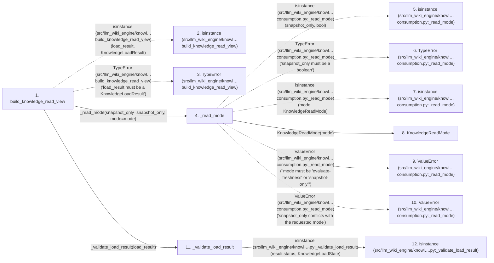

# build_knowledge_read_view

**Entry point:** `build_knowledge_read_view` (`api`)
**Source:** [knowledge_consumption](../modules/knowledge_consumption.md)
**Modules touched:** [canonical_json](../modules/canonical_json.md), [integrations](../modules/integrations.md), [knowledge_artifacts](../modules/knowledge_artifacts.md), and 18 more

**Complete modules touched:**

- [canonical_json](../modules/canonical_json.md)
- [integrations](../modules/integrations.md)
- [knowledge_artifacts](../modules/knowledge_artifacts.md)
- [knowledge_consumption](../modules/knowledge_consumption.md)
- [knowledge_evidence](../modules/knowledge_evidence.md)
- [knowledge_freshness](../modules/knowledge_freshness.md)
- [knowledge_graph](../modules/knowledge_graph.md)
- [knowledge_kinds](../modules/knowledge_kinds.md)
- [knowledge_model](../modules/knowledge_model.md)
- [knowledge_reuse_format](../modules/knowledge_reuse_format.md)
- [knowledge_storage](../modules/knowledge_storage.md)
- [knowledge_validators](../modules/knowledge_validators.md)
- [maintenance_evidence](../modules/maintenance_evidence.md)
- [maintenance_shapes](../modules/maintenance_shapes.md)
- [maintenance_state](../modules/maintenance_state.md)
- [maintenance_status](../modules/maintenance_status.md)
- [section_ownership](../modules/section_ownership.md)
- [source_retirement](../modules/source_retirement.md)
- [sync_manifest](../modules/sync_manifest.md)
- [validation](../modules/validation.md)
- [wiki_surface](../modules/wiki_surface.md)

## Call sequence

> Static overview in presentation order, not runtime execution order. Arrows retain captured callers; representative internal continuations and boundary examples precede repeated helper detail.

```mermaid
sequenceDiagram
    participant p0 as build_knowledge_read_view
    participant p1 as _read_mode
    participant p2 as _validate_load_result
    participant p3 as _loaded_freshness
    participant p4 as _knowledge_counts
    participant p5 as _loaded_retired_locators
    participant p6 as _snapshot_maintenance_report
    participant p7 as _implementation_report
    participant p8 as KnowledgeReadView
    participant p9 as _unsupported_reason
    participant p10 as build_maintenance_status
    participant p11 as evaluate_knowledge_freshness
    participant p12 as marker_from_validated_state
    participant p13 as parse_knowledge_index
    participant p14 as _knowledge_index_to_payload_unchecked
    participant p15 as qualified_retired_entity_locators
    participant p16 as validate_maintenance_state
    participant p17 as _evaluate_model_freshness
    participant p18 as validate_maintenance_adoption
    participant p19 as canonical_hash
    participant p20 as owner_key
    participant p21 as compare_implementation_observations
    participant p22 as _record
    participant p23 as _bundle_to_payload
    participant p24 as retired_entity_mappings
    participant p25 as _validate_live_evaluation
    participant p26 as _detached
    participant p27 as _string
    participant p28 as canonical_bytes
    participant p29 as isinstance (src/llm_wiki_engine/knowl…build_knowledge_read_view)
    participant p30 as compare_knowledge_implementation
    p0->>p1: _read_mode
    p0->>p2: _validate_load_result
    p0->>p3: _loaded_freshness
    p0->>p4: _knowledge_counts
    p0->>p5: _loaded_retired_locators
    p0->>p6: _snapshot_maintenance_report
    p0->>p7: _implementation_report
    p0->>p8: KnowledgeReadView
    p0->>p9: _unsupported_reason
    p6->>p10: build_maintenance_status
    p3->>p11: evaluate_knowledge_freshness
    p6->>p12: marker_from_validated_state
    p11->>p13: parse_knowledge_index
    p11->>p14: _knowledge_index_to_payload_unchecked
    p11->>p15: qualified_retired_entity_locators
    p10->>p16: validate_maintenance_state
    p11->>p17: _evaluate_model_freshness
    p10->>p18: validate_maintenance_adoption
    p10->>p19: canonical_hash
    p10->>p20: owner_key
    p10->>p21: compare_implementation_observations
    p13->>p22: _record
    p14->>p23: _bundle_to_payload
    p15->>p24: retired_entity_mappings
    p17->>p25: _validate_live_evaluation
    p16->>p26: _detached
    p13->>p27: _string
    p19->>p28: canonical_bytes
    p0-->>p29: isinstance (src/llm_wiki_engine/knowl…build_knowledge_read_view)(load_result, KnowledgeLoadResult)
    p7-->>p30: compare_knowledge_implementation(knowledge, None, analysis_scope='snapshot')
```

<!-- Auto-generated from static call edges. Dashed arrows are external or unresolved calls. Reviewed runtime conditions and side effects belong in Behavior. -->

> Call sequence diagram shows 30 of 805 interactions; 775 omitted to keep the visualization within the 30-interaction and generated-diagram limits, with uncertain identities omitted rather than inferred.

> Captured boundary calls: external 1 of 216 (215 omitted); unresolved 1 of 117 (116 omitted). These counts cover the captured static trace.

Omitted captured detail, grouped by actual caller occurrence and target module:

| Caller | Parent step | Target module | Kind | Omitted interactions |
| --- | --- | --- | --- | --- |
| `src/llm_wiki_engine/knowledge_consumption.py:build_knowledge_read_view` | 1 | - | external | 1 |
| `src/llm_wiki_engine/knowledge_consumption.py:_read_mode` | 4 | - | external | 5 |
| `src/llm_wiki_engine/knowledge_consumption.py:_read_mode` | 4 | [src/llm_wiki_engine/knowledge_consumption.py](../modules/knowledge_consumption.md) | internal | 1 |
| `src/llm_wiki_engine/knowledge_consumption.py:_validate_load_result` | 11 | - | external | 18 |
| `src/llm_wiki_engine/knowledge_consumption.py:_validate_load_result` | 11 | [src/llm_wiki_engine/knowledge_consumption.py](../modules/knowledge_consumption.md) | internal | 1 |
| `src/llm_wiki_engine/knowledge_consumption.py:_unsupported_reason` | 29 | - | unresolved | 1 |
| `src/llm_wiki_engine/knowledge_consumption.py:_loaded_freshness` | 32 | [src/llm_wiki_engine/knowledge_artifacts.py](../modules/knowledge_artifacts.md) | internal | 1 |
| `src/llm_wiki_engine/knowledge_artifacts.py:require_validated_artifacts` | 33 | - | external | 4 |
> Omission summary shows 8 of 175 groups; 167 further groups are not expanded here. Counts above include all omitted interactions.
> Detailed flow queries retain their own coverage and limits; omitted paths may execute at runtime.

> Trace truncated at the depth limit; deeper calls are omitted.

## Data flow

<!-- Auto-generated static analysis. Treat values and boundaries as best-effort hints, not runtime proof. -->

### Analysis coverage

**Effect analysis partially available.** Flow assembly and source effect analysis are separate; empty observations do not prove an empty handler body.

Source steps: 473; effect analysis evaluated: 320, partial: 13, unavailable: 140. Counts include steps omitted from the displayed trace.

Collector observations for 333 source steps with known totals: observed: 1604, emitted: 1504, omitted: 100. Unavailable totals are excluded.

- Callable record unavailable for one or more source steps; those steps have no represented callable body.
- Effect collector omitted observations before flow assembly; displayed effects are partial.
- Effect collector totals unavailable; observed counts cover captured records only.

| Step | Callable record | Effect analysis | Collector totals | Observed | Emitted | Omitted |
|---|---|---|---|---:|---:|---:|
| `build_knowledge_read_view` | `available` | `partial` | `available` | `23` | `15` | `8` |
| `isinstance (src/llm_wiki_engine/knowl…build_knowledge_read_view)` | `not_applicable` | `not_applicable` | `not_applicable` | — | — | — |
| `TypeError (src/llm_wiki_engine/knowl…build_knowledge_read_view)` | `not_applicable` | `not_applicable` | `not_applicable` | — | — | — |
| `_read_mode` | `available` | `evaluated` | `available` | `8` | `8` | `0` |
| `isinstance (src/llm_wiki_engine/knowl…consumption.py:_read_mode)` | `not_applicable` | `not_applicable` | `not_applicable` | — | — | — |
| `TypeError (src/llm_wiki_engine/knowl…consumption.py:_read_mode)` | `not_applicable` | `not_applicable` | `not_applicable` | — | — | — |
| `isinstance (src/llm_wiki_engine/knowl…consumption.py:_read_mode)` | `not_applicable` | `not_applicable` | `not_applicable` | — | — | — |
| `KnowledgeReadMode` | `unavailable` | `unavailable` | `unavailable` | — | — | — |
| `ValueError (src/llm_wiki_engine/knowl…consumption.py:_read_mode)` | `not_applicable` | `not_applicable` | `not_applicable` | — | — | — |
| `ValueError (src/llm_wiki_engine/knowl…consumption.py:_read_mode)` | `not_applicable` | `not_applicable` | `not_applicable` | — | — | — |
| `_validate_load_result` | `available` | `partial` | `available` | `20` | `13` | `7` |
| `isinstance (src/llm_wiki_engine/knowl….py:_validate_load_result)` | `not_applicable` | `not_applicable` | `not_applicable` | — | — | — |

### Step data

| Step | Inputs | Reads | Writes | Returns |
|---|---|---|---|---|
| `build_knowledge_read_view` | `load_result: KnowledgeLoadResult`, `live_evaluation: LiveKnowledgeEvaluation \| None`, `snapshot_only: bool`, `mode: KnowledgeReadMode \| str \| None` | `KnowledgeLoadResult`, `KnowledgeLoadState`, `KnowledgeLoadState`, `KnowledgeReadMode`, `KnowledgeAvailability`, `KnowledgeReadReason`, `KnowledgeReadMode`, `KnowledgeLoadState` | - | `KnowledgeReadView(...)`, `KnowledgeReadView(...)`, `KnowledgeReadView(...)` |
| `isinstance (src/llm_wiki_engine/knowl…build_knowledge_read_view)` | - | - | - | - |
| `TypeError (src/llm_wiki_engine/knowl…build_knowledge_read_view)` | - | - | - | - |
| `_read_mode` | `snapshot_only: bool`, `mode: KnowledgeReadMode \| str \| None` | `KnowledgeReadMode`, `KnowledgeReadMode`, `KnowledgeReadMode`, `KnowledgeReadMode` | - | `...`, `selected` |
| `isinstance (src/llm_wiki_engine/knowl…consumption.py:_read_mode)` | - | - | - | - |
| `TypeError (src/llm_wiki_engine/knowl…consumption.py:_read_mode)` | - | - | - | - |
| `isinstance (src/llm_wiki_engine/knowl…consumption.py:_read_mode)` | - | - | - | - |
| `KnowledgeReadMode` | - | - | - | - |
| `ValueError (src/llm_wiki_engine/knowl…consumption.py:_read_mode)` | - | - | - | - |
| `ValueError (src/llm_wiki_engine/knowl…consumption.py:_read_mode)` | - | - | - | - |
| `_validate_load_result` | `result: KnowledgeLoadResult` | `KnowledgeLoadState`, `KnowledgeLoadState`, `KnowledgeLoadIssue`, `KnowledgeLoadState`, `Mapping`, `KnowledgeIndex`, `SyncManifest`, `KnowledgeLoadState` | - | `none`, `none`, `none`, `none` |
| `isinstance (src/llm_wiki_engine/knowl….py:_validate_load_result)` | - | - | - | - |

### Call data

| From | To | Line | Call |
|---|---|---:|---|
| build_knowledge_read_view | isinstance (src/llm_wiki_engine/knowl…build_knowledge_read_view) | 625 | `isinstance(load_result, KnowledgeLoadResult)` |
| build_knowledge_read_view | TypeError (src/llm_wiki_engine/knowl…build_knowledge_read_view) | 626 | `TypeError('load_result must be a KnowledgeLoadResult')` |
| build_knowledge_read_view | _read_mode | 627 | `_read_mode(snapshot_only=snapshot_only, mode=mode)` |
| _read_mode | isinstance (src/llm_wiki_engine/knowl…consumption.py:_read_mode) | 776 | `isinstance(snapshot_only, bool)` |
| _read_mode | TypeError (src/llm_wiki_engine/knowl…consumption.py:_read_mode) | 777 | `TypeError('snapshot_only must be a boolean')` |
| _read_mode | isinstance (src/llm_wiki_engine/knowl…consumption.py:_read_mode) | 787 | `isinstance(mode, KnowledgeReadMode)` |
| _read_mode | KnowledgeReadMode | 788 | `KnowledgeReadMode(mode)` |
| _read_mode | ValueError (src/llm_wiki_engine/knowl…consumption.py:_read_mode) | 791 | `ValueError("mode must be 'evaluate-freshness' or 'snapshot-only'")` |
| _read_mode | ValueError (src/llm_wiki_engine/knowl…consumption.py:_read_mode) | 795 | `ValueError('snapshot_only conflicts with the requested mode')` |
| build_knowledge_read_view | _validate_load_result | 628 | `_validate_load_result(load_result)` |
| _validate_load_result | isinstance (src/llm_wiki_engine/knowl….py:_validate_load_result) | 909 | `isinstance(result.status, KnowledgeLoadState)` |

### Boundary effects

*No boundary-effect observations were captured in this static trace.*

### Static analysis gaps

| Kind | Step | Target | Line |
|---|---|---|---:|
| external_call | `build_knowledge_read_view` | `isinstance` | 625 |
| external_call | `build_knowledge_read_view` | `TypeError` | 626 |
| external_call | `_read_mode` | `isinstance` | 776 |
| external_call | `_read_mode` | `TypeError` | 777 |
| external_call | `_read_mode` | `isinstance` | 787 |
| external_call | `_read_mode` | `ValueError` | 791 |
| external_call | `_read_mode` | `ValueError` | 795 |
| external_call | `_validate_load_result` | `isinstance` | 909 |
| step_limit | `build_knowledge_read_view` | `first 12 steps` | 0 |
| truncated_flow | `build_knowledge_read_view` | `depth limit` | 0 |

## Behavior

This flow starts at `build_knowledge_read_view` and is classified as `api`. The generated call and data-flow sections are bounded static projections; runtime conditions and side effects require source-level confirmation.
