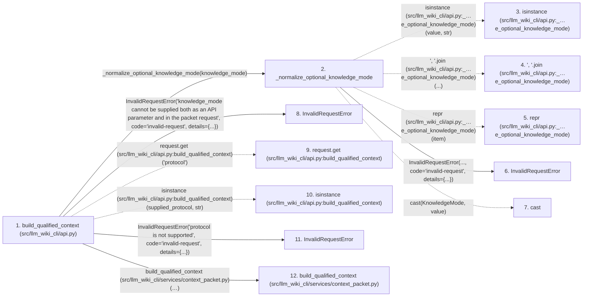

# build_qualified_context

**Entry point:** `build_qualified_context` (`api`)
**Source:** [api](../modules/api.md)
**Modules touched:** [analysis_capture](../modules/analysis_capture.md), [analysis_compatibility](../modules/analysis_compatibility.md), [api](../modules/api.md), [change_selection](../modules/change_selection.md), and 54 more

**Complete modules touched:**

- [analysis_capture](../modules/analysis_capture.md)
- [analysis_compatibility](../modules/analysis_compatibility.md)
- [api](../modules/api.md)
- [change_selection](../modules/change_selection.md)
- [common](../modules/common.md)
- [config](../modules/config.md)
- [context_budget](../modules/context_budget.md)
- [context_packet](../modules/context_packet.md)
- [context_service](../modules/context_service.md)
- [data_flow](../modules/data_flow.md)
- [dependency_versions](../modules/dependency_versions.md)
- [documentation_queries](../modules/documentation_queries.md)
- [documentation_query_builder](../modules/documentation_query_builder.md)
- [entrypoints](../modules/entrypoints.md)
- [extraction_service](../modules/extraction_service.md)
- [filesystem_guard](../modules/filesystem_guard.md)
- [go_calls](../modules/go_calls.md)
- [immutable](../modules/immutable.md)
- [implementation_evidence](../modules/implementation_evidence.md)
- [imports](../modules/imports.md)
- [infrastructure_inventory](../modules/infrastructure_inventory.md)
- [infrastructure_sync](../modules/infrastructure_sync.md)
- [io](../modules/io.md)
- [knowledge_artifacts](../modules/knowledge_artifacts.md)
- [knowledge_consumption](../modules/knowledge_consumption.md)
- [knowledge_envelope](../modules/knowledge_envelope.md)
- [knowledge_evidence](../modules/knowledge_evidence.md)
- [knowledge_freshness](../modules/knowledge_freshness.md)
- [knowledge_generation](../modules/knowledge_generation.md)
- [knowledge_governance](../modules/knowledge_governance.md)
- [knowledge_loader](../modules/knowledge_loader.md)
- [knowledge_model](../modules/knowledge_model.md)
- [knowledge_orchestration](../modules/knowledge_orchestration.md)
- [knowledge_storage](../modules/knowledge_storage.md)
- [knowledge_storage_io](../modules/knowledge_storage_io.md)
- [knowledge_verification](../modules/knowledge_verification.md)
- [maintenance_evidence](../modules/maintenance_evidence.md)
- [maintenance_protocol](../modules/maintenance_protocol.md)
- [maintenance_service](../modules/maintenance_service.md)
- [maintenance_state](../modules/maintenance_state.md)
- [maintenance_status](../modules/maintenance_status.md)
- [manifest_storage](../modules/manifest_storage.md)
- [packages](../modules/packages.md)
- [packet_field_policy](../modules/packet_field_policy.md)
- [plugins](../modules/plugins.md)
- [python_bindings](../modules/python_bindings.md)
- [python_calls](../modules/python_calls.md)
- [python_implementation](../modules/python_implementation.md)
- [python_imports](../modules/python_imports.md)
- [services_dependencies](../modules/services_dependencies.md)
- [source_selection](../modules/source_selection.md)
- [source_snapshot](../modules/source_snapshot.md)
- [sync_manifest](../modules/sync_manifest.md)
- [validation](../modules/validation.md)
- [verification_contracts](../modules/verification_contracts.md)
- [wiki_media](../modules/wiki_media.md)
- [wiki_surface](../modules/wiki_surface.md)
- [wiki_surface_index](../modules/wiki_surface_index.md)

## Call sequence

> Static overview in presentation order, not runtime execution order. Arrows retain captured callers; siblings are shown before deeper helper detail.

```mermaid
sequenceDiagram
    participant p0 as build_qualified_context (src/llm_wiki_cli/api.py)
    participant p1 as _normalize_optional_knowledge_mode
    participant p2 as InvalidRequestError
    participant p3 as request.get (src/llm_wiki_cli/api.py:build_qualified_context)
    participant p4 as isinstance (src/llm_wiki_cli/api.py:build_qualified_context)
    participant p5 as build_qualified_context (src/llm_wiki_cli/services/context_packet.py)
    participant p6 as _raise_context_packet_api_error
    participant p7 as isinstance (src/llm_wiki_cli/api.py:_…e_optional_knowledge_mode)
    participant p8 as _normalized_request
    participant p9 as _raise_required_knowledge_api_error
    participant p10 as ', '.join (src/llm_wiki_cli/api.py:_…e_optional_knowledge_mode)
    participant p11 as _packet_contract_for_request
    participant p12 as describe_context_packet_error
    participant p13 as repr (src/llm_wiki_cli/api.py:_…e_optional_knowledge_mode)
    participant p14 as capture_context_read
    participant p15 as leaf
    participant p16 as normalized.get (src/llm_wiki_cli/services…y:build_qualified_context)
    participant p17 as cast
    participant p18 as bool (src/llm_wiki_cli/services…y:build_qualified_context)
    participant p19 as set (src/llm_wiki_cli/services…y:build_qualified_context)
    participant p20 as build_context_from_captured_read
    participant p21 as _protocol_success_payload
    participant p22 as sorted (src/llm_wiki_cli/services…y:build_qualified_context)
    participant p23 as payload.get(…).items
    participant p24 as payload.get (src/llm_wiki_cli/services…y:build_qualified_context)
    participant p25 as isinstance (src/llm_wiki_cli/services…y:build_qualified_context)
    participant p26 as _fit_knowledge_packet_response
    participant p27 as packet_from_captured_response
    p0->>p1: _normalize_optional_knowledge_mode
    p0->>p2: InvalidRequestError
    p0-->>p3: request.get (src/llm_wiki_cli/api.py:build_qualified_context)('protocol')
    p0-->>p4: isinstance (src/llm_wiki_cli/api.py:build_qualified_context)(supplied_protocol, str)
    p0->>p2: InvalidRequestError
    p0->>p5: build_qualified_context (src/llm_wiki_cli/services/context_packet.py)
    p0->>p6: _raise_context_packet_api_error
    p1-->>p7: isinstance (src/llm_wiki_cli/api.py:_…e_optional_knowledge_mode)(value, str)
    p5->>p8: _normalized_request
    p6->>p9: _raise_required_knowledge_api_error
    p1-->>p10: ', '.join (src/llm_wiki_cli/api.py:_…e_optional_knowledge_mode)(...)
    p5->>p11: _packet_contract_for_request
    p6->>p12: describe_context_packet_error
    p1-->>p13: repr (src/llm_wiki_cli/api.py:_…e_optional_knowledge_mode)(item)
    p5->>p14: capture_context_read
    p6-->>p15: leaf(failure[...], code=failure[...], details=failure[...])
    p1->>p2: InvalidRequestError
    p5-->>p16: normalized.get (src/llm_wiki_cli/services…y:build_qualified_context)('knowledge_mode')
    p1-->>p17: cast(KnowledgeMode, value)
    p5-->>p16: normalized.get (src/llm_wiki_cli/services…y:build_qualified_context)('knowledge_mode')
    p5-->>p18: bool (src/llm_wiki_cli/services…y:build_qualified_context)(...)
    p5-->>p19: set (src/llm_wiki_cli/services…y:build_qualified_context)(normalized[...])
    p5->>p20: build_context_from_captured_read
    p5->>p21: _protocol_success_payload
    p5-->>p22: sorted (src/llm_wiki_cli/services…y:build_qualified_context)(...)
    p5-->>p23: payload.get(…).items
    p5-->>p24: payload.get (src/llm_wiki_cli/services…y:build_qualified_context)('source_priorities', {...})
    p5-->>p25: isinstance (src/llm_wiki_cli/services…y:build_qualified_context)(path, str)
    p5->>p26: _fit_knowledge_packet_response
    p5->>p27: packet_from_captured_response
```

<!-- Auto-generated from static call edges. Dashed arrows are external or unresolved calls. Reviewed runtime conditions and side effects belong in Behavior. -->

> Call sequence diagram shows 30 of 3814 interactions; 3784 omitted to keep the visualization within the 30-interaction and generated-diagram limits, with uncertain identities omitted rather than inferred.

> Captured boundary calls: external 8 of 1258 (1250 omitted); unresolved 7 of 1326 (1319 omitted). These counts cover the captured static trace.

Omitted captured detail, grouped by actual caller occurrence and target module:

| Caller | Parent step | Target module | Kind | Omitted interactions |
| --- | --- | --- | --- | --- |
| `src/llm_wiki_cli/services/context_packet.py:_normalized_request` | 13 | - | external | 3 |
| `src/llm_wiki_cli/services/context_packet.py:_normalized_request` | 13 | [src/llm_wiki_cli/services/context_service.py](../modules/context_service.md) | internal | 2 |
| `src/llm_wiki_cli/services/context_packet.py:_normalized_request` | 13 | - | unresolved | 2 |
| `src/llm_wiki_cli/services/context_service.py:_validate_protocol_request` | 20 | - | external | 2 |
| `src/llm_wiki_cli/services/context_service.py:_validate_protocol_request` | 20 | - | unresolved | 1 |
| `src/llm_wiki_cli/services/context_service.py:_validate_protocol_request` | 20 | [src/llm_wiki_cli/services/context_service.py](../modules/context_service.md) | internal | 1 |
| `src/llm_wiki_cli/services/context_service.py:_validate_protocol_request_impl` | 23 | - | external | 11 |
| `src/llm_wiki_cli/services/context_service.py:_validate_protocol_request_impl` | 23 | [src/llm_wiki_cli/services/context_service.py](../modules/context_service.md) | internal | 12 |
> Omission summary shows 8 of 840 groups; 832 further groups are not expanded here. Counts above include all omitted interactions.
> Detailed flow queries retain their own coverage and limits; omitted paths may execute at runtime.

> Trace truncated at the depth limit; deeper calls are omitted.

## Data flow

<!-- Auto-generated static analysis. Treat values and boundaries as best-effort hints, not runtime proof. -->

### Step data

| Step | Inputs | Reads | Writes | Returns |
|---|---|---|---|---|
| `build_qualified_context (src/llm_wiki_cli/api.py)` | `src_dir: str`, `wiki_dir: str`, `request: Mapping[str, Any] \| None`, `allow_external_src: bool`, `read_only: bool`, `source_selection: str \| Path \| None`, `knowledge_mode: KnowledgeMode \| None`, `comparison_policy: str \| None` | `KNOWLEDGE_MODE_REQUEST_FIELD`, `KNOWLEDGE_MODE_REQUEST_FIELD`, `context_cmd`, `CONTEXT_KNOWLEDGE_PROTOCOL_VERSION`, `KNOWLEDGE_MODE_REQUEST_FIELD`, `CONTEXT_KNOWLEDGE_PROTOCOL_VERSION`, `KNOWLEDGE_MODE_REQUEST_FIELD`, `CONTEXT_KNOWLEDGE_PROTOCOL_VERSION` | - | `packet` |
| `_normalize_optional_knowledge_mode` | `value: object` | `KNOWLEDGE_MODE_VALUES`, `KNOWLEDGE_MODE_VALUES`, `KNOWLEDGE_MODE_REQUEST_FIELD`, `KnowledgeMode` | - | `None`, `cast(...)` |
| `isinstance (src/llm_wiki_cli/api.py:_…e_optional_knowledge_mode)` | - | - | - | - |
| `', '.join (src/llm_wiki_cli/api.py:_…e_optional_knowledge_mode)` | - | - | - | - |
| `repr (src/llm_wiki_cli/api.py:_…e_optional_knowledge_mode)` | - | - | - | - |
| `InvalidRequestError` | - | - | - | - |
| `cast` | - | - | - | - |
| `InvalidRequestError` | - | - | - | - |
| `request.get (src/llm_wiki_cli/api.py:build_qualified_context)` | - | - | - | - |
| `isinstance (src/llm_wiki_cli/api.py:build_qualified_context)` | - | - | - | - |
| `InvalidRequestError` | - | - | - | - |
| `build_qualified_context (src/llm_wiki_cli/services/context_packet.py)` | `src_dir: str`, `wiki_dir: str`, `request: Mapping[str, Any] \| None`, `allow_external_src: bool`, `read_only: bool`, `job_request: ExtractionJobRequest \| None`, `plan_reporter: Callable[[ExtractionJobPlan], None] \| None`, `source_selection: str \| Path \| None` | `_KNOWLEDGE_PACKET_CONTRACT`, `_KNOWLEDGE_PACKET_CONTRACT`, `context_service`, `_KNOWLEDGE_PACKET_CONTRACT` | `response[...]` | `packet_from_captured_response(...)` |

### Call data

| From | To | Line | Call |
|---|---|---:|---|
| build_qualified_context (src/llm_wiki_cli/api.py) | _normalize_optional_knowledge_mode | 1685 | `_normalize_optional_knowledge_mode(knowledge_mode)` |
| _normalize_optional_knowledge_mode | isinstance (src/llm_wiki_cli/api.py:_…e_optional_knowledge_mode) | 397 | `isinstance(value, str)` |
| _normalize_optional_knowledge_mode | ', '.join (src/llm_wiki_cli/api.py:_…e_optional_knowledge_mode) | 398 | `', '.join(...)` |
| _normalize_optional_knowledge_mode | repr (src/llm_wiki_cli/api.py:_…e_optional_knowledge_mode) | 398 | `repr(item)` |
| _normalize_optional_knowledge_mode | InvalidRequestError | 399 | `InvalidRequestError(..., code='invalid-request', details={...})` |
| _normalize_optional_knowledge_mode | cast | 404 | `cast(KnowledgeMode, value)` |
| build_qualified_context (src/llm_wiki_cli/api.py) | InvalidRequestError | 1689 | `InvalidRequestError('knowledge_mode cannot be supplied both as an API parameter and in the packet request', code='invalid-request', details={...})` |
| build_qualified_context (src/llm_wiki_cli/api.py) | request.get (src/llm_wiki_cli/api.py:build_qualified_context) | 1695 | `request.get('protocol')` |
| build_qualified_context (src/llm_wiki_cli/api.py) | isinstance (src/llm_wiki_cli/api.py:build_qualified_context) | 1697 | `isinstance(supplied_protocol, str)` |
| build_qualified_context (src/llm_wiki_cli/api.py) | InvalidRequestError | 1704 | `InvalidRequestError('protocol is not supported', code='invalid-request', details={...})` |
| build_qualified_context (src/llm_wiki_cli/api.py) | build_qualified_context (src/llm_wiki_cli/services/context_packet.py) | 1727 | `context_packet_service.build_qualified_context(src_dir, wiki_dir, packet_request, allow_external_src=allow_external_src, read_only=read_only, source_selection=source_selection)` |

### Boundary effects

*No boundary effects detected.*

### Static analysis gaps

| Kind | Step | Target | Line |
|---|---|---|---:|
| external_call | `_normalize_optional_knowledge_mode` | `isinstance` | 397 |
| unresolved_call | `_normalize_optional_knowledge_mode` | `', '.join` | 398 |
| external_call | `_normalize_optional_knowledge_mode` | `cast` | 404 |
| unresolved_call | `build_qualified_context` | `request.get` | 1695 |
| external_call | `build_qualified_context` | `isinstance` | 1697 |
| step_limit | `build_qualified_context` | `first 12 steps` | 0 |
| truncated_flow | `build_qualified_context` | `depth limit` | 0 |

## Behavior

This flow starts at `build_qualified_context` and is classified as `api`. The generated call and data-flow sections are bounded static projections; runtime conditions and side effects require source-level confirmation.
