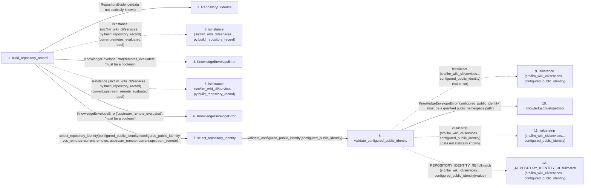

# build_repository_record

**Entry point:** `build_repository_record` (`api`)
**Source:** [knowledge_envelope](../modules/knowledge_envelope.md)
**Modules touched:** [knowledge_envelope](../modules/knowledge_envelope.md), [knowledge_model](../modules/knowledge_model.md)

## Call sequence

> Static overview in presentation order, not runtime execution order. Arrows retain captured callers; representative internal continuations and boundary examples precede repeated helper detail.

```mermaid
sequenceDiagram
    participant p0 as build_repository_record
    participant p1 as select_repository_identity
    participant p2 as _evaluated_revision
    participant p3 as _working_tree
    participant p4 as RepositoryEvidence
    participant p5 as KnowledgeEnvelopeError
    participant p6 as RepositoryRecord
    participant p7 as validate_configured_public_identity
    participant p8 as _remote_mapping
    participant p9 as normalize_vcs_remote
    participant p10 as WorkingTreeState
    participant p11 as _normalize_scheme_remote
    participant p12 as _normalize_scp_remote
    participant p13 as _normalized_remote_identity
    participant p14 as isinstance (src/llm_wiki_cli/services…py:build_repository_record)
    participant p15 as value.startswith (src/llm_wiki_cli/services…ope.py:_evaluated_revision)
    participant p16 as isinstance (src/llm_wiki_cli/services…ope.py:_evaluated_revision)
    participant p17 as isinstance (src/llm_wiki_cli/services…_envelope.py:_working_tree)
    participant p18 as len
    participant p19 as next
    participant p20 as _EVALUATED_REVISION_RE.fullmatch
    participant p21 as iter
    participant p22 as remotes.get
    participant p23 as isinstance (src/llm_wiki_cli/services…select_repository_identity)
    participant p24 as isinstance (src/llm_wiki_cli/services…configured_public_identity)
    participant p25 as isinstance (src/llm_wiki_cli/services…nvelope.py:_remote_mapping)
    participant p26 as isinstance (src/llm_wiki_cli/services…pe.py:normalize_vcs_remote)
    participant p27 as value.strip (src/llm_wiki_cli/services…pe.py:normalize_vcs_remote)
    participant p28 as value.strip (src/llm_wiki_cli/services…configured_public_identity)
    participant p29 as value.items
    p0->>p1: select_repository_identity
    p0->>p2: _evaluated_revision
    p0->>p3: _working_tree
    p0->>p4: RepositoryEvidence
    p0->>p5: KnowledgeEnvelopeError
    p0->>p6: RepositoryRecord
    p1->>p7: validate_configured_public_identity
    p1->>p8: _remote_mapping
    p1->>p9: normalize_vcs_remote
    p3->>p10: WorkingTreeState
    p9->>p11: _normalize_scheme_remote
    p9->>p12: _normalize_scp_remote
    p9->>p13: _normalized_remote_identity
    p0-->>p14: isinstance (src/llm_wiki_cli/services…py:build_repository_record)(current.remotes_evaluated, bool)
    p2-->>p15: value.startswith (src/llm_wiki_cli/services…ope.py:_evaluated_revision)('git:')
    p0-->>p14: isinstance (src/llm_wiki_cli/services…py:build_repository_record)(current.upstream_remote_evaluated, bool)
    p2-->>p16: isinstance (src/llm_wiki_cli/services…ope.py:_evaluated_revision)(value, str)
    p3-->>p17: isinstance (src/llm_wiki_cli/services…_envelope.py:_working_tree)(value, WorkingTreeState)
    p1-->>p18: len(remotes)
    p1-->>p19: next(iter(...))
    p2-->>p20: _EVALUATED_REVISION_RE.fullmatch(candidate)
    p1-->>p21: iter(remotes)
    p1-->>p22: remotes.get(selected)
    p1-->>p23: isinstance (src/llm_wiki_cli/services…select_repository_identity)(remote, str)
    p7-->>p24: isinstance (src/llm_wiki_cli/services…configured_public_identity)(value, str)
    p8-->>p25: isinstance (src/llm_wiki_cli/services…nvelope.py:_remote_mapping)(value, Mapping)
    p9-->>p26: isinstance (src/llm_wiki_cli/services…pe.py:normalize_vcs_remote)(value, str)
    p9-->>p27: value.strip (src/llm_wiki_cli/services…pe.py:normalize_vcs_remote)
    p7-->>p28: value.strip (src/llm_wiki_cli/services…configured_public_identity)
    p8-->>p29: value.items
```

<!-- Auto-generated from static call edges. Dashed arrows are external or unresolved calls. Reviewed runtime conditions and side effects belong in Behavior. -->

> Call sequence diagram shows 30 of 71 interactions; 41 omitted to keep the visualization within the 30-interaction and generated-diagram limits, with uncertain identities omitted rather than inferred.

> Captured boundary calls: external 11 of 18 (7 omitted); unresolved 6 of 31 (25 omitted). These counts cover the captured static trace.

Omitted captured detail, grouped by actual caller occurrence and target module:

| Caller | Parent step | Target module | Kind | Omitted interactions |
| --- | --- | --- | --- | --- |
| `src/llm_wiki_cli/services/knowledge_envelope.py:build_repository_record` | 1 | [src/llm_wiki_cli/services/knowledge_envelope.py](../modules/knowledge_envelope.md) | internal | 1 |
| `src/llm_wiki_cli/services/knowledge_envelope.py:validate_configured_public_identity` | 8 | [src/llm_wiki_cli/services/knowledge_envelope.py](../modules/knowledge_envelope.md) | internal | 2 |
| `src/llm_wiki_cli/services/knowledge_envelope.py:validate_configured_public_identity` | 8 | - | unresolved | 3 |
| `src/llm_wiki_cli/services/knowledge_envelope.py:_remote_mapping` | 16 | [src/llm_wiki_cli/services/knowledge_envelope.py](../modules/knowledge_envelope.md) | internal | 3 |
| `src/llm_wiki_cli/services/knowledge_envelope.py:_remote_mapping` | 16 | - | external | 2 |
| `src/llm_wiki_cli/services/knowledge_envelope.py:normalize_vcs_remote` | 29 | - | external | 2 |
| `src/llm_wiki_cli/services/knowledge_envelope.py:normalize_vcs_remote` | 29 | - | unresolved | 3 |
| `src/llm_wiki_cli/services/knowledge_envelope.py:_normalize_scheme_remote` | 37 | - | external | 1 |
> Omission summary shows 8 of 14 groups; 6 further groups are not expanded here. Counts above include all omitted interactions.
> Detailed flow queries retain their own coverage and limits; omitted paths may execute at runtime.

## Data flow

<!-- Auto-generated static analysis. Treat values and boundaries as best-effort hints, not runtime proof. -->

### Analysis coverage

**Effect analysis partially available.** Flow assembly and source effect analysis are separate; empty observations do not prove an empty handler body.

Source steps: 23; effect analysis evaluated: 10, partial: 0, unavailable: 13. Counts include steps omitted from the displayed trace.

Collector observations for 10 source steps with known totals: observed: 52, emitted: 52, omitted: 0. Unavailable totals are excluded.

- Callable record unavailable; the selected entry symbol has no represented callable body.
- Effect collector totals unavailable; observed counts cover captured records only.

| Step | Callable record | Effect analysis | Collector totals | Observed | Emitted | Omitted |
|---|---|---|---|---:|---:|---:|
| `build_repository_record` | `available` | `evaluated` | `available` | `6` | `6` | `0` |
| `RepositoryEvidence` | `unavailable` | `unavailable` | `unavailable` | — | — | — |
| `isinstance (src/llm_wiki_cli/services…py:build_repository_record)` | `not_applicable` | `not_applicable` | `not_applicable` | — | — | — |
| `KnowledgeEnvelopeError` | `unavailable` | `unavailable` | `unavailable` | — | — | — |
| `isinstance (src/llm_wiki_cli/services…py:build_repository_record)` | `not_applicable` | `not_applicable` | `not_applicable` | — | — | — |
| `KnowledgeEnvelopeError` | `unavailable` | `unavailable` | `unavailable` | — | — | — |
| `select_repository_identity` | `available` | `evaluated` | `available` | `11` | `11` | `0` |
| `validate_configured_public_identity` | `available` | `evaluated` | `available` | `2` | `2` | `0` |
| `isinstance (src/llm_wiki_cli/services…configured_public_identity)` | `not_applicable` | `not_applicable` | `not_applicable` | — | — | — |
| `KnowledgeEnvelopeError` | `unavailable` | `unavailable` | `unavailable` | — | — | — |
| `value.strip (src/llm_wiki_cli/services…configured_public_identity)` | `not_applicable` | `not_applicable` | `not_applicable` | — | — | — |
| `_REPOSITORY_IDENTITY_RE.fullmatch (src/llm_wiki_cli/services…configured_public_identity)` | `not_applicable` | `not_applicable` | `not_applicable` | — | — | — |

### Step data

| Step | Inputs | Reads | Writes | Returns |
|---|---|---|---|---|
| `build_repository_record` | `configured_public_identity: str \| None`, `evidence: RepositoryEvidence \| None` | `RepositoryIdentitySource`, `RepositoryIdentitySource` | `extensions[...]` | `RepositoryRecord(...)` |
| `RepositoryEvidence` | - | - | - | - |
| `isinstance (src/llm_wiki_cli/services…py:build_repository_record)` | - | - | - | - |
| `KnowledgeEnvelopeError` | - | - | - | - |
| `isinstance (src/llm_wiki_cli/services…py:build_repository_record)` | - | - | - | - |
| `KnowledgeEnvelopeError` | - | - | - | - |
| `select_repository_identity` | `configured_public_identity: str \| None`, `vcs_remotes: Mapping[str, str \| None]`, `upstream_remote: str \| None` | `RepositoryIdentitySource`, `RepositoryIdentitySource`, `RepositoryIdentitySource`, `RepositoryIdentitySource` | - | `(...)`, `(...)`, `(...)`, `(...)` |
| `validate_configured_public_identity` | `value: object` | - | - | `value` |
| `isinstance (src/llm_wiki_cli/services…configured_public_identity)` | - | - | - | - |
| `KnowledgeEnvelopeError` | - | - | - | - |
| `value.strip (src/llm_wiki_cli/services…configured_public_identity)` | - | - | - | - |
| `_REPOSITORY_IDENTITY_RE.fullmatch (src/llm_wiki_cli/services…configured_public_identity)` | - | - | - | - |

### Call data

| From | To | Line | Call |
|---|---|---:|---|
| build_repository_record | RepositoryEvidence | 615 | `RepositoryEvidence(data not statically known)` |
| build_repository_record | isinstance (src/llm_wiki_cli/services…py:build_repository_record) | 616 | `isinstance(current.remotes_evaluated, bool)` |
| build_repository_record | KnowledgeEnvelopeError | 617 | `KnowledgeEnvelopeError('remotes_evaluated', 'must be a boolean')` |
| build_repository_record | isinstance (src/llm_wiki_cli/services…py:build_repository_record) | 621 | `isinstance(current.upstream_remote_evaluated, bool)` |
| build_repository_record | KnowledgeEnvelopeError | 622 | `KnowledgeEnvelopeError('upstream_remote_evaluated', 'must be a boolean')` |
| build_repository_record | select_repository_identity | 631 | `select_repository_identity(configured_public_identity=configured_public_identity, vcs_remotes=current.remotes, upstream_remote=current.upstream_remote)` |
| select_repository_identity | validate_configured_public_identity | 658 | `validate_configured_public_identity(configured_public_identity)` |
| validate_configured_public_identity | isinstance (src/llm_wiki_cli/services…configured_public_identity) | 687 | `isinstance(value, str)` |
| validate_configured_public_identity | KnowledgeEnvelopeError | 688 | `KnowledgeEnvelopeError('configured_public_identity', 'must be a qualified public namespace path')` |
| validate_configured_public_identity | value.strip (src/llm_wiki_cli/services…configured_public_identity) | 693 | `value.strip(data not statically known)` |
| validate_configured_public_identity | _REPOSITORY_IDENTITY_RE.fullmatch (src/llm_wiki_cli/services…configured_public_identity) | 694 | `_REPOSITORY_IDENTITY_RE.fullmatch(value)` |

### Boundary effects

*No boundary-effect observations were captured in this static trace.*

### Static analysis gaps

| Kind | Step | Target | Line |
|---|---|---|---:|
| external_call | `build_repository_record` | `isinstance` | 616 |
| external_call | `build_repository_record` | `isinstance` | 621 |
| external_call | `validate_configured_public_identity` | `isinstance` | 687 |
| unresolved_call | `validate_configured_public_identity` | `value.strip` | 693 |
| unresolved_call | `validate_configured_public_identity` | `_REPOSITORY_IDENTITY_RE.fullmatch` | 694 |
| step_limit | `build_repository_record` | `first 12 steps` | 0 |

## Behavior

This flow starts at `build_repository_record` and is classified as `api`. The generated call and data-flow sections are bounded static projections; runtime conditions and side effects require source-level confirmation.
