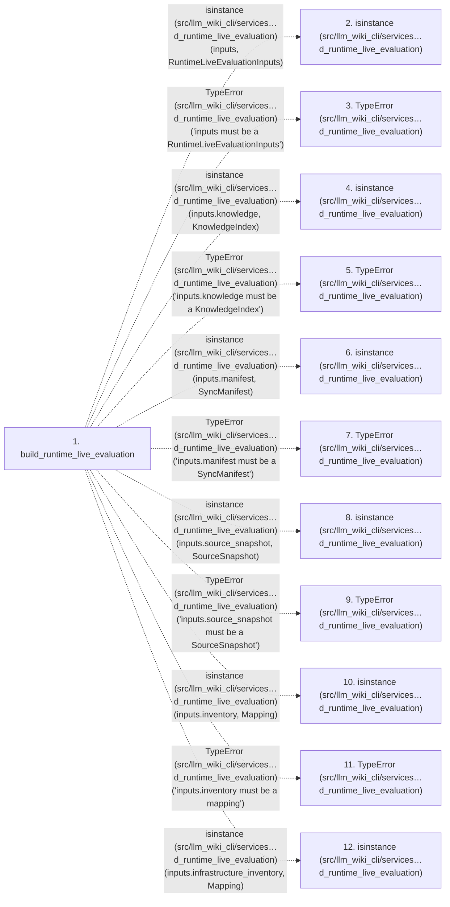

# build_runtime_live_evaluation

**Entry point:** `build_runtime_live_evaluation` (`api`)
**Source:** [knowledge_orchestration](../modules/knowledge_orchestration.md)
**Modules touched:** [analysis_capture](../modules/analysis_capture.md), [analysis_compatibility](../modules/analysis_compatibility.md), [infrastructure_inventory](../modules/infrastructure_inventory.md), and 9 more

**Complete modules touched:**

- [analysis_capture](../modules/analysis_capture.md)
- [analysis_compatibility](../modules/analysis_compatibility.md)
- [infrastructure_inventory](../modules/infrastructure_inventory.md)
- [infrastructure_sync](../modules/infrastructure_sync.md)
- [knowledge_envelope](../modules/knowledge_envelope.md)
- [knowledge_evidence](../modules/knowledge_evidence.md)
- [knowledge_freshness](../modules/knowledge_freshness.md)
- [knowledge_generation](../modules/knowledge_generation.md)
- [knowledge_model](../modules/knowledge_model.md)
- [knowledge_orchestration](../modules/knowledge_orchestration.md)
- [python_implementation](../modules/python_implementation.md)
- [validation](../modules/validation.md)

## Call sequence

> Static overview in presentation order, not runtime execution order. Arrows retain captured callers; siblings are shown before deeper helper detail.

```mermaid
sequenceDiagram
    participant p0 as build_runtime_live_evaluation
    participant p1 as isinstance (src/llm_wiki_cli/services…d_runtime_live_evaluation)
    participant p2 as TypeError (src/llm_wiki_cli/services…d_runtime_live_evaluation)
    participant p3 as has_contract
    participant p4 as replace (src/llm_wiki_cli/services…d_runtime_live_evaluation)
    participant p5 as dict (src/llm_wiki_cli/services…d_runtime_live_evaluation)
    participant p6 as inputs.infrastructure_inventory.items
    participant p7 as inputs.source_snapshot.hashes_for
    participant p8 as sorted (src/llm_wiki_cli/services…d_runtime_live_evaluation)
    participant p9 as set (src/llm_wiki_cli/services…d_runtime_live_evaluation)
    participant p10 as inputs.source_snapshot.captured_content_hashes.get
    participant p11 as _producer_evidence
    participant p12 as _infrastructure_extractor_component
    participant p13 as build_producer_record
    participant p14 as _tool_component
    participant p15 as prepare_runtime_generation_options
    participant p16 as LiveKnowledgeEvaluation
    participant p17 as hash_generation_options
    participant p18 as analysis_identity
    p0-->>p1: isinstance (src/llm_wiki_cli/services…d_runtime_live_evaluation)(inputs, RuntimeLiveEvaluationInputs)
    p0-->>p2: TypeError (src/llm_wiki_cli/services…d_runtime_live_evaluation)('inputs must be a RuntimeLiveEvaluationInputs')
    p0-->>p1: isinstance (src/llm_wiki_cli/services…d_runtime_live_evaluation)(inputs.knowledge, KnowledgeIndex)
    p0-->>p2: TypeError (src/llm_wiki_cli/services…d_runtime_live_evaluation)('inputs.knowledge must be a KnowledgeIndex')
    p0-->>p1: isinstance (src/llm_wiki_cli/services…d_runtime_live_evaluation)(inputs.manifest, SyncManifest)
    p0-->>p2: TypeError (src/llm_wiki_cli/services…d_runtime_live_evaluation)('inputs.manifest must be a SyncManifest')
    p0-->>p1: isinstance (src/llm_wiki_cli/services…d_runtime_live_evaluation)(inputs.source_snapshot, SourceSnapshot)
    p0-->>p2: TypeError (src/llm_wiki_cli/services…d_runtime_live_evaluation)('inputs.source_snapshot must be a SourceSnapshot')
    p0-->>p1: isinstance (src/llm_wiki_cli/services…d_runtime_live_evaluation)(inputs.inventory, Mapping)
    p0-->>p2: TypeError (src/llm_wiki_cli/services…d_runtime_live_evaluation)('inputs.inventory must be a mapping')
    p0-->>p1: isinstance (src/llm_wiki_cli/services…d_runtime_live_evaluation)(inputs.infrastructure_inventory, Mapping)
    p0-->>p2: TypeError (src/llm_wiki_cli/services…d_runtime_live_evaluation)('inputs.infrastructure_inventory must be a mapping')
    p0->>p3: has_contract
    p0-->>p4: replace (src/llm_wiki_cli/services…d_runtime_live_evaluation)(inputs, analysis_components=None)
    p0-->>p5: dict (src/llm_wiki_cli/services…d_runtime_live_evaluation)(inputs.inventory)
    p0-->>p5: dict (src/llm_wiki_cli/services…d_runtime_live_evaluation)(record)
    p0-->>p6: inputs.infrastructure_inventory.items
    p0-->>p5: dict (src/llm_wiki_cli/services…d_runtime_live_evaluation)(inputs.source_snapshot.hashes_for(...))
    p0-->>p7: inputs.source_snapshot.hashes_for(inventory)
    p0-->>p8: sorted (src/llm_wiki_cli/services…d_runtime_live_evaluation)(...)
    p0-->>p9: set (src/llm_wiki_cli/services…d_runtime_live_evaluation)(infrastructure_inventory)
    p0-->>p10: inputs.source_snapshot.captured_content_hashes.get(source_path)
    p0->>p11: _producer_evidence
    p0->>p12: _infrastructure_extractor_component
    p0->>p13: build_producer_record
    p0->>p14: _tool_component
    p0->>p15: prepare_runtime_generation_options
    p0->>p16: LiveKnowledgeEvaluation
    p0->>p17: hash_generation_options
    p0->>p18: analysis_identity
```

<!-- Auto-generated from static call edges. Dashed arrows are external or unresolved calls. Reviewed runtime conditions and side effects belong in Behavior. -->

> Call sequence diagram shows 30 of 574 interactions; 544 omitted to keep the visualization within the 30-interaction and generated-diagram limits, with uncertain identities omitted rather than inferred.

> Captured boundary calls: external 18 of 212 (194 omitted); unresolved 3 of 111 (108 omitted). These counts cover the captured static trace.

Omitted captured detail, grouped by actual caller occurrence and target module:

| Caller | Parent step | Target module | Kind | Omitted interactions |
| --- | --- | --- | --- | --- |
| `src/llm_wiki_cli/services/analysis_compatibility.py:has_contract` | 14 | [src/llm_wiki_cli/services/analysis_compatibility.py](../modules/analysis_compatibility.md) | internal | 1 |
| `src/llm_wiki_cli/services/analysis_compatibility.py:component_record` | 15 | - | external | 4 |
| `src/llm_wiki_cli/services/analysis_compatibility.py:component_record` | 15 | - | unresolved | 2 |
| `src/llm_wiki_cli/services/analysis_compatibility.py:component_record` | 15 | [src/llm_wiki_cli/services/analysis_compatibility.py](../modules/analysis_compatibility.md) | internal | 2 |
| `src/llm_wiki_cli/services/analysis_compatibility.py:validate_record` | 20 | - | external | 22 |
| `src/llm_wiki_cli/services/analysis_compatibility.py:validate_record` | 20 | - | unresolved | 2 |
| `src/llm_wiki_cli/services/analysis_compatibility.py:validate_record` | 20 | [src/llm_wiki_cli/services/analysis_compatibility.py](../modules/analysis_compatibility.md) | internal | 1 |
| `src/llm_wiki_cli/services/analysis_compatibility.py:digest` | 43 | - | unresolved | 2 |
> Omission summary shows 8 of 181 groups; 173 further groups are not expanded here. Counts above include all omitted interactions.
> Detailed flow queries retain their own coverage and limits; omitted paths may execute at runtime.

> Trace truncated at the depth limit; deeper calls are omitted.

## Data flow

<!-- Auto-generated static analysis. Treat values and boundaries as best-effort hints, not runtime proof. -->

### Step data

| Step | Inputs | Reads | Writes | Returns |
|---|---|---|---|---|
| `build_runtime_live_evaluation` | `inputs: RuntimeLiveEvaluationInputs` | `RuntimeLiveEvaluationInputs`, `KnowledgeIndex`, `SyncManifest`, `SourceSnapshot`, `Mapping`, `Mapping`, `ObservationScope`, `__version__` | `source_hashes[...]` | `LiveKnowledgeEvaluation(...)` |
| `isinstance (src/llm_wiki_cli/services…d_runtime_live_evaluation)` | - | - | - | - |
| `TypeError (src/llm_wiki_cli/services…d_runtime_live_evaluation)` | - | - | - | - |
| `isinstance (src/llm_wiki_cli/services…d_runtime_live_evaluation)` | - | - | - | - |
| `TypeError (src/llm_wiki_cli/services…d_runtime_live_evaluation)` | - | - | - | - |
| `isinstance (src/llm_wiki_cli/services…d_runtime_live_evaluation)` | - | - | - | - |
| `TypeError (src/llm_wiki_cli/services…d_runtime_live_evaluation)` | - | - | - | - |
| `isinstance (src/llm_wiki_cli/services…d_runtime_live_evaluation)` | - | - | - | - |
| `TypeError (src/llm_wiki_cli/services…d_runtime_live_evaluation)` | - | - | - | - |
| `isinstance (src/llm_wiki_cli/services…d_runtime_live_evaluation)` | - | - | - | - |
| `TypeError (src/llm_wiki_cli/services…d_runtime_live_evaluation)` | - | - | - | - |
| `isinstance (src/llm_wiki_cli/services…d_runtime_live_evaluation)` | - | - | - | - |

### Call data

| From | To | Line | Call |
|---|---|---:|---|
| build_runtime_live_evaluation | isinstance (src/llm_wiki_cli/services…d_runtime_live_evaluation) | 591 | `isinstance(inputs, RuntimeLiveEvaluationInputs)` |
| build_runtime_live_evaluation | TypeError (src/llm_wiki_cli/services…d_runtime_live_evaluation) | 592 | `TypeError('inputs must be a RuntimeLiveEvaluationInputs')` |
| build_runtime_live_evaluation | isinstance (src/llm_wiki_cli/services…d_runtime_live_evaluation) | 593 | `isinstance(inputs.knowledge, KnowledgeIndex)` |
| build_runtime_live_evaluation | TypeError (src/llm_wiki_cli/services…d_runtime_live_evaluation) | 594 | `TypeError('inputs.knowledge must be a KnowledgeIndex')` |
| build_runtime_live_evaluation | isinstance (src/llm_wiki_cli/services…d_runtime_live_evaluation) | 595 | `isinstance(inputs.manifest, SyncManifest)` |
| build_runtime_live_evaluation | TypeError (src/llm_wiki_cli/services…d_runtime_live_evaluation) | 596 | `TypeError('inputs.manifest must be a SyncManifest')` |
| build_runtime_live_evaluation | isinstance (src/llm_wiki_cli/services…d_runtime_live_evaluation) | 597 | `isinstance(inputs.source_snapshot, SourceSnapshot)` |
| build_runtime_live_evaluation | TypeError (src/llm_wiki_cli/services…d_runtime_live_evaluation) | 598 | `TypeError('inputs.source_snapshot must be a SourceSnapshot')` |
| build_runtime_live_evaluation | isinstance (src/llm_wiki_cli/services…d_runtime_live_evaluation) | 599 | `isinstance(inputs.inventory, Mapping)` |
| build_runtime_live_evaluation | TypeError (src/llm_wiki_cli/services…d_runtime_live_evaluation) | 600 | `TypeError('inputs.inventory must be a mapping')` |
| build_runtime_live_evaluation | isinstance (src/llm_wiki_cli/services…d_runtime_live_evaluation) | 601 | `isinstance(inputs.infrastructure_inventory, Mapping)` |

### Boundary effects

*No boundary effects detected.*

### Static analysis gaps

| Kind | Step | Target | Line |
|---|---|---|---:|
| external_call | `build_runtime_live_evaluation` | `isinstance` | 591 |
| external_call | `build_runtime_live_evaluation` | `TypeError` | 592 |
| external_call | `build_runtime_live_evaluation` | `isinstance` | 593 |
| external_call | `build_runtime_live_evaluation` | `TypeError` | 594 |
| external_call | `build_runtime_live_evaluation` | `isinstance` | 595 |
| external_call | `build_runtime_live_evaluation` | `TypeError` | 596 |
| external_call | `build_runtime_live_evaluation` | `isinstance` | 597 |
| external_call | `build_runtime_live_evaluation` | `TypeError` | 598 |
| external_call | `build_runtime_live_evaluation` | `isinstance` | 599 |
| external_call | `build_runtime_live_evaluation` | `TypeError` | 600 |
| external_call | `build_runtime_live_evaluation` | `isinstance` | 601 |
| step_limit | `build_runtime_live_evaluation` | `first 12 steps` | 0 |

## Behavior

This flow starts at `build_runtime_live_evaluation` and is classified as `api`. The generated call and data-flow sections are bounded static projections; runtime conditions and side effects require source-level confirmation.
