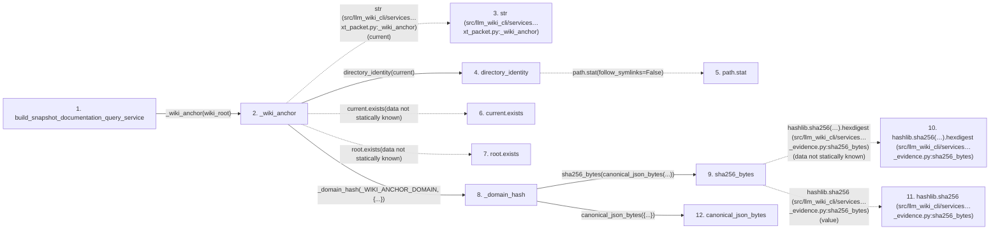

# build_snapshot_documentation_query_service

**Entry point:** `build_snapshot_documentation_query_service` (`api`)
**Source:** [documentation_query_builder](../modules/documentation_query_builder.md)
**Modules touched:** [analysis_compatibility](../modules/analysis_compatibility.md), [canonical_json](../modules/canonical_json.md), [context_packet](../modules/context_packet.md), and 32 more

**Complete modules touched:**

- [analysis_compatibility](../modules/analysis_compatibility.md)
- [canonical_json](../modules/canonical_json.md)
- [context_packet](../modules/context_packet.md)
- [documentation_query_builder](../modules/documentation_query_builder.md)
- [filesystem_guard](../modules/filesystem_guard.md)
- [immutable](../modules/immutable.md)
- [implementation_evidence](../modules/implementation_evidence.md)
- [infrastructure_sync](../modules/infrastructure_sync.md)
- [io](../modules/io.md)
- [knowledge_artifacts](../modules/knowledge_artifacts.md)
- [knowledge_consumption](../modules/knowledge_consumption.md)
- [knowledge_envelope](../modules/knowledge_envelope.md)
- [knowledge_evidence](../modules/knowledge_evidence.md)
- [knowledge_freshness](../modules/knowledge_freshness.md)
- [knowledge_governance](../modules/knowledge_governance.md)
- [knowledge_graph](../modules/knowledge_graph.md)
- [knowledge_index](../modules/knowledge_index.md)
- [knowledge_loader](../modules/knowledge_loader.md)
- [knowledge_model](../modules/knowledge_model.md)
- [knowledge_packs](../modules/knowledge_packs.md)
- [knowledge_reuse](../modules/knowledge_reuse.md)
- [knowledge_storage](../modules/knowledge_storage.md)
- [knowledge_storage_io](../modules/knowledge_storage_io.md)
- [knowledge_verification](../modules/knowledge_verification.md)
- [maintenance_evidence](../modules/maintenance_evidence.md)
- [maintenance_projection](../modules/maintenance_projection.md)
- [maintenance_protocol](../modules/maintenance_protocol.md)
- [maintenance_state](../modules/maintenance_state.md)
- [maintenance_status](../modules/maintenance_status.md)
- [manifest_storage](../modules/manifest_storage.md)
- [section_ownership](../modules/section_ownership.md)
- [source_snapshot](../modules/source_snapshot.md)
- [sync_manifest](../modules/sync_manifest.md)
- [verification_contracts](../modules/verification_contracts.md)
- [wiki_surface](../modules/wiki_surface.md)

## Call sequence

> Static overview in presentation order, not runtime execution order. Arrows retain captured callers; siblings are shown before deeper helper detail.

```mermaid
sequenceDiagram
    participant p0 as build_snapshot_documentation_query_service
    participant p1 as _wiki_anchor
    participant p2 as load_knowledge_read_view
    participant p3 as build_documentation_query_service_from_view
    participant p4 as _assert_wiki_unchanged
    participant p5 as str (src/llm_wiki_cli/services…xt_packet.py:_wiki_anchor)
    participant p6 as isinstance (src/llm_wiki_cli/services…:load_knowledge_read_view)
    participant p7 as attach_machine_verification_read_view
    participant p8 as _assert_wiki_integrity
    participant p9 as directory_identity
    participant p10 as TypeError (src/llm_wiki_cli/services…:load_knowledge_read_view)
    participant p11 as assemble_documentation_query_service
    participant p12 as current.exists
    participant p13 as load_knowledge_state
    participant p14 as verification_summaries_for_concepts
    participant p15 as root.exists
    participant p16 as _unsupported_reason
    participant p17 as ContextPacketSourceMutationError
    participant p18 as _domain_hash
    participant p19 as KnowledgeLoadResult
    participant p20 as walk
    participant p21 as build_knowledge_read_view
    participant p22 as Path (src/llm_wiki_cli/services…xt_packet.py:_wiki_anchor)
    participant p23 as path.stat
    participant p24 as sha256_bytes
    p0->>p1: _wiki_anchor
    p0->>p2: load_knowledge_read_view
    p0->>p3: build_documentation_query_service_from_view
    p0->>p4: _assert_wiki_unchanged
    p1-->>p5: str (src/llm_wiki_cli/services…xt_packet.py:_wiki_anchor)(current)
    p2-->>p6: isinstance (src/llm_wiki_cli/services…:load_knowledge_read_view)(include_machine_verification, bool)
    p3->>p7: attach_machine_verification_read_view
    p4->>p8: _assert_wiki_integrity
    p1->>p9: directory_identity
    p2-->>p10: TypeError (src/llm_wiki_cli/services…:load_knowledge_read_view)('include_machine_verification must be a boolean')
    p3->>p11: assemble_documentation_query_service
    p4->>p1: _wiki_anchor
    p1-->>p12: current.exists
    p2->>p13: load_knowledge_state
    p3->>p14: verification_summaries_for_concepts
    p4->>p1: _wiki_anchor
    p1-->>p15: root.exists
    p2->>p16: _unsupported_reason
    p4->>p17: ContextPacketSourceMutationError
    p1->>p18: _domain_hash
    p2->>p19: KnowledgeLoadResult
    p4->>p17: ContextPacketSourceMutationError
    p1-->>p20: walk(root, Path(...))
    p2->>p21: build_knowledge_read_view
    p1-->>p22: Path (src/llm_wiki_cli/services…xt_packet.py:_wiki_anchor)
    p2->>p7: attach_machine_verification_read_view
    p1->>p8: _assert_wiki_integrity
    p1->>p18: _domain_hash
    p9-->>p23: path.stat(follow_symlinks=False)
    p18->>p24: sha256_bytes
```

<!-- Auto-generated from static call edges. Dashed arrows are external or unresolved calls. Reviewed runtime conditions and side effects belong in Behavior. -->

> Call sequence diagram shows 30 of 1162 interactions; 1132 omitted to keep the visualization within the 30-interaction and generated-diagram limits, with uncertain identities omitted rather than inferred.

> Captured boundary calls: external 3 of 421 (418 omitted); unresolved 5 of 233 (228 omitted). These counts cover the captured static trace.

Omitted captured detail, grouped by actual caller occurrence and target module:

| Caller | Parent step | Target module | Kind | Omitted interactions |
| --- | --- | --- | --- | --- |
| `src/llm_wiki_cli/services/knowledge_evidence.py:sha256_bytes` | 9 | - | unresolved | 1 |
| `src/llm_wiki_cli/services/knowledge_evidence.py:sha256_bytes` | 9 | - | external | 1 |
| `src/llm_wiki_cli/services/context_packet.py:_domain_hash` | 8 | [src/llm_wiki_cli/services/knowledge_evidence.py](../modules/knowledge_evidence.md) | internal | 1 |
| `src/llm_wiki_cli/services/knowledge_evidence.py:canonical_json_bytes` | 12 | - | unresolved | 1 |
| `src/llm_wiki_cli/services/knowledge_evidence.py:canonical_json_bytes` | 12 | [src/llm_wiki_cli/services/knowledge_evidence.py](../modules/knowledge_evidence.md) | internal | 1 |
| `src/llm_wiki_cli/services/knowledge_evidence.py:canonical_json_text` | 14 | - | external | 1 |
| `src/llm_wiki_cli/services/context_packet.py:_assert_wiki_integrity` | 18 | - | external | 3 |
| `src/llm_wiki_cli/services/context_packet.py:_assert_wiki_integrity` | 18 | [src/llm_wiki_cli/services/source_snapshot.py](../modules/source_snapshot.md) | internal | 1 |
> Omission summary shows 8 of 251 groups; 243 further groups are not expanded here. Counts above include all omitted interactions.
> Detailed flow queries retain their own coverage and limits; omitted paths may execute at runtime.

> Trace truncated at the depth limit; deeper calls are omitted.

## Data flow

<!-- Auto-generated static analysis. Treat values and boundaries as best-effort hints, not runtime proof. -->

### Step data

| Step | Inputs | Reads | Writes | Returns |
|---|---|---|---|---|
| `build_snapshot_documentation_query_service` | `wiki_root: Path`, `limit: int` | - | - | `service` |
| `_wiki_anchor` | `root: Path`, `reject_all_symlinks: bool`, `max_bytes: int \| None`, `metrics: dict[str, int] \| None`, `integrity_out: dict[str, tuple[int, ...]] \| None`, `guard_windows: bool` | `_WIKI_ANCHOR_DOMAIN`, `_WIKI_ANCHOR_DOMAIN` | - | `_domain_hash(...)`, `_domain_hash(...)` |
| `str (src/llm_wiki_cli/services…xt_packet.py:_wiki_anchor)` | - | - | - | - |
| `directory_identity` | `path: Path` | - | - | `(...)`, `(...)` |
| `path.stat` | - | - | - | - |
| `current.exists` | - | - | - | - |
| `root.exists` | - | - | - | - |
| `_domain_hash` | `domain: str`, `value: Mapping[str, Any]` | - | - | `sha256_bytes(...)` |
| `sha256_bytes` | `value: bytes` | - | - | `...` |
| `hashlib.sha256(…).hexdigest (src/llm_wiki_cli/services…_evidence.py:sha256_bytes)` | - | - | - | - |
| `hashlib.sha256 (src/llm_wiki_cli/services…_evidence.py:sha256_bytes)` | - | - | - | - |
| `canonical_json_bytes` | `value: Any` | - | - | `...` |

### Call data

| From | To | Line | Call |
|---|---|---:|---|
| build_snapshot_documentation_query_service | _wiki_anchor | 440 | `_wiki_anchor(wiki_root)` |
| _wiki_anchor | str (src/llm_wiki_cli/services…xt_packet.py:_wiki_anchor) | 5062 | `str(current)` |
| _wiki_anchor | directory_identity | 5062 | `directory_identity(current)` |
| directory_identity | path.stat | 687 | `path.stat(follow_symlinks=False)` |
| _wiki_anchor | current.exists | 5063 | `current.exists(data not statically known)` |
| _wiki_anchor | root.exists | 5066 | `root.exists(data not statically known)` |
| _wiki_anchor | _domain_hash | 5067 | `_domain_hash(_WIKI_ANCHOR_DOMAIN, {...})` |
| _domain_hash | sha256_bytes | 5197 | `sha256_bytes(canonical_json_bytes(...))` |
| sha256_bytes | hashlib.sha256(…).hexdigest (src/llm_wiki_cli/services…_evidence.py:sha256_bytes) | 199 | `hashlib.sha256(value).hexdigest(data not statically known)` |
| sha256_bytes | hashlib.sha256 (src/llm_wiki_cli/services…_evidence.py:sha256_bytes) | 199 | `hashlib.sha256(value)` |
| _domain_hash | canonical_json_bytes | 5198 | `canonical_json_bytes({...})` |

### Boundary effects

*No boundary effects detected.*

### Static analysis gaps

| Kind | Step | Target | Line |
|---|---|---|---:|
| unresolved_call | `directory_identity` | `path.stat` | 687 |
| unresolved_call | `_wiki_anchor` | `current.exists` | 5063 |
| unresolved_call | `_wiki_anchor` | `root.exists` | 5066 |
| unresolved_call | `sha256_bytes` | `hashlib.sha256(value).hexdigest` | 199 |
| external_call | `sha256_bytes` | `hashlib.sha256` | 199 |
| step_limit | `build_snapshot_documentation_query_service` | `first 12 steps` | 0 |
| truncated_flow | `build_snapshot_documentation_query_service` | `depth limit` | 0 |

## Behavior

This flow starts at `build_snapshot_documentation_query_service` and is classified as `api`. The generated call and data-flow sections are bounded static projections; runtime conditions and side effects require source-level confirmation.
