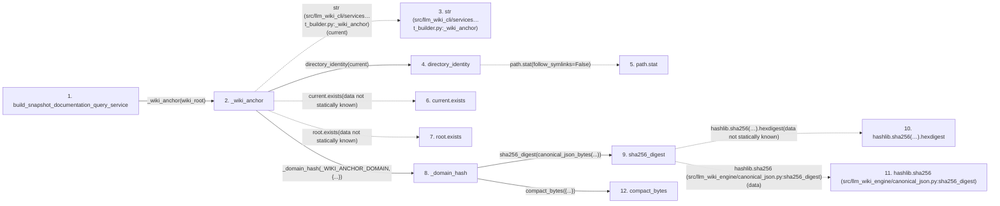

# build_snapshot_documentation_query_service

**Entry point:** `build_snapshot_documentation_query_service` (`api`)
**Source:** [documentation_query_builder](../modules/documentation_query_builder.md)
**Modules touched:** [canonical_json](../modules/canonical_json.md), [context_packet](../modules/context_packet.md), [context_packet_builder](../modules/context_packet_builder.md), and 34 more

**Complete modules touched:**

- [canonical_json](../modules/canonical_json.md)
- [context_packet](../modules/context_packet.md)
- [context_packet_builder](../modules/context_packet_builder.md)
- [documentation_query_builder](../modules/documentation_query_builder.md)
- [filesystem_guard](../modules/filesystem_guard.md)
- [host](../modules/host.md)
- [immutable](../modules/immutable.md)
- [integrations](../modules/integrations.md)
- [io](../modules/io.md)
- [knowledge_artifacts](../modules/knowledge_artifacts.md)
- [knowledge_consumption](../modules/knowledge_consumption.md)
- [knowledge_envelope](../modules/knowledge_envelope.md)
- [knowledge_evidence](../modules/knowledge_evidence.md)
- [knowledge_freshness](../modules/knowledge_freshness.md)
- [knowledge_governance](../modules/knowledge_governance.md)
- [knowledge_graph](../modules/knowledge_graph.md)
- [knowledge_index](../modules/knowledge_index.md)
- [knowledge_kinds](../modules/knowledge_kinds.md)
- [knowledge_loader](../modules/knowledge_loader.md)
- [knowledge_model](../modules/knowledge_model.md)
- [knowledge_packs](../modules/knowledge_packs.md)
- [knowledge_reuse_format](../modules/knowledge_reuse_format.md)
- [knowledge_storage](../modules/knowledge_storage.md)
- [knowledge_storage_io](../modules/knowledge_storage_io.md)
- [knowledge_validators](../modules/knowledge_validators.md)
- [knowledge_verification](../modules/knowledge_verification.md)
- [maintenance_evidence](../modules/maintenance_evidence.md)
- [maintenance_protocol](../modules/maintenance_protocol.md)
- [maintenance_state](../modules/maintenance_state.md)
- [maintenance_status](../modules/maintenance_status.md)
- [manifest_storage](../modules/manifest_storage.md)
- [section_ownership](../modules/section_ownership.md)
- [source_retirement](../modules/source_retirement.md)
- [source_snapshot](../modules/source_snapshot.md)
- [sync_manifest](../modules/sync_manifest.md)
- [verification_contracts](../modules/verification_contracts.md)
- [wiki_surface](../modules/wiki_surface.md)

## Call sequence

> Static overview in presentation order, not runtime execution order. Arrows retain captured callers; representative internal continuations and boundary examples precede repeated helper detail.

```mermaid
sequenceDiagram
    participant p0 as build_snapshot_documentation_query_service
    participant p1 as _wiki_anchor
    participant p2 as load_knowledge_read_view
    participant p3 as build_documentation_query_service_from_view
    participant p4 as _assert_wiki_unchanged
    participant p5 as load_knowledge_state
    participant p6 as verification_summaries_for_concepts
    participant p7 as _domain_hash
    participant p8 as _governance_lock_root
    participant p9 as build_knowledge_read_view
    participant p10 as attach_machine_verification_read_view
    participant p11 as _assert_wiki_integrity
    participant p12 as repository_metadata
    participant p13 as compact_bytes
    participant p14 as _read_mode
    participant p15 as _validate_load_result
    participant p16 as load_machine_verification_read_view
    participant p17 as _loaded_freshness
    participant p18 as _knowledge_counts
    participant p19 as guard_maintenance_owner
    participant p20 as _loaded_retired_locators
    participant p21 as _snapshot_maintenance_report
    participant p22 as _implementation_report
    participant p23 as _load_once
    participant p24 as _deep_copy
    participant p25 as _absolute_path
    participant p26 as _read_artifact
    participant p27 as build_maintenance_status
    participant p28 as evaluate_knowledge_freshness
    participant p29 as str (src/llm_wiki_cli/services…t_builder.py:_wiki_anchor)
    participant p30 as current.exists
    p0->>p1: _wiki_anchor
    p0->>p2: load_knowledge_read_view
    p0->>p3: build_documentation_query_service_from_view
    p0->>p4: _assert_wiki_unchanged
    p2->>p5: load_knowledge_state
    p3->>p6: verification_summaries_for_concepts
    p1->>p7: _domain_hash
    p1->>p8: _governance_lock_root
    p2->>p9: build_knowledge_read_view
    p2->>p10: attach_machine_verification_read_view
    p1->>p11: _assert_wiki_integrity
    p8->>p12: repository_metadata
    p7->>p13: compact_bytes
    p9->>p14: _read_mode
    p9->>p15: _validate_load_result
    p10->>p16: load_machine_verification_read_view
    p9->>p17: _loaded_freshness
    p9->>p18: _knowledge_counts
    p5->>p19: guard_maintenance_owner
    p9->>p20: _loaded_retired_locators
    p9->>p21: _snapshot_maintenance_report
    p9->>p22: _implementation_report
    p5->>p23: _load_once
    p6->>p24: _deep_copy
    p19->>p25: _absolute_path
    p23->>p26: _read_artifact
    p21->>p27: build_maintenance_status
    p17->>p28: evaluate_knowledge_freshness
    p1-->>p29: str (src/llm_wiki_cli/services…t_builder.py:_wiki_anchor)(current)
    p1-->>p30: current.exists
```

<!-- Auto-generated from static call edges. Dashed arrows are external or unresolved calls. Reviewed runtime conditions and side effects belong in Behavior. -->

> Call sequence diagram shows 30 of 1166 interactions; 1136 omitted to keep the visualization within the 30-interaction and generated-diagram limits, with uncertain identities omitted rather than inferred.

> Captured boundary calls: external 1 of 413 (412 omitted); unresolved 1 of 221 (220 omitted). These counts cover the captured static trace.

Omitted captured detail, grouped by actual caller occurrence and target module:

| Caller | Parent step | Target module | Kind | Omitted interactions |
| --- | --- | --- | --- | --- |
| `src/llm_wiki_cli/services/context_packet_builder.py:_wiki_anchor` | 2 | [src/llm_wiki_cli/services/source_snapshot.py](../modules/source_snapshot.md) | internal | 1 |
| `src/llm_wiki_cli/services/source_snapshot.py:directory_identity` | 4 | - | unresolved | 1 |
| `src/llm_wiki_cli/services/context_packet_builder.py:_wiki_anchor` | 2 | - | unresolved | 2 |
| `src/llm_wiki_engine/context_packet.py:_domain_hash` | 8 | [src/llm_wiki_engine/canonical_json.py](../modules/canonical_json.md) | internal | 1 |
| `src/llm_wiki_engine/canonical_json.py:sha256_digest` | 9 | - | unresolved | 1 |
| `src/llm_wiki_engine/canonical_json.py:sha256_digest` | 9 | - | external | 1 |
| `src/llm_wiki_engine/canonical_json.py:compact_bytes` | 12 | - | unresolved | 1 |
| `src/llm_wiki_engine/canonical_json.py:compact_bytes` | 12 | [src/llm_wiki_engine/canonical_json.py](../modules/canonical_json.md) | internal | 1 |
> Omission summary shows 8 of 283 groups; 275 further groups are not expanded here. Counts above include all omitted interactions.
> Detailed flow queries retain their own coverage and limits; omitted paths may execute at runtime.

> Trace truncated at the depth limit; deeper calls are omitted.

## Data flow

<!-- Auto-generated static analysis. Treat values and boundaries as best-effort hints, not runtime proof. -->

### Analysis coverage

**Effect analysis partially available.** Flow assembly and source effect analysis are separate; empty observations do not prove an empty handler body.

Source steps: 533; effect analysis evaluated: 311, partial: 27, unavailable: 195. Counts include steps omitted from the displayed trace.

Collector observations for 338 source steps with known totals: observed: 2253, emitted: 2053, omitted: 200. Unavailable totals are excluded.

- Callable record unavailable for one or more source steps; those steps have no represented callable body.
- Effect collector omitted observations before flow assembly; displayed effects are partial.
- Effect collector totals unavailable; observed counts cover captured records only.

| Step | Callable record | Effect analysis | Collector totals | Observed | Emitted | Omitted |
|---|---|---|---|---:|---:|---:|
| `build_snapshot_documentation_query_service` | `available` | `evaluated` | `available` | `3` | `3` | `0` |
| `_wiki_anchor` | `available` | `evaluated` | `available` | `12` | `12` | `0` |
| `str (src/llm_wiki_cli/services…t_builder.py:_wiki_anchor)` | `not_applicable` | `not_applicable` | `not_applicable` | — | — | — |
| `directory_identity` | `available` | `evaluated` | `available` | `3` | `3` | `0` |
| `path.stat` | `not_applicable` | `not_applicable` | `not_applicable` | — | — | — |
| `current.exists` | `not_applicable` | `not_applicable` | `not_applicable` | — | — | — |
| `root.exists` | `not_applicable` | `not_applicable` | `not_applicable` | — | — | — |
| `_domain_hash` | `available` | `evaluated` | `available` | `3` | `3` | `0` |
| `sha256_digest` | `available` | `evaluated` | `available` | `2` | `2` | `0` |
| `hashlib.sha256(…).hexdigest` | `not_applicable` | `not_applicable` | `not_applicable` | — | — | — |
| `hashlib.sha256 (src/llm_wiki_engine/canonical_json.py:sha256_digest)` | `not_applicable` | `not_applicable` | `not_applicable` | — | — | — |
| `compact_bytes` | `available` | `evaluated` | `available` | `3` | `3` | `0` |

### Step data

| Step | Inputs | Reads | Writes | Returns |
|---|---|---|---|---|
| `build_snapshot_documentation_query_service` | `wiki_root: Path`, `limit: int` | - | - | `service` |
| `_wiki_anchor` | `root: Path`, `reject_all_symlinks: bool`, `max_bytes: int \| None`, `metrics: dict[str, int] \| None`, `integrity_out: dict[str, tuple[int, ...]] \| None`, `guard_windows: bool` | `_WIKI_ANCHOR_DOMAIN`, `GOVERNANCE_LOCK_FILENAME`, `DEFAULT_LAYOUT`, `_WIKI_ANCHOR_DOMAIN` | - | `_domain_hash(...)`, `_domain_hash(...)` |
| `str (src/llm_wiki_cli/services…t_builder.py:_wiki_anchor)` | - | - | - | - |
| `directory_identity` | `path: Path` | - | - | `(...)`, `(...)` |
| `path.stat` | - | - | - | - |
| `current.exists` | - | - | - | - |
| `root.exists` | - | - | - | - |
| `_domain_hash` | `domain: str`, `value: Mapping[str, Any]` | - | - | `sha256_bytes(...)` |
| `sha256_digest` | `data: bytes` | - | - | `...` |
| `hashlib.sha256(…).hexdigest` | - | - | - | - |
| `hashlib.sha256 (src/llm_wiki_engine/canonical_json.py:sha256_digest)` | - | - | - | - |
| `compact_bytes` | `value: Any`, `allow_nan: bool` | - | - | `...` |

### Call data

| From | To | Line | Call |
|---|---|---:|---|
| build_snapshot_documentation_query_service | _wiki_anchor | 267 | `_wiki_anchor(wiki_root)` |
| _wiki_anchor | str (src/llm_wiki_cli/services…t_builder.py:_wiki_anchor) | 2143 | `str(current)` |
| _wiki_anchor | directory_identity | 2143 | `directory_identity(current)` |
| directory_identity | path.stat | 688 | `path.stat(follow_symlinks=False)` |
| _wiki_anchor | current.exists | 2144 | `current.exists(data not statically known)` |
| _wiki_anchor | root.exists | 2147 | `root.exists(data not statically known)` |
| _wiki_anchor | _domain_hash | 2148 | `_domain_hash(_WIKI_ANCHOR_DOMAIN, {...})` |
| _domain_hash | sha256_digest | 3084 | `sha256_bytes(canonical_json_bytes(...))` |
| sha256_digest | hashlib.sha256(…).hexdigest | 56 | `hashlib.sha256(data).hexdigest(data not statically known)` |
| sha256_digest | hashlib.sha256 (src/llm_wiki_engine/canonical_json.py:sha256_digest) | 56 | `hashlib.sha256(data)` |
| _domain_hash | compact_bytes | 3085 | `canonical_json_bytes({...})` |

### Boundary effects

*No boundary-effect observations were captured in this static trace.*

### Static analysis gaps

| Kind | Step | Target | Line |
|---|---|---|---:|
| unresolved_call | `directory_identity` | `path.stat` | 688 |
| unresolved_call | `_wiki_anchor` | `current.exists` | 2144 |
| unresolved_call | `_wiki_anchor` | `root.exists` | 2147 |
| unresolved_call | `sha256_digest` | `hashlib.sha256(data).hexdigest` | 56 |
| external_call | `sha256_digest` | `hashlib.sha256` | 56 |
| step_limit | `build_snapshot_documentation_query_service` | `first 12 steps` | 0 |
| truncated_flow | `build_snapshot_documentation_query_service` | `depth limit` | 0 |

## Behavior

This flow starts at `build_snapshot_documentation_query_service` and is classified as `api`. The generated call and data-flow sections are bounded static projections; runtime conditions and side effects require source-level confirmation.
