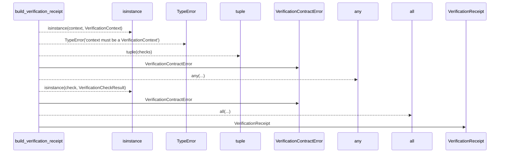
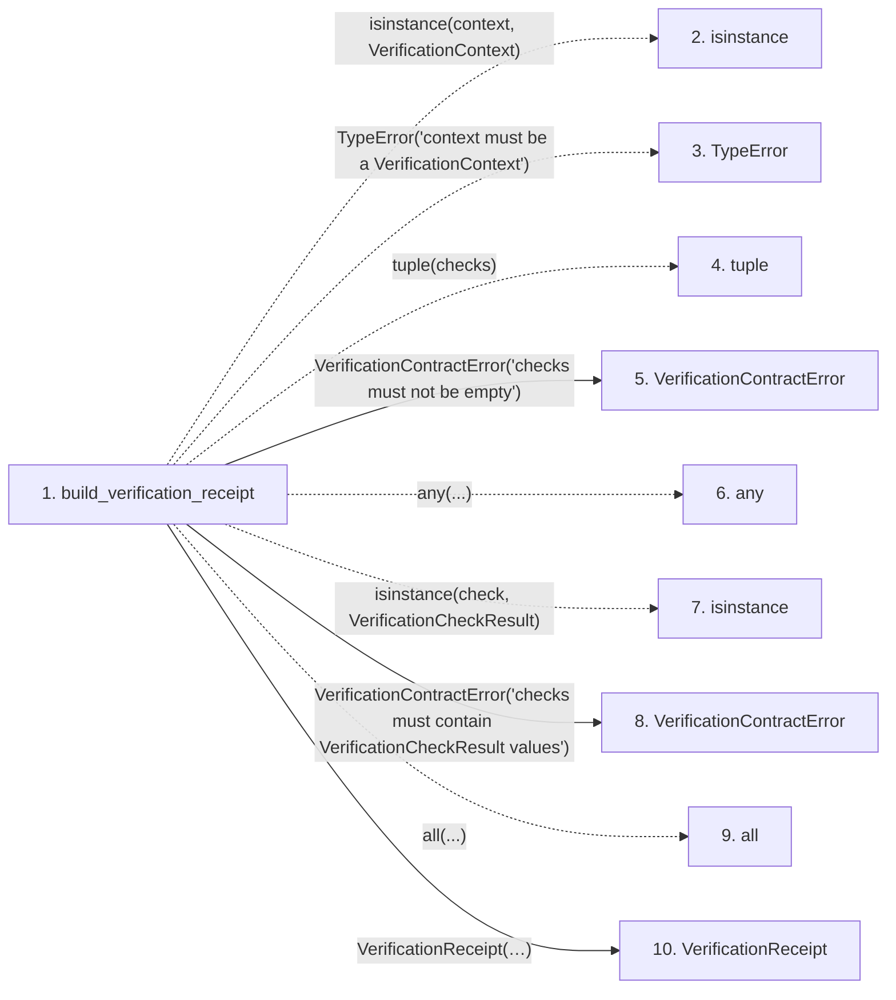

# build_verification_receipt

**Entry point:** `build_verification_receipt` (`api`)
**Source:** [verification_contracts](../modules/verification_contracts.md)
**Modules touched:** [verification_contracts](../modules/verification_contracts.md)

## Call sequence

> Static overview in presentation order, not runtime execution order. Arrows retain captured callers; representative internal continuations and boundary examples precede repeated helper detail.

<!-- Auto-generated from static call edges. Dashed arrows are external or unresolved calls. Reviewed runtime conditions and side effects belong in Behavior. -->

> Call sequence diagram shows 9 of 9 interactions; 0 omitted to keep the visualization within the 30-interaction and generated-diagram limits, with uncertain identities omitted rather than inferred.

> Captured boundary calls: external 6 of 6 (0 omitted); unresolved 0 of 0 (0 omitted). These counts cover the captured static trace.
> Detailed flow queries retain their own coverage and limits; omitted paths may execute at runtime.

## Data flow

<!-- Auto-generated static analysis. Treat values and boundaries as best-effort hints, not runtime proof. -->

### Analysis coverage

**Effect analysis partially available.** Flow assembly and source effect analysis are separate; empty observations do not prove an empty handler body.

Source steps: 4; effect analysis evaluated: 1, partial: 0, unavailable: 3. Counts include steps omitted from the displayed trace.

Collector observations for 1 source steps with known totals: observed: 8, emitted: 8, omitted: 0. Unavailable totals are excluded.

- Callable record unavailable for one or more source steps; those steps have no represented callable body.
- Effect collector totals unavailable; observed counts cover captured records only.

| Step | Callable record | Effect analysis | Collector totals | Observed | Emitted | Omitted |
|---|---|---|---|---:|---:|---:|
| `build_verification_receipt` | `available` | `evaluated` | `available` | `8` | `8` | `0` |
| `isinstance` | `not_applicable` | `not_applicable` | `not_applicable` | — | — | — |
| `TypeError` | `not_applicable` | `not_applicable` | `not_applicable` | — | — | — |
| `tuple` | `not_applicable` | `not_applicable` | `not_applicable` | — | — | — |
| `VerificationContractError` | `unavailable` | `unavailable` | `unavailable` | — | — | — |
| `any` | `not_applicable` | `not_applicable` | `not_applicable` | — | — | — |
| `isinstance` | `not_applicable` | `not_applicable` | `not_applicable` | — | — | — |
| `VerificationContractError` | `unavailable` | `unavailable` | `unavailable` | — | — | — |
| `all` | `not_applicable` | `not_applicable` | `not_applicable` | — | — | — |
| `VerificationReceipt` | `unavailable` | `unavailable` | `unavailable` | — | — | — |

### Step data

| Step | Inputs | Reads | Writes | Returns |
|---|---|---|---|---|
| `build_verification_receipt` | `context: VerificationContext`, `checks: Sequence[VerificationCheckResult]` | `VerificationContext`, `VerificationCheckResult`, `VerificationResult`, `VerificationResult`, `VerificationResult` | - | `VerificationReceipt(...)` |
| `isinstance` | - | - | - | - |
| `TypeError` | - | - | - | - |
| `tuple` | - | - | - | - |
| `VerificationContractError` | - | - | - | - |
| `any` | - | - | - | - |
| `isinstance` | - | - | - | - |
| `VerificationContractError` | - | - | - | - |
| `all` | - | - | - | - |
| `VerificationReceipt` | - | - | - | - |

### Call data

| From | To | Line | Call |
|---|---|---:|---|
| build_verification_receipt | isinstance | 731 | `isinstance(context, VerificationContext)` |
| build_verification_receipt | TypeError | 732 | `TypeError('context must be a VerificationContext')` |
| build_verification_receipt | tuple | 733 | `tuple(checks)` |
| build_verification_receipt | VerificationContractError | 735 | `VerificationContractError('checks must not be empty')` |
| build_verification_receipt | any | 736 | `any(...)` |
| build_verification_receipt | isinstance | 737 | `isinstance(check, VerificationCheckResult)` |
| build_verification_receipt | VerificationContractError | 740 | `VerificationContractError('checks must contain VerificationCheckResult values')` |
| build_verification_receipt | all | 745 | `all(...)` |
| build_verification_receipt | VerificationReceipt | 751 | `VerificationReceipt(knowledge_hash=context.knowledge_hash, scope_uid=context.scope_uid, scope_hash=context.scope_hash, evidence=context.evidence, evidence_hash=context.evidence_hash, evaluated_snapshot=context.evaluated_snapshot, snapshot_hash=context.snapshot_hash, result=result, checks=normalized_checks)` |

### Boundary effects

*No boundary-effect observations were captured in this static trace.*

### Static analysis gaps

| Kind | Step | Target | Line |
|---|---|---|---:|
| external_call | `build_verification_receipt` | `isinstance` | 731 |
| external_call | `build_verification_receipt` | `TypeError` | 732 |
| external_call | `build_verification_receipt` | `any` | 736 |
| external_call | `build_verification_receipt` | `isinstance` | 737 |
| external_call | `build_verification_receipt` | `all` | 745 |

## Behavior

This flow starts at `build_verification_receipt` and is classified as `api`. The generated call and data-flow sections are bounded static projections; runtime conditions and side effects require source-level confirmation.
