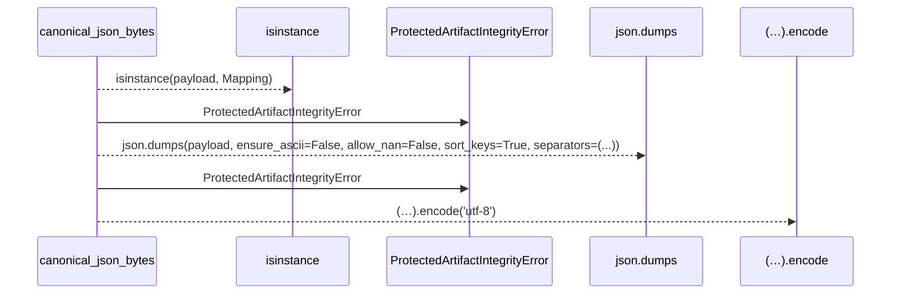
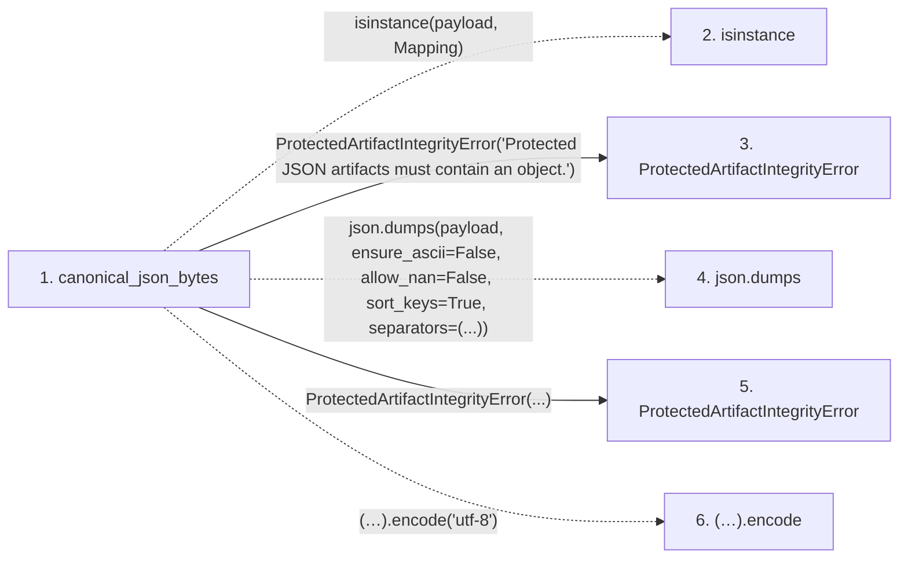

# canonical_json_bytes

**Entry point:** `canonical_json_bytes` (`api`)
**Source:** [protected_artifacts](../modules/protected_artifacts.md)
**Modules touched:** [protected_artifacts](../modules/protected_artifacts.md)

## Call sequence

> Static overview in presentation order, not runtime execution order. Arrows retain captured callers; representative internal continuations and boundary examples precede repeated helper detail.

<!-- Auto-generated from static call edges. Dashed arrows are external or unresolved calls. Reviewed runtime conditions and side effects belong in Behavior. -->

> Call sequence diagram shows 5 of 5 interactions; 0 omitted to keep the visualization within the 30-interaction and generated-diagram limits, with uncertain identities omitted rather than inferred.

> Captured boundary calls: external 2 of 2 (0 omitted); unresolved 1 of 1 (0 omitted). These counts cover the captured static trace.
> Detailed flow queries retain their own coverage and limits; omitted paths may execute at runtime.

## Data flow

<!-- Auto-generated static analysis. Treat values and boundaries as best-effort hints, not runtime proof. -->

### Analysis coverage

**Effect analysis partially available.** Flow assembly and source effect analysis are separate; empty observations do not prove an empty handler body.

Source steps: 3; effect analysis evaluated: 1, partial: 0, unavailable: 2. Counts include steps omitted from the displayed trace.

Collector observations for 1 source steps with known totals: observed: 3, emitted: 3, omitted: 0. Unavailable totals are excluded.

- Callable record unavailable; the selected entry symbol has no represented callable body.
- Effect collector totals unavailable; observed counts cover captured records only.

| Step | Callable record | Effect analysis | Collector totals | Observed | Emitted | Omitted |
|---|---|---|---|---:|---:|---:|
| `canonical_json_bytes` | `available` | `evaluated` | `available` | `3` | `3` | `0` |
| `isinstance` | `not_applicable` | `not_applicable` | `not_applicable` | — | — | — |
| `ProtectedArtifactIntegrityError` | `unavailable` | `unavailable` | `unavailable` | — | — | — |
| `json.dumps` | `not_applicable` | `not_applicable` | `not_applicable` | — | — | — |
| `ProtectedArtifactIntegrityError` | `unavailable` | `unavailable` | `unavailable` | — | — | — |
| `(…).encode` | `not_applicable` | `not_applicable` | `not_applicable` | — | — | — |

### Step data

| Step | Inputs | Reads | Writes | Returns |
|---|---|---|---|---|
| `canonical_json_bytes` | `payload: Mapping[str, Any]` | `Mapping` | - | `...` |
| `isinstance` | - | - | - | - |
| `ProtectedArtifactIntegrityError` | - | - | - | - |
| `json.dumps` | - | - | - | - |
| `ProtectedArtifactIntegrityError` | - | - | - | - |
| `(…).encode` | - | - | - | - |

### Call data

| From | To | Line | Call |
|---|---|---:|---|
| canonical_json_bytes | isinstance | 130 | `isinstance(payload, Mapping)` |
| canonical_json_bytes | ProtectedArtifactIntegrityError | 131 | `ProtectedArtifactIntegrityError('Protected JSON artifacts must contain an object.')` |
| canonical_json_bytes | json.dumps | 135 | `json.dumps(payload, ensure_ascii=False, allow_nan=False, sort_keys=True, separators=(...))` |
| canonical_json_bytes | ProtectedArtifactIntegrityError | 143 | `ProtectedArtifactIntegrityError(...)` |
| canonical_json_bytes | (…).encode | 146 | `(serialized + '\n').encode('utf-8')` |

### Boundary effects

*No boundary-effect observations were captured in this static trace.*

### Static analysis gaps

| Kind | Step | Target | Line |
|---|---|---|---:|
| external_call | `canonical_json_bytes` | `isinstance` | 130 |
| external_call | `canonical_json_bytes` | `json.dumps` | 135 |
| unresolved_call | `canonical_json_bytes` | `(serialized + '\n').encode` | 146 |

## Behavior

This flow starts at `canonical_json_bytes` and is classified as `api`. The generated call and data-flow sections are bounded static projections; runtime conditions and side effects require source-level confirmation.
