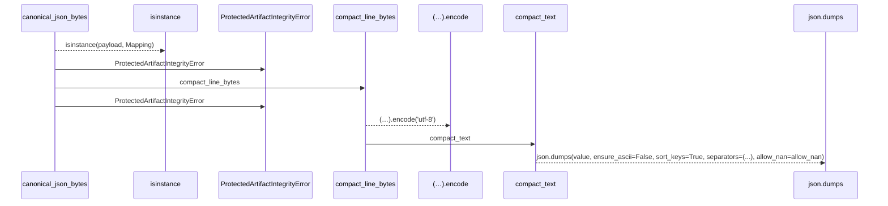
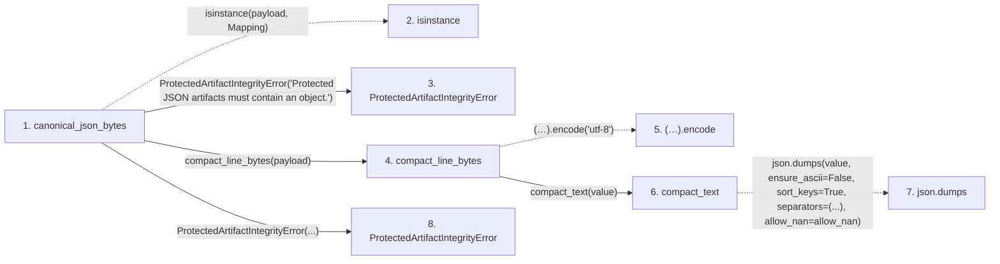

# canonical_json_bytes

**Entry point:** `canonical_json_bytes` (`api`)
**Source:** [protected_artifacts](../modules/protected_artifacts.md)
**Modules touched:** [canonical_json](../modules/canonical_json.md), [protected_artifacts](../modules/protected_artifacts.md)

## Call sequence

> Static overview in presentation order, not runtime execution order. Arrows retain captured callers; representative internal continuations and boundary examples precede repeated helper detail.

<!-- Auto-generated from static call edges. Dashed arrows are external or unresolved calls. Reviewed runtime conditions and side effects belong in Behavior. -->

> Call sequence diagram shows 7 of 7 interactions; 0 omitted to keep the visualization within the 30-interaction and generated-diagram limits, with uncertain identities omitted rather than inferred.

> Captured boundary calls: external 2 of 2 (0 omitted); unresolved 1 of 1 (0 omitted). These counts cover the captured static trace.
> Detailed flow queries retain their own coverage and limits; omitted paths may execute at runtime.

## Data flow

<!-- Auto-generated static analysis. Treat values and boundaries as best-effort hints, not runtime proof. -->

### Analysis coverage

**Effect analysis partially available.** Flow assembly and source effect analysis are separate; empty observations do not prove an empty handler body.

Source steps: 5; effect analysis evaluated: 3, partial: 0, unavailable: 2. Counts include steps omitted from the displayed trace.

Collector observations for 3 source steps with known totals: observed: 8, emitted: 8, omitted: 0. Unavailable totals are excluded.

- Callable record unavailable for one or more source steps; those steps have no represented callable body.
- Effect collector totals unavailable; observed counts cover captured records only.

| Step | Callable record | Effect analysis | Collector totals | Observed | Emitted | Omitted |
|---|---|---|---|---:|---:|---:|
| `canonical_json_bytes` | `available` | `evaluated` | `available` | `3` | `3` | `0` |
| `isinstance` | `not_applicable` | `not_applicable` | `not_applicable` | — | — | — |
| `ProtectedArtifactIntegrityError` | `unavailable` | `unavailable` | `unavailable` | — | — | — |
| `compact_line_bytes` | `available` | `evaluated` | `available` | `2` | `2` | `0` |
| `(…).encode` | `not_applicable` | `not_applicable` | `not_applicable` | — | — | — |
| `compact_text` | `available` | `evaluated` | `available` | `3` | `3` | `0` |
| `json.dumps` | `not_applicable` | `not_applicable` | `not_applicable` | — | — | — |
| `ProtectedArtifactIntegrityError` | `unavailable` | `unavailable` | `unavailable` | — | — | — |

### Step data

| Step | Inputs | Reads | Writes | Returns |
|---|---|---|---|---|
| `canonical_json_bytes` | `payload: Mapping[str, Any]` | `Mapping` | - | `compact_line_bytes(...)` |
| `isinstance` | - | - | - | - |
| `ProtectedArtifactIntegrityError` | - | - | - | - |
| `compact_line_bytes` | `value: Any` | - | - | `...` |
| `(…).encode` | - | - | - | - |
| `compact_text` | `value: Any`, `allow_nan: bool` | - | - | `json.dumps(...)` |
| `json.dumps` | - | - | - | - |
| `ProtectedArtifactIntegrityError` | - | - | - | - |

### Call data

| From | To | Line | Call |
|---|---|---:|---|
| canonical_json_bytes | isinstance | 131 | `isinstance(payload, Mapping)` |
| canonical_json_bytes | ProtectedArtifactIntegrityError | 132 | `ProtectedArtifactIntegrityError('Protected JSON artifacts must contain an object.')` |
| canonical_json_bytes | compact_line_bytes | 136 | `compact_line_bytes(payload)` |
| compact_line_bytes | (…).encode | 41 | `(compact_text(value) + '\n').encode('utf-8')` |
| compact_line_bytes | compact_text | 41 | `compact_text(value)` |
| compact_text | json.dumps | 32 | `json.dumps(value, ensure_ascii=False, sort_keys=True, separators=(...), allow_nan=allow_nan)` |
| canonical_json_bytes | ProtectedArtifactIntegrityError | 138 | `ProtectedArtifactIntegrityError(...)` |

### Boundary effects

*No boundary-effect observations were captured in this static trace.*

### Static analysis gaps

| Kind | Step | Target | Line |
|---|---|---|---:|
| external_call | `canonical_json_bytes` | `isinstance` | 131 |
| unresolved_call | `compact_line_bytes` | `(compact_text(value) + '\n').encode` | 41 |
| external_call | `compact_text` | `json.dumps` | 32 |

## Behavior

This flow starts at `canonical_json_bytes` and is classified as `api`. The generated call and data-flow sections are bounded static projections; runtime conditions and side effects require source-level confirmation.
