# capture_publication_basis

**Entry point:** `capture_publication_basis` (`api`)
**Source:** [api](../modules/api.md)
**Modules touched:** [api](../modules/api.md), [cli](../modules/cli.md), [cli_reference](../modules/cli_reference.md), [concept_identity](../modules/concept_identity.md), and 10 more

**Complete modules touched:**

- [api](../modules/api.md)
- [cli](../modules/cli.md)
- [cli_reference](../modules/cli_reference.md)
- [concept_identity](../modules/concept_identity.md)
- [instruction_ownership](../modules/instruction_ownership.md)
- [knowledge_evidence](../modules/knowledge_evidence.md)
- [knowledge_storage_io](../modules/knowledge_storage_io.md)
- [markdown_sections](../modules/markdown_sections.md)
- [publication_config](../modules/publication_config.md)
- [publication_contracts](../modules/publication_contracts.md)
- [publication_impact](../modules/publication_impact.md)
- [publication_references](../modules/publication_references.md)
- [source_selection](../modules/source_selection.md)
- [validation](../modules/validation.md)

## Call sequence

> Static overview in presentation order, not runtime execution order. Arrows retain captured callers; representative internal continuations and boundary examples precede repeated helper detail.

```mermaid
sequenceDiagram
    participant p0 as capture_publication_basis (src/llm_wiki_cli/api.py)
    participant p1 as capture_publication_basis (src/llm_wiki_cli/services/publication_impact.py)
    participant p2 as load_publication_config
    participant p3 as validate_publication_basis
    participant p4 as _topic_versions
    participant p5 as publication_path
    participant p6 as _file_hash
    participant p7 as capture_reference_inputs
    participant p8 as _target_hash
    participant p9 as recheck_reference_inputs
    participant p10 as _seal
    participant p11 as _consumer_root
    participant p12 as _guard
    participant p13 as _relative_path
    participant p14 as reference_identity
    participant p15 as locate_exact_repository_path
    participant p16 as get_cli_contract
    participant p17 as parse_markdown_document
    participant p18 as hash_json
    participant p19 as read_publication_json
    participant p20 as parse_cli_contract
    participant p21 as validate_publication_config
    participant p22 as _locate_exact_path
    participant p23 as _json_tree (src/llm_wiki_cli/services/publication_contracts.py)
    participant p24 as build_cli_contract
    participant p25 as require_repository_relative_path
    participant p26 as _object
    participant p27 as canonical_json_bytes
    participant p28 as build_cli_parser
    participant p29 as Path (src/llm_wiki_cli/services…capture_publication_basis)
    participant p30 as Path(…).absolute
    p0->>p1: capture_publication_basis (src/llm_wiki_cli/services/publication_impact.py)
    p1->>p2: load_publication_config
    p1->>p3: validate_publication_basis
    p1->>p4: _topic_versions
    p1->>p5: publication_path
    p1->>p6: _file_hash
    p1->>p7: capture_reference_inputs
    p1->>p8: _target_hash
    p1->>p9: recheck_reference_inputs
    p1->>p10: _seal
    p2->>p11: _consumer_root
    p3->>p12: _guard
    p2->>p13: _relative_path
    p7->>p14: reference_identity
    p2->>p15: locate_exact_repository_path
    p7->>p16: get_cli_contract
    p8->>p17: parse_markdown_document
    p4->>p18: hash_json
    p2->>p19: read_publication_json
    p7->>p20: parse_cli_contract
    p2->>p21: validate_publication_config
    p15->>p22: _locate_exact_path
    p12->>p23: _json_tree (src/llm_wiki_cli/services/publication_contracts.py)
    p16->>p24: build_cli_contract
    p13->>p25: require_repository_relative_path
    p21->>p26: _object
    p18->>p27: canonical_json_bytes
    p16->>p28: build_cli_parser
    p1-->>p29: Path (src/llm_wiki_cli/services…capture_publication_basis)(consumer_root)
    p1-->>p30: Path(…).absolute
```

<!-- Auto-generated from static call edges. Dashed arrows are external or unresolved calls. Reviewed runtime conditions and side effects belong in Behavior. -->

> Call sequence diagram shows 30 of 635 interactions; 605 omitted to keep the visualization within the 30-interaction and generated-diagram limits, with uncertain identities omitted rather than inferred.

> Captured boundary calls: external 1 of 210 (209 omitted); unresolved 1 of 178 (177 omitted). These counts cover the captured static trace.

Omitted captured detail, grouped by actual caller occurrence and target module:

| Caller | Parent step | Target module | Kind | Omitted interactions |
| --- | --- | --- | --- | --- |
| `src/llm_wiki_cli/services/publication_config.py:_consumer_root` | 6 | - | unresolved | 3 |
| `src/llm_wiki_cli/services/publication_config.py:_consumer_root` | 6 | - | external | 2 |
| `src/llm_wiki_cli/services/publication_config.py:_consumer_root` | 6 | [src/llm_wiki_cli/services/source_selection.py](../modules/source_selection.md) | internal | 1 |
| `src/llm_wiki_cli/services/source_selection.py:path_is_link_or_reparse` | 9 | [src/llm_wiki_cli/services/source_selection.py](../modules/source_selection.md) | internal | 1 |
| `src/llm_wiki_cli/services/source_selection.py:_is_link_or_reparse_stat` | 10 | - | external | 4 |
| `src/llm_wiki_cli/services/source_selection.py:path_is_link_or_reparse` | 9 | - | unresolved | 1 |
| `src/llm_wiki_cli/services/publication_config.py:_consumer_root` | 6 | [src/llm_wiki_cli/services/publication_config.py](../modules/publication_config.md) | internal | 3 |
| `src/llm_wiki_cli/services/publication_config.py:_relative_path` | 22 | [src/llm_wiki_cli/services/publication_config.py](../modules/publication_config.md) | internal | 2 |
> Omission summary shows 8 of 142 groups; 134 further groups are not expanded here. Counts above include all omitted interactions.
> Detailed flow queries retain their own coverage and limits; omitted paths may execute at runtime.

> Trace truncated at the depth limit; deeper calls are omitted.

## Data flow

<!-- Auto-generated static analysis. Treat values and boundaries as best-effort hints, not runtime proof. -->

### Analysis coverage

**Effect analysis partially available.** Flow assembly and source effect analysis are separate; empty observations do not prove an empty handler body.

Source steps: 248; effect analysis evaluated: 165, partial: 3, unavailable: 80. Counts include steps omitted from the displayed trace.

Collector observations for 168 source steps with known totals: observed: 802, emitted: 787, omitted: 15. Unavailable totals are excluded.

- Callable record unavailable for one or more source steps; those steps have no represented callable body.
- Effect collector omitted observations before flow assembly; displayed effects are partial.
- Effect collector totals unavailable; observed counts cover captured records only.

| Step | Callable record | Effect analysis | Collector totals | Observed | Emitted | Omitted |
|---|---|---|---|---:|---:|---:|
| `capture_publication_basis (src/llm_wiki_cli/api.py)` | `available` | `evaluated` | `available` | `5` | `5` | `0` |
| `capture_publication_basis (src/llm_wiki_cli/services/publication_impact.py)` | `available` | `evaluated` | `available` | `11` | `11` | `0` |
| `Path(…).absolute` | `not_applicable` | `not_applicable` | `not_applicable` | — | — | — |
| `Path (src/llm_wiki_cli/services…capture_publication_basis)` | `not_applicable` | `not_applicable` | `not_applicable` | — | — | — |
| `load_publication_config` | `available` | `evaluated` | `available` | `5` | `5` | `0` |
| `_consumer_root` | `available` | `evaluated` | `available` | `3` | `3` | `0` |
| `Path(…).expanduser` | `not_applicable` | `not_applicable` | `not_applicable` | — | — | — |
| `Path (src/llm_wiki_cli/services…_config.py:_consumer_root)` | `not_applicable` | `not_applicable` | `not_applicable` | — | — | — |
| `path_is_link_or_reparse` | `available` | `evaluated` | `available` | `3` | `3` | `0` |
| `_is_link_or_reparse_stat` | `available` | `evaluated` | `available` | `4` | `4` | `0` |
| `stat.S_ISLNK` | `not_applicable` | `not_applicable` | `not_applicable` | — | — | — |
| `getattr (src/llm_wiki_cli/services…:_is_link_or_reparse_stat)` | `not_applicable` | `not_applicable` | `not_applicable` | — | — | — |

```mermaid
flowchart LR
    s1["1. capture_publication_basis (src/llm_wiki_cli/api.py)"]
    s2["2. capture_publication_basis (src/llm_wiki_cli/services/publication_impact.py)"]
    s3["3. Path(…).absolute"]
    s4["4. Path (src/llm_wiki_cli/services…capture_publication_basis)"]
    s5["5. load_publication_config"]
    s6["6. _consumer_root"]
    s7["7. Path(…).expanduser"]
    s8["8. Path (src/llm_wiki_cli/services…_config.py:_consumer_root)"]
    s9["9. path_is_link_or_reparse"]
    s10["10. _is_link_or_reparse_stat"]
    s11["11. stat.S_ISLNK"]
    s12["12. getattr (src/llm_wiki_cli/services…:_is_link_or_reparse_stat)"]
    s1 -->|"capture_publication_basis (src/llm_wiki_cli/services/publication_impact.py)(consumer_root, config_path=config_path, target_dir=target_dir, baseline=baseline)"| s2
    s2 -. "Path(…).absolute(data not statically known)" .-> s3
    s2 -. "Path (src/llm_wiki_cli/services…capture_publication_basis)(consumer_root)" .-> s4
    s2 -->|"load_publication_config(root, config_path=config_path)"| s5
    s5 -->|"_consumer_root(consumer_root)"| s6
    s6 -. "Path(…).expanduser(data not statically known)" .-> s7
    s6 -. "Path (src/llm_wiki_cli/services…_config.py:_consumer_root)(value)" .-> s8
    s6 -->|"path_is_link_or_reparse(root)"| s9
    s9 -->|"_is_link_or_reparse_stat(path.lstat(...))"| s10
    s10 -. "stat.S_ISLNK(metadata.st_mode)" .-> s11
    s10 -. "getattr (src/llm_wiki_cli/services…:_is_link_or_reparse_stat)(metadata, 'st_file_attributes', 0)" .-> s12
    b0["mutation source_paths.update"]
    s2 -. "mutation source_paths.update" .-> b0
    click s1 "../modules/api.md"
    click s2 "../modules/publication_impact.md"
    click s5 "../modules/publication_config.md"
    click s6 "../modules/publication_config.md"
    click s9 "../modules/source_selection.md"
    click s10 "../modules/source_selection.md"
    classDef boundary stroke:#b45309,stroke-dasharray: 4 2
    class b0 boundary
```

### Step data

| Step | Inputs | Reads | Writes | Returns |
|---|---|---|---|---|
| `capture_publication_basis (src/llm_wiki_cli/api.py)` | `consumer_root: str \| Path`, `config_path: str \| Path`, `target_dir: str \| Path \| None`, `baseline: Mapping[str, Any] \| None` | - | - | `capture(...)` |
| `capture_publication_basis (src/llm_wiki_cli/services/publication_impact.py)` | `consumer_root: str \| Path`, `config_path: str \| Path`, `target_dir: str \| Path \| None`, `baseline: Mapping[str, Any] \| None` | `build_bootstrap_publication_snapshot`, `build_publication_snapshot`, `BASIS_SCHEMA` | `files[...]`, `result[...]` | `_seal(...)` |
| `Path(…).absolute` | - | - | - | - |
| `Path (src/llm_wiki_cli/services…capture_publication_basis)` | - | - | - | - |
| `load_publication_config` | `consumer_root: str \| Path`, `config_path: str \| Path` | `Path`, `SourceSelectionError` | - | `validate_publication_config(...)` |
| `_consumer_root` | `value: str \| Path` | `PublicationConfigError` | - | `root` |
| `Path(…).expanduser` | - | - | - | - |
| `Path (src/llm_wiki_cli/services…_config.py:_consumer_root)` | - | - | - | - |
| `path_is_link_or_reparse` | `path: Path` | - | - | `_is_link_or_reparse_stat(...)`, `False` |
| `_is_link_or_reparse_stat` | `metadata: os.stat_result` | `stat` | - | `True`, `bool(...)` |
| `stat.S_ISLNK` | - | - | - | - |
| `getattr (src/llm_wiki_cli/services…:_is_link_or_reparse_stat)` | - | - | - | - |

### Call data

| From | To | Line | Call |
|---|---|---:|---|
| capture_publication_basis (src/llm_wiki_cli/api.py) | capture_publication_basis (src/llm_wiki_cli/services/publication_impact.py) | 3588 | `capture(consumer_root, config_path=config_path, target_dir=target_dir, baseline=baseline)` |
| capture_publication_basis (src/llm_wiki_cli/services/publication_impact.py) | Path(…).absolute | 142 | `Path(consumer_root).absolute(data not statically known)` |
| capture_publication_basis (src/llm_wiki_cli/services/publication_impact.py) | Path (src/llm_wiki_cli/services…capture_publication_basis) | 142 | `Path(consumer_root)` |
| capture_publication_basis (src/llm_wiki_cli/services/publication_impact.py) | load_publication_config | 143 | `load_publication_config(root, config_path=config_path)` |
| load_publication_config | _consumer_root | 643 | `_consumer_root(consumer_root)` |
| _consumer_root | Path(…).expanduser | 132 | `Path(value).expanduser(data not statically known)` |
| _consumer_root | Path (src/llm_wiki_cli/services…_config.py:_consumer_root) | 132 | `Path(value)` |
| _consumer_root | path_is_link_or_reparse | 133 | `path_is_link_or_reparse(root)` |
| path_is_link_or_reparse | _is_link_or_reparse_stat | 309 | `_is_link_or_reparse_stat(path.lstat(...))` |
| _is_link_or_reparse_stat | stat.S_ISLNK | 299 | `stat.S_ISLNK(metadata.st_mode)` |
| _is_link_or_reparse_stat | getattr (src/llm_wiki_cli/services…:_is_link_or_reparse_stat) | 301 | `getattr(metadata, 'st_file_attributes', 0)` |

### Boundary effects

| Kind | Target | Step | Line |
|---|---|---|---:|
| mutation | `source_paths.update` | `capture_publication_basis` | 163 |

### Static analysis gaps

| Kind | Step | Target | Line |
|---|---|---|---:|
| unresolved_call | `capture_publication_basis` | `Path(consumer_root).absolute` | 142 |
| unresolved_call | `_consumer_root` | `Path(value).expanduser` | 132 |
| external_call | `_is_link_or_reparse_stat` | `stat.S_ISLNK` | 299 |
| external_call | `_is_link_or_reparse_stat` | `getattr` | 301 |
| step_limit | `capture_publication_basis` | `first 12 steps` | 0 |
| truncated_flow | `capture_publication_basis` | `depth limit` | 0 |

## Behavior

This flow starts at `capture_publication_basis` and is classified as `api`. The generated call and data-flow sections are bounded static projections; runtime conditions and side effects require source-level confirmation.
