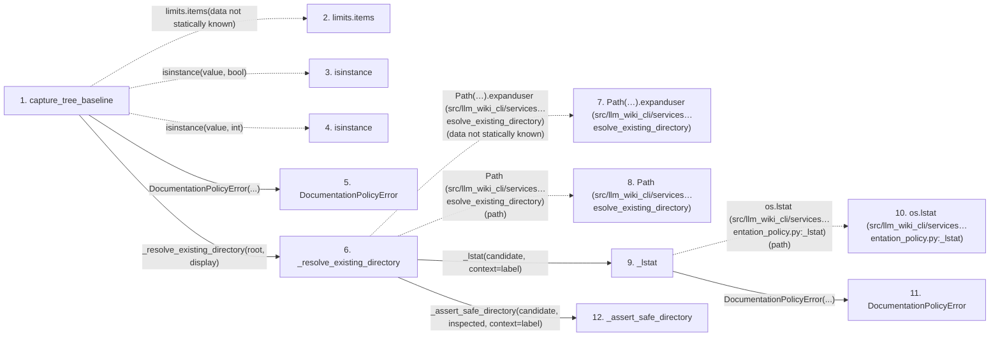

# capture_tree_baseline

**Entry point:** `capture_tree_baseline` (`api`)
**Source:** [documentation_policy](../modules/documentation_policy.md)
**Modules touched:** [documentation_policy](../modules/documentation_policy.md), [filesystem_guard](../modules/filesystem_guard.md)

## Call sequence

> Static overview in presentation order, not runtime execution order. Arrows retain captured callers; representative internal continuations and boundary examples precede repeated helper detail.

```mermaid
sequenceDiagram
    participant p0 as capture_tree_baseline
    participant p1 as _resolve_existing_directory
    participant p2 as _walk_regular_files
    participant p3 as _hash_file
    participant p4 as DocumentationPolicyError
    participant p5 as TreeBaseline
    participant p6 as _hash_labeled_hashes
    participant p7 as _lstat
    participant p8 as _assert_safe_directory
    participant p9 as _resolve_path
    participant p10 as _guard_baseline_directory
    participant p11 as _hash_windows_file
    participant p12 as _assert_same_file_identity
    participant p13 as windows_object_identity
    participant p14 as guard_windows_directory_chain
    participant p15 as _assert_safe_regular_file
    participant p16 as open_windows_readonly_file
    participant p17 as _assert_stable_windows_path_handle_metadata
    participant p18 as _assert_stable_file_metadata
    participant p19 as windows_object_identity_from_values
    participant p20 as _windows_path_handle_metadata
    participant p21 as _open_windows_readonly_file_handle
    participant p22 as _open_windows_directory_guard
    participant p23 as create_private_windows_directory
    participant p24 as _private_windows_security_attributes
    participant p25 as move_windows_path_write_through
    participant p26 as _verify_windows_handle_restrictive_dacl
    participant p27 as fresh_no_follow_stat
    participant p28 as _is_windows_reparse_point
    participant p29 as isinstance
    participant p30 as limits.items
    p0->>p1: _resolve_existing_directory
    p0->>p2: _walk_regular_files
    p0->>p3: _hash_file
    p0->>p4: DocumentationPolicyError
    p0->>p5: TreeBaseline
    p0->>p6: _hash_labeled_hashes
    p1->>p7: _lstat
    p1->>p8: _assert_safe_directory
    p1->>p9: _resolve_path
    p2->>p10: _guard_baseline_directory
    p3->>p11: _hash_windows_file
    p1->>p12: _assert_same_file_identity
    p12->>p13: windows_object_identity
    p10->>p14: guard_windows_directory_chain
    p11->>p15: _assert_safe_regular_file
    p11->>p16: open_windows_readonly_file
    p11->>p17: _assert_stable_windows_path_handle_metadata
    p11->>p18: _assert_stable_file_metadata
    p13->>p19: windows_object_identity_from_values
    p17->>p20: _windows_path_handle_metadata
    p16->>p21: _open_windows_readonly_file_handle
    p14->>p22: _open_windows_directory_guard
    p14->>p23: create_private_windows_directory
    p23->>p24: _private_windows_security_attributes
    p23->>p25: move_windows_path_write_through
    p22->>p26: _verify_windows_handle_restrictive_dacl
    p2->>p27: fresh_no_follow_stat
    p2->>p28: _is_windows_reparse_point
    p0-->>p29: isinstance(value, bool)
    p0-->>p30: limits.items
```

<!-- Auto-generated from static call edges. Dashed arrows are external or unresolved calls. Reviewed runtime conditions and side effects belong in Behavior. -->

> Call sequence diagram shows 30 of 412 interactions; 382 omitted to keep the visualization within the 30-interaction and generated-diagram limits, with uncertain identities omitted rather than inferred.

> Captured boundary calls: external 1 of 199 (198 omitted); unresolved 1 of 54 (53 omitted). These counts cover the captured static trace.

Omitted captured detail, grouped by actual caller occurrence and target module:

| Caller | Parent step | Target module | Kind | Omitted interactions |
| --- | --- | --- | --- | --- |
| `src/llm_wiki_cli/services/documentation_policy.py:capture_tree_baseline` | 1 | - | external | 8 |
| `src/llm_wiki_cli/services/documentation_policy.py:_resolve_existing_directory` | 6 | - | unresolved | 1 |
| `src/llm_wiki_cli/services/documentation_policy.py:_resolve_existing_directory` | 6 | - | external | 1 |
| `src/llm_wiki_cli/services/documentation_policy.py:_lstat` | 9 | - | external | 1 |
| `src/llm_wiki_cli/services/documentation_policy.py:_lstat` | 9 | [src/llm_wiki_cli/services/documentation_policy.py](../modules/documentation_policy.md) | internal | 1 |
| `src/llm_wiki_cli/services/documentation_policy.py:_assert_safe_directory` | 12 | - | external | 2 |
| `src/llm_wiki_cli/services/documentation_policy.py:_assert_safe_directory` | 12 | [src/llm_wiki_cli/services/documentation_policy.py](../modules/documentation_policy.md) | internal | 4 |
| `src/llm_wiki_cli/services/documentation_policy.py:_is_windows_reparse_point` | 15 | - | external | 5 |
> Omission summary shows 8 of 72 groups; 64 further groups are not expanded here. Counts above include all omitted interactions.
> Detailed flow queries retain their own coverage and limits; omitted paths may execute at runtime.

> Trace truncated at the depth limit; deeper calls are omitted.

## Data flow

<!-- Auto-generated static analysis. Treat values and boundaries as best-effort hints, not runtime proof. -->

### Analysis coverage

**Effect analysis partially available.** Flow assembly and source effect analysis are separate; empty observations do not prove an empty handler body.

Source steps: 160; effect analysis evaluated: 86, partial: 7, unavailable: 67. Counts include steps omitted from the displayed trace.

Collector observations for 93 source steps with known totals: observed: 500, emitted: 491, omitted: 9. Unavailable totals are excluded.

- Callable record unavailable; the selected entry symbol has no represented callable body.
- Effect collector omitted observations before flow assembly; displayed effects are partial.
- Effect collector totals unavailable; observed counts cover captured records only.

| Step | Callable record | Effect analysis | Collector totals | Observed | Emitted | Omitted |
|---|---|---|---|---:|---:|---:|
| `capture_tree_baseline` | `available` | `evaluated` | `available` | `8` | `8` | `0` |
| `limits.items` | `not_applicable` | `not_applicable` | `not_applicable` | — | — | — |
| `isinstance` | `not_applicable` | `not_applicable` | `not_applicable` | — | — | — |
| `isinstance` | `not_applicable` | `not_applicable` | `not_applicable` | — | — | — |
| `DocumentationPolicyError` | `unavailable` | `unavailable` | `unavailable` | — | — | — |
| `_resolve_existing_directory` | `available` | `evaluated` | `available` | `3` | `3` | `0` |
| `Path(…).expanduser (src/llm_wiki_cli/services…esolve_existing_directory)` | `not_applicable` | `not_applicable` | `not_applicable` | — | — | — |
| `Path (src/llm_wiki_cli/services…esolve_existing_directory)` | `not_applicable` | `not_applicable` | `not_applicable` | — | — | — |
| `_lstat` | `available` | `evaluated` | `available` | `3` | `3` | `0` |
| `os.lstat (src/llm_wiki_cli/services…entation_policy.py:_lstat)` | `not_applicable` | `not_applicable` | `not_applicable` | — | — | — |
| `DocumentationPolicyError` | `unavailable` | `unavailable` | `unavailable` | — | — | — |
| `_assert_safe_directory` | `available` | `evaluated` | `available` | `3` | `3` | `0` |

### Step data

| Step | Inputs | Reads | Writes | Returns |
|---|---|---|---|---|
| `capture_tree_baseline` | `root: str \| Path`, `display: str`, `excluded_directories: Iterable[str]`, `max_files: int`, `max_file_bytes: int`, `max_total_bytes: int` | - | `file_hashes[...]` | `TreeBaseline(...)` |
| `limits.items` | - | - | - | - |
| `isinstance` | - | - | - | - |
| `isinstance` | - | - | - | - |
| `DocumentationPolicyError` | - | - | - | - |
| `_resolve_existing_directory` | `path: str \| Path`, `label: str` | - | - | `resolved` |
| `Path(…).expanduser (src/llm_wiki_cli/services…esolve_existing_directory)` | - | - | - | - |
| `Path (src/llm_wiki_cli/services…esolve_existing_directory)` | - | - | - | - |
| `_lstat` | `path: Path`, `context: str` | - | - | `os.lstat(...)` |
| `os.lstat (src/llm_wiki_cli/services…entation_policy.py:_lstat)` | - | - | - | - |
| `DocumentationPolicyError` | - | - | - | - |
| `_assert_safe_directory` | `path: Path`, `result: os.stat_result`, `context: str` | - | - | - |

### Call data

| From | To | Line | Call |
|---|---|---:|---|
| capture_tree_baseline | limits.items | 304 | `limits.items(data not statically known)` |
| capture_tree_baseline | isinstance | 305 | `isinstance(value, bool)` |
| capture_tree_baseline | isinstance | 305 | `isinstance(value, int)` |
| capture_tree_baseline | DocumentationPolicyError | 306 | `DocumentationPolicyError(...)` |
| capture_tree_baseline | _resolve_existing_directory | 308 | `_resolve_existing_directory(root, display)` |
| _resolve_existing_directory | Path(…).expanduser (src/llm_wiki_cli/services…esolve_existing_directory) | 948 | `Path(path).expanduser(data not statically known)` |
| _resolve_existing_directory | Path (src/llm_wiki_cli/services…esolve_existing_directory) | 948 | `Path(path)` |
| _resolve_existing_directory | _lstat | 949 | `_lstat(candidate, context=label)` |
| _lstat | os.lstat (src/llm_wiki_cli/services…entation_policy.py:_lstat) | 782 | `os.lstat(path)` |
| _lstat | DocumentationPolicyError | 784 | `DocumentationPolicyError(...)` |
| _resolve_existing_directory | _assert_safe_directory | 950 | `_assert_safe_directory(candidate, inspected, context=label)` |

### Boundary effects

*No boundary-effect observations were captured in this static trace.*

### Static analysis gaps

| Kind | Step | Target | Line |
|---|---|---|---:|
| unresolved_call | `capture_tree_baseline` | `limits.items` | 304 |
| external_call | `capture_tree_baseline` | `isinstance` | 305 |
| unresolved_call | `_resolve_existing_directory` | `Path(path).expanduser` | 948 |
| external_call | `_lstat` | `os.lstat` | 782 |
| step_limit | `capture_tree_baseline` | `first 12 steps` | 0 |
| truncated_flow | `capture_tree_baseline` | `depth limit` | 0 |

## Behavior

This flow starts at `capture_tree_baseline` and is classified as `api`. The generated call and data-flow sections are bounded static projections; runtime conditions and side effects require source-level confirmation.
