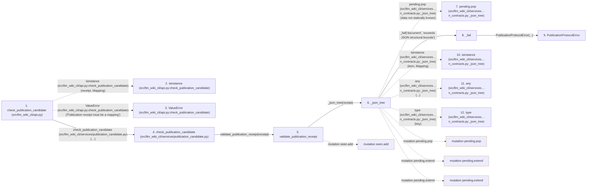

# check_publication_candidate

**Entry point:** `check_publication_candidate` (`api`)
**Source:** [api](../modules/api.md)
**Modules touched:** [api](../modules/api.md), [cli](../modules/cli.md), [cli_reference](../modules/cli_reference.md), [instruction_ownership](../modules/instruction_ownership.md), and 13 more

**Complete modules touched:**

- [api](../modules/api.md)
- [cli](../modules/cli.md)
- [cli_reference](../modules/cli_reference.md)
- [instruction_ownership](../modules/instruction_ownership.md)
- [io](../modules/io.md)
- [knowledge_evidence](../modules/knowledge_evidence.md)
- [knowledge_storage](../modules/knowledge_storage.md)
- [knowledge_storage_io](../modules/knowledge_storage_io.md)
- [markdown_sections](../modules/markdown_sections.md)
- [publication_candidate](../modules/publication_candidate.md)
- [publication_config](../modules/publication_config.md)
- [publication_contracts](../modules/publication_contracts.md)
- [publication_impact](../modules/publication_impact.md)
- [publication_links](../modules/publication_links.md)
- [publication_references](../modules/publication_references.md)
- [source_selection](../modules/source_selection.md)
- [validation](../modules/validation.md)

## Call sequence

> Static overview in presentation order, not runtime execution order. Arrows retain captured callers; representative internal continuations and boundary examples precede repeated helper detail.

```mermaid
sequenceDiagram
    participant p0 as check_publication_candidate (src/llm_wiki_cli/api.py)
    participant p1 as check_publication_candidate (src/llm_wiki_cli/services/publication_candidate.py)
    participant p2 as validate_publication_receipt
    participant p3 as _prepare
    participant p4 as _candidate_path
    participant p5 as _recheck_basis
    participant p6 as _json_tree
    participant p7 as _absolute_path
    participant p8 as load_publication_config
    participant p9 as hash_json
    participant p10 as publication_path
    participant p11 as validate_publication_basis
    participant p12 as validate_publication_report
    participant p13 as _hash_map
    participant p14 as _within
    participant p15 as _provider
    participant p16 as _read_tree
    participant p17 as capture_publication_basis
    participant p18 as prepare_wiki_markdown
    participant p19 as check_github_wiki
    participant p20 as project_publication_targets
    participant p21 as compare_publication_impact
    participant p22 as _hashes
    participant p23 as _validate_review
    participant p24 as _sealed
    participant p25 as _proposal
    participant p26 as _guard
    participant p27 as _consumer_root
    participant p28 as _path
    participant p29 as isinstance (src/llm_wiki_cli/api.py:check_publication_candidate)
    participant p30 as json.dumps(…).encode (src/llm_wiki_cli/services…idate_publication_receipt)
    p0->>p1: check_publication_candidate (src/llm_wiki_cli/services/publication_candidate.py)
    p1->>p2: validate_publication_receipt
    p1->>p3: _prepare
    p1->>p4: _candidate_path
    p1->>p5: _recheck_basis
    p2->>p6: _json_tree
    p3->>p7: _absolute_path
    p3->>p8: load_publication_config
    p2->>p9: hash_json
    p3->>p10: publication_path
    p2->>p11: validate_publication_basis
    p2->>p12: validate_publication_report
    p2->>p13: _hash_map
    p3->>p14: _within
    p3->>p15: _provider
    p3->>p16: _read_tree
    p3->>p17: capture_publication_basis
    p3->>p18: prepare_wiki_markdown
    p3->>p19: check_github_wiki
    p3->>p20: project_publication_targets
    p3->>p21: compare_publication_impact
    p3->>p22: _hashes
    p2->>p23: _validate_review
    p3->>p24: _sealed
    p2->>p25: _proposal
    p11->>p26: _guard
    p8->>p27: _consumer_root
    p18->>p28: _path
    p0-->>p29: isinstance (src/llm_wiki_cli/api.py:check_publication_candidate)(receipt, Mapping)
    p2-->>p30: json.dumps(…).encode (src/llm_wiki_cli/services…idate_publication_receipt)('utf-8')
```

<!-- Auto-generated from static call edges. Dashed arrows are external or unresolved calls. Reviewed runtime conditions and side effects belong in Behavior. -->

> Call sequence diagram shows 30 of 1265 interactions; 1235 omitted to keep the visualization within the 30-interaction and generated-diagram limits, with uncertain identities omitted rather than inferred.

> Captured boundary calls: external 1 of 472 (471 omitted); unresolved 1 of 385 (384 omitted). These counts cover the captured static trace.

Omitted captured detail, grouped by actual caller occurrence and target module:

| Caller | Parent step | Target module | Kind | Omitted interactions |
| --- | --- | --- | --- | --- |
| `src/llm_wiki_cli/api.py:check_publication_candidate` | 1 | - | external | 2 |
| `src/llm_wiki_cli/services/publication_contracts.py:_json_tree` | 6 | - | unresolved | 4 |
| `src/llm_wiki_cli/services/publication_contracts.py:_json_tree` | 6 | [src/llm_wiki_cli/services/publication_contracts.py](../modules/publication_contracts.md) | internal | 4 |
| `src/llm_wiki_cli/services/publication_contracts.py:_fail` | 8 | [src/llm_wiki_cli/services/publication_contracts.py](../modules/publication_contracts.md) | internal | 1 |
| `src/llm_wiki_cli/services/publication_contracts.py:_json_tree` | 6 | - | external | 7 |
| `src/llm_wiki_cli/services/publication_candidate.py:validate_publication_receipt` | 5 | - | external | 75 |
| `src/llm_wiki_cli/services/publication_candidate.py:validate_publication_receipt` | 5 | [src/llm_wiki_cli/services/publication_candidate.py](../modules/publication_candidate.md) | internal | 7 |
| `src/llm_wiki_cli/services/publication_candidate.py:_check_hash` | 30 | - | external | 2 |
> Omission summary shows 8 of 240 groups; 232 further groups are not expanded here. Counts above include all omitted interactions.
> Detailed flow queries retain their own coverage and limits; omitted paths may execute at runtime.

> Trace truncated at the depth limit; deeper calls are omitted.

## Data flow

<!-- Auto-generated static analysis. Treat values and boundaries as best-effort hints, not runtime proof. -->

### Analysis coverage

**Effect analysis partially available.** Flow assembly and source effect analysis are separate; empty observations do not prove an empty handler body.

Source steps: 409; effect analysis evaluated: 314, partial: 9, unavailable: 86. Counts include steps omitted from the displayed trace.

Collector observations for 323 source steps with known totals: observed: 1463, emitted: 1417, omitted: 46. Unavailable totals are excluded.

- Callable record unavailable for one or more source steps; those steps have no represented callable body.
- Effect collector omitted observations before flow assembly; displayed effects are partial.
- Effect collector totals unavailable; observed counts cover captured records only.

| Step | Callable record | Effect analysis | Collector totals | Observed | Emitted | Omitted |
|---|---|---|---|---:|---:|---:|
| `check_publication_candidate (src/llm_wiki_cli/api.py)` | `available` | `partial` | `available` | `13` | `10` | `3` |
| `isinstance (src/llm_wiki_cli/api.py:check_publication_candidate)` | `not_applicable` | `not_applicable` | `not_applicable` | — | — | — |
| `ValueError (src/llm_wiki_cli/api.py:check_publication_candidate)` | `not_applicable` | `not_applicable` | `not_applicable` | — | — | — |
| `check_publication_candidate (src/llm_wiki_cli/services/publication_candidate.py)` | `available` | `partial` | `available` | `12` | `9` | `3` |
| `validate_publication_receipt` | `available` | `evaluated` | `available` | `7` | `7` | `0` |
| `_json_tree` | `available` | `evaluated` | `available` | `6` | `6` | `0` |
| `pending.pop (src/llm_wiki_cli/services…n_contracts.py:_json_tree)` | `not_applicable` | `not_applicable` | `not_applicable` | — | — | — |
| `_fail` | `available` | `evaluated` | `available` | `2` | `2` | `0` |
| `PublicationProtocolError` | `unavailable` | `unavailable` | `unavailable` | — | — | — |
| `isinstance (src/llm_wiki_cli/services…n_contracts.py:_json_tree)` | `not_applicable` | `not_applicable` | `not_applicable` | — | — | — |
| `any (src/llm_wiki_cli/services…n_contracts.py:_json_tree)` | `not_applicable` | `not_applicable` | `not_applicable` | — | — | — |
| `type (src/llm_wiki_cli/services…n_contracts.py:_json_tree)` | `not_applicable` | `not_applicable` | `not_applicable` | — | — | — |

### Step data

| Step | Inputs | Reads | Writes | Returns |
|---|---|---|---|---|
| `check_publication_candidate (src/llm_wiki_cli/api.py)` | `consumer_root: str \| Path`, `candidate_dir: str \| Path`, `receipt: Mapping[str, Any]`, `config_path: str \| Path`, `target_dir: str \| Path \| None`, `baseline: Mapping[str, Any] \| None`, `reviews: Mapping[str, Any] \| None`, `previous_receipt: Mapping[str, Any] \| None` | `Mapping` | - | `check(...)` |
| `isinstance (src/llm_wiki_cli/api.py:check_publication_candidate)` | - | - | - | - |
| `ValueError (src/llm_wiki_cli/api.py:check_publication_candidate)` | - | - | - | - |
| `check_publication_candidate (src/llm_wiki_cli/services/publication_candidate.py)` | `consumer_root: str \| Path`, `candidate_dir: str \| Path`, `receipt: Mapping[str, Any]`, `config_path: str \| Path`, `target_dir: str \| Path \| None`, `baseline: Mapping[str, Any] \| None`, `reviews: Mapping[str, Any] \| None`, `previous_receipt: Mapping[str, Any] \| None` | - | - | `current` |
| `validate_publication_receipt` | `receipt: Mapping[str, Any]` | `MAX_TREE_BYTES`, `Mapping`, `_RECEIPT_FIELDS`, `RECEIPT_SCHEMA`, `MAX_FILES` | - | - |
| `_json_tree` | `value: object` | `_MAX_JSON_NODES`, `Mapping` | - | - |
| `pending.pop (src/llm_wiki_cli/services…n_contracts.py:_json_tree)` | - | - | - | - |
| `_fail` | `field: str`, `message: str` | - | - | - |
| `PublicationProtocolError` | - | - | - | - |
| `isinstance (src/llm_wiki_cli/services…n_contracts.py:_json_tree)` | - | - | - | - |
| `any (src/llm_wiki_cli/services…n_contracts.py:_json_tree)` | - | - | - | - |
| `type (src/llm_wiki_cli/services…n_contracts.py:_json_tree)` | - | - | - | - |

### Call data

| From | To | Line | Call |
|---|---|---:|---|
| check_publication_candidate (src/llm_wiki_cli/api.py) | isinstance (src/llm_wiki_cli/api.py:check_publication_candidate) | 3626 | `isinstance(receipt, Mapping)` |
| check_publication_candidate (src/llm_wiki_cli/api.py) | ValueError (src/llm_wiki_cli/api.py:check_publication_candidate) | 3627 | `ValueError('Publication receipt must be a mapping')` |
| check_publication_candidate (src/llm_wiki_cli/api.py) | check_publication_candidate (src/llm_wiki_cli/services/publication_candidate.py) | 3628 | `check(consumer_root, candidate_dir=candidate_dir, receipt=dict(...), config_path=config_path, target_dir=target_dir, baseline=baseline, reviews=reviews, previous_receipt=previous_receipt, candidate_review=candidate_review, source_revision=source_revision, target_revision=target_revision)` |
| check_publication_candidate (src/llm_wiki_cli/services/publication_candidate.py) | validate_publication_receipt | 851 | `validate_publication_receipt(receipt)` |
| validate_publication_receipt | _json_tree | 270 | `_json_tree(receipt)` |
| _json_tree | pending.pop (src/llm_wiki_cli/services…n_contracts.py:_json_tree) | 135 | `pending.pop(data not statically known)` |
| _json_tree | _fail | 138 | `_fail('document', 'exceeds JSON structural bounds')` |
| _fail | PublicationProtocolError | 43 | `PublicationProtocolError(...)` |
| _json_tree | isinstance (src/llm_wiki_cli/services…n_contracts.py:_json_tree) | 139 | `isinstance(item, Mapping)` |
| _json_tree | any (src/llm_wiki_cli/services…n_contracts.py:_json_tree) | 140 | `any(...)` |
| _json_tree | type (src/llm_wiki_cli/services…n_contracts.py:_json_tree) | 140 | `type(key)` |

### Boundary effects

| Kind | Target | Step | Line |
|---|---|---|---:|
| mutation | `seen.add` | `validate_publication_receipt` | 409 |
| mutation | `pending.pop` | `_json_tree` | 135 |
| mutation | `pending.extend` | `_json_tree` | 142 |
| mutation | `pending.extend` | `_json_tree` | 144 |

### Static analysis gaps

| Kind | Step | Target | Line |
|---|---|---|---:|
| external_call | `check_publication_candidate` | `isinstance` | 3626 |
| external_call | `check_publication_candidate` | `ValueError` | 3627 |
| external_call | `_json_tree` | `isinstance` | 139 |
| external_call | `_json_tree` | `any` | 140 |
| external_call | `_json_tree` | `type` | 140 |
| step_limit | `check_publication_candidate` | `first 12 steps` | 0 |
| truncated_flow | `check_publication_candidate` | `depth limit` | 0 |

## Behavior

This flow starts at `check_publication_candidate` and is classified as `api`. The generated call and data-flow sections are bounded static projections; runtime conditions and side effects require source-level confirmation.
