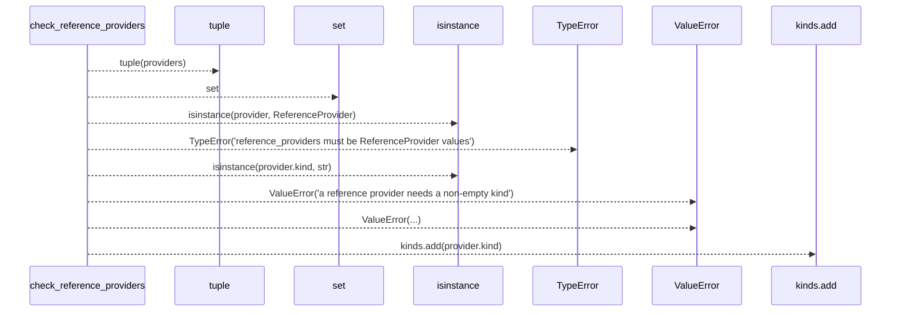
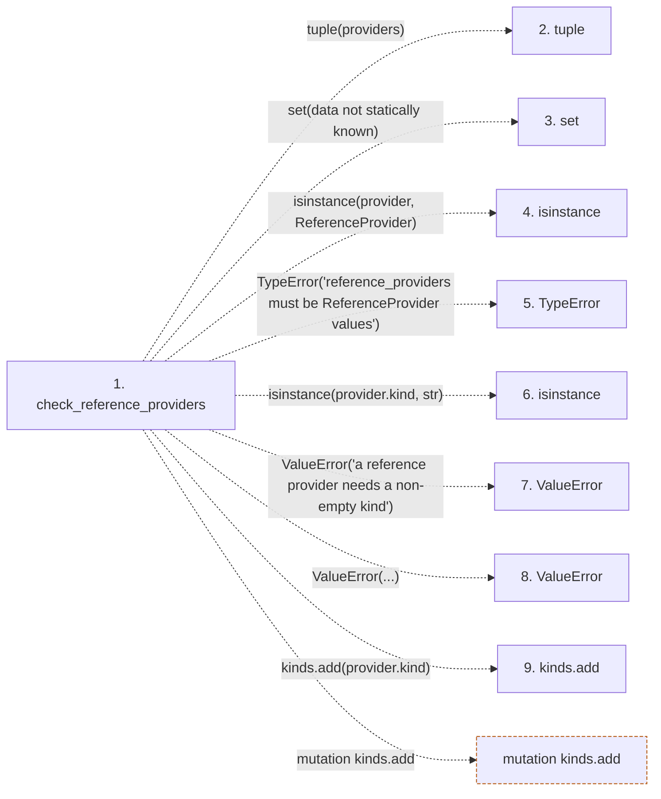

# check_reference_providers

**Entry point:** `check_reference_providers` (`api`)
**Source:** [reference_providers](../modules/reference_providers.md)
**Modules touched:** [reference_providers](../modules/reference_providers.md)

## Call sequence

> Static overview in presentation order, not runtime execution order. Arrows retain captured callers; representative internal continuations and boundary examples precede repeated helper detail.

<!-- Auto-generated from static call edges. Dashed arrows are external or unresolved calls. Reviewed runtime conditions and side effects belong in Behavior. -->

> Call sequence diagram shows 8 of 8 interactions; 0 omitted to keep the visualization within the 30-interaction and generated-diagram limits, with uncertain identities omitted rather than inferred.

> Captured boundary calls: external 7 of 7 (0 omitted); unresolved 1 of 1 (0 omitted). These counts cover the captured static trace.
> Detailed flow queries retain their own coverage and limits; omitted paths may execute at runtime.

## Data flow

<!-- Auto-generated static analysis. Treat values and boundaries as best-effort hints, not runtime proof. -->

### Analysis coverage

**Effect analysis evaluated.** Flow assembly and source effect analysis are separate; empty observations do not prove an empty handler body.

Source steps: 1; effect analysis evaluated: 1, partial: 0, unavailable: 0. Counts include steps omitted from the displayed trace.

Collector observations for 1 source steps with known totals: observed: 4, emitted: 4, omitted: 0. Unavailable totals are excluded.

### Step data

| Step | Inputs | Reads | Writes | Returns |
|---|---|---|---|---|
| `check_reference_providers` | `providers: object` | `ReferenceProvider` | - | `values` |
| `tuple` | - | - | - | - |
| `set` | - | - | - | - |
| `isinstance` | - | - | - | - |
| `TypeError` | - | - | - | - |
| `isinstance` | - | - | - | - |
| `ValueError` | - | - | - | - |
| `ValueError` | - | - | - | - |
| `kinds.add` | - | - | - | - |

### Call data

| From | To | Line | Call |
|---|---|---:|---|
| check_reference_providers | tuple | 336 | `tuple(providers)` |
| check_reference_providers | set | 337 | `set(data not statically known)` |
| check_reference_providers | isinstance | 339 | `isinstance(provider, ReferenceProvider)` |
| check_reference_providers | TypeError | 340 | `TypeError('reference_providers must be ReferenceProvider values')` |
| check_reference_providers | isinstance | 341 | `isinstance(provider.kind, str)` |
| check_reference_providers | ValueError | 342 | `ValueError('a reference provider needs a non-empty kind')` |
| check_reference_providers | ValueError | 344 | `ValueError(...)` |
| check_reference_providers | kinds.add | 345 | `kinds.add(provider.kind)` |

### Boundary effects

| Kind | Target | Step | Line |
|---|---|---|---:|
| mutation | `kinds.add` | `check_reference_providers` | 345 |

### Static analysis gaps

| Kind | Step | Target | Line |
|---|---|---|---:|
| external_call | `check_reference_providers` | `isinstance` | 339 |
| external_call | `check_reference_providers` | `TypeError` | 340 |
| external_call | `check_reference_providers` | `isinstance` | 341 |
| external_call | `check_reference_providers` | `ValueError` | 342 |
| external_call | `check_reference_providers` | `ValueError` | 344 |

## Behavior

This flow starts at `check_reference_providers` and is classified as `api`. The generated call and data-flow sections are bounded static projections; runtime conditions and side effects require source-level confirmation.
