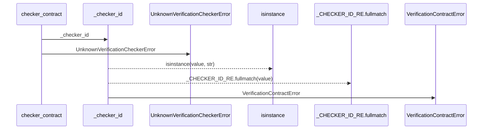
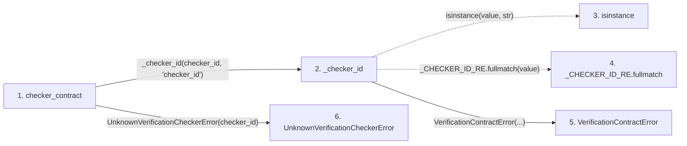

# checker_contract

**Entry point:** `checker_contract` (`api`)
**Source:** [verification_contracts](../modules/verification_contracts.md)
**Modules touched:** [verification_contracts](../modules/verification_contracts.md)

## Call sequence

> Static overview in presentation order, not runtime execution order. Arrows retain captured callers; representative internal continuations and boundary examples precede repeated helper detail.

<!-- Auto-generated from static call edges. Dashed arrows are external or unresolved calls. Reviewed runtime conditions and side effects belong in Behavior. -->

> Call sequence diagram shows 5 of 5 interactions; 0 omitted to keep the visualization within the 30-interaction and generated-diagram limits, with uncertain identities omitted rather than inferred.

> Captured boundary calls: external 1 of 1 (0 omitted); unresolved 1 of 1 (0 omitted). These counts cover the captured static trace.
> Detailed flow queries retain their own coverage and limits; omitted paths may execute at runtime.

## Data flow

<!-- Auto-generated static analysis. Treat values and boundaries as best-effort hints, not runtime proof. -->

### Analysis coverage

**Effect analysis partially available.** Flow assembly and source effect analysis are separate; empty observations do not prove an empty handler body.

Source steps: 4; effect analysis evaluated: 2, partial: 0, unavailable: 2. Counts include steps omitted from the displayed trace.

- Callable record unavailable; the selected entry symbol has no represented callable body.
- Effect collector totals unavailable; observed counts cover captured records only.

| Step | Callable record | Effect analysis | Collector totals |
|---|---|---|---|
| `checker_contract` | `available` | `evaluated` | `available` |
| `_checker_id` | `available` | `evaluated` | `available` |
| `isinstance` | `not_applicable` | `not_applicable` | `not_applicable` |
| `_CHECKER_ID_RE.fullmatch` | `not_applicable` | `not_applicable` | `not_applicable` |
| `VerificationContractError` | `unavailable` | `unavailable` | `unavailable` |
| `UnknownVerificationCheckerError` | `unavailable` | `unavailable` | `unavailable` |

### Step data

| Step | Inputs | Reads | Writes | Returns |
|---|---|---|---|---|
| `checker_contract` | `checker_id: str` | `_CHECKER_REGISTRY` | - | `_CHECKER_REGISTRY[...]` |
| `_checker_id` | `value: object`, `field_name: str` | - | - | `value` |
| `isinstance` | - | - | - | - |
| `_CHECKER_ID_RE.fullmatch` | - | - | - | - |
| `VerificationContractError` | - | - | - | - |
| `UnknownVerificationCheckerError` | - | - | - | - |

### Call data

| From | To | Line | Call |
|---|---|---:|---|
| checker_contract | _checker_id | 671 | `_checker_id(checker_id, 'checker_id')` |
| _checker_id | isinstance | 1359 | `isinstance(value, str)` |
| _checker_id | _CHECKER_ID_RE.fullmatch | 1359 | `_CHECKER_ID_RE.fullmatch(value)` |
| _checker_id | VerificationContractError | 1360 | `VerificationContractError(...)` |
| checker_contract | UnknownVerificationCheckerError | 675 | `UnknownVerificationCheckerError(checker_id)` |

### Boundary effects

*No boundary-effect observations were captured in this static trace.*

### Static analysis gaps

| Kind | Step | Target | Line |
|---|---|---|---:|
| external_call | `_checker_id` | `isinstance` | 1359 |
| unresolved_call | `_checker_id` | `_CHECKER_ID_RE.fullmatch` | 1359 |

## Behavior

This flow starts at `checker_contract` and is classified as `api`. The generated call and data-flow sections are bounded static projections; runtime conditions and side effects require source-level confirmation.
