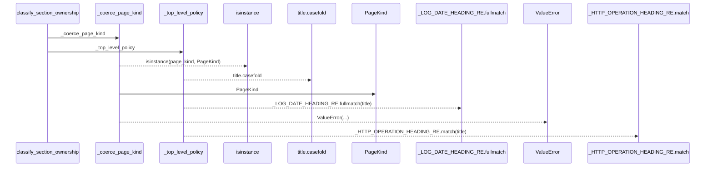
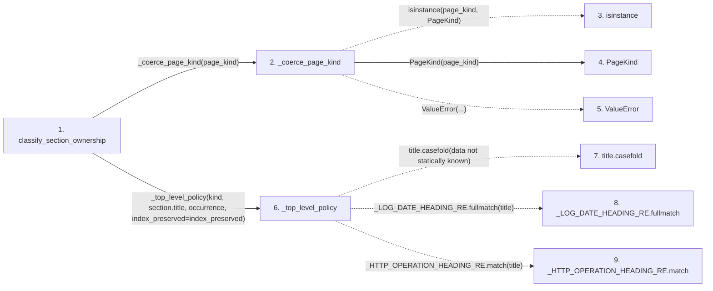

# classify_section_ownership

**Entry point:** `classify_section_ownership` (`api`)
**Source:** [section_ownership](../modules/section_ownership.md)
**Modules touched:** [section_ownership](../modules/section_ownership.md), [wiki_surface](../modules/wiki_surface.md)

## Call sequence

> Static overview in presentation order, not runtime execution order. Arrows retain captured callers; representative internal continuations and boundary examples precede repeated helper detail.

<!-- Auto-generated from static call edges. Dashed arrows are external or unresolved calls. Reviewed runtime conditions and side effects belong in Behavior. -->

> Call sequence diagram shows 8 of 8 interactions; 0 omitted to keep the visualization within the 30-interaction and generated-diagram limits, with uncertain identities omitted rather than inferred.

> Captured boundary calls: external 2 of 2 (0 omitted); unresolved 3 of 3 (0 omitted). These counts cover the captured static trace.
> Detailed flow queries retain their own coverage and limits; omitted paths may execute at runtime.

## Data flow

<!-- Auto-generated static analysis. Treat values and boundaries as best-effort hints, not runtime proof. -->

### Analysis coverage

**Effect analysis partially available.** Flow assembly and source effect analysis are separate; empty observations do not prove an empty handler body.

Source steps: 4; effect analysis evaluated: 2, partial: 1, unavailable: 1. Counts include steps omitted from the displayed trace.

Collector observations for 3 source steps with known totals: observed: 123, emitted: 39, omitted: 84. Unavailable totals are excluded.

- Callable record unavailable for one or more source steps; those steps have no represented callable body.
- Effect collector omitted observations before flow assembly; displayed effects are partial.
- Effect collector totals unavailable; observed counts cover captured records only.

| Step | Callable record | Effect analysis | Collector totals | Observed | Emitted | Omitted |
|---|---|---|---|---:|---:|---:|
| `classify_section_ownership` | `available` | `evaluated` | `available` | `15` | `15` | `0` |
| `_coerce_page_kind` | `available` | `evaluated` | `available` | `4` | `4` | `0` |
| `isinstance` | `not_applicable` | `not_applicable` | `not_applicable` | — | — | — |
| `PageKind` | `unavailable` | `unavailable` | `unavailable` | — | — | — |
| `ValueError` | `not_applicable` | `not_applicable` | `not_applicable` | — | — | — |
| `_top_level_policy` | `available` | `partial` | `available` | `104` | `20` | `84` |
| `title.casefold` | `not_applicable` | `not_applicable` | `not_applicable` | — | — | — |
| `_LOG_DATE_HEADING_RE.fullmatch` | `not_applicable` | `not_applicable` | `not_applicable` | — | — | — |
| `_HTTP_OPERATION_HEADING_RE.match` | `not_applicable` | `not_applicable` | `not_applicable` | — | — | — |

### Step data

| Step | Inputs | Reads | Writes | Returns |
|---|---|---|---|---|
| `classify_section_ownership` | `page_kind: PageKind \| str`, `section: MarkdownSection`, `parent_ownership: SectionOwnership \| None`, `canonical_occurrence: int \| None`, `index_preserved: bool` | `PageKind`, `SectionOwnership`, `PageKind`, `SectionOwnership`, `SectionOwnership` | - | `SectionOwnership.SEMANTIC`, `SectionOwnership.GENERATED`, `parent_ownership`, `SectionOwnership.UNKNOWN`, `_top_level_policy(...)` |
| `_coerce_page_kind` | `page_kind: PageKind \| str` | `PageKind` | - | `page_kind`, `PageKind(...)` |
| `isinstance` | - | - | - | - |
| `PageKind` | - | - | - | - |
| `ValueError` | - | - | - | - |
| `_top_level_policy` | `page_kind: PageKind`, `title: str`, `canonical_occurrence: int`, `index_preserved: bool` | `PageKind`, `SectionOwnership`, `PageKind`, `SectionOwnership`, `SectionOwnership`, `PageKind`, `_INDEX_GENERATED_HEADINGS`, `SectionOwnership` | - | `SectionOwnership.SEMANTIC`, `SectionOwnership.GENERATED`, `SectionOwnership.UNKNOWN`, `...`, `...`, `...`, `...`, `...` |
| `title.casefold` | - | - | - | - |
| `_LOG_DATE_HEADING_RE.fullmatch` | - | - | - | - |
| `_HTTP_OPERATION_HEADING_RE.match` | - | - | - | - |

### Call data

| From | To | Line | Call |
|---|---|---:|---|
| classify_section_ownership | _coerce_page_kind | 435 | `_coerce_page_kind(page_kind)` |
| _coerce_page_kind | isinstance | 269 | `isinstance(page_kind, PageKind)` |
| _coerce_page_kind | PageKind | 272 | `PageKind(page_kind)` |
| _coerce_page_kind | ValueError | 274 | `ValueError(...)` |
| classify_section_ownership | _top_level_policy | 445 | `_top_level_policy(kind, section.title, occurrence, index_preserved=index_preserved)` |
| _top_level_policy | title.casefold | 284 | `title.casefold(data not statically known)` |
| _top_level_policy | _LOG_DATE_HEADING_RE.fullmatch | 289 | `_LOG_DATE_HEADING_RE.fullmatch(title)` |
| _top_level_policy | _HTTP_OPERATION_HEADING_RE.match | 387 | `_HTTP_OPERATION_HEADING_RE.match(title)` |

### Boundary effects

*No boundary-effect observations were captured in this static trace.*

### Static analysis gaps

| Kind | Step | Target | Line |
|---|---|---|---:|
| external_call | `_coerce_page_kind` | `isinstance` | 269 |
| external_call | `_coerce_page_kind` | `ValueError` | 274 |
| unresolved_call | `_top_level_policy` | `title.casefold` | 284 |
| unresolved_call | `_top_level_policy` | `_LOG_DATE_HEADING_RE.fullmatch` | 289 |
| unresolved_call | `_top_level_policy` | `_HTTP_OPERATION_HEADING_RE.match` | 387 |

## Behavior

This flow starts at `classify_section_ownership` and is classified as `api`. The generated call and data-flow sections are bounded static projections; runtime conditions and side effects require source-level confirmation.
