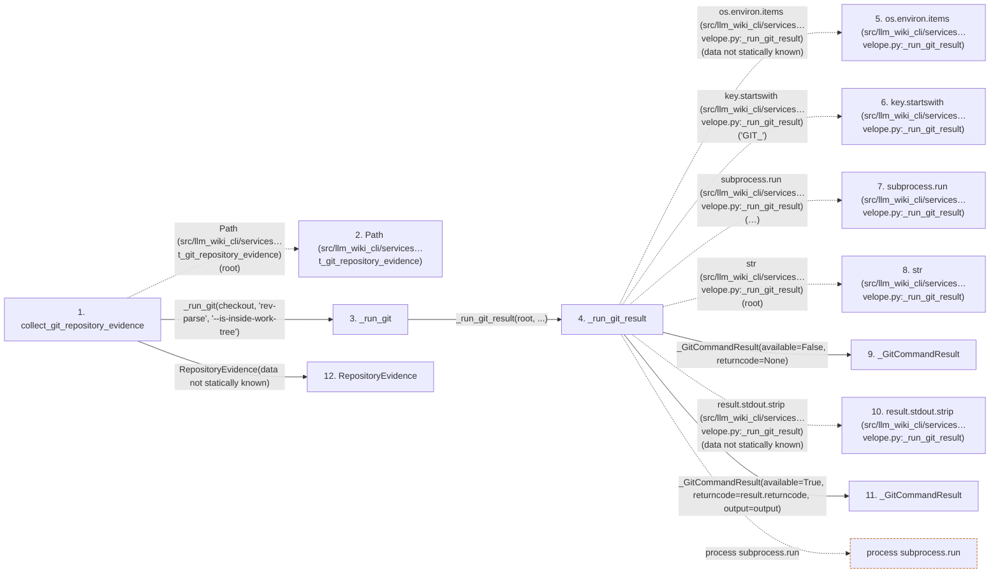

# collect_git_repository_evidence

**Entry point:** `collect_git_repository_evidence` (`api`)
**Source:** [knowledge_envelope](../modules/knowledge_envelope.md)
**Modules touched:** [knowledge_envelope](../modules/knowledge_envelope.md), [validation](../modules/validation.md)

## Call sequence

> Static overview in presentation order, not runtime execution order. Arrows retain captured callers; representative internal continuations and boundary examples precede repeated helper detail.

```mermaid
sequenceDiagram
    participant p0 as collect_git_repository_evidence
    participant p1 as _run_git
    participant p2 as _worktree_pathspecs
    participant p3 as _effective_line_ending_overrides
    participant p4 as _filtered_worktree_status_is_dirty
    participant p5 as _local_config_values
    participant p6 as RepositoryEvidence
    participant p7 as _is_full_git_oid
    participant p8 as _run_git_result
    participant p9 as _parse_local_remote_config
    participant p10 as _run_effective_git_config
    participant p11 as _repository_relative_path
    participant p12 as require_repository_relative_path
    participant p13 as require_portable_relative_path
    participant p14 as _default_path_error
    participant p15 as _check_path_collision
    participant p16 as require_portable_path_component
    participant p17 as KnowledgeEnvelopeError
    participant p18 as _GitCommandResult
    participant p19 as _syntax_key
    participant p20 as _known_syntax
    participant p21 as _remember_syntax
    participant p22 as SharedValidationError
    participant p23 as portable_path_key
    participant p24 as Path (src/llm_wiki_cli/services…t_git_repository_evidence)
    participant p25 as Path(…).resolve (src/llm_wiki_cli/services…t_git_repository_evidence)
    participant p26 as bool
    participant p27 as len (src/llm_wiki_cli/services…t_git_repository_evidence)
    p0->>p1: _run_git
    p0->>p2: _worktree_pathspecs
    p0->>p3: _effective_line_ending_overrides
    p0->>p4: _filtered_worktree_status_is_dirty
    p0->>p5: _local_config_values
    p0->>p6: RepositoryEvidence
    p0->>p7: _is_full_git_oid
    p0->>p8: _run_git_result
    p0->>p9: _parse_local_remote_config
    p3->>p10: _run_effective_git_config
    p4->>p11: _repository_relative_path
    p11->>p12: require_repository_relative_path
    p12->>p13: require_portable_relative_path
    p13->>p14: _default_path_error
    p13->>p15: _check_path_collision
    p13->>p16: require_portable_path_component
    p11->>p17: KnowledgeEnvelopeError
    p8->>p18: _GitCommandResult
    p12->>p19: _syntax_key
    p12->>p20: _known_syntax
    p12->>p21: _remember_syntax
    p14->>p22: SharedValidationError
    p15->>p23: portable_path_key
    p0-->>p24: Path (src/llm_wiki_cli/services…t_git_repository_evidence)(root)
    p0-->>p25: Path(…).resolve (src/llm_wiki_cli/services…t_git_repository_evidence)
    p0-->>p24: Path (src/llm_wiki_cli/services…t_git_repository_evidence)(raw_top_level)
    p0-->>p26: bool(status)
    p0-->>p27: len (src/llm_wiki_cli/services…t_git_repository_evidence)(branch_remotes)
    p0-->>p27: len (src/llm_wiki_cli/services…t_git_repository_evidence)(branch_merges)
    p0-->>p27: len (src/llm_wiki_cli/services…t_git_repository_evidence)(branch_remotes)
```

<!-- Auto-generated from static call edges. Dashed arrows are external or unresolved calls. Reviewed runtime conditions and side effects belong in Behavior. -->

> Call sequence diagram shows 30 of 182 interactions; 152 omitted to keep the visualization within the 30-interaction and generated-diagram limits, with uncertain identities omitted rather than inferred.

> Captured boundary calls: external 6 of 70 (64 omitted); unresolved 1 of 55 (54 omitted). These counts cover the captured static trace.

Omitted captured detail, grouped by actual caller occurrence and target module:

| Caller | Parent step | Target module | Kind | Omitted interactions |
| --- | --- | --- | --- | --- |
| `src/llm_wiki_cli/services/knowledge_envelope.py:_run_git` | 3 | [src/llm_wiki_cli/services/knowledge_envelope.py](../modules/knowledge_envelope.md) | internal | 1 |
| `src/llm_wiki_cli/services/knowledge_envelope.py:_run_git_result` | 4 | - | external | 3 |
| `src/llm_wiki_cli/services/knowledge_envelope.py:_run_git_result` | 4 | - | unresolved | 2 |
| `src/llm_wiki_cli/services/knowledge_envelope.py:_run_git_result` | 4 | [src/llm_wiki_cli/services/knowledge_envelope.py](../modules/knowledge_envelope.md) | internal | 1 |
| `src/llm_wiki_cli/services/knowledge_envelope.py:collect_git_repository_evidence` | 1 | [src/llm_wiki_cli/services/knowledge_envelope.py](../modules/knowledge_envelope.md) | internal | 7 |
| `src/llm_wiki_cli/services/knowledge_envelope.py:_is_full_git_oid` | 14 | - | external | 3 |
| `src/llm_wiki_cli/services/knowledge_envelope.py:_worktree_pathspecs` | 18 | - | external | 20 |
| `src/llm_wiki_cli/services/knowledge_envelope.py:_worktree_pathspecs` | 18 | [src/llm_wiki_cli/services/knowledge_envelope.py](../modules/knowledge_envelope.md) | internal | 1 |
> Omission summary shows 8 of 38 groups; 30 further groups are not expanded here. Counts above include all omitted interactions.
> Detailed flow queries retain their own coverage and limits; omitted paths may execute at runtime.

> Trace truncated at the depth limit; deeper calls are omitted.

## Data flow

<!-- Auto-generated static analysis. Treat values and boundaries as best-effort hints, not runtime proof. -->

### Analysis coverage

**Effect analysis partially available.** Flow assembly and source effect analysis are separate; empty observations do not prove an empty handler body.

Source steps: 58; effect analysis evaluated: 39, partial: 3, unavailable: 16. Counts include steps omitted from the displayed trace.

Collector observations for 42 source steps with known totals: observed: 300, emitted: 285, omitted: 15. Unavailable totals are excluded.

- Callable record unavailable for one or more source steps; those steps have no represented callable body.
- Effect collector omitted observations before flow assembly; displayed effects are partial.
- Effect collector totals unavailable; observed counts cover captured records only.

| Step | Callable record | Effect analysis | Collector totals | Observed | Emitted | Omitted |
|---|---|---|---|---:|---:|---:|
| `collect_git_repository_evidence` | `available` | `evaluated` | `available` | `10` | `10` | `0` |
| `Path (src/llm_wiki_cli/services…t_git_repository_evidence)` | `not_applicable` | `not_applicable` | `not_applicable` | — | — | — |
| `_run_git` | `available` | `evaluated` | `available` | `6` | `6` | `0` |
| `_run_git_result` | `available` | `evaluated` | `available` | `12` | `12` | `0` |
| `os.environ.items (src/llm_wiki_cli/services…velope.py:_run_git_result)` | `not_applicable` | `not_applicable` | `not_applicable` | — | — | — |
| `key.startswith (src/llm_wiki_cli/services…velope.py:_run_git_result)` | `not_applicable` | `not_applicable` | `not_applicable` | — | — | — |
| `subprocess.run (src/llm_wiki_cli/services…velope.py:_run_git_result)` | `not_applicable` | `not_applicable` | `not_applicable` | — | — | — |
| `str (src/llm_wiki_cli/services…velope.py:_run_git_result)` | `not_applicable` | `not_applicable` | `not_applicable` | — | — | — |
| `_GitCommandResult` | `unavailable` | `unavailable` | `unavailable` | — | — | — |
| `result.stdout.strip (src/llm_wiki_cli/services…velope.py:_run_git_result)` | `not_applicable` | `not_applicable` | `not_applicable` | — | — | — |
| `_GitCommandResult` | `unavailable` | `unavailable` | `unavailable` | — | — | — |
| `RepositoryEvidence` | `unavailable` | `unavailable` | `unavailable` | — | — | — |

### Step data

| Step | Inputs | Reads | Writes | Returns |
|---|---|---|---|---|
| `collect_git_repository_evidence` | `root: str \| Path`, `included_worktree_paths: Iterable[str \| Path] \| None`, `excluded_worktree_paths: Iterable[str \| Path]`, `excluded_worktree_globs: Iterable[str]`, `worktree_path_filter: Callable[[Path], bool] \| None` | `WorkingTreeState`, `WorkingTreeState`, `WorkingTreeState` | - | `RepositoryEvidence(...)`, `RepositoryEvidence(...)` |
| `Path (src/llm_wiki_cli/services…t_git_repository_evidence)` | - | - | - | - |
| `_run_git` | `root: Path`, `args: str`, `preserve_empty: bool` | - | - | `None`, `result.output`, `None` |
| `_run_git_result` | `root: Path`, `args: str`, `preserve_output: bool` | `os`, `subprocess` | `git_environment[...]`, `git_environment[...]`, `git_environment[...]`, `git_environment[...]` | `_GitCommandResult(...)`, `_GitCommandResult(...)` |
| `os.environ.items (src/llm_wiki_cli/services…velope.py:_run_git_result)` | - | - | - | - |
| `key.startswith (src/llm_wiki_cli/services…velope.py:_run_git_result)` | - | - | - | - |
| `subprocess.run (src/llm_wiki_cli/services…velope.py:_run_git_result)` | - | - | - | - |
| `str (src/llm_wiki_cli/services…velope.py:_run_git_result)` | - | - | - | - |
| `_GitCommandResult` | - | - | - | - |
| `result.stdout.strip (src/llm_wiki_cli/services…velope.py:_run_git_result)` | - | - | - | - |
| `_GitCommandResult` | - | - | - | - |
| `RepositoryEvidence` | - | - | - | - |

### Call data

| From | To | Line | Call |
|---|---|---:|---|
| collect_git_repository_evidence | Path (src/llm_wiki_cli/services…t_git_repository_evidence) | 311 | `Path(root)` |
| collect_git_repository_evidence | _run_git | 312 | `_run_git(checkout, 'rev-parse', '--is-inside-work-tree')` |
| _run_git | _run_git_result | 1188 | `_run_git_result(root, ...)` |
| _run_git_result | os.environ.items (src/llm_wiki_cli/services…velope.py:_run_git_result) | 1202 | `os.environ.items(data not statically known)` |
| _run_git_result | key.startswith (src/llm_wiki_cli/services…velope.py:_run_git_result) | 1202 | `key.startswith('GIT_')` |
| _run_git_result | subprocess.run (src/llm_wiki_cli/services…velope.py:_run_git_result) | 1209 | `subprocess.run([...], input='', capture_output=True, text=True, encoding='utf-8', errors='strict', env=git_environment, timeout=15, check=False)` |
| _run_git_result | str (src/llm_wiki_cli/services…velope.py:_run_git_result) | 1210 | `str(root)` |
| _run_git_result | _GitCommandResult | 1228 | `_GitCommandResult(available=False, returncode=None)` |
| _run_git_result | result.stdout.strip (src/llm_wiki_cli/services…velope.py:_run_git_result) | 1229 | `result.stdout.strip(data not statically known)` |
| _run_git_result | _GitCommandResult | 1230 | `_GitCommandResult(available=True, returncode=result.returncode, output=output)` |
| collect_git_repository_evidence | RepositoryEvidence | 314 | `RepositoryEvidence(data not statically known)` |

### Boundary effects

| Kind | Target | Step | Line |
|---|---|---|---:|
| process | `subprocess.run` | `_run_git_result` | 1209 |

### Static analysis gaps

| Kind | Step | Target | Line |
|---|---|---|---:|
| external_call | `_run_git_result` | `os.environ.items` | 1202 |
| unresolved_call | `_run_git_result` | `key.startswith` | 1202 |
| unresolved_call | `_run_git_result` | `result.stdout.strip` | 1229 |
| step_limit | `collect_git_repository_evidence` | `first 12 steps` | 0 |
| truncated_flow | `collect_git_repository_evidence` | `depth limit` | 0 |

## Behavior

This flow starts at `collect_git_repository_evidence` and is classified as `api`. The generated call and data-flow sections are bounded static projections; runtime conditions and side effects require source-level confirmation.
