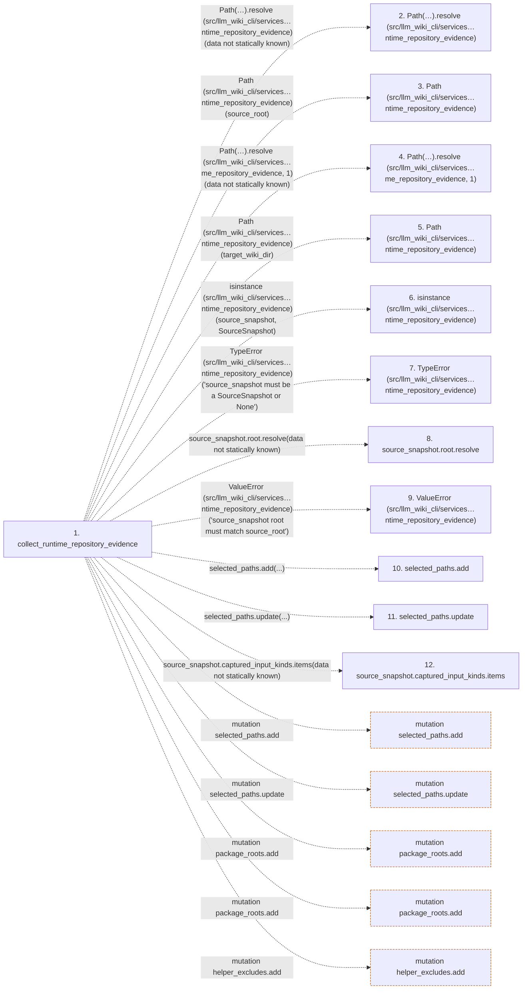

# collect_runtime_repository_evidence

**Entry point:** `collect_runtime_repository_evidence` (`api`)
**Source:** [knowledge_orchestration](../modules/knowledge_orchestration.md)
**Modules touched:** [common](../modules/common.md), [knowledge_envelope](../modules/knowledge_envelope.md), [knowledge_orchestration](../modules/knowledge_orchestration.md), [validation](../modules/validation.md)

## Call sequence

> Static overview in presentation order, not runtime execution order. Arrows retain captured callers; representative internal continuations and boundary examples precede repeated helper detail.

```mermaid
sequenceDiagram
    participant p0 as collect_runtime_repository_evidence
    participant p1 as is_bundled_helper_implementation_path
    participant p2 as collect_git_repository_evidence
    participant p3 as _run_git
    participant p4 as _is_absolute_path_text
    participant p5 as _worktree_pathspecs
    participant p6 as _effective_line_ending_overrides
    participant p7 as _path_text_equal
    participant p8 as _filtered_worktree_status_is_dirty
    participant p9 as _local_config_values
    participant p10 as _run_git_result
    participant p11 as _run_effective_git_config
    participant p12 as _repository_relative_path
    participant p13 as require_repository_relative_path
    participant p14 as require_portable_relative_path
    participant p15 as _normalize_path_text
    participant p16 as _is_windows_absolute_path_text
    participant p17 as RepositoryEvidence
    participant p18 as _is_full_git_oid
    participant p19 as _parse_local_remote_config
    participant p20 as _helper_relative_path_matches
    participant p21 as _owned_package_sentinels_present
    participant p22 as KnowledgeEnvelopeError
    participant p23 as _GitCommandResult
    participant p24 as _syntax_key
    participant p25 as _known_syntax
    participant p26 as _remember_syntax
    participant p27 as _default_path_error
    participant p28 as _check_path_collision
    participant p29 as Path (src/llm_wiki_cli/services…ntime_repository_evidence)
    participant p30 as Path(…).resolve (src/llm_wiki_cli/services…ntime_repository_evidence)
    p0->>p1: is_bundled_helper_implementation_path
    p0->>p2: collect_git_repository_evidence
    p2->>p3: _run_git
    p1->>p4: _is_absolute_path_text
    p2->>p5: _worktree_pathspecs
    p2->>p6: _effective_line_ending_overrides
    p1->>p7: _path_text_equal
    p2->>p8: _filtered_worktree_status_is_dirty
    p2->>p9: _local_config_values
    p3->>p10: _run_git_result
    p6->>p11: _run_effective_git_config
    p8->>p12: _repository_relative_path
    p12->>p13: require_repository_relative_path
    p13->>p14: require_portable_relative_path
    p1->>p15: _normalize_path_text
    p1->>p16: _is_windows_absolute_path_text
    p2->>p17: RepositoryEvidence
    p2->>p18: _is_full_git_oid
    p2->>p19: _parse_local_remote_config
    p1->>p20: _helper_relative_path_matches
    p1->>p21: _owned_package_sentinels_present
    p12->>p22: KnowledgeEnvelopeError
    p10->>p23: _GitCommandResult
    p13->>p24: _syntax_key
    p13->>p25: _known_syntax
    p13->>p26: _remember_syntax
    p14->>p27: _default_path_error
    p14->>p28: _check_path_collision
    p0-->>p29: Path (src/llm_wiki_cli/services…ntime_repository_evidence)(source_root)
    p0-->>p30: Path(…).resolve (src/llm_wiki_cli/services…ntime_repository_evidence)
```

<!-- Auto-generated from static call edges. Dashed arrows are external or unresolved calls. Reviewed runtime conditions and side effects belong in Behavior. -->

> Call sequence diagram shows 30 of 236 interactions; 206 omitted to keep the visualization within the 30-interaction and generated-diagram limits, with uncertain identities omitted rather than inferred.

> Captured boundary calls: external 1 of 98 (97 omitted); unresolved 1 of 75 (74 omitted). These counts cover the captured static trace.

Omitted captured detail, grouped by actual caller occurrence and target module:

| Caller | Parent step | Target module | Kind | Omitted interactions |
| --- | --- | --- | --- | --- |
| `src/llm_wiki_cli/services/knowledge_orchestration.py:collect_runtime_repository_evidence` | 1 | - | unresolved | 11 |
| `src/llm_wiki_cli/services/knowledge_orchestration.py:collect_runtime_repository_evidence` | 1 | - | external | 20 |
| `src/llm_wiki_cli/extractors/common.py:_normalize_path_text` | 28 | - | external | 3 |
| `src/llm_wiki_cli/extractors/common.py:_normalize_path_text` | 28 | - | unresolved | 2 |
| `src/llm_wiki_cli/extractors/common.py:is_bundled_helper_implementation_path` | 27 | [src/llm_wiki_cli/extractors/common.py](../modules/common.md) | internal | 3 |
| `src/llm_wiki_cli/extractors/common.py:_is_windows_absolute_path_text` | 35 | - | external | 2 |
| `src/llm_wiki_cli/extractors/common.py:_is_windows_absolute_path_text` | 35 | - | unresolved | 1 |
| `src/llm_wiki_cli/extractors/common.py:is_bundled_helper_implementation_path` | 27 | - | external | 6 |
> Omission summary shows 8 of 47 groups; 39 further groups are not expanded here. Counts above include all omitted interactions.
> Detailed flow queries retain their own coverage and limits; omitted paths may execute at runtime.

> Trace truncated at the depth limit; deeper calls are omitted.

## Data flow

<!-- Auto-generated static analysis. Treat values and boundaries as best-effort hints, not runtime proof. -->

### Analysis coverage

**Effect analysis partially available.** Flow assembly and source effect analysis are separate; empty observations do not prove an empty handler body.

Source steps: 64; effect analysis evaluated: 55, partial: 0, unavailable: 9. Counts include steps omitted from the displayed trace.

- Callable record unavailable; the selected entry symbol has no represented callable body.
- Effect collector totals unavailable; observed counts cover captured records only.

| Step | Callable record | Effect analysis | Collector totals |
|---|---|---|---|
| `collect_runtime_repository_evidence` | `available` | `evaluated` | `available` |
| `Path(…).resolve (src/llm_wiki_cli/services…ntime_repository_evidence)` | `not_applicable` | `not_applicable` | `not_applicable` |
| `Path (src/llm_wiki_cli/services…ntime_repository_evidence)` | `not_applicable` | `not_applicable` | `not_applicable` |
| `Path(…).resolve (src/llm_wiki_cli/services…me_repository_evidence, 1)` | `not_applicable` | `not_applicable` | `not_applicable` |
| `Path (src/llm_wiki_cli/services…ntime_repository_evidence)` | `not_applicable` | `not_applicable` | `not_applicable` |
| `isinstance (src/llm_wiki_cli/services…ntime_repository_evidence)` | `not_applicable` | `not_applicable` | `not_applicable` |
| `TypeError (src/llm_wiki_cli/services…ntime_repository_evidence)` | `not_applicable` | `not_applicable` | `not_applicable` |
| `source_snapshot.root.resolve` | `not_applicable` | `not_applicable` | `not_applicable` |
| `ValueError (src/llm_wiki_cli/services…ntime_repository_evidence)` | `not_applicable` | `not_applicable` | `not_applicable` |
| `selected_paths.add` | `not_applicable` | `not_applicable` | `not_applicable` |
| `selected_paths.update` | `not_applicable` | `not_applicable` | `not_applicable` |
| `source_snapshot.captured_input_kinds.items` | `not_applicable` | `not_applicable` | `not_applicable` |

### Step data

| Step | Inputs | Reads | Writes | Returns |
|---|---|---|---|---|
| `collect_runtime_repository_evidence` | `source_root: str \| Path`, `target_wiki_dir: str \| Path`, `source_snapshot: SourceSnapshot \| None` | `SourceSnapshot`, `ConsumedInputKind`, `BUNDLED_HELPER_IMPLEMENTATION_PATHS`, `SURFACE_INDEX_FILENAME`, `KNOWLEDGE_INDEX_FILENAME`, `MANIFEST_FILENAME`, `EXCLUDED_DIRS`, `AGENT_WORKTREE_DIR_PATTERNS` | - | `collect_git_repository_evidence(...)` |
| `Path(…).resolve (src/llm_wiki_cli/services…ntime_repository_evidence)` | - | - | - | - |
| `Path (src/llm_wiki_cli/services…ntime_repository_evidence)` | - | - | - | - |
| `Path(…).resolve (src/llm_wiki_cli/services…me_repository_evidence, 1)` | - | - | - | - |
| `Path (src/llm_wiki_cli/services…ntime_repository_evidence)` | - | - | - | - |
| `isinstance (src/llm_wiki_cli/services…ntime_repository_evidence)` | - | - | - | - |
| `TypeError (src/llm_wiki_cli/services…ntime_repository_evidence)` | - | - | - | - |
| `source_snapshot.root.resolve` | - | - | - | - |
| `ValueError (src/llm_wiki_cli/services…ntime_repository_evidence)` | - | - | - | - |
| `selected_paths.add` | - | - | - | - |
| `selected_paths.update` | - | - | - | - |
| `source_snapshot.captured_input_kinds.items` | - | - | - | - |

### Call data

| From | To | Line | Call |
|---|---|---:|---|
| collect_runtime_repository_evidence | Path(…).resolve (src/llm_wiki_cli/services…ntime_repository_evidence) | 1034 | `Path(source_root).resolve(data not statically known)` |
| collect_runtime_repository_evidence | Path (src/llm_wiki_cli/services…ntime_repository_evidence) | 1034 | `Path(source_root)` |
| collect_runtime_repository_evidence | Path(…).resolve (src/llm_wiki_cli/services…me_repository_evidence, 1) | 1035 | `Path(target_wiki_dir).resolve(data not statically known)` |
| collect_runtime_repository_evidence | Path (src/llm_wiki_cli/services…ntime_repository_evidence) | 1035 | `Path(target_wiki_dir)` |
| collect_runtime_repository_evidence | isinstance (src/llm_wiki_cli/services…ntime_repository_evidence) | 1040 | `isinstance(source_snapshot, SourceSnapshot)` |
| collect_runtime_repository_evidence | TypeError (src/llm_wiki_cli/services…ntime_repository_evidence) | 1041 | `TypeError('source_snapshot must be a SourceSnapshot or None')` |
| collect_runtime_repository_evidence | source_snapshot.root.resolve | 1042 | `source_snapshot.root.resolve(data not statically known)` |
| collect_runtime_repository_evidence | ValueError (src/llm_wiki_cli/services…ntime_repository_evidence) | 1043 | `ValueError('source_snapshot root must match source_root')` |
| collect_runtime_repository_evidence | selected_paths.add | 1051 | `selected_paths.add(...)` |
| collect_runtime_repository_evidence | selected_paths.update | 1052 | `selected_paths.update(...)` |
| collect_runtime_repository_evidence | source_snapshot.captured_input_kinds.items | 1054 | `source_snapshot.captured_input_kinds.items(data not statically known)` |

### Boundary effects

| Kind | Target | Step | Line |
|---|---|---|---:|
| mutation | `selected_paths.add` | `collect_runtime_repository_evidence` | 1051 |
| mutation | `selected_paths.update` | `collect_runtime_repository_evidence` | 1052 |
| mutation | `package_roots.add` | `collect_runtime_repository_evidence` | 1067 |
| mutation | `package_roots.add` | `collect_runtime_repository_evidence` | 1069 |
| mutation | `helper_excludes.add` | `collect_runtime_repository_evidence` | 1075 |

### Static analysis gaps

| Kind | Step | Target | Line |
|---|---|---|---:|
| unresolved_call | `collect_runtime_repository_evidence` | `Path(source_root).resolve` | 1034 |
| unresolved_call | `collect_runtime_repository_evidence` | `Path(target_wiki_dir).resolve` | 1035 |
| external_call | `collect_runtime_repository_evidence` | `isinstance` | 1040 |
| external_call | `collect_runtime_repository_evidence` | `TypeError` | 1041 |
| unresolved_call | `collect_runtime_repository_evidence` | `source_snapshot.root.resolve` | 1042 |
| external_call | `collect_runtime_repository_evidence` | `ValueError` | 1043 |
| unresolved_call | `collect_runtime_repository_evidence` | `source_snapshot.captured_input_kinds.items` | 1054 |
| step_limit | `collect_runtime_repository_evidence` | `first 12 steps` | 0 |
| truncated_flow | `collect_runtime_repository_evidence` | `depth limit` | 0 |

## Behavior

This flow starts at `collect_runtime_repository_evidence` and is classified as `api`. The generated call and data-flow sections are bounded static projections; runtime conditions and side effects require source-level confirmation.
