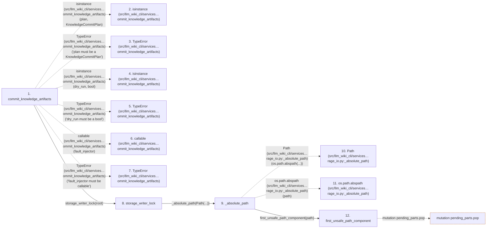

# commit_knowledge_artifacts

**Entry point:** `commit_knowledge_artifacts` (`api`)
**Source:** [knowledge_artifacts](../modules/knowledge_artifacts.md)
**Modules touched:** [bootstrap_recovery](../modules/bootstrap_recovery.md), [common](../modules/common.md), [filesystem_guard](../modules/filesystem_guard.md), [io](../modules/io.md), and 12 more

**Complete modules touched:**

- [bootstrap_recovery](../modules/bootstrap_recovery.md)
- [common](../modules/common.md)
- [filesystem_guard](../modules/filesystem_guard.md)
- [io](../modules/io.md)
- [knowledge_artifacts](../modules/knowledge_artifacts.md)
- [knowledge_evidence](../modules/knowledge_evidence.md)
- [knowledge_governance](../modules/knowledge_governance.md)
- [knowledge_storage](../modules/knowledge_storage.md)
- [knowledge_storage_io](../modules/knowledge_storage_io.md)
- [maintenance_protocol](../modules/maintenance_protocol.md)
- [maintenance_shapes](../modules/maintenance_shapes.md)
- [maintenance_state](../modules/maintenance_state.md)
- [manifest_storage](../modules/manifest_storage.md)
- [sync_manifest](../modules/sync_manifest.md)
- [validation](../modules/validation.md)
- [wiki_write_basis](../modules/wiki_write_basis.md)

## Call sequence

> Static overview in presentation order, not runtime execution order. Arrows retain captured callers; representative internal continuations and boundary examples precede repeated helper detail.

```mermaid
sequenceDiagram
    participant p0 as commit_knowledge_artifacts
    participant p1 as storage_writer_lock
    participant p2 as load_adoption_marker
    participant p3 as guard_maintenance_owner
    participant p4 as _commit_sharded
    participant p5 as _commit_flat
    participant p6 as KnowledgeArtifactError
    participant p7 as KnowledgeCommitResult
    participant p8 as _absolute_path
    participant p9 as _apply_write
    participant p10 as ensure_guarded_directory
    participant p11 as guard_incomplete_bootstrap
    participant p12 as _verify_persisted
    participant p13 as read_guarded
    participant p14 as SyncManifest.load
    participant p15 as governance_lock
    participant p16 as validate_maintenance_adoption
    participant p17 as canonical_bytes
    participant p18 as _validate_range
    participant p19 as _detached
    participant p20 as write_bytes_atomic
    participant p21 as pending_bootstrap
    participant p22 as guard_windows_directory_chain
    participant p23 as maintenance_core
    participant p24 as open_windows_readonly_file
    participant p25 as _assert_windows_file_binding
    participant p26 as StorageReadSession.read
    participant p27 as SyncManifest.from_payload
    participant p28 as StorageReadSession.recheck
    participant p29 as isinstance (src/llm_wiki_cli/services…ommit_knowledge_artifacts)
    participant p30 as path.exists (src/llm_wiki_cli/services…l.py:load_adoption_marker)
    p0->>p1: storage_writer_lock
    p0->>p2: load_adoption_marker
    p0->>p3: guard_maintenance_owner
    p0->>p4: _commit_sharded
    p0->>p5: _commit_flat
    p0->>p6: KnowledgeArtifactError
    p0->>p7: KnowledgeCommitResult
    p1->>p8: _absolute_path
    p5->>p9: _apply_write
    p4->>p10: ensure_guarded_directory
    p3->>p11: guard_incomplete_bootstrap
    p5->>p12: _verify_persisted
    p2->>p13: read_guarded
    p3->>p14: SyncManifest.load
    p1->>p15: governance_lock
    p2->>p16: validate_maintenance_adoption
    p2->>p17: canonical_bytes
    p13->>p18: _validate_range
    p16->>p19: _detached
    p9->>p20: write_bytes_atomic
    p11->>p21: pending_bootstrap
    p13->>p22: guard_windows_directory_chain
    p16->>p23: maintenance_core
    p13->>p24: open_windows_readonly_file
    p13->>p25: _assert_windows_file_binding
    p14->>p26: StorageReadSession.read
    p14->>p27: SyncManifest.from_payload
    p14->>p28: StorageReadSession.recheck
    p0-->>p29: isinstance (src/llm_wiki_cli/services…ommit_knowledge_artifacts)(plan, KnowledgeCommitPlan)
    p2-->>p30: path.exists (src/llm_wiki_cli/services…l.py:load_adoption_marker)
```

<!-- Auto-generated from static call edges. Dashed arrows are external or unresolved calls. Reviewed runtime conditions and side effects belong in Behavior. -->

> Call sequence diagram shows 30 of 856 interactions; 826 omitted to keep the visualization within the 30-interaction and generated-diagram limits, with uncertain identities omitted rather than inferred.

> Captured boundary calls: external 1 of 357 (356 omitted); unresolved 1 of 154 (153 omitted). These counts cover the captured static trace.

Omitted captured detail, grouped by actual caller occurrence and target module:

| Caller | Parent step | Target module | Kind | Omitted interactions |
| --- | --- | --- | --- | --- |
| `src/llm_wiki_cli/services/knowledge_artifacts.py:commit_knowledge_artifacts` | 1 | - | external | 5 |
| `src/llm_wiki_cli/services/knowledge_storage_io.py:_absolute_path` | 9 | - | external | 4 |
| `src/llm_wiki_cli/services/knowledge_storage_io.py:_absolute_path` | 9 | [src/llm_wiki_cli/services/io.py](../modules/io.md) | internal | 1 |
| `src/llm_wiki_cli/services/io.py:first_unsafe_path_component` | 12 | - | external | 20 |
| `src/llm_wiki_cli/services/io.py:first_unsafe_path_component` | 12 | - | unresolved | 5 |
| `src/llm_wiki_cli/services/knowledge_storage_io.py:_absolute_path` | 9 | [src/llm_wiki_cli/services/knowledge_storage.py](../modules/knowledge_storage.md) | internal | 1 |
| `src/llm_wiki_cli/services/knowledge_storage_io.py:_absolute_path` | 9 | - | unresolved | 3 |
| `src/llm_wiki_cli/services/maintenance_protocol.py:storage_writer_lock` | 8 | - | external | 2 |
> Omission summary shows 8 of 213 groups; 205 further groups are not expanded here. Counts above include all omitted interactions.
> Detailed flow queries retain their own coverage and limits; omitted paths may execute at runtime.

> Trace truncated at the depth limit; deeper calls are omitted.

## Data flow

<!-- Auto-generated static analysis. Treat values and boundaries as best-effort hints, not runtime proof. -->

### Analysis coverage

**Effect analysis partially available.** Flow assembly and source effect analysis are separate; empty observations do not prove an empty handler body.

Source steps: 346; effect analysis evaluated: 190, partial: 13, unavailable: 143. Counts include steps omitted from the displayed trace.

Collector observations for 203 source steps with known totals: observed: 1004, emitted: 979, omitted: 25. Unavailable totals are excluded.

- Callable record unavailable for one or more source steps; those steps have no represented callable body.
- Effect collector omitted observations before flow assembly; displayed effects are partial.
- Effect collector totals unavailable; observed counts cover captured records only.

| Step | Callable record | Effect analysis | Collector totals | Observed | Emitted | Omitted |
|---|---|---|---|---:|---:|---:|
| `commit_knowledge_artifacts` | `available` | `evaluated` | `available` | `5` | `5` | `0` |
| `isinstance (src/llm_wiki_cli/services…ommit_knowledge_artifacts)` | `not_applicable` | `not_applicable` | `not_applicable` | — | — | — |
| `TypeError (src/llm_wiki_cli/services…ommit_knowledge_artifacts)` | `not_applicable` | `not_applicable` | `not_applicable` | — | — | — |
| `isinstance (src/llm_wiki_cli/services…ommit_knowledge_artifacts)` | `not_applicable` | `not_applicable` | `not_applicable` | — | — | — |
| `TypeError (src/llm_wiki_cli/services…ommit_knowledge_artifacts)` | `not_applicable` | `not_applicable` | `not_applicable` | — | — | — |
| `callable (src/llm_wiki_cli/services…ommit_knowledge_artifacts)` | `not_applicable` | `not_applicable` | `not_applicable` | — | — | — |
| `TypeError (src/llm_wiki_cli/services…ommit_knowledge_artifacts)` | `not_applicable` | `not_applicable` | `not_applicable` | — | — | — |
| `storage_writer_lock` | `available` | `evaluated` | `available` | `3` | `3` | `0` |
| `_absolute_path` | `available` | `evaluated` | `available` | `2` | `2` | `0` |
| `Path (src/llm_wiki_cli/services…rage_io.py:_absolute_path)` | `not_applicable` | `not_applicable` | `not_applicable` | — | — | — |
| `os.path.abspath (src/llm_wiki_cli/services…rage_io.py:_absolute_path)` | `not_applicable` | `not_applicable` | `not_applicable` | — | — | — |
| `first_unsafe_path_component` | `available` | `evaluated` | `available` | `14` | `14` | `0` |

### Step data

| Step | Inputs | Reads | Writes | Returns |
|---|---|---|---|---|
| `commit_knowledge_artifacts` | `plan: KnowledgeCommitPlan`, `dry_run: bool`, `fault_injector: FaultInjector \| None` | `KnowledgeCommitPlan` | - | `KnowledgeCommitResult(...)` |
| `isinstance (src/llm_wiki_cli/services…ommit_knowledge_artifacts)` | - | - | - | - |
| `TypeError (src/llm_wiki_cli/services…ommit_knowledge_artifacts)` | - | - | - | - |
| `isinstance (src/llm_wiki_cli/services…ommit_knowledge_artifacts)` | - | - | - | - |
| `TypeError (src/llm_wiki_cli/services…ommit_knowledge_artifacts)` | - | - | - | - |
| `callable (src/llm_wiki_cli/services…ommit_knowledge_artifacts)` | - | - | - | - |
| `TypeError (src/llm_wiki_cli/services…ommit_knowledge_artifacts)` | - | - | - | - |
| `storage_writer_lock` | `wiki_dir: str \| Path` | `STORAGE_LOCK_FILENAME` | - | `none` |
| `_absolute_path` | `path: Path` | - | - | `path` |
| `Path (src/llm_wiki_cli/services…rage_io.py:_absolute_path)` | - | - | - | - |
| `os.path.abspath (src/llm_wiki_cli/services…rage_io.py:_absolute_path)` | - | - | - | - |
| `first_unsafe_path_component` | `path: str \| Path`, `trusted_symlink_uids: Set[int] \| None`, `trusted_symlink_owner: Callable[[Path], bool] \| None` | `stat`, `os` | - | `lexical`, `None`, `current`, `current`, `current`, `current`, `current`, `None` |

### Call data

| From | To | Line | Call |
|---|---|---:|---|
| commit_knowledge_artifacts | isinstance (src/llm_wiki_cli/services…ommit_knowledge_artifacts) | 727 | `isinstance(plan, KnowledgeCommitPlan)` |
| commit_knowledge_artifacts | TypeError (src/llm_wiki_cli/services…ommit_knowledge_artifacts) | 728 | `TypeError('plan must be a KnowledgeCommitPlan')` |
| commit_knowledge_artifacts | isinstance (src/llm_wiki_cli/services…ommit_knowledge_artifacts) | 729 | `isinstance(dry_run, bool)` |
| commit_knowledge_artifacts | TypeError (src/llm_wiki_cli/services…ommit_knowledge_artifacts) | 730 | `TypeError('dry_run must be a bool')` |
| commit_knowledge_artifacts | callable (src/llm_wiki_cli/services…ommit_knowledge_artifacts) | 731 | `callable(fault_injector)` |
| commit_knowledge_artifacts | TypeError (src/llm_wiki_cli/services…ommit_knowledge_artifacts) | 732 | `TypeError('fault_injector must be callable')` |
| commit_knowledge_artifacts | storage_writer_lock | 738 | `storage_writer_lock(root)` |
| storage_writer_lock | _absolute_path | 49 | `_absolute_path(Path(...))` |
| _absolute_path | Path (src/llm_wiki_cli/services…rage_io.py:_absolute_path) | 49 | `Path(os.path.abspath(...))` |
| _absolute_path | os.path.abspath (src/llm_wiki_cli/services…rage_io.py:_absolute_path) | 49 | `os.path.abspath(path)` |
| _absolute_path | first_unsafe_path_component | 50 | `first_unsafe_path_component(path)` |

### Boundary effects

| Kind | Target | Step | Line |
|---|---|---|---:|
| mutation | `pending_parts.pop` | `first_unsafe_path_component` | 71 |

### Static analysis gaps

| Kind | Step | Target | Line |
|---|---|---|---:|
| external_call | `commit_knowledge_artifacts` | `isinstance` | 727 |
| external_call | `commit_knowledge_artifacts` | `TypeError` | 728 |
| external_call | `commit_knowledge_artifacts` | `isinstance` | 729 |
| external_call | `commit_knowledge_artifacts` | `TypeError` | 730 |
| external_call | `commit_knowledge_artifacts` | `callable` | 731 |
| external_call | `commit_knowledge_artifacts` | `TypeError` | 732 |
| external_call | `_absolute_path` | `os.path.abspath` | 49 |
| step_limit | `commit_knowledge_artifacts` | `first 12 steps` | 0 |
| truncated_flow | `commit_knowledge_artifacts` | `depth limit` | 0 |

## Behavior

This flow starts at `commit_knowledge_artifacts` and is classified as `api`. The generated call and data-flow sections are bounded static projections; runtime conditions and side effects require source-level confirmation.
