# committed_governance_bundle_id

**Entry point:** `committed_governance_bundle_id` (`api`)
**Source:** [knowledge_orchestration](../modules/knowledge_orchestration.md)
**Modules touched:** [canonical_json](../modules/canonical_json.md), [filesystem_guard](../modules/filesystem_guard.md), [immutable](../modules/immutable.md), [implementation_evidence](../modules/implementation_evidence.md), and 24 more

**Complete modules touched:**

- [canonical_json](../modules/canonical_json.md)
- [filesystem_guard](../modules/filesystem_guard.md)
- [immutable](../modules/immutable.md)
- [implementation_evidence](../modules/implementation_evidence.md)
- [infrastructure_sync](../modules/infrastructure_sync.md)
- [io](../modules/io.md)
- [knowledge_artifacts](../modules/knowledge_artifacts.md)
- [knowledge_envelope](../modules/knowledge_envelope.md)
- [knowledge_evidence](../modules/knowledge_evidence.md)
- [knowledge_governance](../modules/knowledge_governance.md)
- [knowledge_graph](../modules/knowledge_graph.md)
- [knowledge_index](../modules/knowledge_index.md)
- [knowledge_model](../modules/knowledge_model.md)
- [knowledge_orchestration](../modules/knowledge_orchestration.md)
- [knowledge_packs](../modules/knowledge_packs.md)
- [knowledge_reuse](../modules/knowledge_reuse.md)
- [knowledge_storage](../modules/knowledge_storage.md)
- [knowledge_storage_io](../modules/knowledge_storage_io.md)
- [maintenance_projection](../modules/maintenance_projection.md)
- [maintenance_protocol](../modules/maintenance_protocol.md)
- [maintenance_shapes](../modules/maintenance_shapes.md)
- [maintenance_state](../modules/maintenance_state.md)
- [manifest_storage](../modules/manifest_storage.md)
- [markdown_sections](../modules/markdown_sections.md)
- [section_ownership](../modules/section_ownership.md)
- [sync_manifest](../modules/sync_manifest.md)
- [validation](../modules/validation.md)
- [wiki_surface](../modules/wiki_surface.md)

## Call sequence

> Static overview in presentation order, not runtime execution order. Arrows retain captured callers; siblings are shown before deeper helper detail.

```mermaid
sequenceDiagram
    participant p0 as committed_governance_bundle_id
    participant p1 as _previous_committed_artifacts
    participant p2 as governance_bundle_id_from_knowledge
    participant p3 as capture_committed_knowledge
    participant p4 as validate_governance_projection
    participant p5 as state.require_for
    participant p6 as isinstance (src/llm_wiki_cli/services…_bundle_id_from_knowledge)
    participant p7 as Path(…).resolve (src/llm_wiki_cli/services…pture_committed_knowledge)
    participant p8 as Path (src/llm_wiki_cli/services…pture_committed_knowledge)
    participant p9 as guard_maintenance_owner
    participant p10 as (…).read_bytes
    participant p11 as SyncManifest.from_payload
    participant p12 as _decode_json_object
    participant p13 as read_guarded (src/llm_wiki_cli/services…pture_committed_knowledge)
    participant p14 as recorded_manifest.to_payload
    participant p15 as manifest.to_payload (src/llm_wiki_cli/services…pture_committed_knowledge)
    participant p16 as KnowledgeArtifactError
    participant p17 as validate_knowledge_artifacts
    participant p18 as captured.update
    participant p19 as isinstance (src/llm_wiki_cli/services…pture_committed_knowledge)
    participant p20 as exc.field.split
    participant p21 as CommittedKnowledgeState
    participant p22 as freeze
    participant p23 as object.__setattr__ (src/llm_wiki_cli/services…pture_committed_knowledge)
    participant p24 as _absolute_path
    participant p25 as isinstance (src/llm_wiki_cli/services…ts.py:_decode_json_object)
    participant p26 as validate_surface_index_bytes
    participant p27 as Path (src/llm_wiki_cli/services…y:guard_maintenance_owner)
    p0->>p1: _previous_committed_artifacts
    p0->>p2: governance_bundle_id_from_knowledge
    p1->>p3: capture_committed_knowledge
    p2->>p4: validate_governance_projection
    p1-->>p5: state.require_for(wiki_dir)
    p2-->>p6: isinstance (src/llm_wiki_cli/services…_bundle_id_from_knowledge)(value, str)
    p3-->>p7: Path(…).resolve (src/llm_wiki_cli/services…pture_committed_knowledge)
    p3-->>p8: Path (src/llm_wiki_cli/services…pture_committed_knowledge)(wiki_dir)
    p3->>p9: guard_maintenance_owner
    p3-->>p10: (…).read_bytes
    p3->>p11: SyncManifest.from_payload
    p3->>p12: _decode_json_object
    p3-->>p13: read_guarded (src/llm_wiki_cli/services…pture_committed_knowledge)(..., maximum)
    p3-->>p14: recorded_manifest.to_payload
    p3-->>p15: manifest.to_payload (src/llm_wiki_cli/services…pture_committed_knowledge)
    p3->>p16: KnowledgeArtifactError
    p3->>p17: validate_knowledge_artifacts
    p3-->>p18: captured.update(candidate.storage_objects)
    p3-->>p19: isinstance (src/llm_wiki_cli/services…pture_committed_knowledge)(exc, KnowledgeArtifactError)
    p3-->>p20: exc.field.split('.')
    p3->>p16: KnowledgeArtifactError
    p3->>p16: KnowledgeArtifactError
    p3->>p16: KnowledgeArtifactError
    p3->>p21: CommittedKnowledgeState
    p3->>p22: freeze
    p3-->>p23: object.__setattr__ (src/llm_wiki_cli/services…pture_committed_knowledge)(state, '_issued', _COMMITTED_STATE_TOKEN)
    p9->>p24: _absolute_path
    p12-->>p25: isinstance (src/llm_wiki_cli/services…ts.py:_decode_json_object)(content, bytes)
    p17->>p26: validate_surface_index_bytes
    p9-->>p27: Path (src/llm_wiki_cli/services…y:guard_maintenance_owner)(wiki_dir)
```

<!-- Auto-generated from static call edges. Dashed arrows are external or unresolved calls. Reviewed runtime conditions and side effects belong in Behavior. -->

> Call sequence diagram shows 30 of 862 interactions; 832 omitted to keep the visualization within the 30-interaction and generated-diagram limits, with uncertain identities omitted rather than inferred.

> Captured boundary calls: external 6 of 286 (280 omitted); unresolved 8 of 157 (149 omitted). These counts cover the captured static trace.

Omitted captured detail, grouped by actual caller occurrence and target module:

| Caller | Parent step | Target module | Kind | Omitted interactions |
| --- | --- | --- | --- | --- |
| `src/llm_wiki_cli/services/knowledge_storage_io.py:_absolute_path` | 7 | - | external | 4 |
| `src/llm_wiki_cli/services/knowledge_storage_io.py:_absolute_path` | 7 | [src/llm_wiki_cli/services/io.py](../modules/io.md) | internal | 1 |
| `src/llm_wiki_cli/services/io.py:first_unsafe_path_component` | 10 | - | external | 20 |
| `src/llm_wiki_cli/services/io.py:first_unsafe_path_component` | 10 | - | unresolved | 5 |
| `src/llm_wiki_cli/services/knowledge_storage_io.py:_absolute_path` | 7 | [src/llm_wiki_cli/services/knowledge_storage.py](../modules/knowledge_storage.md) | internal | 1 |
| `src/llm_wiki_cli/services/knowledge_storage_io.py:_absolute_path` | 7 | - | unresolved | 3 |
| `src/llm_wiki_cli/services/maintenance_protocol.py:guard_maintenance_owner` | 6 | [src/llm_wiki_cli/services/maintenance_protocol.py](../modules/maintenance_protocol.md) | internal | 8 |
| `src/llm_wiki_cli/services/maintenance_protocol.py:load_adoption_marker` | 43 | [src/llm_wiki_cli/services/knowledge_storage_io.py](../modules/knowledge_storage_io.md) | internal | 2 |
> Omission summary shows 8 of 175 groups; 167 further groups are not expanded here. Counts above include all omitted interactions.
> Detailed flow queries retain their own coverage and limits; omitted paths may execute at runtime.

> Trace truncated at the depth limit; deeper calls are omitted.

## Data flow

```mermaid
flowchart LR
    s1["1. committed_governance_bundle_id"]
    s2["2. _previous_committed_artifacts"]
    s3["3. capture_committed_knowledge"]
    s4["4. Path(…).resolve (src/llm_wiki_cli/services…pture_committed_knowledge)"]
    s5["5. Path (src/llm_wiki_cli/services…pture_committed_knowledge)"]
    s6["6. guard_maintenance_owner"]
    s7["7. _absolute_path"]
    s8["8. Path (src/llm_wiki_cli/services…rage_io.py:_absolute_path)"]
    s9["9. os.path.abspath (src/llm_wiki_cli/services…rage_io.py:_absolute_path)"]
    s10["10. first_unsafe_path_component"]
    s11["11. Path (src/llm_wiki_cli/services…rst_unsafe_path_component)"]
    s12["12. os.fspath"]
    s1 -->|"_previous_committed_artifacts(wiki_dir, manifest, committed_state=committed_state)"| s2
    s2 -->|"capture_committed_knowledge(wiki_dir, manifest)"| s3
    s3 -. "Path(…).resolve (src/llm_wiki_cli/services…pture_committed_knowledge)(data not statically known)" .-> s4
    s3 -. "Path (src/llm_wiki_cli/services…pture_committed_knowledge)(wiki_dir)" .-> s5
    s3 -->|"guard_maintenance_owner(root, manifest)"| s6
    s6 -->|"_absolute_path(Path(...))"| s7
    s7 -. "Path (src/llm_wiki_cli/services…rage_io.py:_absolute_path)(os.path.abspath(...))" .-> s8
    s7 -. "os.path.abspath (src/llm_wiki_cli/services…rage_io.py:_absolute_path)(path)" .-> s9
    s7 -->|"first_unsafe_path_component(path)"| s10
    s10 -. "Path (src/llm_wiki_cli/services…rst_unsafe_path_component)(os.fspath(...))" .-> s11
    s10 -. "os.fspath(path)" .-> s12
    b0["mutation captured.update"]
    s3 -. "mutation captured.update" .-> b0
    b1["mutation pending_parts.pop"]
    s10 -. "mutation pending_parts.pop" .-> b1
    click s1 "../modules/knowledge_orchestration.md"
    click s2 "../modules/knowledge_orchestration.md"
    click s3 "../modules/knowledge_orchestration.md"
    click s6 "../modules/maintenance_protocol.md"
    click s7 "../modules/knowledge_storage_io.md"
    click s10 "../modules/io.md"
    classDef boundary stroke:#b45309,stroke-dasharray: 4 2
    class b0 boundary
    class b1 boundary
```

<!-- Auto-generated static analysis. Treat values and boundaries as best-effort hints, not runtime proof. -->

### Step data

| Step | Inputs | Reads | Writes | Returns |
|---|---|---|---|---|
| `committed_governance_bundle_id` | `wiki_dir: str \| Path`, `manifest: SyncManifest \| None`, `committed_state: CommittedKnowledgeState \| None` | - | - | `None`, `governance_bundle_id_from_knowledge(...)` |
| `_previous_committed_artifacts` | `wiki_dir: str \| Path`, `manifest: SyncManifest \| None`, `committed_state: CommittedKnowledgeState \| None` | - | - | `state.artifacts` |
| `capture_committed_knowledge` | `wiki_dir: str \| Path`, `manifest: SyncManifest \| None` | `SURFACE_INDEX_FILENAME`, `KNOWLEDGE_INDEX_FILENAME`, `MANIFEST_FILENAME`, `MANIFEST_FILENAME`, `SURFACE_INDEX_FILENAME`, `KNOWLEDGE_INDEX_FILENAME`, `KnowledgeArtifactError`, `KnowledgeArtifactError` | `captured[...]`, `captured[...]` | `state` |
| `Path(…).resolve (src/llm_wiki_cli/services…pture_committed_knowledge)` | - | - | - | - |
| `Path (src/llm_wiki_cli/services…pture_committed_knowledge)` | - | - | - | - |
| `guard_maintenance_owner` | `wiki_dir: str \| Path`, `manifest` | - | - | `None`, `None`, `marker` |
| `_absolute_path` | `path: Path` | - | - | `path` |
| `Path (src/llm_wiki_cli/services…rage_io.py:_absolute_path)` | - | - | - | - |
| `os.path.abspath (src/llm_wiki_cli/services…rage_io.py:_absolute_path)` | - | - | - | - |
| `first_unsafe_path_component` | `path: str \| Path`, `trusted_symlink_uids: Set[int] \| None`, `trusted_symlink_owner: Callable[[Path], bool] \| None` | `stat`, `os` | - | `lexical`, `None`, `current`, `current`, `current`, `current`, `current`, `None` |
| `Path (src/llm_wiki_cli/services…rst_unsafe_path_component)` | - | - | - | - |
| `os.fspath` | - | - | - | - |

### Call data

| From | To | Line | Call |
|---|---|---:|---|
| committed_governance_bundle_id | _previous_committed_artifacts | 769 | `_previous_committed_artifacts(wiki_dir, manifest, committed_state=committed_state)` |
| _previous_committed_artifacts | capture_committed_knowledge | 756 | `capture_committed_knowledge(wiki_dir, manifest)` |
| capture_committed_knowledge | Path(…).resolve (src/llm_wiki_cli/services…pture_committed_knowledge) | 235 | `Path(wiki_dir).resolve(data not statically known)` |
| capture_committed_knowledge | Path (src/llm_wiki_cli/services…pture_committed_knowledge) | 235 | `Path(wiki_dir)` |
| capture_committed_knowledge | guard_maintenance_owner | 238 | `guard_maintenance_owner(root, manifest)` |
| guard_maintenance_owner | _absolute_path | 104 | `_absolute_path(Path(...))` |
| _absolute_path | Path (src/llm_wiki_cli/services…rage_io.py:_absolute_path) | 49 | `Path(os.path.abspath(...))` |
| _absolute_path | os.path.abspath (src/llm_wiki_cli/services…rage_io.py:_absolute_path) | 49 | `os.path.abspath(path)` |
| _absolute_path | first_unsafe_path_component | 50 | `first_unsafe_path_component(path)` |
| first_unsafe_path_component | Path (src/llm_wiki_cli/services…rst_unsafe_path_component) | 51 | `Path(os.fspath(...))` |
| first_unsafe_path_component | os.fspath | 51 | `os.fspath(path)` |

### Boundary effects

| Kind | Target | Step | Line |
|---|---|---|---:|
| mutation | `captured.update` | `capture_committed_knowledge` | 264 |
| mutation | `pending_parts.pop` | `first_unsafe_path_component` | 71 |

### Static analysis gaps

| Kind | Step | Target | Line |
|---|---|---|---:|
| unresolved_call | `capture_committed_knowledge` | `Path(wiki_dir).resolve` | 235 |
| external_call | `_absolute_path` | `os.path.abspath` | 49 |
| external_call | `first_unsafe_path_component` | `os.fspath` | 51 |
| step_limit | `committed_governance_bundle_id` | `first 12 steps` | 0 |
| truncated_flow | `committed_governance_bundle_id` | `depth limit` | 0 |

## Behavior

This flow starts at `committed_governance_bundle_id` and is classified as `api`. The generated call and data-flow sections are bounded static projections; runtime conditions and side effects require source-level confirmation.
